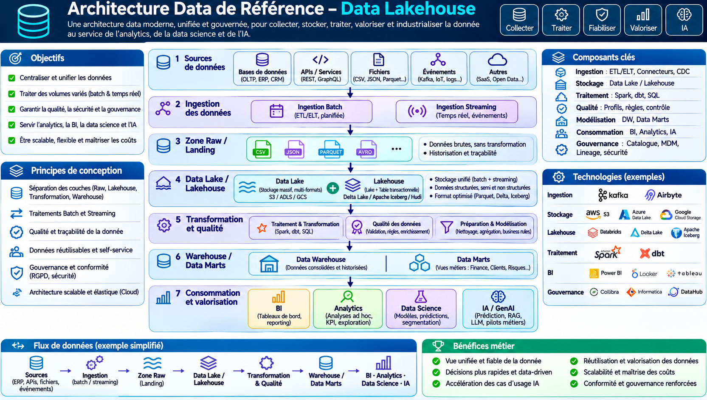
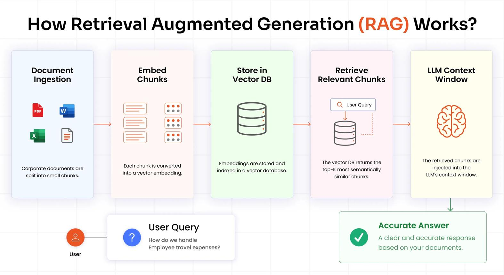
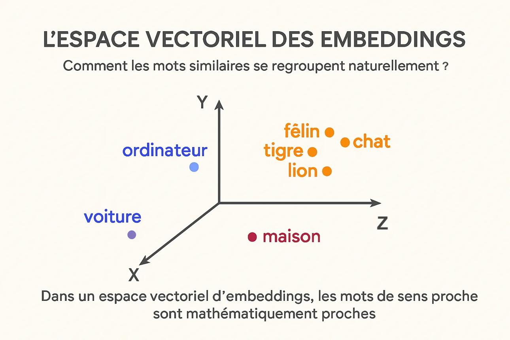

# 1. Rôle de l’architecture Data

L’architecture Data décrit comment les données sont acquises, transportées, stockées, transformées, gouvernées et consommées. Elle sert les métiers, le reporting, l’analytique et les applications opérationnelles.

<figure class="resource-figure"></figure>

Catalogue, métadonnées, qualité, sécurité, lineage et observabilité sont des fonctions transverses.

# 2. Data Warehouse, Data Lake et Lakehouse

| Approche | Idée principale | Usage courant |
|---|---|---|
| Data Warehouse | Données structurées et intégrées pour l’analyse | Reporting, KPI, BI |
| Data Lake | Stockage de données variées à grande échelle | Exploration, Data Science |
| Lakehouse | Combine stockage de type lake et gestion de tables | Analytics, BI et Data Science |

Un Data Lake sans catalogue, qualité, sécurité et cycle de vie peut devenir un *Data Swamp*. Un Lakehouse s’appuie souvent sur Delta Lake ou Apache Iceberg pour les métadonnées, l’évolution des schémas et les transactions selon le moteur utilisé.

# 3. Ingestion batch et streaming

**Batch :** collecte et traitement par lots, à intervalles réguliers. Adapté aux clôtures, consolidations et traitements périodiques.

**Streaming :** traitement au fil de l’arrivée des événements, pour une fraîcheur plus élevée et des cas d’usage opérationnels.

Exemple : `Application bancaire → Kafka → Spark Structured Streaming → Table Lakehouse → Tableau de bord`.

Kafka diffuse et conserve les événements selon une politique de rétention ; ce n’est pas à lui seul un moteur de transformation analytique.

# 4. Stockage et formats

HDFS (*Hadoop Distributed File System*) répartit les blocs de fichiers sur plusieurs nœuds. Les plateformes modernes utilisent aussi fréquemment du stockage objet cloud.

Parquet et ORC sont des formats de fichiers colonnaires, adaptés aux lectures analytiques :

- **Parquet :** largement supporté dans l’écosystème Data.
- **ORC :** format colonnaire optimisé pour les usages analytiques, historiquement présent dans Hive.

Le format de fichier ne remplace pas le format de table. Delta Lake et Iceberg ajoutent une couche de métadonnées et de gestion au-dessus des fichiers.

# 5. Traitement distribué avec Spark

Spark répartit les traitements sur un cluster.

- **RDD :** abstraction distribuée de bas niveau, résiliente.
- **DataFrame :** données structurées en colonnes avec un schéma, optimisables par le moteur.
- **Spark SQL :** interface SQL pour interroger et transformer.
- **Structured Streaming :** API de traitement de flux construite autour du modèle DataFrame.

Exemple PySpark :

```python
from pyspark.sql import SparkSession
from pyspark.sql.functions import col, sum as sum_

spark = SparkSession.builder.appName("AnalyseVentes").getOrCreate()
ventes = spark.read.parquet("data/ventes/")

resultat = (
    ventes.filter(col("statut") == "VALIDEE")
    .groupBy("pays")
    .agg(sum_("montant").alias("total_ventes"))
)

resultat.write.mode("overwrite").parquet("output/ventes_par_pays/")
```

Spark construit un plan logique puis optimise et exécute les opérations. Les transformations sont généralement évaluées de manière différée (*lazy evaluation*) jusqu’à une action.

# 6. Delta Lake et Apache Iceberg

Ce sont des formats de tables ouverts qui ajoutent des fonctionnalités de gestion au-delà de simples fichiers Parquet. Selon le moteur et la configuration, ils peuvent fournir transactions ACID, évolution de schéma, snapshots, lecture cohérente et maintenance des tables.

Le choix doit être validé avec les moteurs de calcul, catalogues, outils d’ingestion et exigences de portabilité.

# 7. Orchestration Data

Apache Airflow orchestre des workflows sous forme de DAG (*Directed Acyclic Graph*). Il planifie les tâches, gère les dépendances, les reprises et le suivi des exécutions.

Airflow ne réalise pas nécessairement le calcul distribué : il peut déclencher un job Spark, appeler une API, exécuter du SQL puis contrôler le résultat.

`Extraction → Contrôle qualité → Transformation Spark → Chargement Lakehouse → Publication BI`

À distinguer de Camunda : Camunda orchestre un processus métier avec validations et décisions ; Airflow orchestre un pipeline technique de données. Ils peuvent coopérer via des échanges asynchrones, un identifiant de corrélation, l’idempotence et des timeouts.

# 8. Gouvernance et qualité

Une plateforme robuste doit définir l’ownership des données, un catalogue et glossaire métier, la classification, les contrôles de qualité (complétude, unicité, validité, fraîcheur, cohérence), le lineage, la conservation, les accès et l’audit.

# 9. Choisir le bon style

Pour un reporting quotidien, un pipeline batch avec Lakehouse et moteur SQL peut suffire. Pour une alerte de fraude à faible latence, une architecture événementielle et du streaming peuvent être nécessaires.

Le choix dépend du SLA de fraîcheur, du volume, de la tolérance aux doublons, du coût, de la complexité opérationnelle et des compétences.

**À retenir :** une architecture Data relie ingestion, stockage, traitement, orchestration, gouvernance, sécurité et usages ; elle ne se résume pas au choix de Spark ou d’un Data Lake.


## Visuels de la bibliothèque

<div class="category-gallery">
<a class="category-visual" href="/ressources/agents-ia-rag-graphrag/"><span>Pipeline RAG et données documentaires</span></a>
<a class="category-visual" href="/ressources/agents-ia-rag-graphrag/"><span>Embeddings et recherche vectorielle</span></a>
</div>
