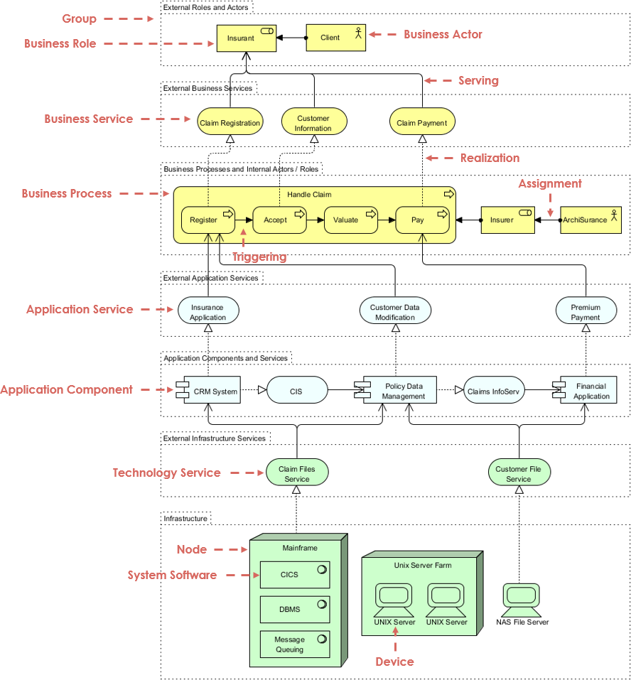
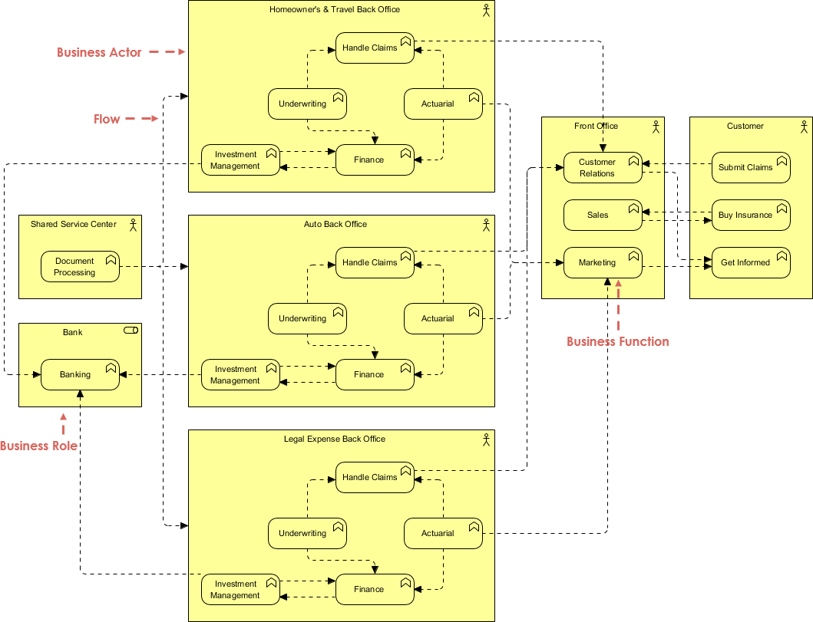
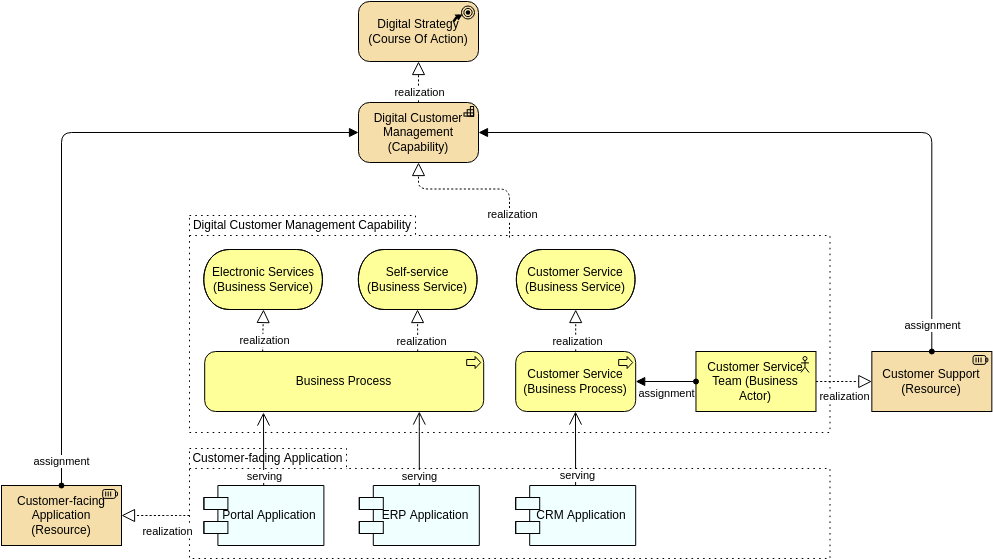
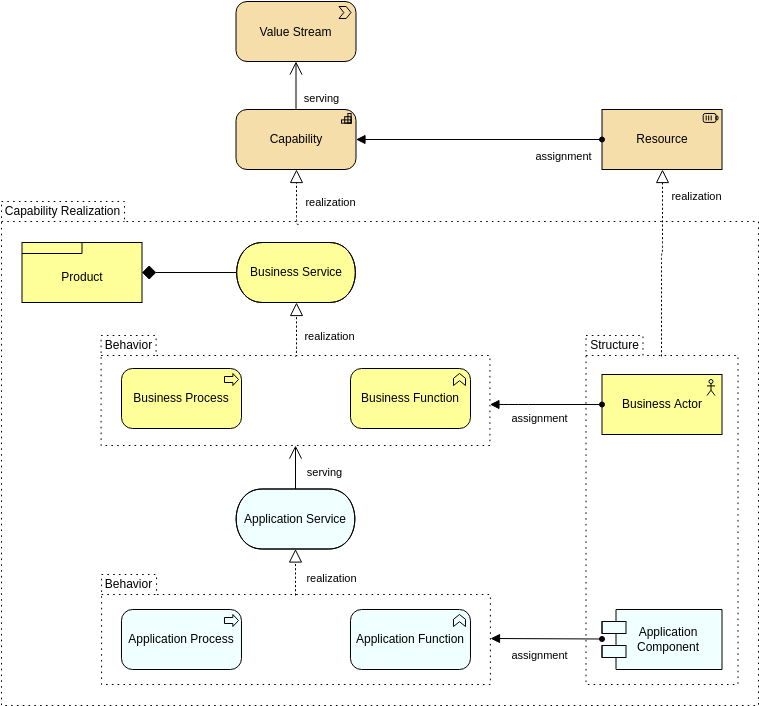
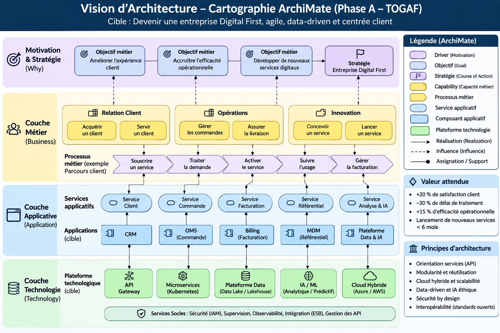
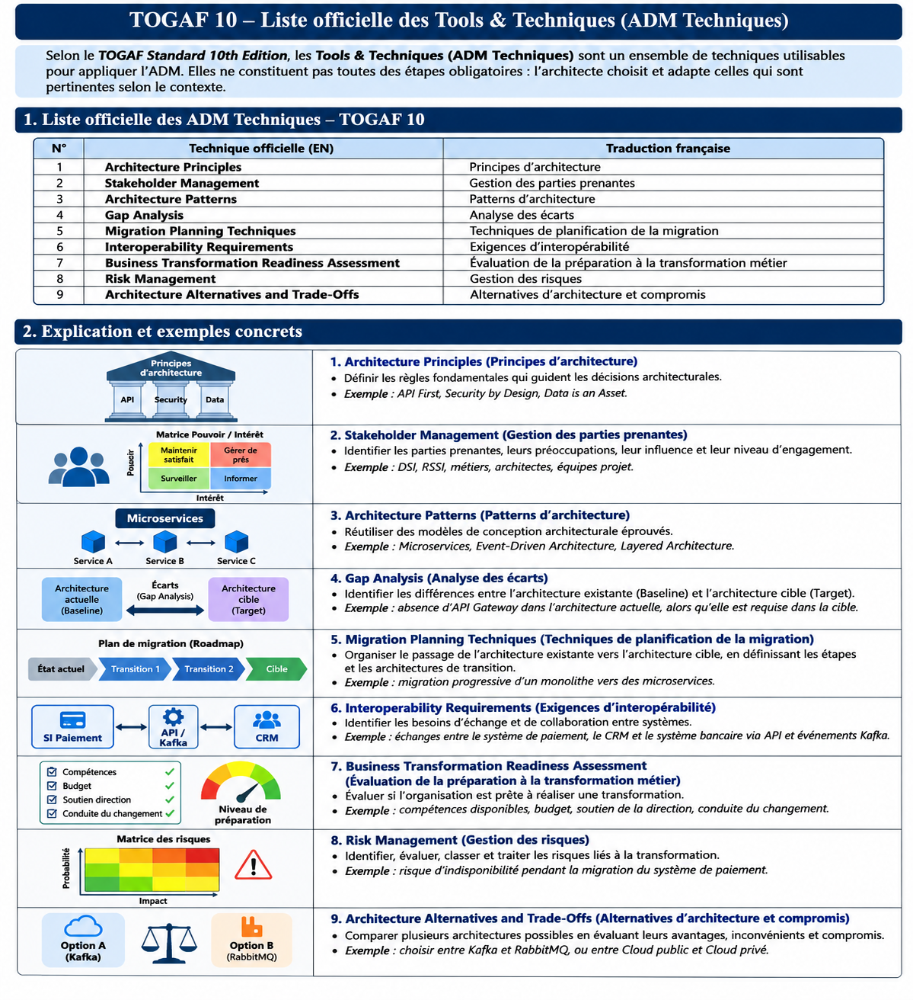
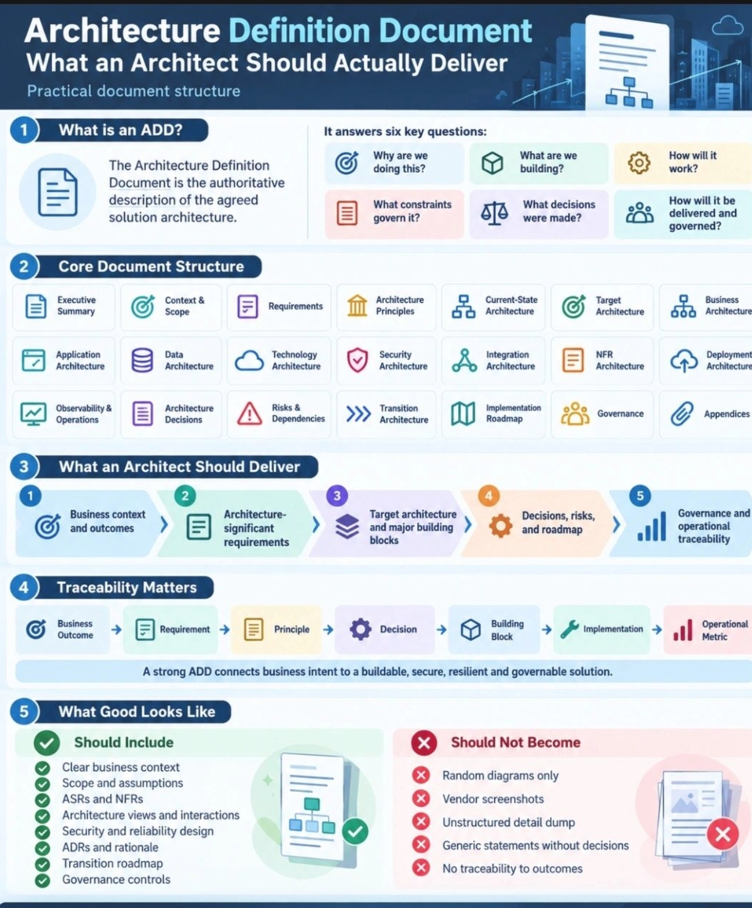
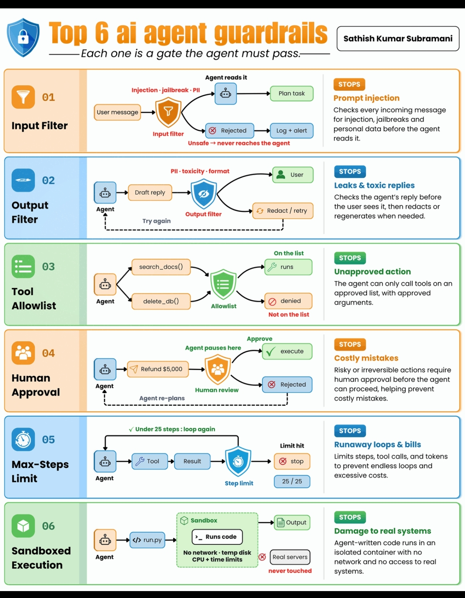
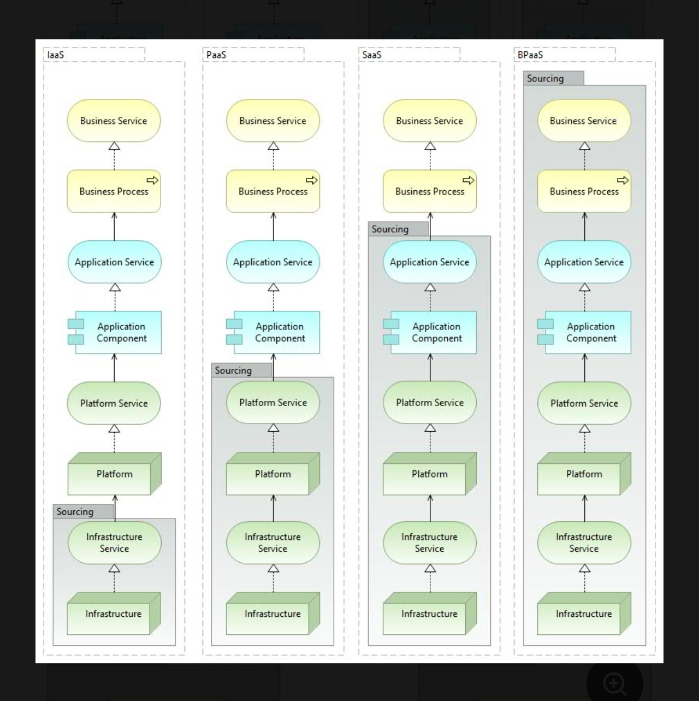
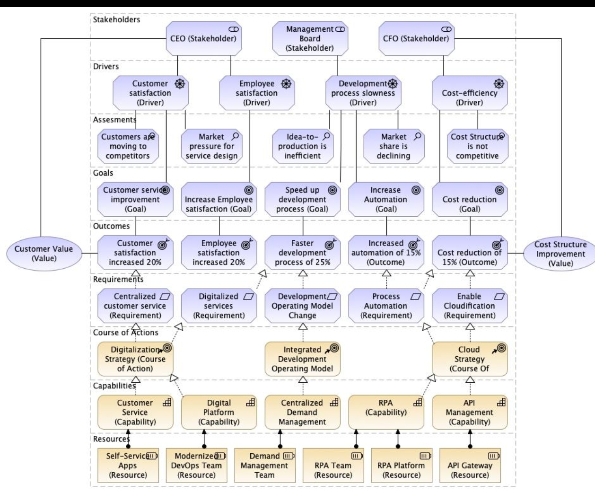

<a href="/architecture-entreprise/">Architecture d’entreprise</a><a href="/architecture-entreprise/archimate/" aria-current="page">ArchiMate</a>

# Comprendre ArchiMate

ArchiMate est un langage de modélisation d’architecture d’entreprise. Il fournit des concepts et des relations communs pour décrire les motivations, les capacités métier, les processus, les applications, les données et les technologies. Il complète TOGAF : l’ADM structure la démarche, tandis qu’ArchiMate aide à représenter les architectures et leurs évolutions.

## Couches principales

Les vues ArchiMate organisent les éléments selon leur rôle. La couche métier décrit les acteurs, rôles, processus et services. La couche applicative montre les composants, fonctions et services logiciels. La couche technologique représente l’infrastructure et les services qui exécutent les applications. Des éléments de motivation et de stratégie relient ces couches aux objectifs et capacités.

Ce diagramme présente les trois couches principales et les relations de réalisation entre les éléments métier, applicatifs et technologiques.

<figure class="resource-figure"><figcaption>Couches métier, applicative et technologique en ArchiMate.</figcaption></figure>

## Décrire une capacité et ses réalisations

Une capacité exprime ce que l’entreprise doit savoir faire. Les processus, services et composants applicatifs peuvent ensuite être reliés à cette capacité afin d’expliquer comment elle est réalisée. Cette vue facilite l’analyse des impacts et des responsabilités.

L’exemple relie une capacité de gestion client à un parcours métier, à des services et aux applications qui les soutiennent.

<figure class="resource-figure"><figcaption>Exemple de fonctions métier, processus, services et applications.</figcaption></figure>

Cette vue montre comment une capacité métier peut être planifiée à partir d’une stratégie, puis détaillée en services et processus.

<figure class="resource-figure"><figcaption>Exemple de planification des capacités métier.</figcaption></figure>

La réalisation d’une capacité peut être décrite en reliant les produits, services et comportements métier aux fonctions et composants applicatifs.

<figure class="resource-figure"><figcaption>Exemple de réalisation d’une capacité métier.</figcaption></figure>

## Relier la vision aux éléments d’architecture

Une vue de vision clarifie les objectifs, les capacités cibles et les principes avant de détailler les solutions. Les relations entre ces éléments donnent une base aux décisions et à la trajectoire de transformation.

Cet exemple de vision d’architecture illustre les objectifs métier, les capacités, les services applicatifs et les technologies cibles.

<figure class="resource-figure"><figcaption>Exemple de cartographie de vision d’architecture.</figcaption></figure>

## Exemples complémentaires d’architecture d’entreprise

Les modèles ci-dessous illustrent les domaines et composants d’une architecture d’entreprise. Ils servent de vues de synthèse ; il faut vérifier les notations et les relations avant de les traiter comme des modèles ArchiMate formels.

Cette cartographie donne une vue d’ensemble des domaines et composants qui structurent une architecture d’entreprise.

<figure class="resource-figure"><figcaption>Cartographie des domaines et composants d’une architecture d’entreprise.</figcaption></figure>

Cette architecture de référence montre les principaux composants d’une plateforme IA d’entreprise et leurs interactions avec les données, les modèles et les opérations.

<figure class="resource-figure"><figcaption>Architecture de référence IA en entreprise.</figcaption></figure>

## Domaines, frontières et applications

Le Domain-Driven Design aide à identifier les sous-domaines et les frontières de modèles. Ces vues complètent les cartes d’architecture en clarifiant le langage métier et les dépendances entre domaines.

Ce visuel distingue les domaines cœur, support et génériques, puis montre comment cette classification éclaire les décisions d’architecture.

<figure class="resource-figure"><figcaption>Classification des domaines métier.</figcaption></figure>

L’exemple présente les bounded contexts et les relations entre domaines, utiles pour discuter des responsabilités et des intégrations.

<figure class="resource-figure"><figcaption>Domain-Driven Design et context map.</figcaption></figure>

Cette vue montre comment une capacité se traduit en processus métier, services et applications de support.

<figure class="resource-figure"><figcaption>Capacité métier et réalisation applicative.</figcaption></figure>
