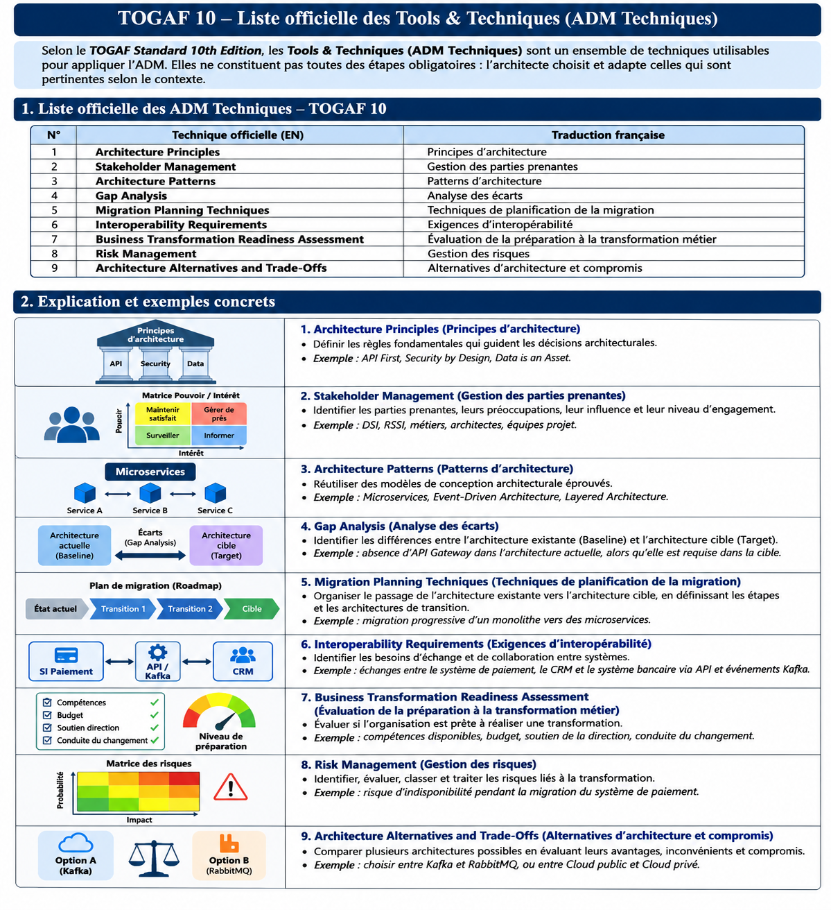
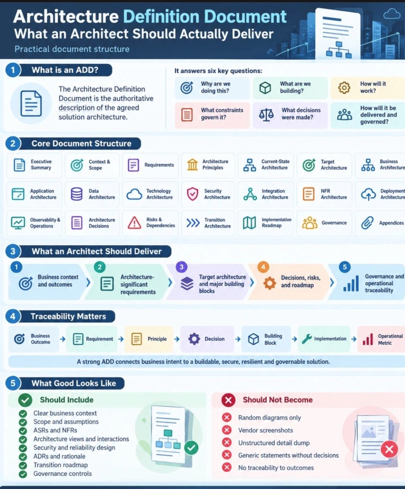
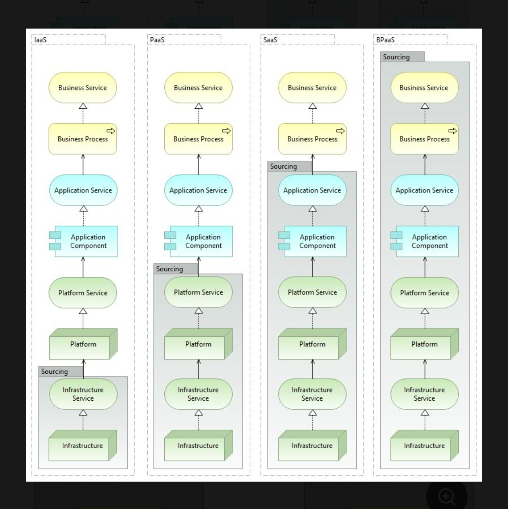
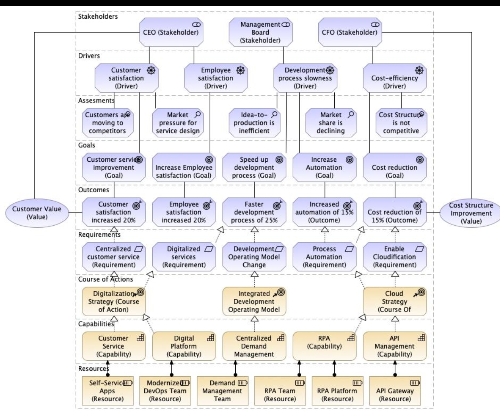

<a href="/architecture-entreprise/">01<strong>Architecture d’Entreprise</strong><small>TOGAF · ADM · gouvernance</small></a><a href="/architecture-entreprise/archimate/">02<strong>ArchiMate</strong><small>Modélisation d’architecture</small></a><a href="/architecture-entreprise/togaf-techniques/" aria-current="page">03<strong>TOGAF Techniques</strong><small>Exemples et pratiques</small></a>

# Exemples complémentaires d’architecture d’entreprise

Les modèles ci-dessous illustrent les domaines et composants d’une architecture d’entreprise. Ils servent de vues de synthèse ; il faut vérifier les notations et les relations avant de les traiter comme des modèles ArchiMate formels.

Cette cartographie donne une vue d’ensemble des domaines et composants qui structurent une architecture d’entreprise.

<figure class="resource-figure"><figcaption>Cartographie des domaines et composants d’une architecture d’entreprise.</figcaption></figure>

Cette architecture de référence montre les principaux composants d’une plateforme IA d’entreprise et leurs interactions avec les données, les modèles et les opérations.

<figure class="resource-figure"><figcaption>Architecture de référence IA en entreprise.</figcaption></figure>

# Domaines, frontières et applications

Le Domain-Driven Design aide à identifier les sous-domaines et les frontières de modèles. Ces vues complètent les cartes d’architecture en clarifiant le langage métier et les dépendances entre domaines.

L’exemple présente les bounded contexts et les relations entre domaines, utiles pour discuter des responsabilités et des intégrations.

<figure class="resource-figure"><figcaption>Domain-Driven Design et context map.</figcaption></figure>

Cette vue montre comment une capacité se traduit en processus métier, services et applications de support.

<figure class="resource-figure"><figcaption>Capacité métier et réalisation applicative.</figcaption></figure>
