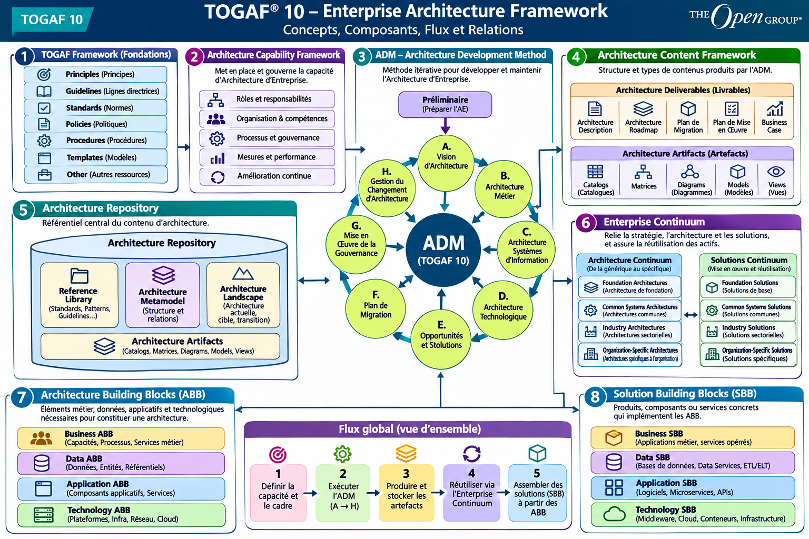
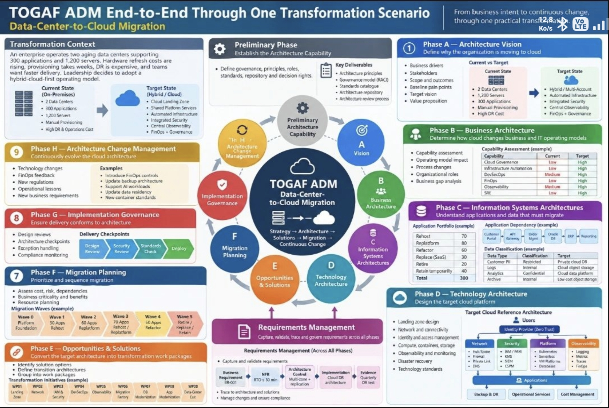
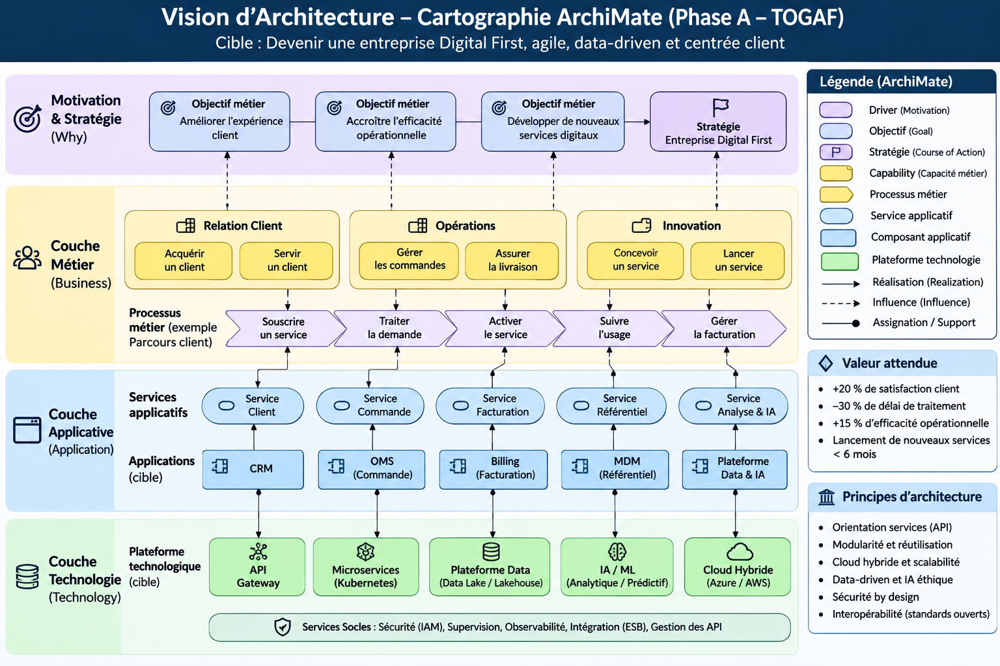
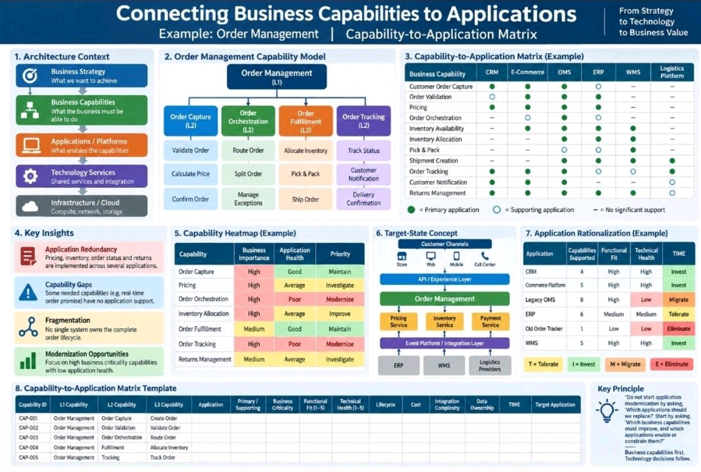
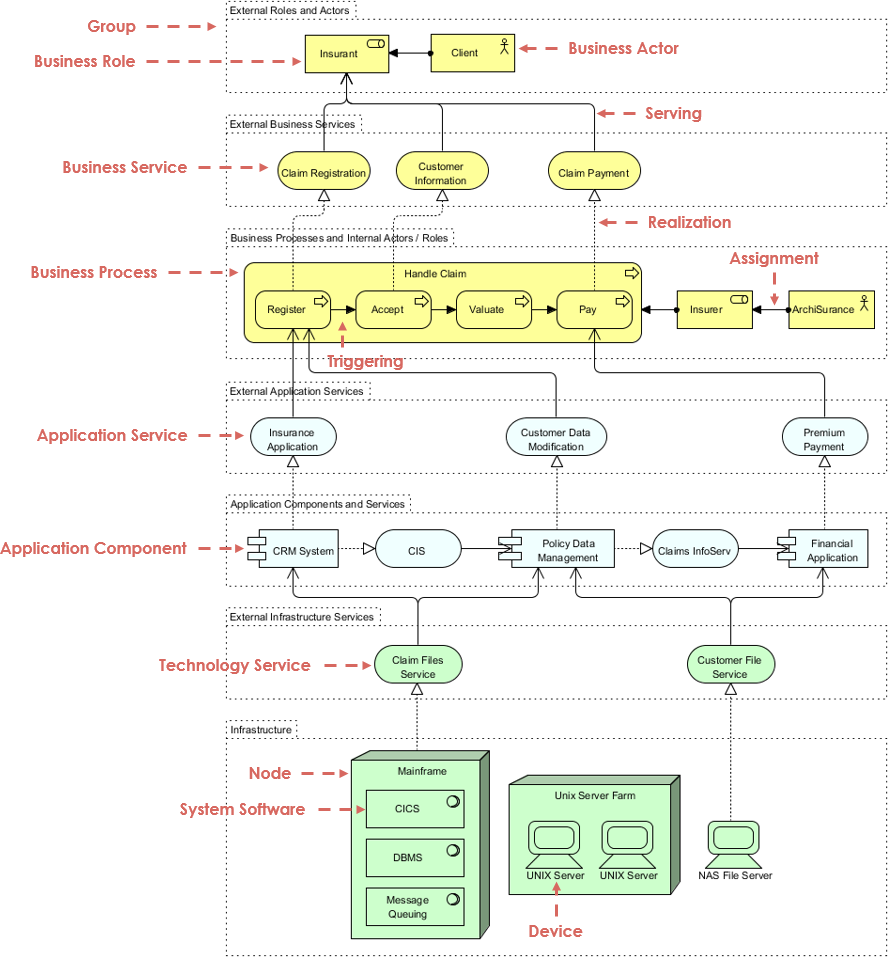

<a href="/architecture-entreprise/" aria-current="page">Architecture d’entreprise</a><a href="/architecture-entreprise/archimate/">ArchiMate</a>

# 1. À quoi sert l’architecture d’entreprise ?

L’architecture d’entreprise (*Enterprise Architecture*, EA) donne une représentation cohérente de l’organisation, de ses capacités métier, de ses processus, de ses données, de ses applications et de ses technologies. Elle relie la stratégie aux transformations du système d’information.

Elle répond à quatre questions : que doit savoir faire le métier ? Quelles informations sont nécessaires ? Quelles applications supportent les activités ? Quelles technologies rendent le tout possible ?

# 2. TOGAF : The Open Group Architecture Framework

Cette vue globale du framework **TOGAF 10** présente les huit composantes principales, leurs interactions et la manière dont elles contribuent à concevoir, gouverner et faire évoluer l’architecture d’entreprise.

L’idée centrale est que TOGAF ne se limite pas à une méthode de conception : c’est un ensemble cohérent de méthodes, de référentiels, de processus de gouvernance, de contenus et de composants réutilisables.

<figure class="resource-figure"><figcaption>Les huit composantes du framework TOGAF 10 et leurs relations.</figcaption></figure>



Le TOGAF Standard 10 s’articule autour d’un contenu fondamental (*Fundamental Content*) et de guides pratiques (*Series Guides*). Son cœur méthodologique est l’ADM (*Architecture Development Method*). Le framework doit être adapté au contexte : il ne s’agit pas d’appliquer mécaniquement toutes les phases et tous les livrables.

| Phase | Finalité | Question clé |
|---|---|---|
| Préliminaire | Installer la capacité et la gouvernance | Comment allons-nous faire de l’architecture ? |
| A – Architecture Vision | Définir vision, périmètre et parties prenantes | Où voulons-nous aller ? |
| B – Business Architecture | Décrire capacités, acteurs et processus | Comment le métier doit-il fonctionner ? |
| C – Information Systems | Décrire Data et Application | Quelles données et applications faut-il ? |
| D – Technology Architecture | Décrire plateformes et infrastructures | Quelle technologie faut-il ? |
| E – Opportunities & Solutions | Identifier solutions et lots de transformation | Quelles solutions construire ou acquérir ? |
| F – Migration Planning | Prioriser les transitions et construire la roadmap | Dans quel ordre les réaliser ? |
| G – Implementation Governance | Contrôler la conformité des réalisations | Les projets respectent-ils l’architecture ? |
| H – Architecture Change Management | Surveiller les changements et faire évoluer la cible | Comment adapter l’architecture ? |

Requirements Management est transversal. L’ADM est itératif : une évolution peut conduire à revisiter une phase précédente.

# 3. Exemple fil rouge : moderniser un SI bancaire

Une banque possède plusieurs applications indépendantes pour la gestion client, le crédit, les contrats, la facturation et le reporting. Les données sont dupliquées, les échanges sont fragiles et les délais de traitement sont longs.

## 3.1 Stakeholders et concerns

Identifier les parties prenantes : direction métier, DSI, responsables de domaines, sécurité, conformité, exploitation et utilisateurs.

Exemples de préoccupations (*Concerns*) : réduire les délais, maîtriser les risques et les accès, améliorer la qualité des données, diminuer les coûts et garantir la continuité de service.

La vision doit relier ces préoccupations à des objectifs mesurables et à un périmètre explicite.

## 3.2 Business Capability et Value Stream

Une **Business Capability** décrit ce que l’organisation doit être capable de faire, indépendamment de l’organisation interne ou du produit logiciel utilisé : gérer la relation client, instruire une demande de crédit, gérer un contrat ou facturer.

Un **Value Stream** représente les grandes étapes de bout en bout qui créent de la valeur pour un bénéficiaire.

`Demande de crédit → Vérification → Instruction → Décision → Contractualisation → Mise à disposition`

La Capability Map répond à « quelles capacités devons-nous maîtriser ? ». Le Value Stream répond à « comment la valeur est-elle délivrée ? ». Ces vues ne sont ni un organigramme ni un catalogue d’applications.

## 3.3 Baseline, Target et Gap Analysis

| Domaine | Existant possible | Cible envisagée |
|---|---|---|
| Métier | Parcours variables selon les entités | Parcours harmonisés |
| Data | Référentiels clients multiples | Référentiel maître gouverné |
| Application | Applications redondantes et interfaces point à point | Services mieux délimités et APIs maîtrisées |
| Technologie | Plateformes hétérogènes | Socle sécurisé, observable et industrialisé |

La **Baseline Architecture** décrit l’état de référence. La **Target Architecture** décrit l’état futur. La *Gap Analysis* identifie les écarts : capacités manquantes, applications à remplacer, interfaces à moderniser, données à migrer et risques à traiter.

# 4. Livrables et référentiel

Le Content Framework organise les éléments produits :

- **Deliverable :** livrable formel, par exemple une Architecture Definition Document ou une roadmap.
- **Artifact :** représentation descriptive, par exemple une Capability Map ou un diagramme de communication applicative.
- **Building Block :** brique réutilisable qui contribue à la solution.

La distinction **ABB / SBB** est utile : l’ABB (*Architecture Building Block*) décrit le besoin logique et les responsabilités attendues sans imposer un produit ; le SBB (*Solution Building Block*) décrit une réalisation concrète.

L’**Architecture Repository** conserve principes, standards, modèles, décisions, architectures de référence et roadmaps. L’**Enterprise Continuum** aide à classer les actifs du plus générique au plus spécifique.

# 5. Gouvernance d’architecture

Une gouvernance pragmatique s’appuie sur des principes vérifiables, des revues adaptées au risque, des décisions documentées (ADR), des dérogations explicites et un suivi de conformité.

Exemples de principes : API First, Security by Design, réutilisation avant duplication, données gouvernées et observabilité dès la conception.

# 6. De l’architecture à la roadmap

La phase E identifie les options et lots de travail. La phase F ordonne les transitions selon les dépendances, les coûts, les risques et la valeur. La phase G accompagne l’implémentation ; la phase H surveille les changements.

Exemple de trajectoire : (1) principes, référentiels et gouvernance ; (2) modernisation des APIs et échanges ; (3) rationalisation applicative et Data ; (4) renforcement de la plateforme, de la sécurité et de l’observabilité.

# 7. Check-list de l’architecte

- Besoin métier et parties prenantes identifiés ?
- Capacités et parcours de valeur décrits ?
- Baseline et cible explicites ?
- Flux de données et responsabilités applicatives connus ?
- Principes, risques et décisions documentés ?
- Dépendances et transitions priorisées ?
- Revues, dérogations et amélioration continue organisées ?

**À retenir :** TOGAF structure la démarche et le contenu ; ArchiMate peut représenter les éléments et leurs relations. Le framework organise le travail, les modèles rendent l’architecture lisible et partageable.

## Sous-onglet ArchiMate

ArchiMate aide à représenter les relations entre stratégie, métier, applications et technologies. La page dédiée présente ses couches et des exemples de modèles.

<a class="text-link" href="/architecture-entreprise/archimate/">Ouvrir le sous-onglet ArchiMate →</a>

## Visuels de la bibliothèque

<a class="category-visual" href="/ressources/guide-togaf-adm-techniques/">Le cycle TOGAF ADM</a>
<a class="category-visual" href="/ressources/guide-togaf-adm-techniques/">Vision d’architecture et ArchiMate</a>
<a class="category-visual" href="/ressources/synthese-matrices-togaf/">Relier capacités et applications</a>
<a class="category-visual" href="/ressources/guide-togaf-adm-techniques/">Les couches ArchiMate</a>

