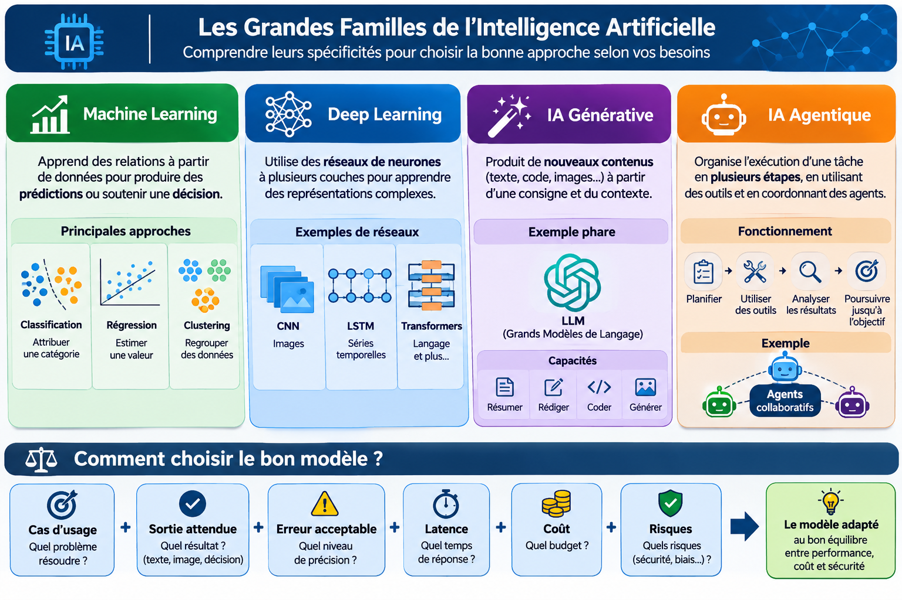
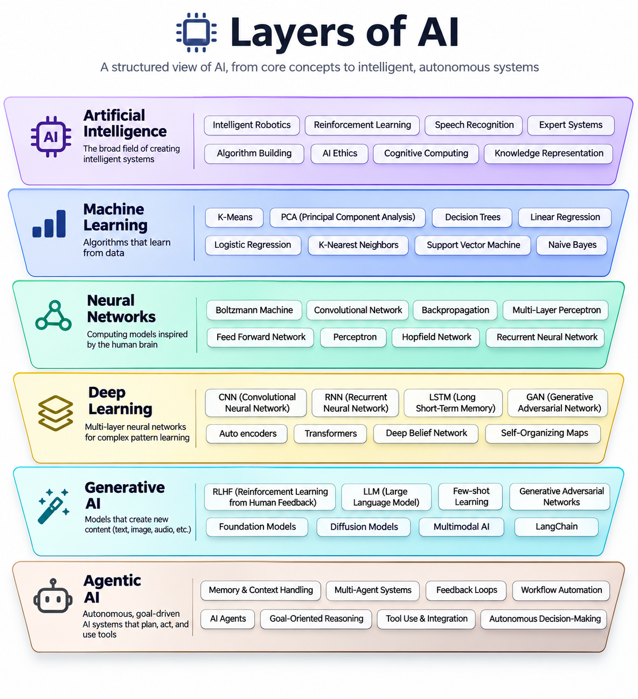

# 1. Grandes familles de l'intelligence artificielle

<figure class="resource-figure"></figure>

Le **Machine Learning** apprend des relations à partir de données afin de produire des prédictions ou de soutenir une décision. Il couvre notamment la classification, qui attribue une catégorie, la régression, qui estime une valeur, et le clustering, qui regroupe des observations similaires. [Pour plus des détails](https://kriahi.pro/ressources/revision-machine-learning/).

Le **Deep Learning** s’appuie sur des réseaux de neurones à plusieurs couches pour apprendre des représentations complexes à partir des données. Les réseaux convolutifs (**CNN**) sont souvent utilisés pour les images, les réseaux récurrents comme les **LSTM** pour les séquences, et les **Transformers** pour le traitement du langage et d’autres tâches séquentielles. [Pour plus des détails](https://kriahi.pro/ressources/tutoriel-ml-deep-learning-llm/).

L’**IA générative** produit de nouveaux contenus, comme du texte, du code ou des images, à partir d’une consigne et du contexte fourni. Les grands modèles de langage (**LLM**) en sont un exemple : ils génèrent du texte et peuvent aussi résumer, reformuler ou répondre à des questions.

L’**IA agentique** organise l’exécution d’une tâche en plusieurs étapes. Un agent peut planifier, utiliser des outils ou des API, examiner leurs résultats et poursuivre jusqu’à l’objectif ; plusieurs agents peuvent aussi coordonner leurs rôles dans un même système. [Pour plus des détails](https://kriahi.pro/ressources/agents-ia-rag-graphrag/).

Le choix d’un modèle vient après la définition du cas d’usage, de la sortie attendue, de l’erreur acceptable, de la latence, du coût et des risques.

<figure class="resource-figure ai-layers-figure"><figcaption>Couches de l’intelligence artificielle, du Machine Learning à l’IA agentique.</figcaption></figure>

### 2. Architecture IA et Machine Learning

- [Cadre Togaf pour une architecture IA](https://kriahi.pro/ressources/architecture-ia-framework/)
- [Architecture technique de référence d'un système IA agentique](https://kriahi.pro/ressources/agents-ia-rag-graphrag/)
- [Cas pratique : Architecture C4 d’un agent de crédit](https://kriahi.pro/ressources/architecture-c4-agent-credit/)
- [Machine Learning : algorithmes de base](https://kriahi.pro/ressources/revision-machine-learning/)
- [Deep Learning: Réseaux de neurones et LLM](https://kriahi.pro/ressources/tutoriel-ml-deep-learning-llm/)
