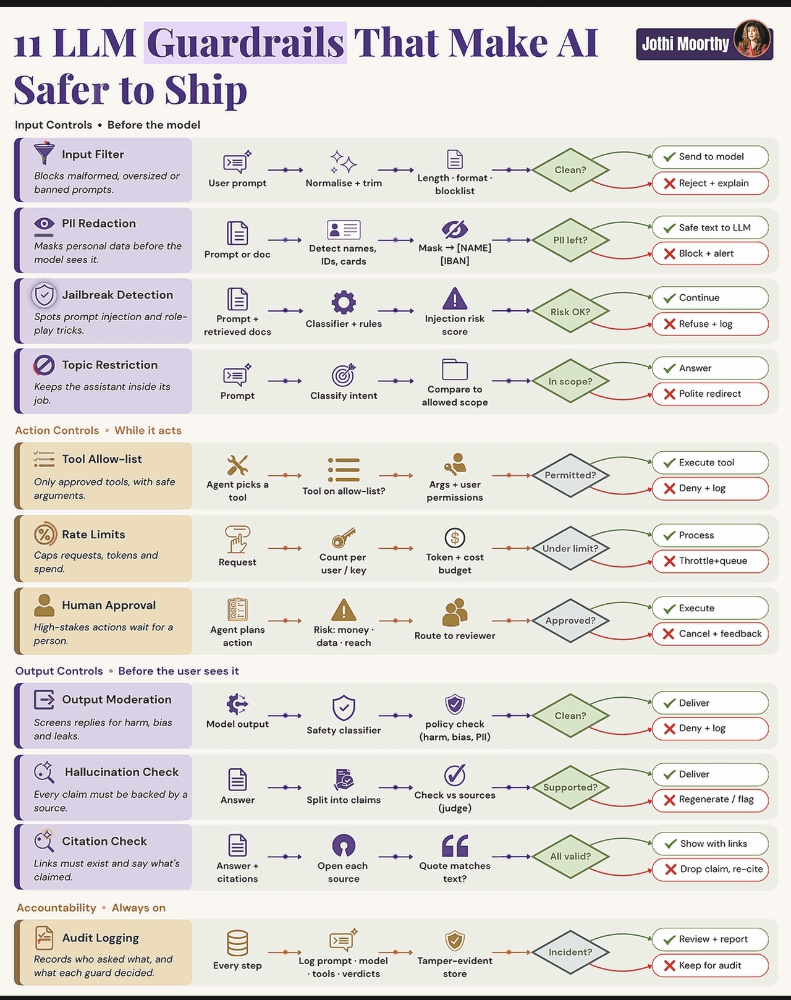
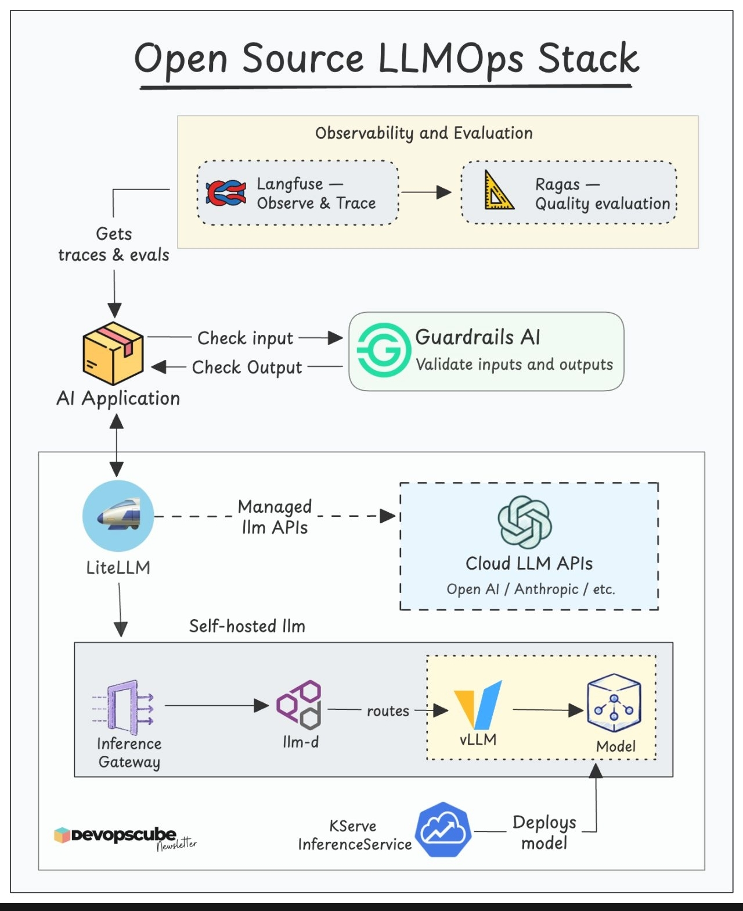
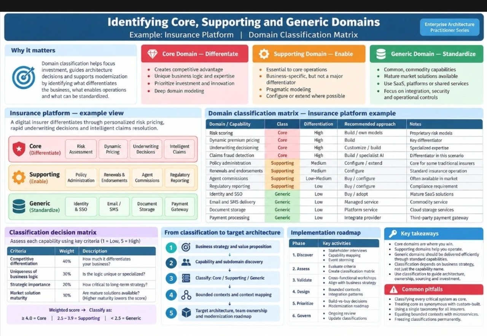

# 1. Grandes familles de l'intelligence artificielle

<figure class="resource-figure"></figure>

Le **Machine Learning** apprend des relations à partir de données afin de produire des prédictions ou de soutenir une décision. Il couvre notamment la classification, qui attribue une catégorie, la régression, qui estime une valeur, et le clustering, qui regroupe des observations similaires. [Pour plus des détails](https://kriahi.pro/ressources/revision-machine-learning/).

Le **Deep Learning** s’appuie sur des réseaux de neurones à plusieurs couches pour apprendre des représentations complexes à partir des données. Les réseaux convolutifs (**CNN**) sont souvent utilisés pour les images, les réseaux récurrents comme les **LSTM** pour les séquences, et les **Transformers** pour le traitement du langage et d’autres tâches séquentielles. [Pour plus des détails](https://kriahi.pro/ressources/tutoriel-ml-deep-learning-llm/).

L’**IA générative** produit de nouveaux contenus, comme du texte, du code ou des images, à partir d’une consigne et du contexte fourni. Les grands modèles de langage (**LLM**) en sont un exemple : ils génèrent du texte et peuvent aussi résumer, reformuler ou répondre à des questions.

L’**IA agentique** organise l’exécution d’une tâche en plusieurs étapes. Un agent peut planifier, utiliser des outils ou des API, examiner leurs résultats et poursuivre jusqu’à l’objectif ; plusieurs agents peuvent aussi coordonner leurs rôles dans un même système. [Pour plus des détails](https://kriahi.pro/ressources/agents-ia-rag-graphrag/).

Le choix d’un modèle vient après la définition du cas d’usage, de la sortie attendue, de l’erreur acceptable, de la latence, du coût et des risques.

# 2. Cycle de vie Machine Learning

Une chaîne ML comprend collecte et qualification, préparation, feature engineering, séparation entraînement/validation/test, entraînement, évaluation, déploiement et surveillance.

Pour une classification, on peut mesurer précision, rappel (*recall*), F1-score et matrice de confusion. Pour une régression : MAE, RMSE ou MAPE selon les données et le coût des erreurs.

Pour les séries temporelles, la séparation doit respecter l’ordre chronologique. Le *backtesting walk-forward* évalue plusieurs fenêtres successives sans mélanger passé et futur. Les features peuvent inclure lags, fenêtres glissantes, saisonnalité, calendrier et variables exogènes. Les modèles possibles comprennent baselines naïves, ETS/ARIMA, Prophet, régression/GBM, LSTM ou Transformers.

# 3. Comprendre les Transformers

Un Transformer traite une séquence à l’aide de mécanismes d’attention. L’attention calcule l’importance relative d’éléments pour construire une représentation contextualisée.

## Attention et Self-Attention

Dans une attention générale, Query (Q), Key (K) et Value (V) peuvent provenir de séquences différentes. Dans le Self-Attention, Q, K et V sont calculées à partir de la même séquence.

- **Query :** quelles informations me sont utiles ?
- **Key :** quelle information ce token peut-il signaler ?
- **Value :** quel contenu sera agrégé ?

`Attention(Q, K, V) = softmax(QKᵀ / √dₖ) V`

Le Softmax transforme les scores de compatibilité en poids, utilisés pour combiner les Value.

Le **Multi-Head Attention** exécute plusieurs attentions en parallèle avec des projections distinctes. Les sorties sont concaténées puis projetées. Les têtes peuvent apprendre des relations différentes, sans correspondre nécessairement à des fonctions linguistiques prédéfinies.

## Encoder et Decoder

| Architecture | Fonction fréquente | Exemples |
|---|---|---|
| Encoder-only | Compréhension, classification, recherche sémantique | BERT, RoBERTa |
| Decoder-only | Génération autorégressive token après token | GPT, Llama, Qwen |
| Encoder-Decoder | Transformer une séquence en une autre | T5, BART |

L’Encoder produit des représentations contextualisées. Le Decoder autorégressif prédit le prochain token à partir des précédents avec un masque causal. Dans le Transformer Encoder-Decoder original, la Cross-Attention relie les états du Decoder aux représentations de l’Encoder. Beaucoup de LLM génératifs conversationnels sont Decoder-only.

# 4. RAG : connecter un LLM à une connaissance documentaire

Le *Retrieval-Augmented Generation* associe recherche documentaire et génération. Des passages pertinents sont récupérés dans un corpus au moment de la question.

**Indexation :** documents → extraction → nettoyage et découpage (*chunking*) → embeddings → base vectorielle avec métadonnées.

**Réponse :** question → embedding → recherche vectorielle ou hybride → reranking éventuel → passages et références → prompt enrichi → LLM → réponse sourcée.

Pour un assistant d’architecture SI, le corpus peut contenir standards TOGAF, décisions d’architecture, cartographies et dossiers techniques. Il faut contrôler les droits d’accès et citer les sources.

# 5. Fine-tuning, LoRA et QLoRA

Le **Fine-tuning** poursuit l’entraînement d’un modèle pré-entraîné sur un dataset spécialisé. Il peut adapter le style, le format ou le comportement pour une tâche. Pour ajouter des documents qui changent souvent, le RAG est généralement plus adapté.

**LoRA (Low-Rank Adaptation)** gèle les poids du modèle de base et ajoute des matrices de faible rang entraînables :

`W' = W₀ + ΔW` et `ΔW = (α / r) BA`

**QLoRA** combine LoRA avec la quantification du modèle de base, souvent en 4 bits, pour réduire l’empreinte mémoire. Cela ne supprime pas les besoins liés aux activations, séquences et calculs.

| Besoin | Approche possible |
|---|---|
| Accéder à la dernière version d’un référentiel | RAG |
| Citer documents et pages | RAG avec métadonnées |
| Respecter un format de fiche d’architecture | Prompting structuré ou Fine-tuning |
| Adapter un style rédactionnel | Instructions et/ou Fine-tuning |
| Réduire les ressources d’adaptation | LoRA / QLoRA |

Fine-tuning et RAG sont complémentaires : le premier adapte le comportement ; le second apporte une connaissance externe actualisable au moment de l’inférence.

# 6. Architecture de référence d’un assistant IA

```text
Utilisateur / Portail
        |
 API Gateway / Authentification
        |
 Backend / Orchestrateur IA
    |              |
    |              +---- Conversations / mémoire
    |
    +---- RAG : Retriever → Vector DB → Documents
    |
    +---- LLM Serving (vLLM ou API modèle)
    |
    +---- Outils métier / APIs / Agents
        |
Observabilité · Guardrails · Audit · Évaluation
```

L’AI Gateway contrôle les appels aux modèles, politiques, quotas et observabilité. L’orchestrateur gère le flux et les outils. La base vectorielle indexe embeddings et métadonnées. Le serving expose le modèle. Les guardrails contrôlent les entrées, sorties et actions.

Une architecture agentique ajoute la planification et l’appel d’outils. Les permissions doivent rester explicites, les actions sensibles contrôlées et les limites d’exécution définies.

# 7. MLOps et LLMOps

Versionner données, modèles, prompts et index ; évaluer hors ligne ; tester les non-régressions ; déployer progressivement ; surveiller latence, erreurs, coût et qualité ; détecter les dérives ; gérer secrets, accès et journaux ; contrôler réentraînement et réindexation.

**À retenir :** une solution IA en entreprise est un système complet. Le modèle n’est qu’un composant parmi les données, pipelines, orchestration, sécurité, serving, évaluation et exploitation.

## Visuels de la bibliothèque

<div class="category-gallery">
<a class="category-visual" href="/ressources/agents-ia-rag-graphrag/"><span>Plateforme multi-agents, RAG et GraphRAG</span></a>
<a class="category-visual" href="/ressources/architecture-agentique-complete/"><span>Orchestration agentique et gateways</span></a>
<a class="category-visual" href="/ressources/architecture-c4-agent-credit/"><span>Sécurité et garde-fous des agents</span></a>
<a class="category-visual" href="/ressources/architecture-agentique-complete/"><span>LLMOps et exploitation</span></a>
<a class="category-visual" href="/ressources/architecture-ia-framework/"><span>Couches d’une architecture IA</span></a>
</div>
