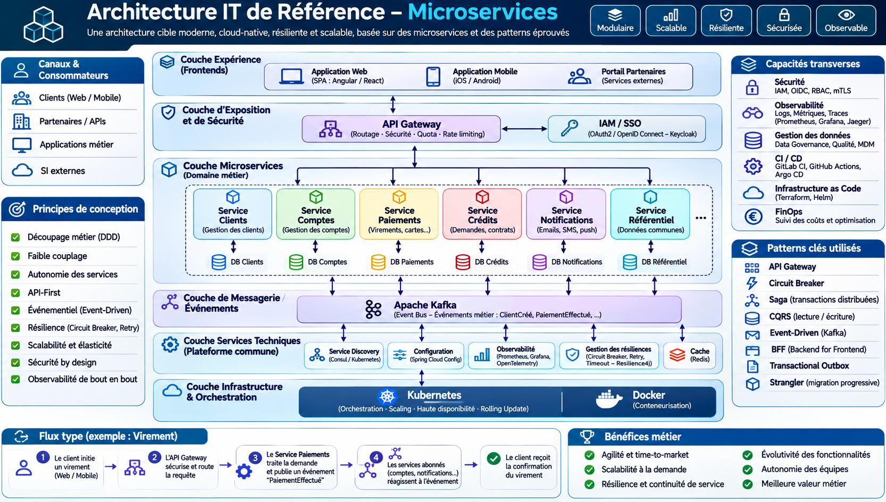

# 1. Pourquoi les microservices ?

Une architecture microservices organise une application en services faiblement couplés, alignés autant que possible sur des domaines ou capacités métier. Chaque service porte une responsabilité claire et expose un contrat d’interaction.

Les bénéfices recherchés sont l’autonomie des équipes, le déploiement indépendant et l’évolution différenciée. Ils ne sont pas automatiques : les microservices introduisent des coûts de réseau, de supervision, de sécurité, de cohérence distribuée et d’exploitation.

Un monolithe modulaire bien conçu peut être préférable lorsque le domaine est mal connu, l’équipe réduite ou le déploiement indépendant inutile.

# 2. Vue Logique / Technique

<figure class="resource-figure"></figure>

L’API Gateway centralise certains besoins transverses : routage, authentification, quotas ou observabilité. Elle ne doit pas concentrer toute la logique métier.

Le **BFF (Backend for Frontend)** adapte les APIs à un canal, par exemple TV ou mobile, lorsque les besoins d’agrégation diffèrent réellement.

# 3. Les six principes fondamentaux du découpage en microservices

Une architecture microservices cohérente repose sur des services bien délimités, autonomes, orientés métier, résilients, observables et déployés par des processus automatisés.

## 3.1 Cohésion (High Cohesion)

Un microservice doit avoir une responsabilité métier unique et regrouper les fonctionnalités qui participent à cette responsabilité. Il doit faire une seule chose, avec un seul focus, et être découpé selon une raison de changer.

Dans un système bancaire, le **Payment Service** gère l’initiation des paiements, la validation de leurs informations, le suivi de leur statut et les règles métier associées. Il ne devient pas responsable de la gestion des clients, des crédits et des comptes.

Bonne pratique : appliquer le principe de responsabilité unique à l’échelle du domaine métier, sans créer des services excessivement petits.

## 3.2 Autonomie (Autonomy)

Chaque microservice doit pouvoir évoluer, être remplacé et être déployé indépendamment des autres. Cette autonomie s’appuie sur un faible couplage, des interfaces versionnées et une responsabilité clairement attribuée à une équipe.

Par exemple, le **Payment Service** peut évoluer de Spring Boot 3 vers Spring Boot 4 sans imposer une évolution simultanée au **Customer Service**, à condition de maintenir la compatibilité des contrats. Pour préserver cette autonomie, il faut définir des API contractuelles, versionner les interfaces, éviter les accès directs aux bases des autres services et limiter les appels synchrones en cascade.

Un service autonome maîtrise son cycle de vie, ses données et ses décisions d’implémentation.

## 3.3 Orienté métier (Business-Oriented)

Les microservices se découpent selon les domaines et les capacités métier, et non selon les couches techniques. Le **Domain-Driven Design (DDD)** aide à identifier ces domaines et leurs frontières fonctionnelles, appelées *Bounded Contexts*.

Dans une banque, au lieu de créer un service par type de contrôleur technique, le découpage suit les domaines métier :

| Domaine métier | Microservice |
|---|---|
| Gestion client | Customer Service |
| Gestion des comptes | Account Service |
| Paiement | Payment Service |
| Crédit | Credit Service |
| Risques | Risk Service |

Le métier doit guider le découpage technique.

## 3.4 Résilience (Resilience)

La défaillance d’un microservice ne doit pas provoquer automatiquement l’indisponibilité de l’ensemble du système. Il faut prévoir le comportement par défaut et les fonctionnalités dégradées, puis surveiller notamment le **MTTR** (*Mean Time To Repair*) et le **MTBF** (*Mean Time Between Failures*).

Si le **Notification Service** devient indisponible pendant un paiement, le paiement peut continuer : l’événement de notification est conservé et traité ultérieurement.

| Pattern | Fonction |
|---|---|
| Circuit Breaker | Bloquer temporairement les appels vers un service défaillant |
| Retry | Réessayer une opération en échec |
| Timeout | Limiter le temps d’attente |
| Bulkhead | Isoler les ressources |
| Fallback | Proposer un comportement alternatif |
| Dead Letter Queue | Isoler les messages non traitables |

Le **MTTR** mesure le temps moyen de réparation ; le **MTBF** mesure le temps moyen entre deux pannes. L’objectif est de réduire le MTTR et d’augmenter le MTBF.

## 3.5 Observabilité (Observability)

L’observabilité permet de comprendre l’état interne d’un système à partir des données qu’il expose. Dans une architecture distribuée, elle aide à suivre le parcours d’une requête entre les microservices et à identifier les erreurs ou les latences.

Ses trois piliers sont les **logs**, qui historisent les événements et les erreurs (par exemple Elasticsearch ou Loki) ; les **métriques**, qui mesurent la performance et la disponibilité (Prometheus ou Grafana) ; et le **tracing distribué**, qui suit une requête entre services (OpenTelemetry ou Jaeger).

Par exemple, si un virement prend anormalement quatre secondes, le tracing permet de déterminer quel microservice est responsable de cette latence.

## 3.6 Automatisation (Automation)

L’automatisation des activités de développement, de test, de construction et de déploiement rend les livraisons plus fiables et rapides. Elle s’appuie notamment sur l’intégration continue (**CI**) et le déploiement continu (**CD**), ainsi que sur les tests, les conteneurs et les déploiements automatisés.

Un pipeline CI/CD peut suivre les étapes suivantes :

1. **Git Push :** le développeur pousse son code.
2. **Build :** compilation, par exemple avec Maven.
3. **Tests :** tests unitaires, d’intégration et de contrats.
4. **Docker :** construction de l’image conteneur.
5. **Security Scan :** analyse des vulnérabilités.
6. **Deployment :** déploiement sur Kubernetes.
7. **Monitoring :** surveillance après déploiement.

Parmi les technologies possibles : GitLab CI ou GitHub Actions, Maven ou Gradle, Docker, Kubernetes, Argo CD et SonarQube.

## 3.7 Synthèse des six principes

| Principe | Question fondamentale |
|---|---|
| Cohésion | Le service a-t-il une responsabilité claire ? |
| Autonomie | Peut-il évoluer et être déployé indépendamment ? |
| Orienté métier | Son découpage respecte-t-il les domaines métier ? |
| Résilience | Le système résiste-t-il aux défaillances ? |
| Observabilité | Peut-on comprendre son comportement ? |
| Automatisation | Peut-on tester et déployer sans intervention manuelle répétitive ? |

