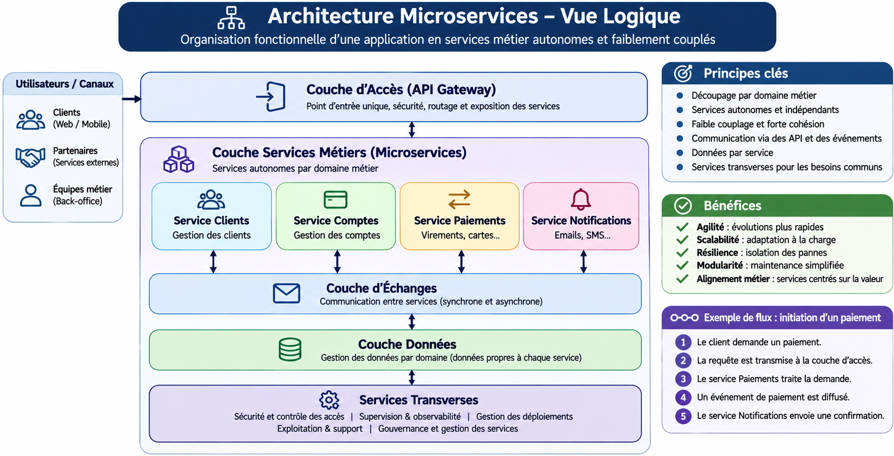
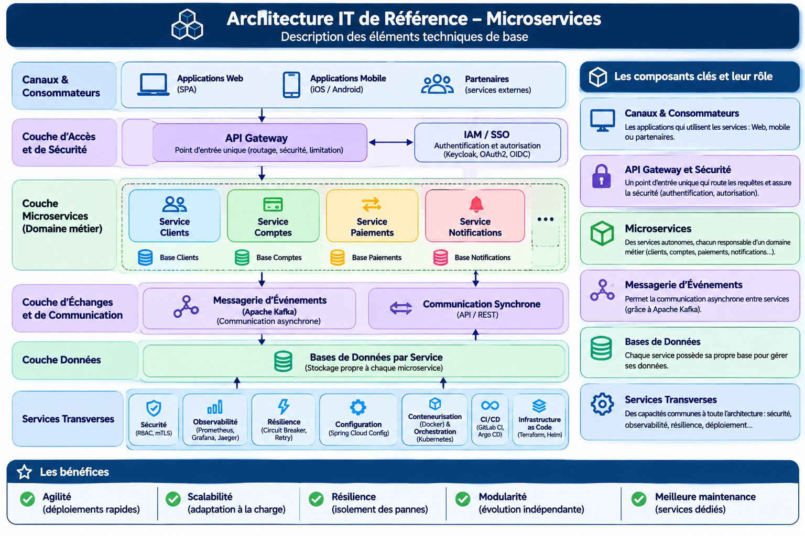

# Vue logique

Une architecture microservices est un style d'architecture logicielle qui consiste à décomposer une application en un ensemble de services autonomes, faiblement couplés et organisés autour de capacités métier.

Chaque microservice possède une responsabilité fonctionnelle clairement définie et peut être développé, déployé, maintenu et faire évoluer indépendamment des autres services.

Les microservices communiquent à travers des interfaces contractuelles, notamment des API, ou par l'échange asynchrone d'événements.

Les principes fondamentaux sont le découpage par domaine métier, la forte cohésion fonctionnelle, le faible couplage, l'autonomie des services et la décentralisation de la gestion des données.
## Composants de l’architecture logique

<figure class="resource-figure"></figure>

### Couche Utilisateurs et Canaux

Cette couche représente les différents consommateurs des fonctionnalités du système.

Elle regroupe les applications Web et Mobile utilisées par les clients, les applications internes destinées aux collaborateurs ainsi que les systèmes partenaires qui interagissent avec l'application.

Son rôle est de permettre aux différents acteurs d'accéder aux capacités métier exposées par le système, sans dépendre de l'organisation interne des microservices.
### Couche d’Accès et d’Exposition

Cette couche constitue le point d'entrée logique des services métier.

Elle assure principalement le routage des requêtes vers les services appropriés, le contrôle des accès, l'application des politiques de sécurité et la gestion des interfaces exposées aux consommateurs.

Elle permet également de masquer la complexité de l'architecture interne et de fournir un accès cohérent aux fonctionnalités du système.

Le composant API Gateway représente un mécanisme courant de mise en œuvre de cette couche.
### Couche Services Métier — Microservices

Cette couche constitue le cœur fonctionnel de l'architecture.

Elle regroupe des services autonomes, chacun responsable d'un domaine métier ou d'une capacité fonctionnelle spécifique.

Dans notre exemple bancaire, elle comprend :

- Service Clients : gestion des informations clients et de leurs profils.

- Service Comptes : gestion des comptes bancaires et de leurs informations.

- Service Paiements : traitement des virements et des opérations de paiement.

- Service Notifications : gestion des communications et notifications adressées aux clients.
Chaque service encapsule ses propres règles métier et expose ses fonctionnalités à travers des interfaces définies.

Le découpage s'appuie notamment sur les principes du Domain-Driven Design (DDD) et des Bounded Contexts, afin de garantir une forte cohésion métier et de limiter les dépendances entre services.
### Couche d’Échanges et de Communication

Cette couche représente les mécanismes de communication entre les différents microservices.

Elle distingue deux modes principaux :

Communication synchrone : un service sollicite directement un autre service et attend sa réponse. Ce mode est adapté aux interactions nécessitant un résultat immédiat.

Communication asynchrone : un service publie un événement ou transmet un message qui peut être traité ultérieurement par un ou plusieurs services consommateurs.

Cette seconde approche favorise le découplage temporel et fonctionnel entre les services.

Par exemple, après le traitement d'un paiement, le service Paiements peut publier un événement PaiementEffectué, permettant au service Notifications de déclencher l'envoi d'une confirmation.
### Couche Données

Cette couche représente la gestion et la persistance des données métier.

Dans une architecture microservices, le principe fondamental est que chaque service est propriétaire de ses données et en contrôle les accès.

Les autres services ne doivent pas accéder directement à ses structures de stockage internes, mais passer par les interfaces ou les événements qu'il expose.

Cette approche favorise l'autonomie des services, réduit les dépendances structurelles et permet de faire évoluer les modèles de données indépendamment.

La séparation logique des données n'impose pas nécessairement une infrastructure de stockage physique distincte pour chaque service.
### Services Transverses

Les services transverses regroupent les capacités communes nécessaires au fonctionnement, à la sécurité et à l'exploitation de l'ensemble de l'architecture.

Ils couvrent notamment :

- Sécurité et gestion des accès : authentification, autorisation et protection des échanges.

- Observabilité : collecte et analyse des journaux, métriques et traces pour superviser les services.

- Résilience : gestion des défaillances et limitation de leur propagation.

- Gestion des configurations : administration cohérente des paramètres des services.

- Gouvernance : définition et contrôle des standards, contrats d'interface et règles d'architecture.

- Gestion du cycle de vie : déploiement, évolution et exploitation des services.
Ces capacités permettent d'assurer la cohérence globale du système tout en préservant l'autonomie des microservices.
# Vue technique

<figure class="resource-figure"></figure>

## Les éléments techniques fondamentaux d'une architecture microservices

L'architecture présentée repose sur plusieurs couches techniques complémentaires. Chaque couche remplit un rôle spécifique dans l'exécution, la communication, la sécurisation et l'exploitation des microservices.

Voici les principaux composants à connaître.

| Composant | Rôle technique | Technologies du schéma |
| --- | --- | --- |
| **Frontend** | Fournir les interfaces utilisateur Web et Mobile. | Angular, React, iOS, Android |
| **API Gateway** | Centraliser l'accès aux API, router les requêtes et appliquer les politiques de sécurité. | Kong, Apache APISIX, NGINX |
| **IAM / SSO** | Gérer l'authentification, les identités et les autorisations. | Keycloak, OAuth 2.0, OIDC |
| **Microservices Backend** | Implémenter les fonctionnalités métier dans des services indépendants. | Spring Boot, Quarkus, .NET, Node.js |
| **Bases de données** | Assurer le stockage et la persistance des données propres à chaque service. | PostgreSQL, MySQL, MongoDB, Oracle |
| **Messagerie événementielle** | Permettre la communication asynchrone entre microservices. | Apache Kafka |
| **Service Discovery** | Permettre aux services de découvrir les adresses de leurs instances. | Consul, Kubernetes |
| **Configuration** | Centraliser et distribuer les paramètres applicatifs. | Spring Cloud Config |
| **Cache** | Accélérer les accès aux données fréquemment utilisées. | Redis |
| **Résilience** | Gérer les défaillances, les délais d'attente et les tentatives de reprise. | Resilience4j |
| **Observabilité** | Collecter les métriques, les logs et les traces distribuées. | Prometheus, Grafana, OpenTelemetry |
| **Centralisation des logs** | Collecter, indexer et rechercher les journaux applicatifs. | Elasticsearch, Logstash, Kibana |
| **Conteneurisation** | Emballer les applications avec leurs dépendances. | Docker |
| **Orchestration** | Automatiser le déploiement, la disponibilité et la mise à l'échelle. | Kubernetes |
| **CI/CD** | Automatiser la construction, les tests et la livraison des applications. | GitLab CI, GitHub Actions, Argo CD |
| **Infrastructure as Code** | Automatiser le provisionnement et la configuration des infrastructures. | Terraform, Helm |

Ces technologies ne sont pas toutes obligatoires. Certaines sont des alternatives, d'autres sont complémentaires. Par exemple, PostgreSQL et MongoDB répondent à des besoins de stockage différents, tandis que Docker et Kubernetes remplissent des rôles complémentaires.

### Comment les composants fonctionnent ensemble

Dans un scénario de paiement bancaire, le fonctionnement est le suivant :

1. Le client effectue une opération depuis une application Angular, React ou mobile.
2. L'API Gateway reçoit la requête et applique les contrôles nécessaires, avec l'appui de Keycloak pour l'authentification.
3. Le microservice Paiements, développé par exemple avec Spring Boot, exécute les règles métier.
4. Le service enregistre les informations du paiement dans sa base PostgreSQL.
5. Apache Kafka diffuse un événement métier, consommé notamment par le service Notifications.
6. Prometheus, Grafana et les outils de journalisation permettent de superviser l'exécution.
7. Docker et Kubernetes assurent l'exécution et l'orchestration des services.

# Bénéfices d'une architecture microservices

| Bénéfice | Description |
| --- | --- |
| Agilité | Accélération des évolutions grâce à des services indépendants. |
| Scalabilité | Possibilité de dimensionner les services selon leurs besoins spécifiques. |
| Résilience | Limitation de la propagation des pannes entre services. |
| Modularité | Meilleure séparation des responsabilités et simplification de la maintenance. |
| Autonomie | Responsabilisation des équipes sur le cycle de vie de leurs services. |
| Évolutivité | Adaptation progressive de l'architecture aux nouveaux besoins métier. |

Ces bénéfices ne sont pas automatiques : ils dépendent de la qualité du découpage métier, des contrats d'interface et de la maîtrise des interactions distribuées.
