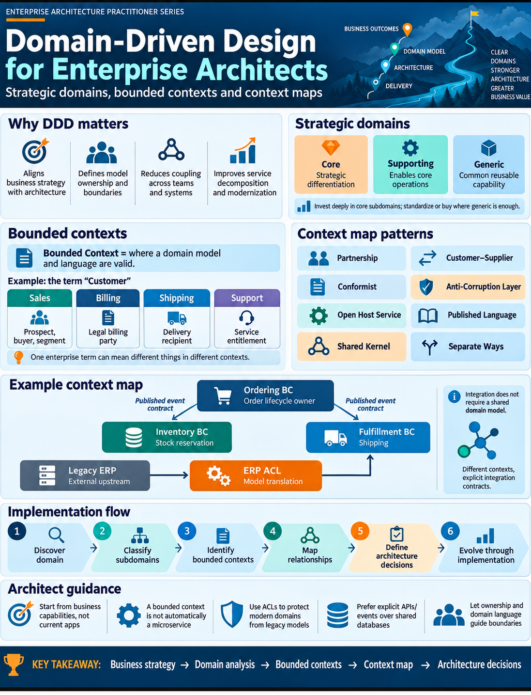
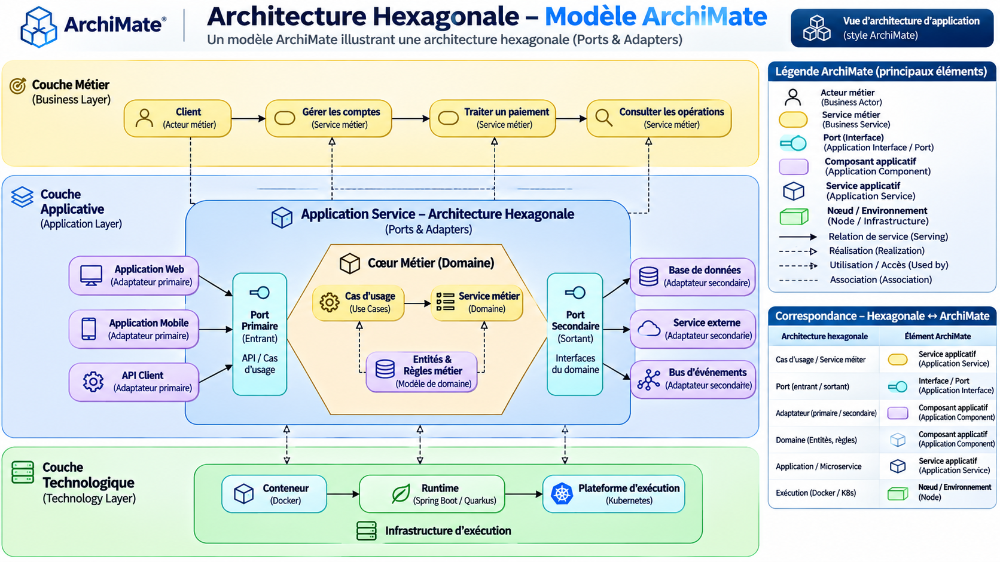

# 1. Qu’est-ce qu’un pattern ?

Un pattern est une solution réutilisable à un problème d’architecture ou de conception récurrent. Il décrit un contexte, un problème, une solution type, ses conséquences et ses limites. Ce n’est ni un produit à installer ni une recette à appliquer partout.

# 2. DDD: Domain Driven Design

Le *Domain-Driven Design* structure les services autour du métier plutôt qu’autour des couches techniques.

- **Domain :** domaine métier étudié.
- **Subdomain :** partie du domaine (core, supporting ou generic).
- **Bounded Context :** frontière dans laquelle un modèle et un vocabulaire métier ont un sens cohérent.
- **Ubiquitous Language :** langage partagé entre experts métier et équipe de réalisation.

Exemple pour une plateforme vidéo :

| Bounded Context | Responsabilité |
|---|---|
| Catalogue | Décrire les contenus et leurs métadonnées |
| Abonnement | Gérer les offres et droits d’accès |
| Identité | Gérer comptes et authentification |
| Lecture | Démarrer et suivre une session |
| Facturation | Produire les éléments de facturation |

Un bounded context n’est pas automatiquement égal à un microservice. La frontière technique tient aussi compte des données, transactions, rythmes d’évolution, contraintes de sécurité et responsabilités des équipes.

### Schéma illustratif

Ce schéma résume les concepts clés du Domain-Driven Design : domaines stratégiques, contextes délimités, relations entre contextes et étapes de mise en œuvre dans une architecture d’entreprise.

<figure class="resource-figure"><figcaption>Domain-Driven Design : domaines stratégiques, bounded contexts, carte des contextes et démarche d’implémentation.</figcaption></figure>

# 3. Architecture hexagonale (Ports & Adapters)

<figure class="resource-figure"><figcaption>Architecture hexagonale modélisée avec ArchiMate : domaine, ports, adaptateurs et relations entre les couches.</figcaption></figure>

Le domaine est au centre. Les interactions passent par des ports et des adaptateurs :

- **Port entrant :** décrit comment une fonctionnalité est appelée.
- **Adaptateur entrant :** API REST, interface utilisateur ou consommateur de message.
- **Port sortant :** décrit une dépendance nécessaire.
- **Adaptateur sortant :** base de données, broker ou service externe.

```text
REST / Message / CLI
        |
Adaptateurs entrants
        |
Ports entrants
        |
Application + Domaine
        |
Ports sortants
        |
Adaptateurs : SQL / Kafka / APIs externes
```

L’objectif est d’éviter que le cœur métier dépende directement des frameworks, du réseau ou du stockage. Cela facilite les tests et le remplacement des technologies, au prix d’interfaces et d’une structuration supplémentaires.

# 4. CQRS

CQRS (*Command Query Responsibility Segregation*) sépare les commandes qui changent l’état et les requêtes qui lisent les informations.

- **Command :** `ActiverAbonnement`.
- **Query :** `ConsulterAbonnement`.

La séparation peut commencer dans le code, sans imposer deux bases. Dans des architectures avancées, des modèles de lecture séparés sont alimentés de manière asynchrone. Cela apporte des modèles de lecture adaptés, mais ajoute cohérence éventuelle, duplication et supervision.

# 5. Event Sourcing

Event Sourcing conserve les événements qui décrivent les changements d’état plutôt que de ne conserver que le dernier état.

`CompteCréé → DépôtEffectué → RetraitEffectué → CompteBloqué`

L’état courant peut être reconstruit en rejouant les événements, éventuellement depuis un snapshot.

À distinguer : l’architecture événementielle est un style de communication ; Event Sourcing fait des événements la source de vérité de l’état. Un système événementiel n’utilise donc pas nécessairement Event Sourcing.

# 6. Saga

Une Saga décompose un processus métier en transactions locales. Chaque étape peut avoir une action de compensation si une étape ultérieure échoue.

Exemple : réserver un billet, réserver un hôtel, effectuer le paiement, confirmer le séjour. Si le paiement échoue, les réservations précédentes peuvent être annulées selon les règles métier.

- **Chorégraphie :** chaque service réagit aux événements.
- **Orchestration :** un coordinateur pilote les étapes et compensations.

Une compensation est une action métier qui corrige les effets déjà produits, pas toujours un rollback technique exact.

# 7. Circuit Breaker et Bulkhead

Le **Circuit Breaker** protège contre les appels répétés à une dépendance défaillante :

- **Closed :** appels normaux.
- **Open :** appels temporairement bloqués.
- **Half-open :** quelques appels testent le rétablissement.

Le **Bulkhead** isole ressources ou pools d’exécution afin qu’une surcharge ne consomme pas toutes les ressources. Ces mécanismes complètent timeouts, retries bornés, backoff, rate limiting et fallback.

# 8. BFF, API Gateway, Service Discovery et Sidecar

| Pattern | Problème | Rôle |
|---|---|---|
| API Gateway | Exposition et contrôle des APIs | Routage, authentification, quotas |
| BFF | Besoins différents selon les canaux | API adaptée au Web, mobile ou TV |
| Service Discovery | Localiser des instances | Découverte dynamique des endpoints |
| Sidecar | Ajouter des fonctions transverses | Proxy, télémétrie, sécurité |
| Service Mesh | Gouverner les communications | Identité, chiffrement, politiques et télémétrie |

Ces patterns ajoutent des capacités, mais aussi des composants, des règles et des coûts opérationnels.

# 9. Orchestration : Camunda, Airflow et Temporal

- **Camunda :** processus métier, BPMN, validations humaines et décisions.
- **Apache Airflow :** pipelines Data et traitements planifiés sous forme de DAG.
- **Temporal :** workflows applicatifs durables avec état, temporisation et reprise.
- **Kubernetes :** orchestration de conteneurs et workloads, pas un moteur BPM.
- **Argo Workflows :** workflows conteneurisés souvent exécutés sur Kubernetes.

Camunda et Airflow peuvent coopérer : Camunda pilote le parcours métier ; Airflow exécute le pipeline technique. Prévoir échange asynchrone, identifiant de corrélation, idempotence, timeouts et reprise.

# 10. Choisir et documenter un pattern

Avant d’adopter un pattern, documenter le problème, le contexte, les exigences, les options, les bénéfices, les coûts, les risques et les conditions d’exploitation.

Exemple d’ADR :

```text
Décision : Saga orchestrée pour le parcours de souscription.

Contexte :
Le parcours implique plusieurs services et ne peut pas être
couvert par une transaction ACID unique.

Options :
- appels synchrones chaînés ;
- chorégraphie événementielle ;
- orchestration Saga.

Choix :
Orchestration Saga pour rendre visibles l'état du parcours,
les délais, les reprises et les compensations.

Conséquences :
- état de workflow à persister ;
- opérations idempotentes ;
- compensations définies avec le métier ;
- supervision et audit du parcours.
```

**À retenir :** un bon architecte ne cherche pas à utiliser tous les patterns. Il identifie le problème, compare les options, explicite les compromis et choisit la solution la plus simple qui répond aux exigences.

