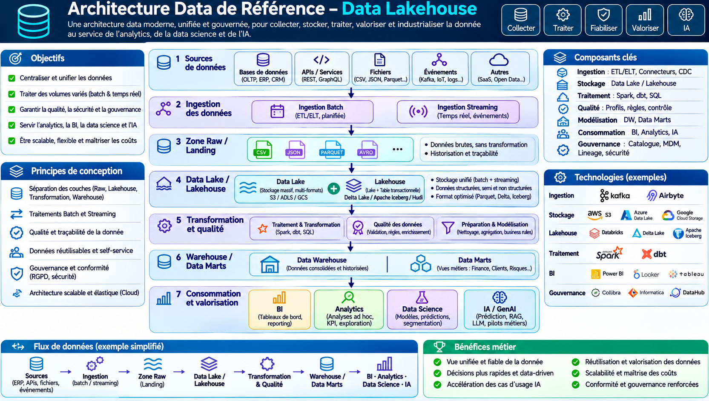

# 1. The role of Data Architecture

Data Architecture describes how data is acquired, moved, stored, transformed, governed and consumed. It supports business operations, reporting, analytics and operational applications.

<figure class="resource-figure"></figure>

Catalogues, metadata, quality, security, lineage and observability are cross-cutting capabilities.

# 2. Data Warehouse, Data Lake and Lakehouse

| Approach | Main idea | Common uses |
|---|---|---|
| Data Warehouse | Structured, integrated data for analysis | Reporting, KPIs, BI |
| Data Lake | Large-scale storage for varied data | Exploration, Data Science |
| Lakehouse | Combines lake-style storage with table management | Analytics, BI and Data Science |

A Data Lake without a catalogue, quality controls, security and a lifecycle can become a *Data Swamp*. A Lakehouse often uses Delta Lake or Apache Iceberg for metadata, schema evolution and transactions, depending on the processing engine.

# 3. Batch and streaming ingestion

**Batch:** data is collected and processed at regular intervals. This suits end-of-period close, consolidation and scheduled processing.

**Streaming:** events are processed as they arrive, enabling fresher data and operational use cases.

Example: `Banking application → Kafka → Spark Structured Streaming → Lakehouse table → Dashboard`.

Kafka distributes and retains events according to a retention policy; on its own, it is not an analytics transformation engine.

# 4. Storage and file formats

HDFS (*Hadoop Distributed File System*) distributes file blocks across multiple nodes. Modern platforms also commonly use cloud object storage.

Parquet and ORC are columnar file formats suited to analytical reads:

- **Parquet:** widely supported across the Data ecosystem.
- **ORC:** a columnar format optimized for analytics, historically common in Hive.

A file format is not a table format. Delta Lake and Iceberg add a metadata and management layer on top of files.

# 5. Distributed processing with Spark

Spark distributes processing across a cluster.

- **RDD:** a resilient, low-level distributed abstraction.
- **DataFrame:** schema-based, column-oriented data that the engine can optimize.
- **Spark SQL:** an SQL interface for querying and transforming data.
- **Structured Streaming:** a stream-processing API built around the DataFrame model.

Example with PySpark:

```python
from pyspark.sql import SparkSession
from pyspark.sql.functions import col, sum as sum_

spark = SparkSession.builder.appName("SalesAnalysis").getOrCreate()
sales = spark.read.parquet("data/sales/")

result = (
    sales.filter(col("status") == "APPROVED")
    .groupBy("country")
    .agg(sum_("amount").alias("total_sales"))
)

result.write.mode("overwrite").parquet("output/sales_by_country/")
```

Spark builds a logical plan, then optimizes and executes the operations. Transformations are usually evaluated lazily until an action is called.

# 6. Delta Lake and Apache Iceberg

These open table formats add management features beyond plain Parquet files. Depending on the engine and configuration, they can provide ACID transactions, schema evolution, snapshots, consistent reads and table maintenance.

Validate the choice against the compute engines, catalogues, ingestion tools and portability requirements.

# 7. Data orchestration

Apache Airflow orchestrates workflows as DAGs (*Directed Acyclic Graphs*). It schedules tasks, manages dependencies and retries, and tracks executions.

Airflow does not necessarily perform distributed computation: it can launch a Spark job, call an API, run SQL and check the result.

`Extract → Quality check → Spark transformation → Lakehouse load → BI publication`

Distinguish Airflow from Camunda: Camunda orchestrates business processes with approvals and decisions; Airflow orchestrates technical data pipelines. They can work together through asynchronous messages, correlation IDs, idempotency and timeouts.

# 8. Governance and quality

A robust platform defines data ownership, a catalogue and business glossary, classification, quality controls (completeness, uniqueness, validity, freshness and consistency), lineage, retention, access and audit.

# 9. Choosing the right style

Daily reporting may need only a batch pipeline, a Lakehouse and a SQL engine. A low-latency fraud alert may require event-driven architecture and streaming.

The choice depends on freshness SLAs, volume, duplicate tolerance, cost, operational complexity and team skills.

**Key takeaway:** Data Architecture connects ingestion, storage, processing, orchestration, governance, security and use cases; it is not just a choice between Spark and a Data Lake.
