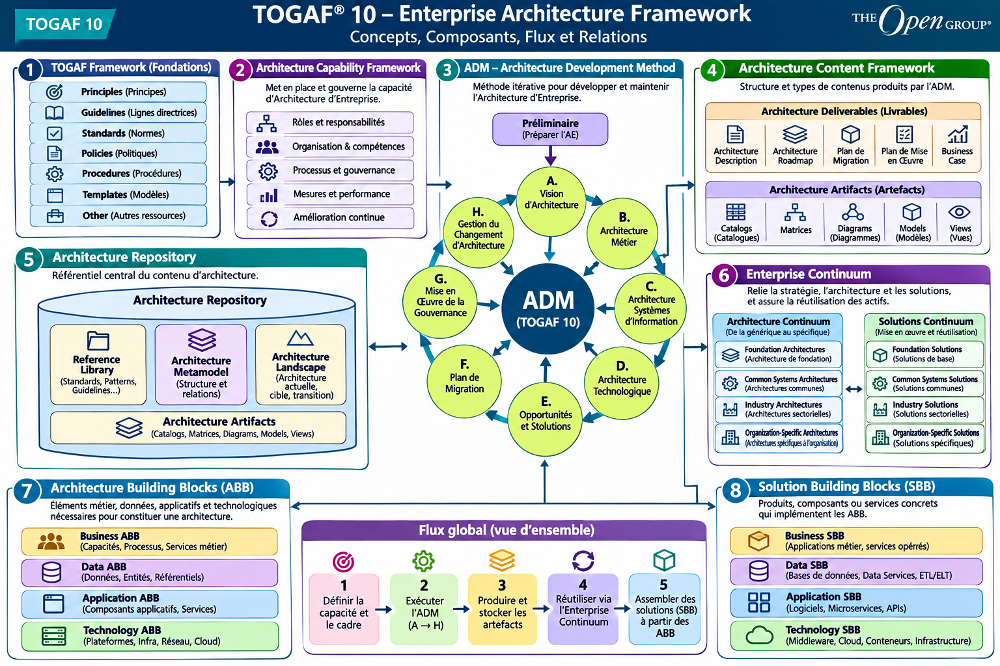

<a href="/en/architecture-entreprise/" aria-current="page">01<strong>Enterprise Architecture</strong><small>TOGAF · ADM · governance</small></a><a href="/en/architecture-entreprise/archimate/">02<strong>ArchiMate</strong><small>Architecture modelling</small></a><a href="/en/architecture-entreprise/togaf-techniques/">03<strong>TOGAF Techniques</strong><small>Examples and practices</small></a>

# 1. What is Enterprise Architecture (EA)?

Enterprise Architecture (EA) provides a coherent view of an organization, its business capabilities and processes, data, applications and technology. It connects strategy to information-system transformation.

It answers four questions: what must the business be able to do? What information does it need? Which applications support its activities? Which technologies make it possible?

# 2. TOGAF: The Open Group Architecture Framework

This overview of **TOGAF Standard, 10th Edition** presents its eight main components, how they interact and how they contribute to designing, governing and evolving Enterprise Architecture.

TOGAF is more than a design method: it is a coherent set of methods, reference materials, governance processes, content and reusable building blocks.

<figure class="resource-figure"><figcaption>The eight main components of TOGAF 10 and their relationships.</figcaption></figure>

# 3. Running example: modernizing a banking system

A bank has separate applications for customer management, lending, contracts, billing and reporting. Data is duplicated, integrations are fragile and processing takes too long.

## 3.1 Stakeholders and concerns

Identify the stakeholders: business leadership, IT, domain owners, security, compliance, operations and end users.

Typical concerns include reducing processing time, controlling risks and access, improving data quality, lowering costs and ensuring service continuity. Connect these concerns to measurable goals and a clearly defined scope.

## 3.2 Business capabilities and value streams

A **Business Capability** describes what the organization must be able to do, independently of its internal structure or software: manage customer relationships, assess a loan application, administer a contract or issue an invoice.

A **Value Stream** shows the end-to-end stages that deliver value to a beneficiary.

`Loan request → Verification → Assessment → Decision → Contracting → Disbursement`

A Capability Map answers “which capabilities must we master?” A Value Stream answers “how is value delivered?” Neither is an organization chart or an application catalogue.

## 3.3 Baseline, target and gap analysis

| Domain | Possible current state | Target state |
|---|---|---|
| Business | Different journeys across entities | Harmonized journeys |
| Data | Multiple customer records | Governed master data |
| Applications | Duplicated apps and point-to-point interfaces | Better-defined services and managed APIs |
| Technology | Heterogeneous platforms | Secure, observable and industrialized foundation |

The **Baseline Architecture** describes the current reference state. The **Target Architecture** describes the future state. A *Gap Analysis* identifies missing capabilities, applications to replace, interfaces to modernize, data to migrate and risks to address.

# 4. Deliverables and the repository

The Content Framework organizes architecture outputs:

- **Deliverable:** a formal output, such as an Architecture Definition Document or roadmap.
- **Artifact:** a descriptive representation, such as a Capability Map or application communication diagram.
- **Building Block:** a reusable component that contributes to a solution.

The **ABB / SBB** distinction is useful: an ABB (*Architecture Building Block*) describes logical needs and responsibilities without mandating a product; an SBB (*Solution Building Block*) describes a concrete implementation.

The **Architecture Repository** stores principles, standards, models, decisions, reference architectures and roadmaps. The **Enterprise Continuum** helps classify assets from generic to specific.

# 5. Architecture governance

Pragmatic governance relies on verifiable principles, risk-based reviews, documented decisions (ADRs), explicit exceptions and compliance follow-up.

Examples include API First, Security by Design, reuse before duplication, governed data and observability by design.

# 6. From architecture to roadmap

Phase E identifies options and work packages. Phase F sequences transitions according to dependencies, cost, risk and value. Phase G supports implementation; Phase H monitors change.

An example roadmap: (1) principles, repositories and governance; (2) API and integration modernization; (3) application and Data rationalization; (4) stronger platform, security and observability.

# 7. Architect’s checklist

- Are the business need and stakeholders clear?
- Are capabilities and value journeys described?
- Are the baseline and target explicit?
- Are data flows and application responsibilities understood?
- Are principles, risks and decisions documented?
- Are dependencies and transitions prioritized?
- Are reviews, exceptions and continuous improvement organized?

**Key takeaway:** TOGAF structures the method and content; ArchiMate can represent architecture elements and their relationships. The framework organizes the work, while models make architecture understandable and shareable.

## ArchiMate section

ArchiMate helps describe the relationships between strategy, business, applications and technology. The [ArchiMate section]({{ '/en/architecture-entreprise/archimate/' | relative_url }}) presents its layers and model examples.
