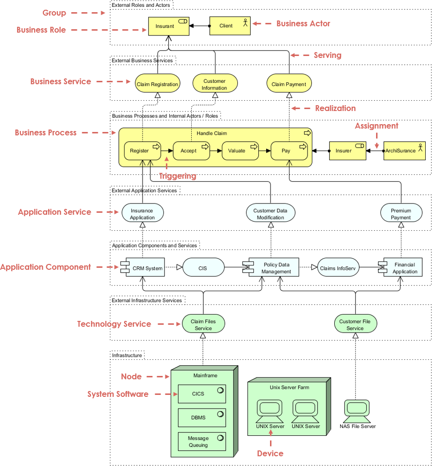
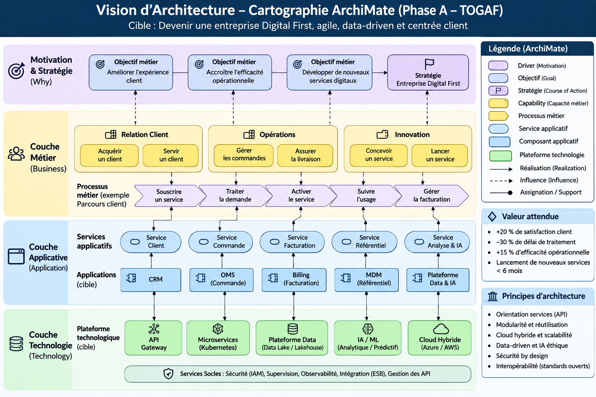
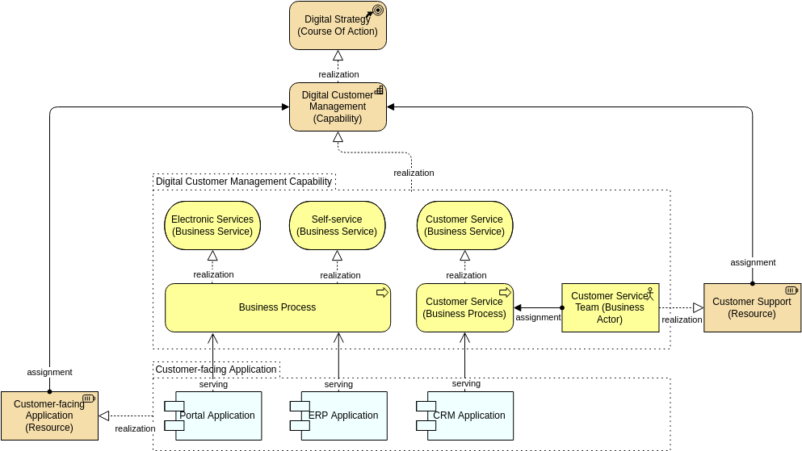
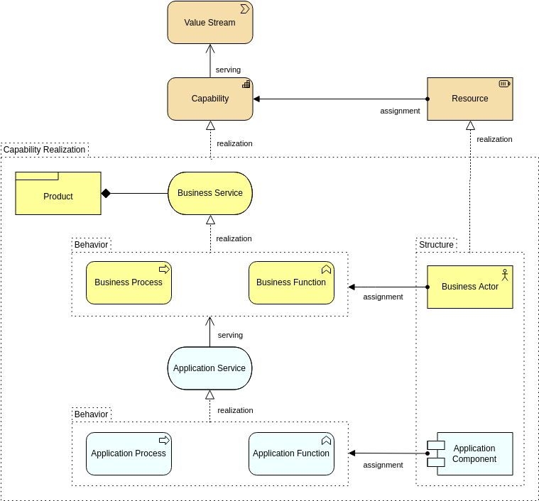
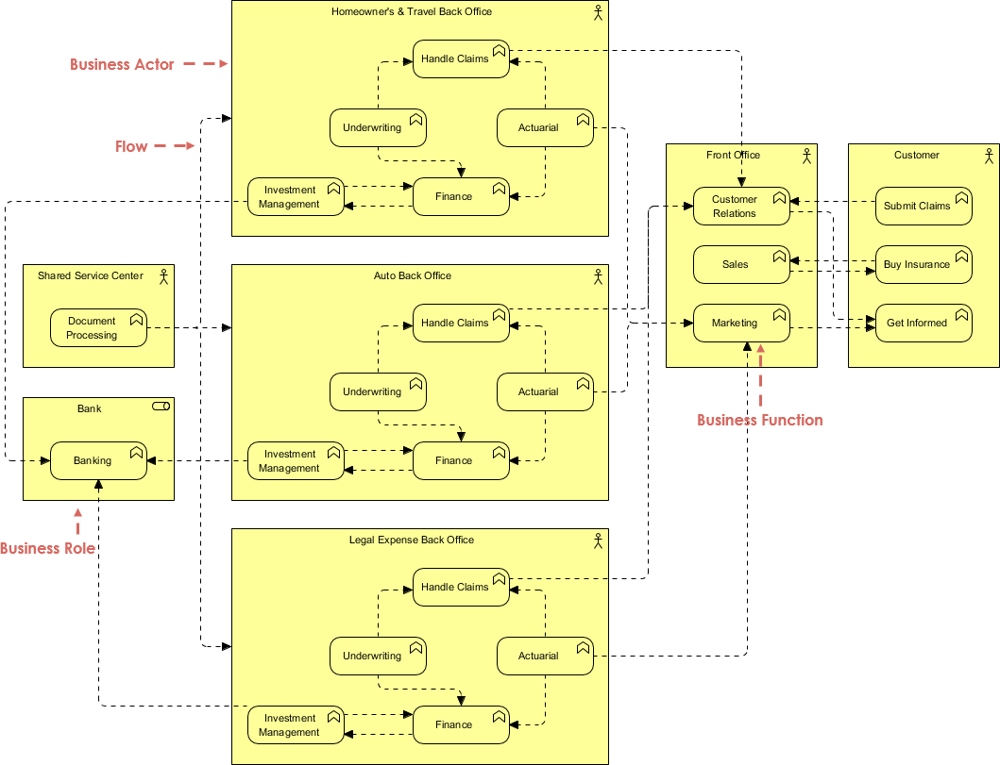

<a href="/en/architecture-entreprise/">01<strong>Enterprise Architecture</strong><small>TOGAF · ADM · governance</small></a><a href="/en/architecture-entreprise/archimate/" aria-current="page">02<strong>ArchiMate</strong><small>Architecture modelling</small></a><a href="/en/architecture-entreprise/togaf-techniques/">03<strong>TOGAF Techniques</strong><small>Examples and practices</small></a>

# Understanding ArchiMate

ArchiMate is an Enterprise Architecture modelling language. It provides shared concepts and relationships for describing motivation, business capabilities, processes, applications, data and technology. It complements TOGAF: the ADM structures the approach, while ArchiMate helps represent architectures and how they evolve.

## Main layers

ArchiMate views organize elements according to their role. The business layer describes actors, roles, processes and services. The application layer shows software components, functions and services. The technology layer represents the infrastructure and services that run applications. Motivation and strategy elements connect these layers to goals and capabilities.

This diagram presents the three main layers and realization relationships between business, application and technology elements.

<figure class="resource-figure"><figcaption>Business, application and technology layers in ArchiMate.</figcaption></figure>

## Connect the vision to architecture elements

A vision view clarifies goals, target capabilities and principles before solutions are detailed. Relationships between these elements provide a basis for decisions and the transformation roadmap.

This architecture vision example shows business goals, capabilities, application services and target technologies.

<figure class="resource-figure"><figcaption>Example architecture vision map.</figcaption></figure>

## Describe a capability and how it is realized

A capability expresses what the enterprise must be able to do. Processes, services and application components can then be linked to that capability to explain how it is realized. This view supports impact and responsibility analysis.

This view shows how a business capability can be planned from strategy and then detailed into services and processes.

<figure class="resource-figure"><figcaption>Example business capability planning.</figcaption></figure>

Capability realization can be described by linking products, services and business behaviour to application functions and components.

<figure class="resource-figure"><figcaption>Example of business capability realization.</figcaption></figure>

## Business Architecture modelled with ArchiMate

This ArchiMate diagram represents an insurance company’s <strong>Business Architecture</strong>. It shows business actors, the allocation of functions and information flows between entities, including customers, the Front Office, specialized Back Offices, shared services and the bank. Each entity performs specific functions such as claims management, underwriting, actuarial work, finance or customer relations. <em>Flow</em> relationships show exchanges between these functions. As a business-layer view aligned with Phase B of TOGAF ADM, it helps explain the functional organization, identify dependencies and duplicated activities, and spot opportunities to share or improve capabilities during information-system transformation.

<figure class="resource-figure"><figcaption>Business Architecture modelled with ArchiMate.</figcaption></figure>
