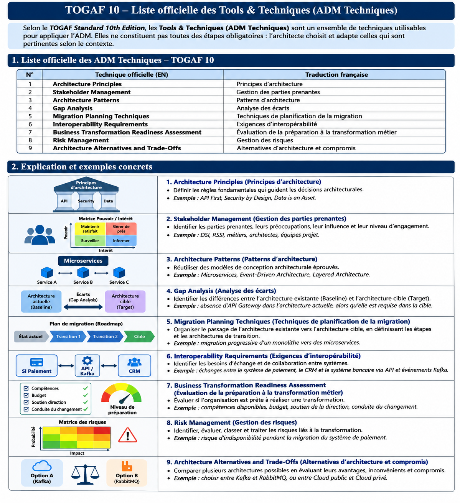
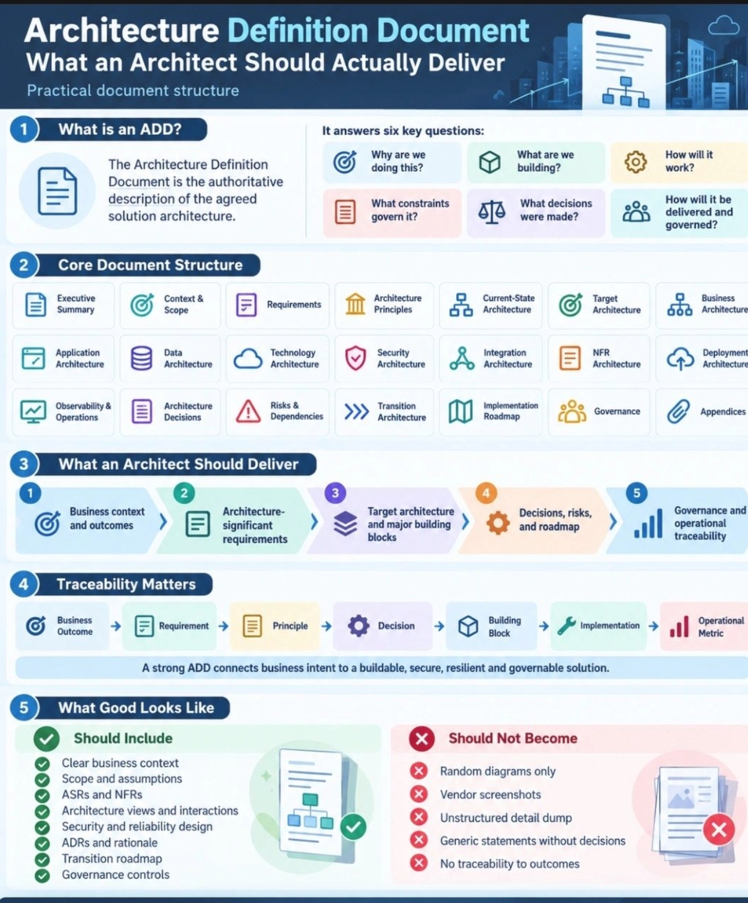
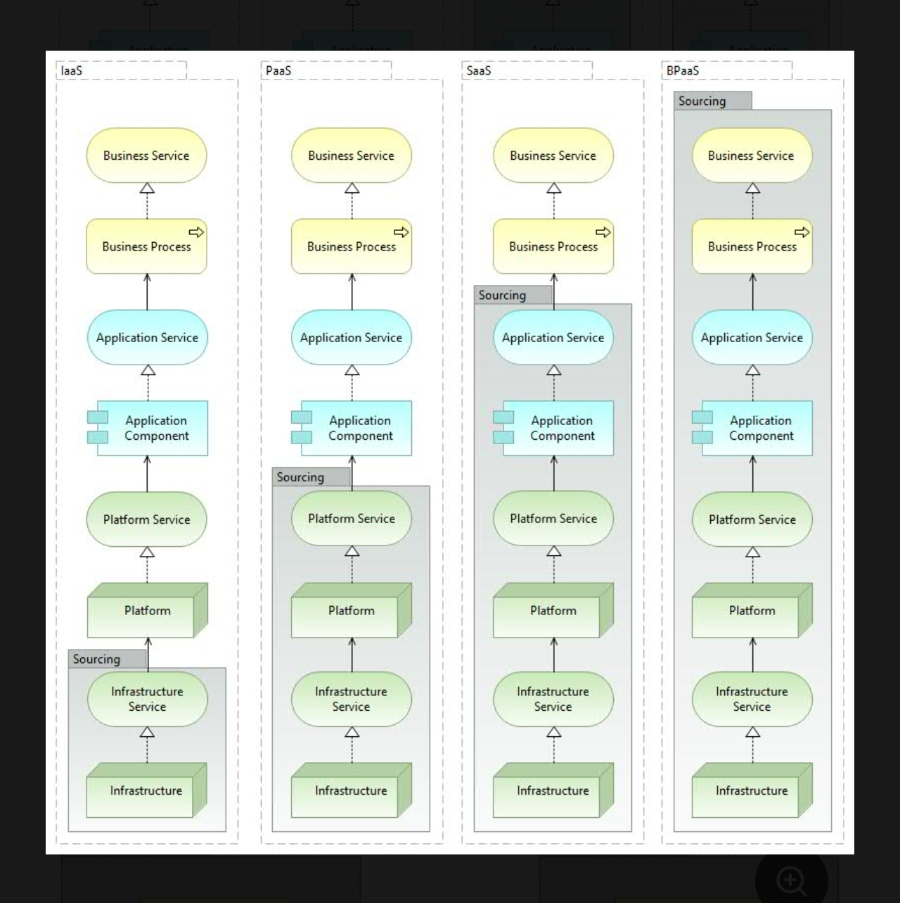
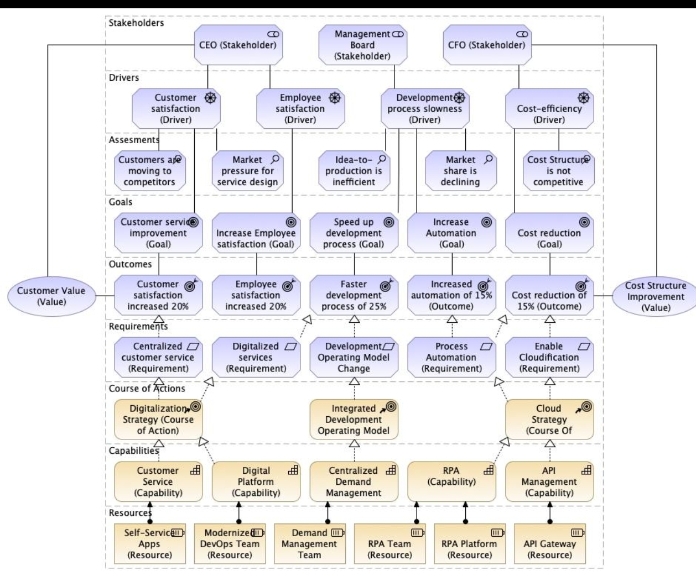

<a href="/en/architecture-entreprise/">01<strong>Enterprise Architecture</strong><small>TOGAF · ADM · governance</small></a><a href="/en/architecture-entreprise/archimate/">02<strong>ArchiMate</strong><small>Architecture modelling</small></a><a href="/en/architecture-entreprise/togaf-techniques/" aria-current="page">03<strong>TOGAF Techniques</strong><small>Examples and practices</small></a>

# Complementary Enterprise Architecture examples

The models below illustrate the domains and components of an Enterprise Architecture. They are overview views; check notation and relationships before treating them as formal ArchiMate models.

This map gives an overview of the domains and components that shape an Enterprise Architecture.

<figure class="resource-figure"><figcaption>Map of Enterprise Architecture domains and components.</figcaption></figure>

This reference architecture shows the main components of an enterprise AI platform and how they interact with data, models and operations.

<figure class="resource-figure"><figcaption>Enterprise AI reference architecture.</figcaption></figure>

# Domains, boundaries and applications

Domain-Driven Design helps identify subdomains and model boundaries. These views complement architecture maps by clarifying business language and dependencies between domains.

This example presents bounded contexts and relationships between domains, helping teams discuss ownership and integration.

<figure class="resource-figure"><figcaption>Domain-Driven Design and context maps.</figcaption></figure>

This view shows how a capability is realized through business processes, services and supporting applications.

<figure class="resource-figure"><figcaption>Business capability and application realization.</figcaption></figure>
