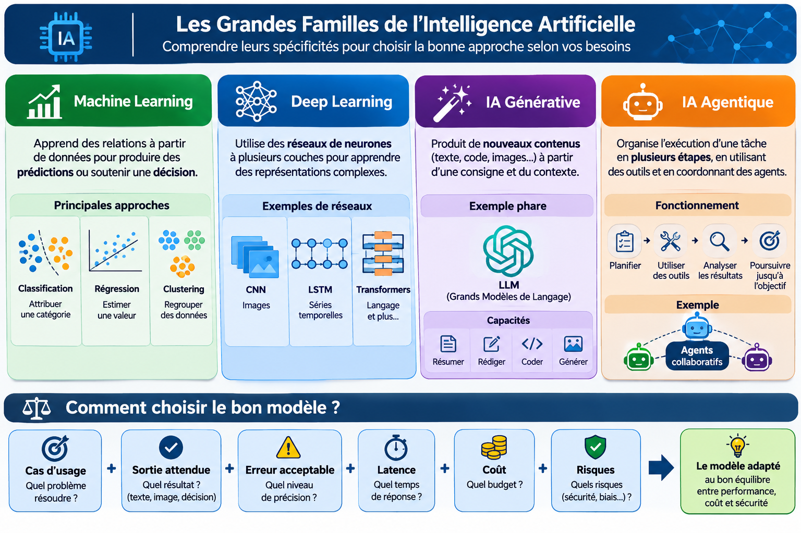
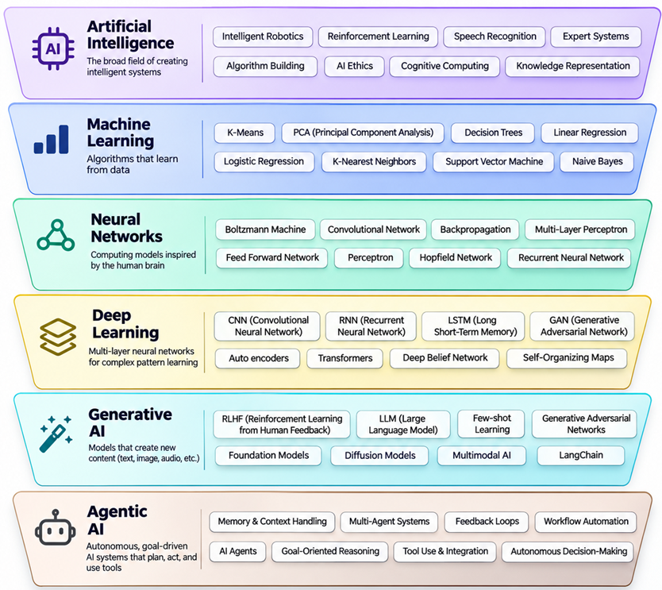

# 1. Main areas of artificial intelligence

<figure class="resource-figure"></figure>

**Machine Learning** learns patterns from data to make predictions or support decisions. It includes classification, which assigns a category; regression, which estimates a value; and clustering, which groups similar observations. [Read the guide to core algorithms]({{ '/en/ressources/revision-machine-learning/' | relative_url }}).

**Deep Learning** uses multi-layer neural networks to learn complex representations. Convolutional networks (**CNNs**) are common for images, recurrent networks such as **LSTMs** for sequences, and **Transformers** for language and other sequential tasks. [Explore Deep Learning, neural networks and LLMs]({{ '/en/ressources/tutoriel-ml-deep-learning-llm/' | relative_url }}).

**Generative AI** creates new content—such as text, code or images—from a prompt and context. Large language models (**LLMs**) are one example: they generate text, summarize, rephrase and answer questions.

**Agentic AI** organizes a task into several steps. An agent can plan, use tools or APIs, examine their results and continue towards a goal. Multiple agents can also coordinate specialized roles within one system. [Explore the agentic AI reference architecture]({{ '/en/ressources/agents-ia-rag-graphrag/' | relative_url }}).

Choose a model only after defining the use case, expected output, acceptable error, latency, cost and risks.

### 2. AI Architecture and Machine Learning

- [AI Enterprise Architecture Framework]({{ '/en/ressources/architecture-ia-framework/' | relative_url }})
- [Reference Architecture for Agentic AI Systems]({{ '/en/ressources/agents-ia-rag-graphrag/' | relative_url }})
- [Case study: C4 architecture for a credit agent]({{ '/en/ressources/architecture-c4-agent-credit/' | relative_url }})
- [Machine Learning: Core Algorithms]({{ '/en/ressources/revision-machine-learning/' | relative_url }})
- [Deep Learning: Neural Networks and LLMs]({{ '/en/ressources/tutoriel-ml-deep-learning-llm/' | relative_url }})

<figure class="resource-figure"></figure>

### From AI foundations to agentic systems

This diagram places the main AI domains in context, from Machine Learning and neural networks through Deep Learning and generative AI to agentic systems.
