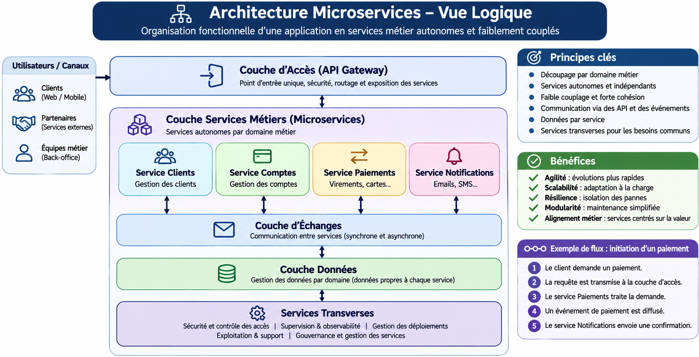

<a href="/en/architecture-entreprise/">01<strong>Enterprise Architecture</strong><small>TOGAF · ADM · governance</small></a><a href="/en/architecture-entreprise/archimate/">02<strong>ArchiMate</strong><small>Architecture modelling</small></a><a href="/en/architecture-entreprise/togaf-techniques/">03<strong>TOGAF Techniques</strong><small>Examples and practices</small></a>

# Logical view

A microservices architecture is a software architecture style that decomposes an application into autonomous, loosely coupled services organized around business capabilities.

Each microservice has a clearly defined functional responsibility and can be developed, deployed, maintained and evolved independently of other services.

Microservices communicate through contract-based interfaces, such as APIs, or through asynchronous events.

Core principles include business-domain decomposition, high functional cohesion, loose coupling, service autonomy and decentralized data ownership.

## Logical architecture components

<figure class="resource-figure"></figure>

### Users and channels

This layer represents the consumers of the system. It includes web and mobile apps for customers, internal applications for employees and partner systems that interact with the application.

Its role is to give different actors access to business capabilities without exposing the internal organization of the microservices.

### Access and exposure

This layer is the logical entry point to business services. It routes requests to the right services, controls access, applies security policies and manages the interfaces exposed to consumers.

### Business services — microservices

Each service owns a business capability, such as customers, accounts, payments or notifications. Services should be cohesive, independently deployable and responsible for their own data. Avoid splitting a service solely by technical layer.

### Communication and exchange

Services can communicate synchronously through APIs or asynchronously through messages and events. Choose based on response-time needs, coupling, consistency and failure handling.

### Data layer

Each service should own the data it needs and expose it through an explicit contract. A shared database can create tight coupling and make independent evolution harder. Cross-service consistency may require events, idempotency and compensating actions.

### Cross-cutting services

Security, observability, resilience, configuration, deployment automation, support and service governance apply across the architecture.

# Technical view

## Core technical building blocks

The architecture uses complementary technical layers. Each has a specific role in running, connecting, securing and operating microservices.

| Component | Technical role | Example technologies |
|---|---|---|
| **Frontend** | Provide web and mobile user interfaces. | Angular, React, iOS, Android |
| **API Gateway** | Centralize API access, route requests and apply security policies. | Kong, Apache APISIX, NGINX |
| **IAM / SSO** | Manage authentication, identities and authorization. | Keycloak, OAuth 2.0, OIDC |
| **Backend microservices** | Implement business functions in independent services. | Spring Boot, Quarkus, .NET, Node.js |
| **Databases** | Store and persist data owned by each service. | PostgreSQL, MySQL, MongoDB, Oracle |
| **Event messaging** | Enable asynchronous communication between services. | Apache Kafka |
| **Service discovery** | Let services find the addresses of their instances. | Consul, Kubernetes |
| **Configuration** | Centralize and distribute application settings. | Spring Cloud Config |
| **Cache** | Speed up access to frequently used data. | Redis |
| **Resilience** | Handle failures, timeouts and retries. | Resilience4j |
| **Observability** | Collect metrics, logs and distributed traces. | Prometheus, Grafana, OpenTelemetry |
| **Centralized logging** | Collect, index and search application logs. | Elasticsearch, Logstash, Kibana |
| **Containerization** | Package applications with their dependencies. | Docker |
| **Orchestration** | Automate deployment, availability and scaling. | Kubernetes |
| **CI/CD** | Automate building, testing and delivery. | GitLab CI, GitHub Actions, Argo CD |
| **Infrastructure as Code** | Automate infrastructure provisioning and configuration. | Terraform, Helm |

These technologies are not all mandatory. Some are alternatives; others complement each other. For example, PostgreSQL and MongoDB suit different data needs, while Docker packages applications and Kubernetes orchestrates them.

## How the components work together

In a banking payment scenario:

1. The customer starts an operation in an Angular, React or mobile app.
2. The API Gateway receives the request and applies controls, with Keycloak handling authentication.
3. The Payments microservice, perhaps built with Spring Boot, runs the business rules.
4. The service stores payment data in its PostgreSQL database.
5. Apache Kafka publishes a business event, which the Notifications service consumes.
6. Prometheus, Grafana and logging tools monitor execution.
7. Docker and Kubernetes run and orchestrate the services.

# Benefits of microservices

Microservices can improve agility, scaling, resilience, modularity and maintainability when service boundaries reflect real business capabilities. They also introduce distributed-system complexity: network failures, observability needs, data consistency and platform operations must be addressed deliberately.
