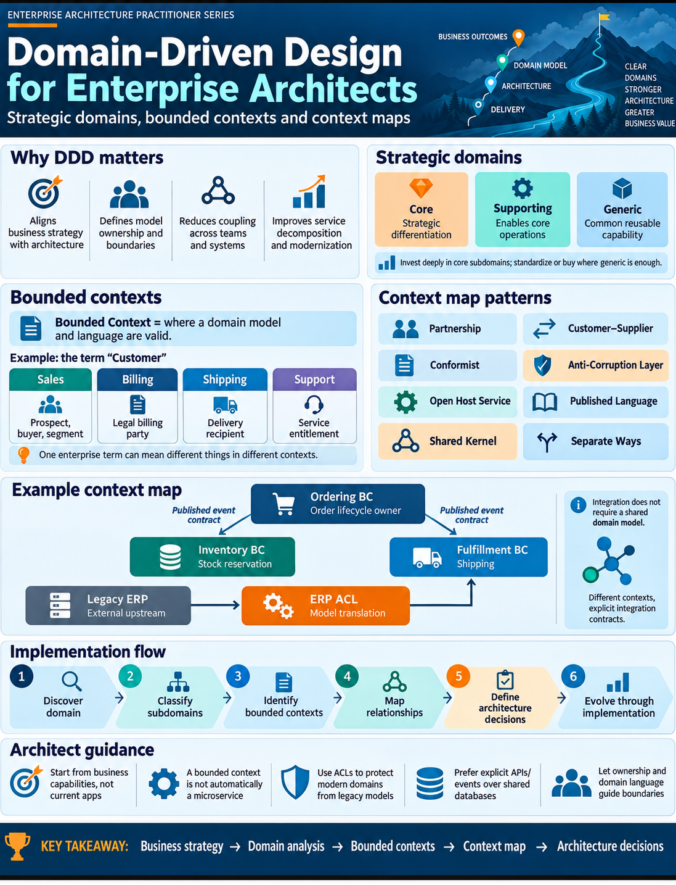

# 1. What is an architecture pattern?

A pattern is a reusable solution to a recurring architecture or design problem. It describes a context, a problem, a typical solution, its consequences and its limitations. It is neither a product to install nor a recipe to apply everywhere.

# 2. Domain-Driven Design (DDD)

*Domain-Driven Design* organizes services around the business domain rather than technical layers.

- **Domain:** the business area being studied.
- **Subdomain:** a part of the domain (core, supporting or generic).
- **Bounded Context:** a boundary within which a model and business vocabulary have a consistent meaning.
- **Ubiquitous Language:** shared language between domain experts and the delivery team.

For a video platform, separate contexts might include Catalogue, Subscription, Identity, Playback and Billing. A bounded context does not automatically equal one microservice. Technical boundaries also depend on data, transactions, rate of change, security and team ownership.

<figure class="resource-figure ddd-figure"><figcaption>Domain-Driven Design: strategic domains, bounded contexts and context maps.</figcaption></figure>

# 3. Hexagonal architecture (Ports and Adapters)

The domain is at the centre. Interactions pass through ports and adapters:

- **Inbound port:** defines how a capability is called.
- **Inbound adapter:** REST API, user interface or message consumer.
- **Outbound port:** describes a required dependency.
- **Outbound adapter:** database, broker or external service.

The goal is to keep the business core independent of frameworks, networks and storage. This makes testing and technology replacement easier, at the cost of additional interfaces and structure.

# 4. CQRS

CQRS (*Command Query Responsibility Segregation*) separates commands that change state from queries that read information.

- **Command:** `ActivateSubscription`.
- **Query:** `GetSubscription`.

The separation can start in code without requiring two databases. More advanced architectures use separate read models updated asynchronously. This enables fit-for-purpose reads, but adds eventual consistency, duplication and monitoring.

# 5. Event Sourcing

Event Sourcing stores the events that describe state changes instead of storing only the latest state.

`AccountCreated → DepositMade → WithdrawalMade → AccountBlocked`

The current state can be rebuilt by replaying events, sometimes from a snapshot.

Event-driven architecture is a communication style; Event Sourcing makes events the source of truth for state. An event-driven system does not necessarily use Event Sourcing.

# 6. Saga

A Saga breaks a business process into local transactions. Each step can have a compensating action if a later step fails.

For example, book a flight, reserve a hotel, take payment and confirm the trip. If payment fails, earlier reservations may be cancelled according to business rules.

- **Choreography:** each service reacts to events.
- **Orchestration:** a coordinator directs the steps and compensations.

A compensation is a business action that corrects effects already produced; it is not always an exact technical rollback.

# 7. Circuit Breaker and Bulkhead

A **Circuit Breaker** protects a system from repeated calls to a failing dependency:

- **Closed:** calls proceed normally.
- **Open:** calls are temporarily blocked.
- **Half-open:** a few calls test recovery.

A **Bulkhead** isolates resources or execution pools so that overload cannot consume all available capacity. These patterns complement timeouts, bounded retries, backoff, rate limits and fallbacks.

# 8. BFF, API Gateway, Service Discovery and Sidecar

| Pattern | Problem | Role |
|---|---|---|
| API Gateway | API exposure and control | Routing, authentication and quotas |
| BFF | Different needs across channels | API tailored to web, mobile or TV |
| Service Discovery | Finding service instances | Dynamic endpoint discovery |
| Sidecar | Adding cross-cutting capabilities | Proxy, telemetry and security |
| Service Mesh | Governing communication | Identity, encryption, policies and telemetry |

These patterns add capabilities, but also components, rules and operational costs.

# 9. Orchestration: Camunda, Airflow and Temporal

- **Camunda:** business processes, BPMN, human approvals and decisions.
- **Apache Airflow:** scheduled Data pipelines and DAG-based tasks.
- **Temporal:** durable application workflows with state, timers and retries.
- **Kubernetes:** container and workload orchestration, not a BPM engine.
- **Argo Workflows:** container workflows often run on Kubernetes.

Camunda and Airflow can cooperate: Camunda manages the business journey; Airflow runs the technical pipeline. Plan for asynchronous communication, correlation IDs, idempotency, timeouts and retries.

# 10. Choosing and documenting a pattern

Before adopting a pattern, document the problem, context, requirements, options, benefits, costs, risks and operating conditions. Use an Architecture Decision Record (ADR) to capture the decision and its consequences.
