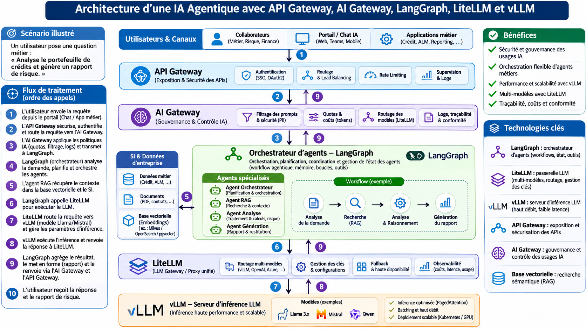
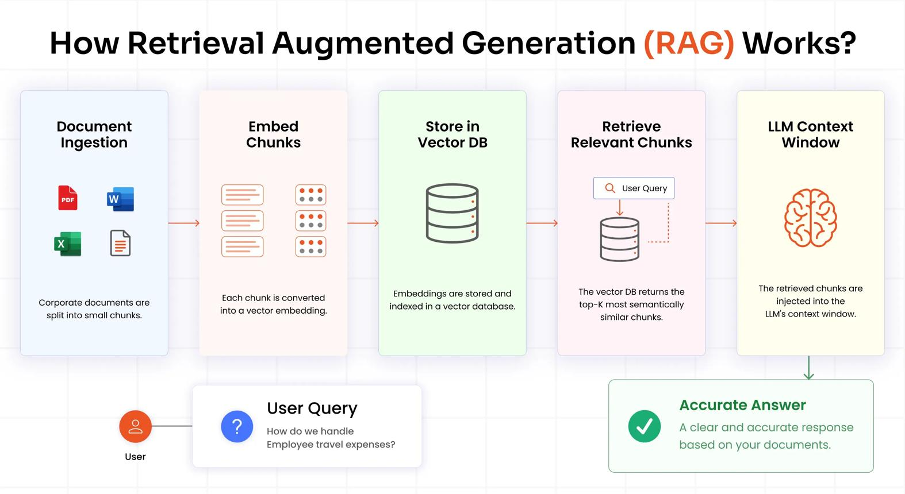

AI ARCHITECTURE · REFERENCE DOCUMENT

<h2>Summary</h2>

<a href="#comprendre-ia-agentique">1. Understanding agentic AI</a>

<a href="#technologies-ecosysteme">2. The 36 technologies of the ecosystem</a>

<a href="#architecture-technique-reference">3. Technical reference architecture</a>

<a href="#rag-graphrag-neo4j">4. RAG, GraphRAG and Neo4j</a>

<a href="#exemple-bout-en-bout">5. End-to-end example: processing a customer request</a>

<a href="#choisir-stack-technologique">6. Choosing a technology stack</a>

<a href="#securite-gouvernance">7. Security, governance and non-functional requirements</a>

<a href="#demarche-realisation">8. Production approach and industrialization</a>

<a href="#glossaire-points-cles">9. Glossary and key points for the architect</a>

<figure class="resource-figure"><figcaption>Agentic architecture with API Gateway, AI Gateway, LangGraph, LiteLLM and vLLM.</figcaption></figure>
<h2 id="comprendre-ia-agentique">1. Understanding agentic AI</h2>

An LLM (Large Language Model) is a model capable of understanding and generating content. An AI agent uses one or more models to pursue a goal: it interprets a request, plans steps, selects tools, executes actions, observes the results and can adjust its plan. A multi-agent system distributes work between several specialized agents.

<table><tr><td>
Concept
</td><td>
Definition
</td><td>
Example
</td></tr><tr><td>
LLM
</td><td>
Language model that generates or analyzes content.
</td><td>
GPT answers a question.
</td></tr><tr><td>
AI agent
</td><td>
Decision loop that combines model, instructions, state and tools.
</td><td>
An agent consults a file and then creates a task.
</td></tr><tr><td>
Multi-agent
</td><td>
Multiple coordinated agents, with distinct roles.
</td><td>
Research, analysis, validation and writing.
</td></tr><tr><td>
Workflow
</td><td>
Explicit sequence of steps, rules and transitions.
</td><td>
Check a file then request approval.
</td></tr><tr><td>
RAG
</td><td>
Search for external knowledge to enrich the model context.
</td><td>
Find useful passages in a contract.
</td></tr><tr><td>
GraphRAG
</td><td>
Search using the entities and relationships of a knowledge graph.
</td><td>
Identify dependencies between customer, contract and warranty.
</td></tr></table>

<table><tr><td>
Takeaway 
An agent is not just a chatbot. As soon as it can act on an IS, it is necessary to regulate its tools, its rights, its limits, its validations, its traceability and its recovery mechanisms.
</td></tr></table>

<h2 id="technologies-ecosysteme">2. The 36 technologies of the ecosystem</h2>

The list below includes the 36 elements of the initial infographic. She classifies them by role. Some elements are frameworks, others models, inference engines, memory platforms or observability tools: they are therefore not all competitors.

<h3>2.1 Frameworks and orchestration — 12 technologies</h3>

<table><tr><td>
Technology
</td><td>
Definition
</td><td>
Main utility
</td><td>
Example
</td></tr><tr><td>
1. LangGraph
</td><td>
Orchestration framework based on graphs and explicit state.
</td><td>
Workflows with branches, loops, checkpoints, restarts and human validations.
</td><td>
Disaster handler with conditional steps.
</td></tr><tr><td>
2. OpenAI Agents SDK
</td><td>
SDK to create agents with tools, delegation and guardrails.
</td><td>
Handoffs between agents, tool calling, sessions and traces.
</td><td>
A support agent delegates technical analysis to a specialized agent.
</td></tr><tr><td>
3. Claude Agent SDK
</td><td>
SDK giving access to the agentic capabilities of Claude Code.
</td><td>
Agents manipulating files, commands and tools within a permissions framework.
</td><td>
Analysis of a code repository and proposal for a fix.
</td></tr><tr><td>
4. Google ADK
</td><td>
Agent Development Kit from Google for developing agents and multi-agent systems.
</td><td>
Sequential, parallel or hierarchical agents, Google Cloud integration.
</td><td>
A supervisor distributes searches to multiple agents.
</td></tr><tr><td>
5. Microsoft Agent Framework
</td><td>
Microsoft framework for building agents and workflows, following on from AutoGen and Semantic Kernel.
</td><td>
Orchestration, middleware and .NET/Python and Microsoft integration.
</td><td>
Agents integrated into an Azure and .NET IS.
</td></tr><tr><td>
6. CrewAI
</td><td>
Framework for agent teams structured by roles and objectives.
</td><td>
Collaboration of specialists with distinct tasks and responsibilities.
</td><td>
Market analyst, financial analyst and writer.
</td></tr><tr><td>
7. Pydantic AI
</td><td>
Python framework with emphasis on types and structured output.
</td><td>
Validation of I/O, dependencies and data contracts.
</td><td>
Generation of a JSON object conforming to the business model.
</td></tr><tr><td>
8. Mastra
</td><td>
TypeScript framework for agents, workflows, memory and evaluations.
</td><td>
Development of agentic applications in the JavaScript ecosystem.
</td><td>
Business assistant in a Node.js application.
</td></tr><tr><td>
9. Vercel AI SDK
</td><td>
TypeScript library for integrating AI models and interactions into applications.
</td><td>
Streaming, model calls, tools and user interface.
</td><td>
Next.js conversational assistant.
</td></tr><tr><td>
10. LlamaIndex
</td><td>
Data-driven framework for connecting LLMs to information sources.
</td><td>
Ingestion, parsing, indexing, retrieval, RAG and data-driven agents.
</td><td>
Wizard querying internal documentation.
</td></tr><tr><td>
11. Strands Agents
</td><td>
AWS open source agentic framework, driven by an agent loop.
</td><td>
Agents using tools and templates in AWS or hybrid environments.
</td><td>
Cloud Infrastructure Diagnostic Agent.
</td></tr><tr><td>
12. smolagents
</td><td>
Hugging Face's lightweight framework for creating Python agents.
</td><td>
Prototyping agents that can use tools and execute code.
</td><td>
Agent parsing a CSV file.
</td></tr></table>

<h3>2.2 Models and runtime — 12 elements</h3>
<h4>Model families</h4>

<table><tr><td>
Model
</td><td>
Definition
</td><td>
Utility
</td></tr><tr><td>
13. Claude
</td><td>
Anthropic model family.
</td><td>
Reasoning, programming, documentary analysis and use of tools.
</td></tr><tr><td>
14.GPT
</td><td>
OpenAI model family.
</td><td>
Generation, reasoning, multimodality and function calls.
</td></tr><tr><td>
15. Gemini
</td><td>
Google model family.
</td><td>
Text, image, audio, video and long contexts depending on the model.
</td></tr><tr><td>
16. Qwen
</td><td>
Alibaba Model Family.
</td><td>
Open or accessible models for language, code, vision and reasoning.
</td></tr><tr><td>
17. DeepSeek
</td><td>
DeepSeek Model Family.
</td><td>
Reasoning, code and open weight models.
</td></tr><tr><td>
18. GLM
</td><td>
Zhipu AI Model Family.
</td><td>
Language, reasoning, programming and agentic uses.
</td></tr></table>

<h4>Serving, routing and execution</h4>

<table><tr><td>
Technology
</td><td>
Definition
</td><td>
Utility
</td></tr><tr><td>
19. vLLM
</td><td>
Powerful LLM serving/inference engine.
</td><td>
Serving models on GPU with high throughput and concurrent query handling.
</td></tr><tr><td>
20. Ollama
</td><td>
Tool that simplifies the downloading and local execution of models.
</td><td>
Development, testing, PoC and simple local inference.
</td></tr><tr><td>
21. LiteLLM
</td><td>
SDK and proxy unifying access to many model providers.
</td><td>
Routing, fallback, budgets, keys, quotas and common interface.
</td></tr><tr><td>
22. OpenRouter
</td><td>
Hosted service for access and routing to many models.
</td><td>
Experiment and select models via a unified API.
</td></tr><tr><td>
23. Modal
</td><td>
Cloud platform for executing workloads, including GPU.
</td><td>
Deploy AI processing without directly administering the entire GPU infrastructure.
</td></tr><tr><td>
24. E2B
</td><td>
Isolated sandbox environments for running code.
</td><td>
Execute agent-generated code without running it in the main application server.
</td></tr></table>

<table><tr><td>
Important distinction 
GPT, Claude, Gemini, Qwen, DeepSeek and GLM are model families. vLLM and Ollama are used to run models. LiteLLM and OpenRouter make access and routing easier. Modal provides cloud execution resources and E2B isolated environments.
</td></tr></table>

<h3>2.3 Memory, evaluation and operations — 12 elements</h3>

<table><tr><td>
Technology
</td><td>
Definition
</td><td>
Utility
</td></tr><tr><td>
25. Mem0
</td><td>
Memory layer that extracts, stores and retrieves useful information.
</td><td>
Preferences and useful facts of a user or session.
</td></tr><tr><td>
26. Letta
</td><td>
Framework for building persistent agents that manage their memory.
</td><td>
Agents capable of maintaining and updating a memory state.
</td></tr><tr><td>
27. Zep
</td><td>
Conversational memory and temporal knowledge platform.
</td><td>
Find facts and relationships that evolve over time.
</td></tr><tr><td>
28. LangSmith
</td><td>
Tracing, debugging and evaluation platform, associated with the LangChain ecosystem.
</td><td>
Understand the steps, LLM calls, tools and errors.
</td></tr><tr><td>
29. Langfuse
</td><td>
LLM/agents observability platform, available as open source.
</td><td>
Traces, prompts, tokens, costs, latency and sessions.
</td></tr><tr><td>
30. Braintrust
</td><td>
Platform for evaluating and improving AI applications.
</td><td>
Compare prompts, templates and versions from datasets.
</td></tr><tr><td>
31. Arize Phoenix
</td><td>
LLM application observability and assessment tool.
</td><td>
Analyze traces, RAG, relevance and agentic behavior.
</td></tr><tr><td>
32. Ragas
</td><td>
Framework for evaluating RAG systems and AI applications.
</td><td>
Measure relevance of context, fidelity and quality of responses.
</td></tr><tr><td>
33. DeepEval
</td><td>
Testing framework for LLM applications, close to pytest.
</td><td>
Automate quality and behavior testing in CI/CD.
</td></tr><tr><td>
34. promptfoo
</td><td>
Prompt testing tool, model comparison and red teaming.
</td><td>
Detect injection prompts, leaks and unwanted behavior.
</td></tr><tr><td>
35. Temporal
</td><td>
Sustainable execution platform for distributed workflows.
</td><td>
Retries, timeouts, crash recovery, and long-running processes.
</td></tr><tr><td>
36. Composio
</td><td>
Platform for connecting agents to external applications and services.
</td><td>
Integrate SaaS tools and manage connections/authentications.
</td></tr></table>

<h2 id="architecture-technique-reference">3. Technical reference architecture</h2>

The target architecture separates responsibilities to limit the coupling between orchestration, models, data, business tools and infrastructure. Technologies are implementation options: it is not necessary to deploy them all.

Detailed view of multi-agent architecture with RAG and GraphRAG

<table><tr><td>
Layer
</td><td>
Responsibility
</td><td>
Possible technologies
</td></tr><tr><td>
1. Channels and users
</td><td>
Web/mobile interfaces, client APIs, business users and support.
</td><td>
React, Angular, REST, GraphQL.
</td></tr><tr><td>
2. Exposure and Security
</td><td>
Point of entry, authentication, authorization, quotas, validation and audit.
</td><td>
API Gateway, OAuth2/OIDC, RBAC/ABAC, rate limiting.
</td></tr><tr><td>
3. Multi-agent orchestration
</td><td>
Scheduling, state, delegation, conditions, execution loop and human validation.
</td><td>
LangGraph, OpenAI Agents SDK, Google ADK, CrewAI.
</td></tr><tr><td>
4. Models and inference
</td><td>
Choice of model, cloud or on-premise access, serving and fallback.
</td><td>
LiteLLM, GPT/Claude/Gemini, Ollama, vLLM.
</td></tr><tr><td>
5. Knowledge and memory
</td><td>
Documentary research, relational research, conversational memory and business data.
</td><td>
LlamaIndex, Neo4j, pgvector/Milvus, Mem0/Zep, PostgreSQL.
</td></tr><tr><td>
6. IS Integration
</td><td>
Controlled access to APIs, tools, events and business systems.
</td><td>
MCP, REST API, Spring Boot, Kafka, ERP/CRM.
</td></tr><tr><td>
7. Observability and quality
</td><td>
Traces, metrics, logs, evaluation, security tests and audit.
</td><td>
Langfuse, LangSmith, Phoenix, Ragas, DeepEval, promptfoo.
</td></tr><tr><td>
8. Infrastructure and operations
</td><td>
Containers, orchestration, sustainable workflows, CI/CD and monitoring.
</td><td>
Docker, Kubernetes, Temporal, GitLab/GitHub CI/CD, Prometheus/Grafana.
</td></tr></table>

<h3>3.1 Role of structuring components</h3>
<h4>LangGraph — orchestrator</h4>

Manages the execution graph: state, transitions, loops, conditions, checkpoints and possible human validation. It does not replace business APIs.

<h4>LlamaIndex — data/RAG layer</h4>

Connects sources, parses and slices documents, builds indexes and retrieves relevant passages. It can participate in RAG workflows and data-driven agents.

<h4>LiteLLM — Model Gateway</h4>

Provides a common access point for vendors and models. It can apply routing, fallback, budgets and policies. It does not replace the agentic orchestrator.

<h4>Ollama — local execution</h4>

Useful for developing and testing with local models. It is not automatically the best choice for a large-scale GPU serving platform.

<h4>vLLM — production serving</h4>

Suitable for exposing self-hosted models on GPU, especially when throughput and concurrency are important. It requires GPU mining capability.

<h4>MCP — Tool Integration</h4>

Standardizes the way a compatible client discovers and invokes tools or resources. REST APIs remain relevant for business contracts and traditional integrations.

<h4>Kafka — events</h4>

Decouples producers and consumers, transports business events and facilitates asynchronous processing. It is not a replacement for a sustainable workflow engine.

<h4>Temporal — durability</h4>

Handles long processes, restarts, retries and timeouts. LangGraph can carry agentic logic while Temporal carries the sustainability of a global process.

<h2 id="rag-graphrag-neo4j">4. RAG, GraphRAG and Neo4j</h2>

RAG (Retrieval-Augmented Generation) enriches the context passed to the model by searching for information in external sources. GraphRAG adds an explicit representation of entities and their relationships. The two approaches are complementary.

<h3>4.1 Vector RAG</h3>

Collection: retrieve documents from EDM, SharePoint, Confluence, databases or files.

Parsing: extract text and metadata.

Chunking: cut content into segments suitable for search.

Embeddings: transform segments into digital vectors.

Indexing: store vectors and metadata in pgvector, Milvus, Weaviate or another vector base.

Retrieval: search for segments close to the question, then optionally rerank the results.

Augmentation: inject the passages retained in the context of the LLM with their references.

Generation: Produce a response based on the retrieved items.

<h3>4.2 GraphRAG and Neo4j</h3>

A Knowledge Graph represents business objects as nodes and relationships. Neo4j is a graph-oriented database that allows you to store and query these structures, particularly with the Cypher language.

<table><tr><td>
Element
</td><td>
Bank example
</td></tr><tr><td>
Node
</td><td>
Customer, Credit, Contract, Guarantee, Rate, Agency.
</td></tr><tr><td>
Relationship
</td><td>
CUSTOMER_HOLDS_CREDIT, CREDIT_GUARANTEED_BY, RATE_APPLICABLE TO.
</td></tr><tr><td>
Property
</td><td>
Signature date, amount, status, maturity, rate.
</td></tr><tr><td>
Query
</td><td>
Which contracts linked to this customer are exposed to a rate increase?
</td></tr></table>

<h3>4.3 Vector RAG and GraphRAG: comparison</h3>

<table><tr><td>
Criterion
</td><td>
Vector RAG
</td><td>
GraphRAG / Knowledge Graph
</td></tr><tr><td>
Principle
</td><td>
Semantic similarity between query and passages.
</td><td>
Exploring entities and relationships.
</td></tr><tr><td>
Adapted data
</td><td>
Documents, paragraphs, FAQs, procedures.
</td><td>
Relational data, dependencies, entity networks.
</td></tr><tr><td>
Sample question
</td><td>
Where is the refund rule?
</td><td>
What products, contracts and guarantees are linked to this customer?
</td></tr><tr><td>
Force
</td><td>
Find relevant content even if the words differ.
</td><td>
Answer multi-relationship and contextualized questions.
</td></tr><tr><td>
Limit
</td><td>
May miss an implicit relationship or dependency chain.
</td><td>
Requires a quality graph and consistent modeling.
</td></tr></table>

<h3>4.4 RAG + GraphRAG hybrid architecture</h3>

The “Knowledge &amp; AI Data” block distinguishes documentary search and knowledge graph.

LlamaIndex ingests documents and prepares document indexes.

The extraction pipeline identifies useful entities, relationships, and metadata.

Neo4j stores knowledge graph; Cypher queries explore relevant relationships.

The vector base stores embeddings for semantic search.

The hybrid retrieval component combines documentary passages and graph results.

LangGraph passes the consolidated context to the analytics agent or business agent.

The LLM formulates a response with sources, limitations and supporting elements.

<table><tr><td>
Design Point 
Neo4j does not necessarily replace pgvector or Milvus. The graph answers relational questions; the vector base responds to similarity search. A hybrid architecture can use both.
</td></tr></table>

<h3>4.5 Example Question GraphRAG</h3>

Question: “What risks are associated with this customer’s mortgage if rates increase?” »

The RAG finds the contract clauses, rate procedures and regulatory documents.

Neo4j links the customer to his credit, the credit to his rate, the credit to his guarantees and the guarantees to the contractual conditions.

The hybrid retrieval assembles documentary extracts and graph relationships.

An analysis agent reviews the scenarios and a compliance agent verifies the applicable rules.

An agent writes an explainable summary, with documentary references and hypotheses.

<h2 id="exemple-bout-en-bout">5. End-to-end example: processing a customer request</h2>

Use case: a customer requests reimbursement for an operation. The agent must analyze the file, consult the business data, check the rules and possibly trigger an action under control.

<table><tr><td>
Step
</td><td>
Processing
</td><td>
Components
</td></tr><tr><td>
1. Receipt
</td><td>
The customer submits their request from the web portal or mobile application.
</td><td>
Web/mobile front
</td></tr><tr><td>
2. Security
</td><td>
The API Gateway authenticates the user, controls rights and enforces quotas.
</td><td>
API Gateway, OIDC, RBAC
</td></tr><tr><td>
3. Orchestration
</td><td>
LangGraph initializes the case state and chooses the necessary agents and steps.
</td><td>
LangGraph
</td></tr><tr><td>
4. Document search
</td><td>
The agent searches for useful procedures and contracts.
</td><td>
LlamaIndex + vector base
</td></tr><tr><td>
5. Relational search
</td><td>
The agent identifies the relationships between customer, order, payment and contract.
</td><td>
Neo4j / GraphRAG
</td></tr><tr><td>
6. Reasoning
</td><td>
The model analyzes the retrieved elements and identifies missing information.
</td><td>
LiteLLM + cloud or local model
</td></tr><tr><td>
7. Business tools
</td><td>
The agent consults the business APIs and can prepare an operation.
</td><td>
MCP and Spring Boot API
</td></tr><tr><td>
8. Validation
</td><td>
A sensitive operation is subject to human validation.
</td><td>
Human-in-the-loop
</td></tr><tr><td>
9. Execution
</td><td>
The authorized business service performs the operation and publishes an event.
</td><td>
Business API + Kafka
</td></tr><tr><td>
10. Traceability
</td><td>
Decisions, tools called, durations, costs and results are traced and evaluated.
</td><td>
Langfuse + evaluations
</td></tr></table>

<h2 id="choisir-stack-technologique">6. Choosing a technology stack</h2>
<h3>6.1 Prototype / MVP</h3>

Python + LangGraph for agentic workflow.

LlamaIndex for ingestion, indexing and RAG.

Ollama to locally test compatible models.

PostgreSQL + pgvector for data and vectors.

Neo4j only if the use case already requires complex relationships.

Langfuse for first traces and analyses.

<h3>6.2 Hybrid Enterprise Production</h3>

Spring Boot for Business Services and API Contracts.

Python + LangGraph for agentic orchestration.

LlamaIndex for the document ingestion and retrieval chain.

Neo4j for relational knowledge when business value is demonstrated.

LiteLLM as a gateway to cloud and self-hosted models.

GPT, Claude or Gemini for cloud models; vLLM to serve self-hosted models on GPU.

Ollama for local development and testing, rather than as an automatic production serving choice.

PostgreSQL, Redis and vector base depending on persistence, cache and search needs.

MCP and REST API for access to business tools and systems; Kafka for events.

Langfuse, Ragas, DeepEval and promptfoo for observability, evaluation and security testing.

Docker, Kubernetes and Temporal depending on deployment needs and sustainable workflows.

<h3>6.3 Sovereign / self-hosted infrastructure</h3>

LangGraph for orchestration.

Qwen, DeepSeek or GLM depending on evaluation results, license and constraints.

vLLM to serve models on GPU.

LlamaIndex for RAG pipelines.

Neo4j for business relationships and pgvector/Milvus for vector search.

Langfuse and Phoenix for supervision.

Kubernetes with GPU management, secrets, storage and networking.

<table><tr><td>
Selection rule 
Do not select a technology because it appears in a list. Start from the use case, data, level of risk, latency, volume, cost, sovereignty and available skills.
</td></tr></table>

<h2 id="securite-gouvernance">7. Security, governance and non-functional requirements</h2>

<table><tr><td>
Domain
</td><td>
Actions to be taken
</td></tr><tr><td>
Identity and authorization
</td><td>
Strong authentication, OAuth2/OIDC, RBAC/ABAC, technical identity by service and least privilege.
</td></tr><tr><td>
Tool Rights
</td><td>
Explicitly authorize each tool, each action, and each data scope. Separate reading and writing.
</td></tr><tr><td>
Human validation
</td><td>
Require approval for payments, refunds, sensitive data changes, or irreversible actions.
</td></tr><tr><td>
Protection against prompt injection
</td><td>
Treat external documents and content as untrusted data; filter and control instructions.
</td></tr><tr><td>
Personal data
</td><td>
Minimization, encryption, retention, access control, logging and GDPR compliance.
</td></tr><tr><td>
Secrets
</td><td>
Never place API keys, passwords or tokens in prompts or traces; use a chest of secrets.
</td></tr><tr><td>
Traceability
</td><td>
Retain query IDs, prompt/template versions, called tools, decisions and results, with retention policy.
</td></tr><tr><td>
Resilience
</td><td>
Timeouts, bounded retries, idempotence, circuit breakers, fallback and workflow recovery.
</td></tr><tr><td>
Quality
</td><td>
Representative test sets, RAG evaluations, non-regression tests, adversarial tests and business validation.
</td></tr><tr><td>
Costs and performance
</td><td>
Track tokens, latency, failure rate, cost per task, GPU utilization and human utilization rate.
</td></tr></table>

<h2 id="demarche-realisation">8. Implementation approach and industrialization</h2>

<table><tr><td>
Phase
</td><td>
Deliverables / activities
</td></tr><tr><td>
Phase 1 — Scoping
</td><td>
Define users, objectives, scope, risks, data, authorized actions and success criteria.
</td></tr><tr><td>
Phase 2 — Architecture
</td><td>
Define components, flows, API contracts, security model, RAG/GraphRAG choice and cloud/on-premise strategy.
</td></tr><tr><td>
Phase 3 — Prototype
</td><td>
Build a simple agent, a first documentary retrieval and some read-only tools.
</td></tr><tr><td>
Phase 4 — Evaluation
</td><td>
Create a question/answer dataset, measure relevance, fidelity, accuracy, latency and costs.
</td></tr><tr><td>
Phase 5 — IS integration
</td><td>
Connect business APIs, MCP if relevant, Kafka events and identity management.
</td></tr><tr><td>
Phase 6 — Industrialization
</td><td>
Add secrets management, observability, security testing, CI/CD, containers and scalability.
</td></tr><tr><td>
Phase 7 — Phased production
</td><td>
Start in read-only or co-pilot mode, introduce actions with approval, then expand rights upon proof.
</td></tr><tr><td>
Phase 8 — Continuous Improvement
</td><td>
Analyze traces, correct errors, enrich data and re-evaluate each model or prompt change.
</td></tr></table>

<h2 id="glossaire-points-cles">9. Glossary and key points for the architect</h2>

<table><tr><td>
Term
</td><td>
Definition
</td></tr><tr><td>
Agent
</td><td>
Software component driven by a model, an objective, a state and tools.
</td></tr><tr><td>
Embedding
</td><td>
Numerical representation of content used for similarity search.
</td></tr><tr><td>
Vector store
</td><td>
Storage and indexing of vectors, often associated with metadata.
</td></tr><tr><td>
Knowledge Graph
</td><td>
Graph of entities, relationships, and properties representing a domain.
</td></tr><tr><td>
Cypher
</td><td>
Neo4j query language.
</td></tr><tr><td>
Chunking
</td><td>
Chunking documents into searchable segments.
</td></tr><tr><td>
Reranking
</td><td>
Reordering search results according to their relevance.
</td></tr><tr><td>
Tool calling
</td><td>
Mechanism by which a model requests the execution of a tool.
</td></tr><tr><td>
Handoff
</td><td>
Delegation of a task or control to another agent.
</td></tr><tr><td>
Checkpoint
</td><td>
Saved state allowing you to resume a workflow.
</td></tr><tr><td>
Human-in-the-loop
</td><td>
Human intervention in the decision or approval process.
</td></tr><tr><td>
MCP
</td><td>
Model Context Protocol: standardized access protocol to tools and resources.
</td></tr><tr><td>
Inference
</td><td>
Running a model to produce output from input.
</td></tr><tr><td>
Serving
</td><td>
Exposing a model via a service capable of processing requests.
</td></tr><tr><td>
Observability
</td><td>
Ability to understand internal behavior via traces, metrics and logs.
</td></tr><tr><td>
Guardrails
</td><td>
Controls that limit the inputs, outputs, and actions of AI systems.
</td></tr></table>

<h3>The 10 technologies to explore as a priority</h3>

<table><tr><td>
Priority
</td><td>
Technology
</td><td>
Why master it
</td></tr><tr><td>
1
</td><td>
LangGraph
</td><td>
Orchestration and control of workflows.
</td></tr><tr><td>
2
</td><td>
OpenAI Agents SDK
</td><td>
Agents, tools, delegation and guardrails.
</td></tr><tr><td>
3
</td><td>
MCP
</td><td>
Tool interoperability.
</td></tr><tr><td>
4
</td><td>
LlamaIndex
</td><td>
RAG and data exploitation.
</td></tr><tr><td>
5
</td><td>
Neo4j / GraphRAG
</td><td>
Relational knowledge and reasoning about links.
</td></tr><tr><td>
6
</td><td>
LiteLLM
</td><td>
Model abstraction and routing.
</td></tr><tr><td>
7
</td><td>
vLLM / Ollama
</td><td>
Production serving and local execution.
</td></tr><tr><td>
8
</td><td>
Mem0
</td><td>
Persistent memory.
</td></tr><tr><td>
9
</td><td>
Langfuse
</td><td>
Observability and traceability.
</td></tr><tr><td>
10
</td><td>
DeepEval / Ragas
</td><td>
Evaluation and testing.
</td></tr></table>

<table><tr><td>
Conclusion 
An enterprise agentic platform is not a simple Python application connected to an LLM. It is a distributed system that combines orchestration, models, data, business tools, security, observability and operation. The architect's value consists of mastering the boundaries between these components, choosing the right technologies and guaranteeing an explainable, controlled, resilient and measurable system.
</td></tr></table>

End of guide

<section class="resource-illustrations"><h2>Schematics and illustrations</h2>
<figure class="resource-figure"><figcaption>Retrieval-Augmented Generation pipeline steps.</figcaption></figure>
</section>

