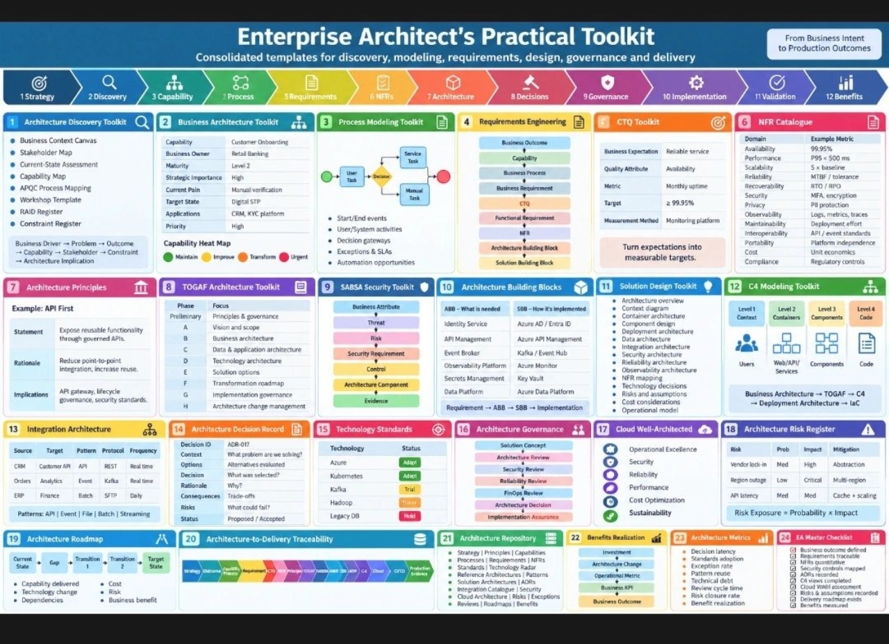

ENTERPRISE ARCHITECTURE · DATA

<h2>An end-to-end data chain</h2>

A data platform combines ingestion, storage, processing, transformation, orchestration, restitution and governance. This summary view locates the tools in the different layers of a data chain.

The diagram walks through the layers of data engineering, from sources and ingestion to serving, quality and governance.

<figure class="resource-figure"><figcaption>Complete data engineering stack.</figcaption></figure>
