
AI ARCHITECTURE · REFERENCE DOCUMENT

AI enterprise architecture methodological guide — Based on TOGAF ADM, ArchiMate and C4 Model

<strong>Positioning:</strong> Proposed framework for designing, documenting, governing and evolving information systems integrating artificial intelligence. This is a proposed methodological adaptation, and not an official publication or certification of The Open Group.

<h2>Summary</h2>

1. Purpose, Scope and Guiding Principles

2. Fundamentals of AI Business Architecture

3. AI Strategy and Business Architecture

4. AI Architecture Metamodel

5. Data &amp; AI architecture

6. AI and Agentic AI application architecture

7. Technological architecture and platforms

8. Security, governance, risks and compliance

9. Adaptation of TOGAF ADM to AI projects

10. ArchiMate modeling and C4

11. Reference architectures and practical cases

12. Deliverables, operational governance and roadmap

Appendices: reusable models, glossary and references

<figure class="resource-figure">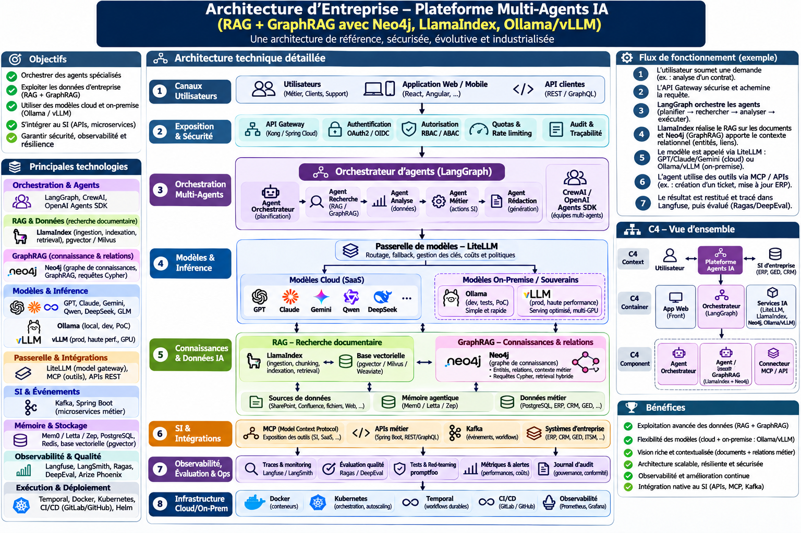<figcaption>Reference architecture of a multi-agent platform integrating RAG, GraphRAG, orchestration, models and operations.</figcaption></figure>
<h2>Executive summary</h2>

Artificial intelligence should not be treated as a simple technology added to the application portfolio. It introduces specific assets, lifecycles, risks and dependencies: training and context data, models, prompts, embeddings, vector bases, agents, tools, evaluations, guardrails and supervision mechanisms.

The AI ​​Enterprise Architecture Framework (AI-EAF) provides a cohesive framework for connecting business strategy with AI capabilities, data, applications, models and technical platforms. It relies on TOGAF ADM logic to organize the transformation, ArchiMate to represent business relationships, and C4 to describe software structures at different zoom levels.

<table><tr><td>
Central idea 
TOGAF organizes the approach and governance of the enterprise architecture; ArchiMate expresses the relationships between capabilities, processes, data, services and technologies; C4 concretely describes software boundaries, containers and components. The three approaches are complementary.
</td></tr></table>

<h3>Proposed structuring decisions</h3>

Treat AI as a business capability, not just a portfolio of models.

Create a governed catalog of AI use cases and a map of the relevant business capabilities.

Clearly separate Data, AI/ML, Application, Platform, Security and Business responsibilities.

Industrialize the life cycle of AI models and applications (MLOps, LLMOps, AIOps as needed).

Establish governance based on risk, traceability, evaluation and human supervision.

Reuse building blocks and reference architectures rather than multiplying isolated solutions.

<h2>1. Purpose, scope and guiding principles</h2>
<h3>1.1 Objectives</h3>

The framework aims to help an organization move from local AI experiments to a coherent, secure, measurable and industrializable AI capability system.

Align AI investments with strategic objectives and business outcomes.

Define reference architectures and technological standards.

Master data, models, prompts, agents and their dependencies.

Make solutions observable, evaluable, explainable when necessary and reversible.

Organize architectural decisions and compliance checks.

Accelerate projects with reusable patterns and components.

<h3>1.2 Scope</h3>

<table><tr><td>
Included
</td><td>
Outside scope / processed by other disciplines
</td></tr><tr><td>
Predictive and descriptive AI: ML, scoring, classification, forecasting, anomaly detection
</td><td>
Detailed definition of business policies independently of AI
</td></tr><tr><td>
AI generative: LLM, RAG, multimodal generation, assistants
</td><td>
Fundamental research and mathematical design of new models
</td></tr><tr><td>
Agentic AI: agents, orchestration, tools, memory, delegation
</td><td>
Comprehensive management of user stations and office support
</td></tr><tr><td>
Data, pipelines, feature stores, vector stores, model registry
</td><td>
Replacement of global cybersecurity or data management policies
</td></tr><tr><td>
Platforms, integration, APIs, observability, exploitation
</td><td>
Contractual choices or purchases, which remain subject to sourcing processes
</td></tr></table>

<h3>1.3 AI architecture guiding principles</h3>

<table><tr><td>
ID
</td><td>
Principle
</td><td>
Verifiable consequence
</td></tr><tr><td>
AI-01
</td><td>
Business first
</td><td>
Each AI solution is linked to a business objective and indicator.
</td></tr><tr><td>
AI-02
</td><td>
Data governance by design
</td><td>
The provenance, quality, rights and retention of the data are known.
</td></tr><tr><td>
AI-03
</td><td>
Model-agnostic where feasible
</td><td>
Models are accessible via standardized interfaces and contracts where relevant.
</td></tr><tr><td>
AI-04
</td><td>
Human accountability
</td><td>
Human accountability is defined for impact decisions.
</td></tr><tr><td>
AI-05
</td><td>
Secure by design
</td><td>
Identity, authorization, encryption, filtering and logging are built in by design.
</td></tr><tr><td>
AI-06
</td><td>
Observable and evaluable
</td><td>
Quality, cost, latency, drift, security and utility are measured.
</td></tr><tr><td>
AI-07
</td><td>
Reusable building blocks
</td><td>
Common patterns, components and platforms are preferred.
</td></tr><tr><td>
AI-08
</td><td>
Lifecycle management
</td><td>
Data, models, prompts, agents and configurations are versioned and governed.
</td></tr><tr><td>
AI-09
</td><td>
Proportionate autonomy
</td><td>
An agent's level of autonomy is limited by risk and controls.
</td></tr><tr><td>
AI-10
</td><td>
Exit and portability
</td><td>
Supplier dependencies and migration possibilities are documented.
</td></tr></table>

<h3>1.4 Typology of solutions</h3>

<table><tr><td>
Family
</td><td>
Examples
</td><td>
Dominant architectural questions
</td></tr><tr><td>
Analytics / augmented BI
</td><td>
Sales forecasting, segmentation, detection
</td><td>
Data quality, bias, explainability, performance
</td></tr><tr><td>
Machine Learning
</td><td>
Scoring, classification, recommendation
</td><td>
Feature engineering, training, registry, drift
</td></tr><tr><td>
Generative AI
</td><td>
Summary, extraction, writing, Q&amp;A
</td><td>
LLM selection, prompts, grounding, evaluation
</td></tr><tr><td>
RAG
</td><td>
Search in internal corpora
</td><td>
Ingestion, chunking, embeddings, ACLs, citations
</td></tr><tr><td>
Agentic AI
</td><td>
Assistant running a multi-step process
</td><td>
Allowed tools, scheduling, memory, action limits
</td></tr><tr><td>
Multimodal AI
</td><td>
Image, audio, video, document analysis
</td><td>
Formats, size, confidentiality, cost, latency
</td></tr></table>

<h2>2. Fundamentals of AI enterprise architecture</h2>
<h3>2.1 From IS architecture to AI architecture</h3>

An AI architecture connects a business need to a set of technical and organizational capabilities. It must explain the complete value chain: source data, preparation, model, orchestration, exposed service, user interaction, supervision and measurement of results.

<h4>Archimate map of an agentic AI architecture</h4>
<figure class="resource-figure">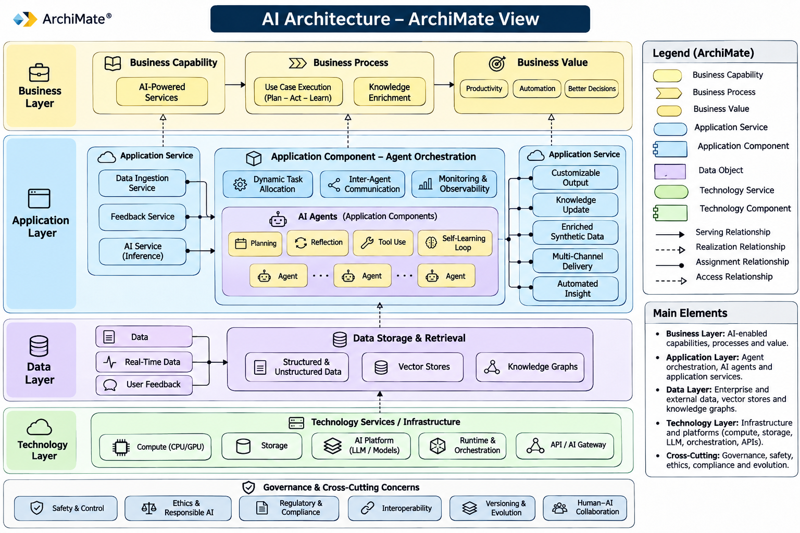</figure>
<h3>2.2 The components of an AI solution</h3>

<table><tr><td>
Component
</td><td>
Role
</td><td>
Examples / points of attention
</td></tr><tr><td>
Data source
</td><td>
Information source
</td><td>
ERP, CRM, EDM, sensors, bases relational, events
</td></tr><tr><td>
Data pipeline
</td><td>
Ingestion, transformation and control
</td><td>
ETL/ELT, streaming, quality, lineage
</td></tr><tr><td>
Dataset / corpus
</td><td>
Data used by the model or RAG
</td><td>
Rights, classification, freshness, version
</td></tr><tr><td>
Feature Store
</td><td>
ML variable management
</td><td>
Offline/online consistency, reuse
</td></tr><tr><td>
Model / LLM
</td><td>
Inference engine
</td><td>
Proprietary model, open weights, specialized model
</td></tr><tr><td>
Prompt / template
</td><td>
Structured instruction for an LLM
</td><td>
Version, tests, parameters, security
</td></tr><tr><td>
Embedding model
</td><td>
Semantic projection of contents
</td><td>
Dimension, version, compatibility
</td></tr><tr><td>
Vector store
</td><td>
Vector search index
</td><td>
Filtering, ACL, update, high availability
</td></tr><tr><td>
Orchestrator / Agent
</td><td>
Coordination of steps and tools
</td><td>
LangGraph, workflows, stopping rules
</td></tr><tr><td>
Tool / API
</td><td>
Action or capability called by the agent
</td><td>
Contract, authentication, authorization, idempotence
</td></tr><tr><td>
AI Gateway
</td><td>
Model access control point
</td><td>
Routing, quotas, logs, policies, cost
</td></tr><tr><td>
Evaluation &amp; monitoring
</td><td>
Quality and risk measurement
</td><td>
Test sets, metrics, alerts, human reviews
</td></tr></table>

<h3>2.3 Classic AI, generative and agentic</h3>

<table><tr><td>
Dimension
</td><td>
Classic ML
</td><td>
Generative AI
</td><td>
Agentic AI
</td></tr><tr><td>
Purpose
</td><td>
Predict / classify / optimize
</td><td>
Generate or transform content
</td><td>
Achieve a goal via multiple steps and tools
</td></tr><tr><td>
Inputs
</td><td>
Structured variables or signals
</td><td>
Text, image, audio, context
</td><td>
Goal, context, state, available tools
</td></tr><tr><td>
Output
</td><td>
Score, class, value
</td><td>
Text, code, image, structure
</td><td>
Next step decision, action or result
</td></tr><tr><td>
Control
</td><td>
Pipeline and thresholds
</td><td>
Prompt, filters, validation
</td><td>
Orchestration, permissions, limits and monitoring
</td></tr><tr><td>
Risks
</td><td>
Bias, drift, prediction errors
</td><td>
Hallucination, escape, prompt injection
</td><td>
Unwanted actions, escalation, loop, abusive delegation
</td></tr></table>

<table><tr><td>
Essential distinction 
A system that uses an LLM is not automatically agentic. It becomes agentic when it chooses or plans steps, uses tools, maintains a state or adapts its behavior to achieve a goal, within defined limits.
</td></tr></table>

<h2>3. AI Strategy and Business Architecture</h2>
<h3>3.1 Starting from business results</h3>

The AI ​​portfolio should be built from business problems, not from the availability of a technology. Each use case must explain the process concerned, the users, the expected value, the necessary data, the level of risk, the costs and the industrialization conditions.

<h3>3.2 Qualification sheet for an AI Use Case</h3>

<table><tr><td>
Section
</td><td>
Expected content
</td></tr><tr><td>
Identity
</td><td>
Name, sponsor, business owner, domain, version, status
</td></tr><tr><td>
Problem
</td><td>
Current situation, irritants, affected population, process
</td></tr><tr><td>
Expected result
</td><td>
Measurable benefit, reference and target KPI
</td></tr><tr><td>
AI approach
</td><td>
ML, GenAI, RAG, agent, vision, audio or combination
</td></tr><tr><td>
Data
</td><td>
Sources, sensitivity, quality, rights, location, retention
</td></tr><tr><td>
Decision / action
</td><td>
Recommendation, generation, assisted decision or automated action
</td></tr><tr><td>
Risk
</td><td>
Potential impact, data subjects, security, compliance
</td></tr><tr><td>
Operation
</td><td>
SLO, volumetry, latency, cost, support, continuity
</td></tr><tr><td>
Validation
</td><td>
Business metrics, technical tests, human validation, go/no-go criteria
</td></tr></table>

<h3>3.3 AI Capability Map</h3>

<table><tr><td>
Business capacity
</td><td>
Associated AI capacity
</td><td>
Example services
</td></tr><tr><td>
Customer relations
</td><td>
Enhanced understanding and assistance
</td><td>
Request classification, advisor assistant, interaction summary
</td></tr><tr><td>
Finance / control
</td><td>
Augmented analysis and detection
</td><td>
Anomaly detection, forecasting, invoice extraction
</td></tr><tr><td>
Human resources
</td><td>
Assisted document processing
</td><td>
Research in procedures, writing assistance under control
</td></tr><tr><td>
Operations
</td><td>
Optimization and anticipation
</td><td>
Predictive maintenance, load forecasting
</td></tr><tr><td>
Legal / compliance
</td><td>
Controlled research and synthesis
</td><td>
Documentary RAG, monitoring, clause extraction
</td></tr></table>

<h3>3.4 Portfolio prioritization</h3>

Evaluate each use case based on value, feasibility, risk, data availability and total cost. A prioritization matrix must not hide the eliminatory criteria: absence of legal basis, unauthorized data, uncontrolled risks or absence of owner.

<table><tr><td>
Criterion
</td><td>
Question
</td><td>
Indicative scale
</td></tr><tr><td>
Business value
</td><td>
Is the gain significant and measurable?
</td><td>
1 to 5
</td></tr><tr><td>
Data feasibility
</td><td>
Is the data accessible and usable?
</td><td>
1 to 5
</td></tr><tr><td>
Technical feasibility
</td><td>
Is the performance achievable?
</td><td>
1 to 5
</td></tr><tr><td>
Adoption
</td><td>
Can users integrate the solution?
</td><td>
1 to 5
</td></tr><tr><td>
Risk
</td><td>
Is the residual risk acceptable?
</td><td>
Low / medium / high
</td></tr><tr><td>
Full cost
</td><td>
Is the cost of inference, operation and control sustainable?
</td><td>
Estimated budget
</td></tr></table>

<h3>3.5 Example: internal documentary assistant</h3>

Objective: allow employees to search for answers in an internal documentary corpus, with cited sources and control of authorizations.

Business capability: access reliable and up-to-date information.

AI Use Case: Document research assistant with RAG.

Value: Reduced search time and improved response consistency.

KPI: correctly sourced response rate, average search time, escalation rate, satisfaction.

Limit: Assistant does not make HR, legal or financial decisions; it provides research assistance.

<h2>4. AI architecture metamodel</h2>
<h3>4.1 Purpose of the metamodel</h3>

The metamodel defines the architectural objects to be inventoried and the relationships to be traced. It serves as the basis for ArchiMate models, the architecture repository, project governance and traceability between business needs and technical components.

<h3>4.2 Proposed entities</h3>

<table><tr><td>
Entity
</td><td>
Definition
</td><td>
Key attributes
</td></tr><tr><td>
AI Strategy
</td><td>
AI strategic direction
</td><td>
objectives, principles, horizon, sponsor
</td></tr><tr><td>
AI Capability
</td><td>
Organizational capacity to design or exploit AI
</td><td>
maturity, owner, target level
</td></tr><tr><td>
AI Use Case
</td><td>
Business use cases using AI
</td><td>
value, risk, status, KPI
</td></tr><tr><td>
AI Product
</td><td>
AI product or service maintained over time
</td><td>
owner, users, SLA, version
</td></tr><tr><td>
Data Asset
</td><td>
Data or exploited corpus
</td><td>
source, classification, quality, lineage, rights
</td></tr><tr><td>
Dataset
</td><td>
Prepared and versioned dataset
</td><td>
schema, period, provenance, quality
</td></tr><tr><td>
Feature
</td><td>
Variable used by an ML model
</td><td>
definition, calculation, freshness
</td></tr><tr><td>
AI Model
</td><td>
Trained model or foundation model
</td><td>
family, version, vendor, license, metrics
</td></tr><tr><td>
Prompt Template
</td><td>
Versioned instruction addressed to a model
</td><td>
version, variables, tests, owner
</td></tr><tr><td>
Embedding Model
</td><td>
Vector producing model
</td><td>
version, dimension, language, compatibility
</td></tr><tr><td>
Vector Store
</td><td>
Vector storage and index
</td><td>
engine, index, ACL, retention
</td></tr><tr><td>
RAG Pipeline
</td><td>
Chain indexing and augmented retrieval
</td><td>
steps, corpus, retrieval strategies
</td></tr><tr><td>
AI Agent
</td><td>
Goal-pursuing component with state and tools
</td><td>
role, permissions, limits, memory
</td></tr><tr><td>
Tool
</td><td>
Function or API that an agent can call
</td><td>
contract, scopes, owner, risk
</td></tr><tr><td>
AI Service
</td><td>
AI capability exposed by API or interface
</td><td>
contract, version, SLO, consumer
</td></tr><tr><td>
Evaluation Suite
</td><td>
Tests and benchmark sets
</td><td>
dataset, criteria, thresholds, results
</td></tr><tr><td>
AI Risk
</td><td>
Risk associated with a use, model or system
</td><td>
impact, probability, control, residual
</td></tr><tr><td>
AI Control
</td><td>
Technical or organizational measure
</td><td>
objective, responsible, proof, frequency
</td></tr></table>

<h3>4.3 Relations</h3>
<figure class="resource-figure ai-relations-figure">
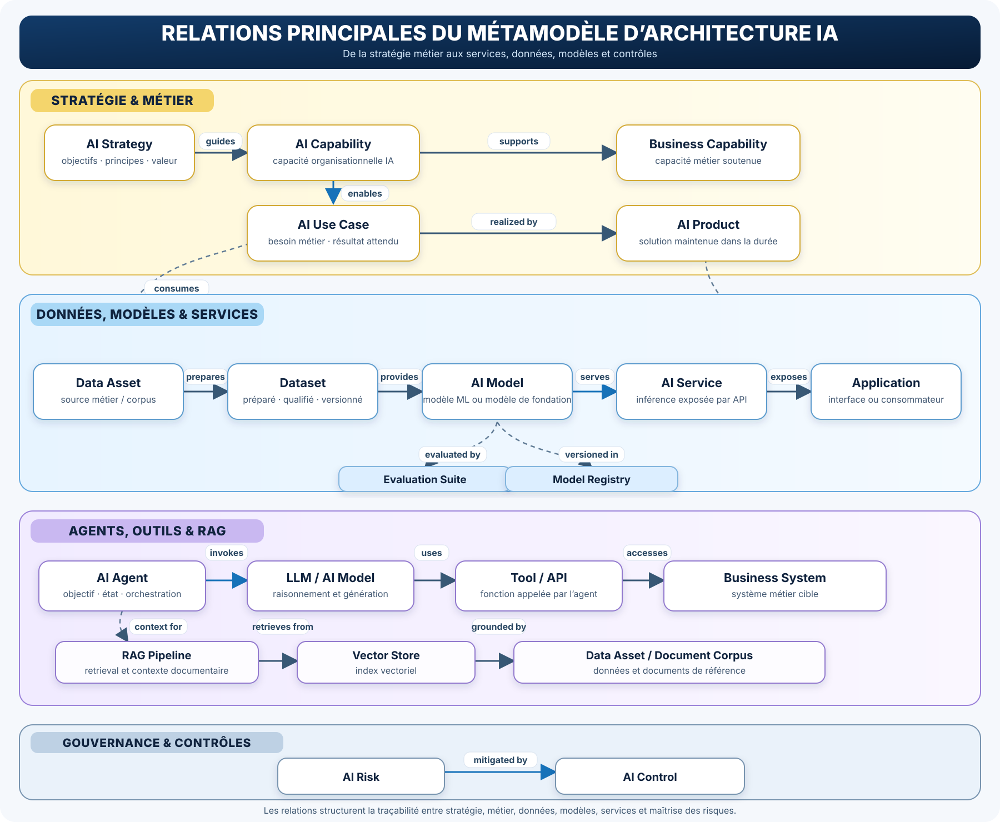<figcaption>Main relationship map of the AI ​​architecture metamodel.</figcaption>
</figure>
<h3>4.4 Modeling rules</h3>

Each AI Use Case has a business owner and a solution manager.

Each model in production has an identifier, a version, a provenance and a status.

Each dataset or corpus has a classification, a source and conservation rules.

Each agent has an explicit list of authorized tools and minimum permissions.

Each AI Service documents its contract, consumers, SLOs and limits.

Each significant risk is linked to one or more controls and verifiable proof.

<h3>4.5 Mapping to ArchiMate</h3>

<table><tr><td>
AI Metamodel Concept
</td><td>
Possible ArchiMate Elements
</td><td>
Note
</td></tr><tr><td>
AI Strategy
</td><td>
Goal, Outcome, Requirement, Principle, Course of Action
</td><td>
Use Motivation for the why.
</td></tr><tr><td>
AI Capability
</td><td>
Capability
</td><td>
Can specialize the enterprise capabilities catalog.
</td></tr><tr><td>
AI Use Case
</td><td>
Business Process, Business Service, Application Service depending on level
</td><td>
A use case is not a single standard ArchiMate element.
</td></tr><tr><td>
AI Product
</td><td>
Product, Business Service, Application Component
</td><td>
Choose according to nature and point of view.
</td></tr><tr><td>
Data Asset
</td><td>
Data Object, Business Object
</td><td>
Distinguish business meaning and application representation.
</td></tr><tr><td>
AI Model
</td><td>
Application Component or Technology Object depending on abstraction
</td><td>
Document model metadata in the repository.
</td></tr><tr><td>
AI Agent
</td><td>
Application Component / Application Function
</td><td>
Represent its behaviors and interactions.
</td></tr><tr><td>
Tool/API
</td><td>
Application Service, Application Interface
</td><td>
Show contract and consumers.
</td></tr><tr><td>
AI Platform
</td><td>
Node, System Software, Technology Service
</td><td>
Describe the execution environment.
</td></tr><tr><td>
AI Risk / Control
</td><td>
Assessment, Constraint, Requirement, Principle
</td><td>
Complete with a dedicated risk register.
</td></tr></table>

<h2>5. Data &amp; AI Architecture</h2>
<h3>5.1 AI data value chain</h3>
<figure class="resource-figure ai-framework-diagram">
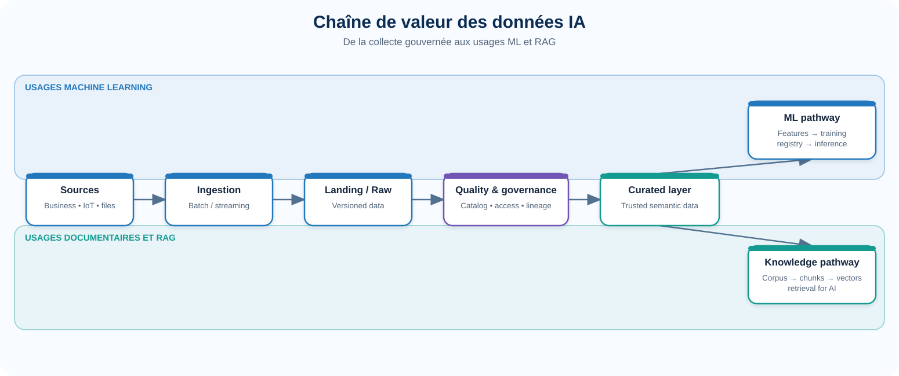
<figcaption>AI data value chain, from sources to ML and RAG uses.</figcaption></figure>
<h3>5.2 Data Architecture for ML</h3>

Define sources, data contracts and quality rules.

Ensure the reproducibility of training and validation datasets.

Check data leaks between training and testing.

Document the features, their business definition, their calculation and their freshness.

Ensure consistency between offline and online features when predictions are real-time.

Trace versions of data, code, parameters and model.

<h3>5.3 RAG architecture</h3>
<figure class="resource-figure ai-framework-diagram">
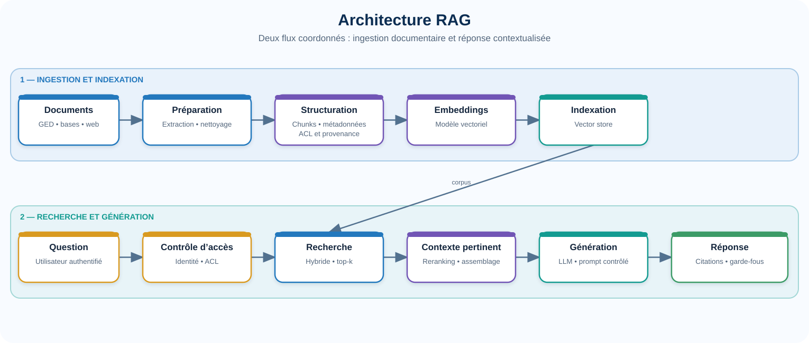
<figcaption>RAG architecture: ingestion, indexing, search and controlled generation.</figcaption></figure>

Architectural decisions to be documented: chunking strategy, embedding model, vector dimension, hybrid search, metadata filters, reranking, relevance threshold, deleted document management, rights synchronization and citation strategy.

<h3>5.4 Data Governance for RAG</h3>

Apply access rights at retrieval time, not just at indexing.

Prevent a user from obtaining an extract of a document that they cannot view.

Preserve the provenance, version, date and identifier of the source document.

Remove or reindex content that has been deleted or whose rights have changed.

Evaluate the freshness, coverage and relevance of the corpus.

Do not consider the retrieved documents as reliable instructions: they are unreliable data.

<h3>5.5 Data architecture and lifecycle</h3>

<table><tr><td>
Step
</td><td>
Expected controls
</td></tr><tr><td>
Collection
</td><td>
Legal basis, rights, purpose, minimization, transfer security
</td></tr><tr><td>
Preparation
</td><td>
Quality, deduplication, normalization, detection of sensitive data
</td></tr><tr><td>
Enrichment
</td><td>
Traceability of transformations and provenance
</td></tr><tr><td>
Storage
</td><td>
Classification, encryption, access, retention, localization
</td></tr><tr><td>
Consumption
</td><td>
Access control, minimization, logging, data contract
</td></tr><tr><td>
Archiving / deletion
</td><td>
Retention periods, deletion propagation, proof
</td></tr></table>

<h2>6. AI and Agentic AI application architecture</h2>
<h3>6.1 Application patterns</h3>

<table><tr><td>
Pattern
</td><td>
Description
</td><td>
À favor when
</td></tr><tr><td>
Direct LLM
</td><td>
Application calls an LLM via API
</td><td>
Simple task, low orchestration, limited context
</td></tr><tr><td>
Prompt chain
</td><td>
Multiple sequential prompts/transformations
</td><td>
Deterministic and testable pipeline
</td></tr><tr><td>
RAG
</td><td>
Knowledge retrieval before generation
</td><td>
Answers based on scalable business corpus
</td></tr><tr><td>
Tool calling
</td><td>
The model chooses from defined functions
</td><td>
Controlled access to external data or actions
</td></tr><tr><td>
Agentic workflow
</td><td>
Orchestration of steps, state and conditions
</td><td>
Complex but supervised process
</td></tr><tr><td>
Multi-agent
</td><td>
Specialized agents cooperate
</td><td>
Real need for separation of roles; justified complexity
</td></tr><tr><td>
Human-in-the-loop
</td><td>
Human validation before action or decision
</td><td>
High impact, ambiguity or irreversible action
</td></tr></table>

<h3>6.2 Reference architecture of an agent</h3>
<figure class="resource-figure ai-framework-diagram">
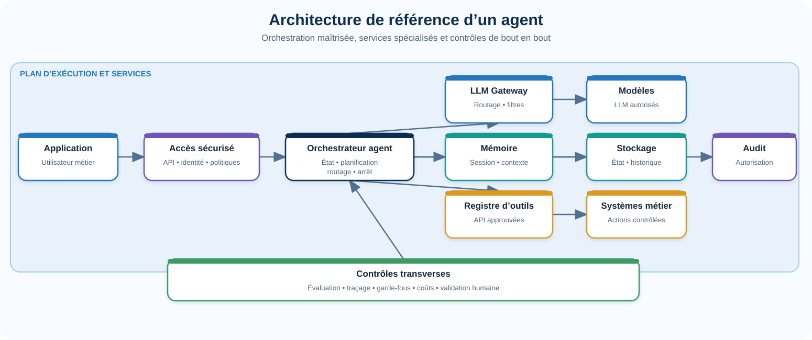
<figcaption>Agentic architecture with orchestration, specialized services and cross-functional controls.</figcaption></figure>
<h3>6.3 Agent, workflow and orchestrator</h3>

A classic workflow follows a predefined sequence. An agent can select an action or a tool based on the context and the current state. A robust architecture often uses hybrid orchestration: deterministic steps for critical operations, model reasoning for open tasks, and explicit checkpoints.

<table><tr><td>
Question
</td><td>
Architecture decision
</td></tr><tr><td>
Can the agent take action?
</td><td>
Set tool whitelist and minimum permissions.
</td></tr><tr><td>
Is the action reversible?
</td><td>
Require human confirmation for irreversible or sensitive actions.
</td></tr><tr><td>
How to avoid curls?
</td><td>
Set maximum number of steps, timeout, budget tokens and stopping conditions.
</td></tr><tr><td>
How to manage status?
</td><td>
Separate session state, business memory and auditable history.
</td></tr><tr><td>
How to handle errors?
</td><td>
Bounded retries, idempotence, circuit breaker, fallback and escalation.
</td></tr><tr><td>
How to check the quality?
</td><td>
Scenario tests, trajectories, tools called, results and refusals.
</td></tr></table>

<h3>6.4 LangGraph Example</h3>

Conceptual example of a request processing wizard. The graph orchestrates controlled steps; Using LangGraph is a possible implementation choice, not a framework obligation.

<figure class="resource-figure ai-framework-diagram">
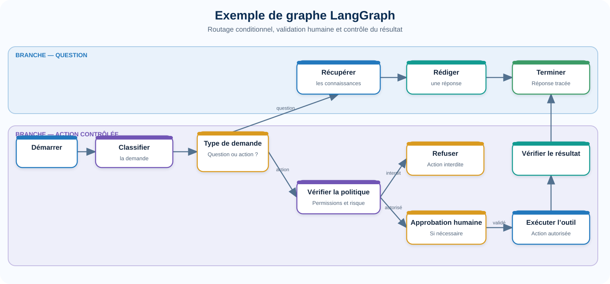
<figcaption>Example LangGraph to process a request.</figcaption></figure>
<h3>6.5 AI API Contracts</h3>

Define input and output schema, errors, version and size limits.

Indicate whether the response is probabilistic and what guarantees are not provided.

Document target latency, quotas, cost, availability and retry policy.

Return useful metadata: model_id, version, sources, correlation_id, evaluation status if relevant.

Never expose vendor secrets or internal details in responses.

<h2>7. Technological architecture and platforms</h2>
<h3>7.1 Logical platform view</h3>
<figure class="resource-figure ai-framework-diagram">
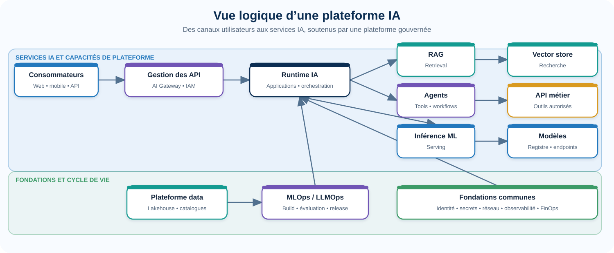
<figcaption>Logical view of the capabilities of an AI platform.</figcaption></figure>
<h3>7.2 Platform capabilities</h3>

<table><tr><td>
Domain
</td><td>
Expected capabilities
</td></tr><tr><td>
Model access
</td><td>
Model catalog, routing, versioning, quotas, fallback
</td></tr><tr><td>
Model development
</td><td>
Environments, notebooks, training, experimentation, registry
</td></tr><tr><td>
Data platform
</td><td>
Ingestion, lakehouse, governance, cataloging, quality, lineage
</td></tr><tr><td>
RAG services
</td><td>
Parsing, chunking, embedding, indexing, retrieval, reranking
</td></tr><tr><td>
Agent runtime
</td><td>
Orchestration, state store, tool registry, sandbox, policy enforcement
</td></tr><tr><td>
Security
</td><td>
IAM, secrets, encryption, private network, DLP, audit
</td></tr><tr><td>
Observability
</td><td>
Logs, traces, metrics, quality, latency, cost, drift
</td></tr><tr><td>
Delivery
</td><td>
CI/CD, tests, scans, validation, promotion and rollback
</td></tr><tr><td>
FinOps
</td><td>
Budgets, costs per product, quotas, model optimization and tokens
</td></tr></table>

<h3>7.3 Technological choices: criteria rather than catalog</h3>

The framework does not prescribe a single supplier. Azure AI Foundry, Azure Machine Learning, AWS Bedrock, SageMaker, Google Vertex AI, open source platforms or internal solutions can be evaluated using the same set of criteria.

Suitability for use cases and required models.

Hosting region, data residency, and contract requirements.

Managing identities, networks, keys and secrets.

Portability of models, formats, APIs and data.

Assessment capabilities, observability and governance.

Total cost: training, inference, storage, transfer, operation and control.

Availability, scalability, quotas, recovery and continuity.

Internal skills, support and ecosystem maturity.

<h3>7.4 MLOps and LLMOps</h3>

<table><tr><td>
Practical
</td><td>
ML / MLOps
</td><td>
GenAI / LLMOps
</td></tr><tr><td>
Version
</td><td>
Code, data, features, parameters, model
</td><td>
Prompts, models, corpus, embeddings, tools, graphs
</td></tr><tr><td>
Tests
</td><td>
Performance, robustness, bias, drift
</td><td>
Groundedness, relevance, hallucination, security, injection
</td></tr><tr><td>
Deployment
</td><td>
Batch, real-time, edge
</td><td>
API, streaming, orchestration, agents
</td></tr><tr><td>
Monitoring
</td><td>
Drift, accuracy, latency, availability
</td><td>
Response quality, token cost, latency, refusal, tool traces
</td></tr><tr><td>
Rollback
</td><td>
Return to previous model
</td><td>
Return to model, prompt, corpus or previous configuration
</td></tr></table>

<h2>8. Security, governance, risks and compliance</h2>
<h3>8.1 Multi-level governance</h3>

<table><tr><td>
Instance
</td><td>
Responsibilities
</td></tr><tr><td>
AI Steering Committee
</td><td>
Priorities, risk appetite, trade-offs, financing
</td></tr><tr><td>
Architecture Board
</td><td>
Principles, standards, exemptions, IS consistency
</td></tr><tr><td>
AI Risk / Compliance Committee
</td><td>
Risk qualification, regulatory requirements, controls
</td></tr><tr><td>
Data Governance
</td><td>
Data ownership, quality, access, conservation and provenance
</td></tr><tr><td>
AI Product Owner
</td><td>
Value, scope, users, business quality and lifecycle
</td></tr><tr><td>
Model Owner
</td><td>
Version, performance, documentation, validation and monitoring
</td></tr><tr><td>
Platform Owner
</td><td>
Availability, security, capacity, costs and operations
</td></tr></table>

<h3>8.2 Risk management cycle</h3>
<figure class="resource-figure ai-framework-diagram">
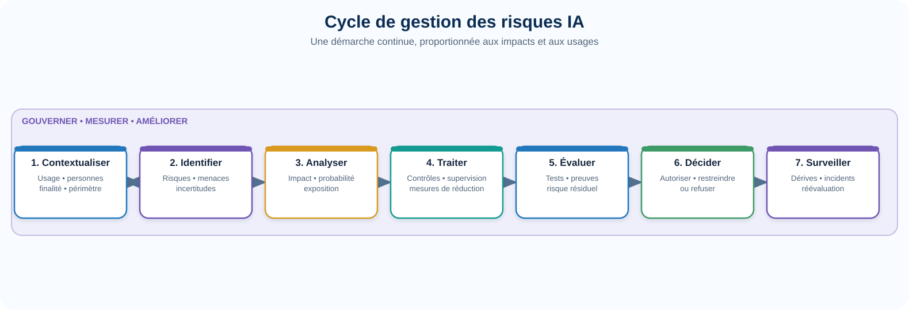
<figcaption>AI Risk Management Cycle.</figcaption></figure>
<h3>8.3 AI risk catalog</h3>

<table><tr><td>
Risk
</td><td>
Example
</td><td>
Possible controls
</td></tr><tr><td>
Unauthorized data
</td><td>
Personal data sent to an external service
</td><td>
Classification, minimization, DLP, contracts, filtering
</td></tr><tr><td>
Bias
</td><td>
Result unfavorable to a group
</td><td>
Bias tests, impact analysis, human review
</td></tr><tr><td>
Hallucination
</td><td>
Invented answer presented as factual
</td><td>
RAG, quotes, thresholds, abstention, validation
</td></tr><tr><td>
Prompt injection
</td><td>
Document or user attempts to hijack the model
</td><td>
Instruction/data separation, filtering, sandboxing, testing
</td></tr><tr><td>
Exfiltration
</td><td>
The agent extracts data via a tool
</td><td>
Least privilege, scopes, DLP, exit control
</td></tr><tr><td>
Unauthorized action
</td><td>
Agent modifies a folder without approval
</td><td>
Allowlist, human validation, idempotence, audit
</td></tr><tr><td>
Drift
</td><td>
Performance degradation over time
</td><td>
Monitoring, reevaluation, retraining or model change
</td></tr><tr><td>
Vendor dependency
</td><td>
Shutdown or API/model change
</td><td>
Abstraction, exit strategy, portability testing
</td></tr><tr><td>
Uncontrolled cost
</td><td>
Agentic loops or prompts too much long
</td><td>
Budgets, quotas, step limits, alerts
</td></tr><tr><td>
Unavailability
</td><td>
LLM service or platform unavailable
</td><td>
Fallback, cache, circuit breaker, degraded mode
</td></tr></table>

<h3>8.4 Agent-specific security</h3>

Separate identity per agent or workload; avoid shared identifiers.

Minimum permissions, limited in time and context.

Tools registered, approved, typed and subject to access control.

Human validation for payments, deletions, external communications or high-impact decisions.

Sandbox for code execution and untrusted content.

Traceability of decisions, tool calls, relevant inputs/outputs and approvals.

Limits on budget, duration, number of iterations and size of manipulated data.

<h3>8.5 Governance frameworks to be articulated</h3>

NIST AI Risk Management Framework: AI risk management approach.

ISO/IEC 42001: artificial intelligence management system.

ISO/IEC 23894: AI risk management guidelines.

European regulations on AI (AI Act): obligations to be determined depending on the role, the system and its qualification.

GDPR and data protection rules: purpose, legal basis, minimization, rights, security and transfers.

<table><tr><td>
Regulatory prudence 
The regulatory qualification of a system depends on the use case, the context, the role of the organization and the applicable texts. This guide does not replace a formal legal analysis or impact analysis.
</td></tr></table>

<h2>9. Adaptation of TOGAF ADM to AI projects</h2>

The ADM cycle remains the common thread. Adaptation consists of adding questions, controls and deliverables specific to AI, without creating a parallel method that would duplicate existing processes.

<table><tr><td>
ADM phase
</td><td>
Complementary AI work
</td><td>
Recommended deliverables
</td></tr><tr><td>
Preliminary
</td><td>
AI maturity, principles, governance, capabilities and standards
</td><td>
AI Architecture Principles, mandate, governance model
</td></tr><tr><td>
A – Vision Architecture
</td><td>
AI Vision, stakeholders, value, high-level risks
</td><td>
AI Vision, target concept, business case, stakeholder map
</td></tr><tr><td>
B – Business Architecture
</td><td>
Business capabilities, processes, roles, human impacts
</td><td>
AI Capability Map, target process, operating model
</td></tr><tr><td>
C – Data Architecture
</td><td>
Sources, quality, lineage, corpus, rights and life cycle
</td><td>
Data/AI Data Architecture, data contracts, corpus map
</td></tr><tr><td>
C – Application Architecture
</td><td>
AI products, agents, RAGs, APIs, consumer systems
</td><td>
AI Application Portfolio, interactions, contracts
</td></tr><tr><td>
D – Technology Architecture
</td><td>
Platform, models, GPU, network, security, observability
</td><td>
AI Technology Reference Architecture, standards
</td></tr><tr><td>
E – Opportunities &amp; Solutions
</td><td>
Work packages, solution candidates, dependencies and risks
</td><td>
Solution Building Blocks, architecture options
</td></tr><tr><td>
F – Migration Planning
</td><td>
Prioritization, trajectories, capacities to build
</td><td>
AI Roadmap, Transition Architectures, business case
</td></tr><tr><td>
G – Implementation Governance
</td><td>
Reviews, conformity, tests, proofs and exemptions
</td><td>
Architecture Compliance Assessment, decisions
</td></tr><tr><td>
H – Architecture Change Management
</td><td>
Monitoring, evolution of models, costs, risks and uses
</td><td>
Change Request, Model Change Assessment, repository update
</td></tr></table>

<h3>9.1 Preliminary phase: prepare the company</h3>

Evaluate the maturity of data, architecture, security and exploitation.

Define the AI ​​governance scope and decision-making bodies.

Establish AI principles and modeling standards.

Create the first taxonomies: use cases, models, agents, data and risks.

Define entry and exit criteria for architecture journals.

<h3>9.2 Phase A: architectural vision</h3>

The vision must explain the business problem, the expected value, the stakeholders, the constraints, the solution options and the major risks. It must not prematurely impose a model or a supplier.

<h3>9.3 Phases B and C: Business, Data and Applications</h3>

Phase B describes changes in human capabilities, processes, roles and controls. Phase C describes the necessary data and applications, including RAG corpora, models, AI services and integrations with the IS.

<h3>9.4 Phase D: Technology</h3>

Phase D compares hosting and execution options: managed service, cloud platform, self-hosted model, GPU, Kubernetes, private network, vector storage and observability tools.

<h3>9.5 Phases E and F: solutions and migration</h3>

Break down the target into Solution Building Blocks and Transition Architectures. Prioritize common foundations: identity, AI Gateway, model catalog, assessment pipeline, observability and data governance.

<h3>9.6 Phases G and H: control and evolution</h3>

Compliance does not end with production. Any change in model, prompt, corpus, tool, provider or level of autonomy may modify the risk and must trigger a proportionate assessment.

<h3>9.7 Decision Gates</h3>

<table><tr><td>
Gate
</td><td>
Decision Question
</td><td>
Minimum Evidence
</td></tr><tr><td>
G0 – Intake
</td><td>
Is the need legitimate and sponsored?
</td><td>
Use case, owner, objective sheet
</td></tr><tr><td>
G1 – Qualification
</td><td>
Are the data and risks sufficiently known?
</td><td>
Data assessment, initial risk, AI option
</td></tr><tr><td>
G2 – Architecture
</td><td>
Is the solution consistent and secure?
</td><td>
ArchiMate/C4 views, ADR, controls
</td></tr><tr><td>
G3 – Preproduction
</td><td>
Are quality and safety demonstrated?
</td><td>
Assessment results, tests, recovery plan
</td></tr><tr><td>
G4 – Production
</td><td>
Is the service operable and governed?
</td><td>
SLO, runbook, ownership, monitoring
</td></tr><tr><td>
G5 – Continuous review
</td><td>
Do performance and risks remain acceptable?
</td><td>
KPI, incidents, drift, costs, re-evaluation
</td></tr></table>

<h2>10. ArchiMate and C4 modeling</h2>
<h3>10.1 When to use ArchiMate?</h3>

ArchiMate is suitable for representing enterprise-wide motivations, business capabilities, processes, services, applications, data and technologies. It helps show why a solution exists, what capabilities it supports, what services it exposes and what platforms it relies on.

<h3>10.2 Recommended ArchiMate views</h3>

<table><tr><td>
View
</td><td>
Question answered
</td><td>
Main elements
</td></tr><tr><td>
Motivation
</td><td>
Why invest in AI?
</td><td>
Stakeholder, Driver, Goal, Outcome, Requirement, Constraint
</td></tr><tr><td>
Capability
</td><td>
What business capabilities are increased?
</td><td>
Capability, Value Stream, Resource
</td></tr><tr><td>
Business Process
</td><td>
How is the process changing?
</td><td>
Business Actor, Role, Process, Service, Event
</td></tr><tr><td>
Information Structure
</td><td>
What information is consumed?
</td><td>
Business Object, Data Object, Representation
</td></tr><tr><td>
Application Cooperation
</td><td>
How do applications collaborate?
</td><td>
Application Component, Interface, Service, Data Object
</td></tr><tr><td>
Technology
</td><td>
Where and how does the solution run?
</td><td>
Node, System Software, Technology Service, Artifact
</td></tr><tr><td>
Implementation &amp; Migration
</td><td>
How to reach the target?
</td><td>
Work Package, Deliverable, Plateau, Gap
</td></tr><tr><td>
Risk &amp; Compliance
</td><td>
Which controls address risks?
</td><td>
Assessment, Requirement, Constraint, Principle
</td></tr></table>

<h3>10.3 Example of ArchiMate view – RAG assistant</h3>
<figure class="resource-figure ai-framework-diagram">
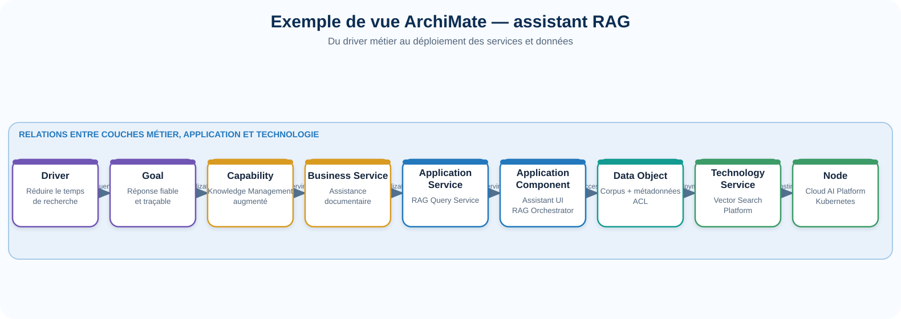
<figcaption>Example ArchiMate relationship chain for a RAG assistant.</figcaption></figure>

This diagram is a simplified logical view. In a formal ArchiMate model, the exact relationships (realization, serving, access, assignment, deployment, influence) must be chosen according to the semantics of the elements and the language version used.

<h3>10.4 When to use C4?</h3>

C4 complements ArchiMate by describing the software structure of a solution. It is particularly useful for aligning architects, developers, platform and security teams.

<table><tr><td>
Level C4
</td><td>
Use for AI
</td><td>
Example
</td></tr><tr><td>
L1 – System Context
</td><td>
Actors, AI system, external systems
</td><td>
Collaborator, AI Assistant, GED, IAM
</td></tr><tr><td>
L2 – Container
</td><td>
Deployable applications and services
</td><td>
Frontend, API, orchestrator, vector DB, LLM Gateway
</td></tr><tr><td>
L3 – Component
</td><td>
Internal components of a container
</td><td>
Retriever, reranker, prompt builder, policy checker
</td></tr><tr><td>
L4 – Code
</td><td>
Useful implementation details
</td><td>
Classes, modules, interfaces; optional
</td></tr></table>

<h3>10.5 Example C4 – L2 RAG containers</h3>
<figure class="resource-figure ai-framework-diagram">
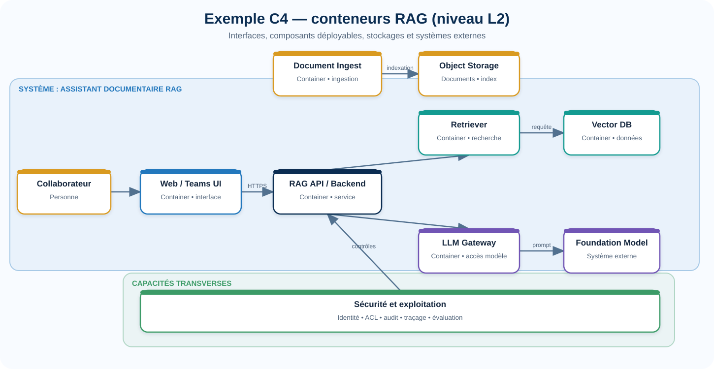
<figcaption>Example C4 level L2 for a RAG assistant.</figcaption></figure>
<h3>10.6 ArchiMate / C4 consistency rules</h3>

ArchiMate describes the enterprise and the relationships between domains; C4 details a software solution.

System, service, and container names must be consistent across views.

An ArchiMate Application Component can correspond to a system or a C4 container depending on the level of granularity.

Views must have an objective, target audience, scope and validity date.

Do not try to represent all the details in a single diagram: produce several complementary views.

<h2>11. Reference architectures and practical cases</h2>
<h3>11.1 Reference A – Enterprise RAG</h3>

Case: internal assistant who answers questions from a corpus of procedures and documents. Responses must be accompanied by references and respect the authorizations.

<table><tr><td>
Zone
</td><td>
Components
</td><td>
Decisions/controls
</td></tr><tr><td>
Channel
</td><td>
Portal or Teams
</td><td>
SSO, user context, experience and feedback
</td></tr><tr><td>
API
</td><td>
Backend RAG
</td><td>
Input validation, rate limit, correlation ID
</td></tr><tr><td>
Retrieval
</td><td>
Hybrid search, reranker, vector store
</td><td>
ACL, threshold, top-k, freshness, deletion
</td></tr><tr><td>
Generation
</td><td>
LLM Gateway, prompt template
</td><td>
Model authorized, versioned prompt, filtering
</td></tr><tr><td>
Knowledge
</td><td>
Ingestion, parsing, chunking
</td><td>
Provenance, metadata, deduplication
</td></tr><tr><td>
Governance
</td><td>
Evaluation, tracing, audit
</td><td>
Groundedness, citation, security, cost
</td></tr></table>

<h3>11.2 Reference B – Business agent</h3>

Case: agent who qualifies a request, consults systems and prepares a response proposal. The agent does not perform any sensitive action without validation.

<figure class="resource-figure ai-framework-diagram">
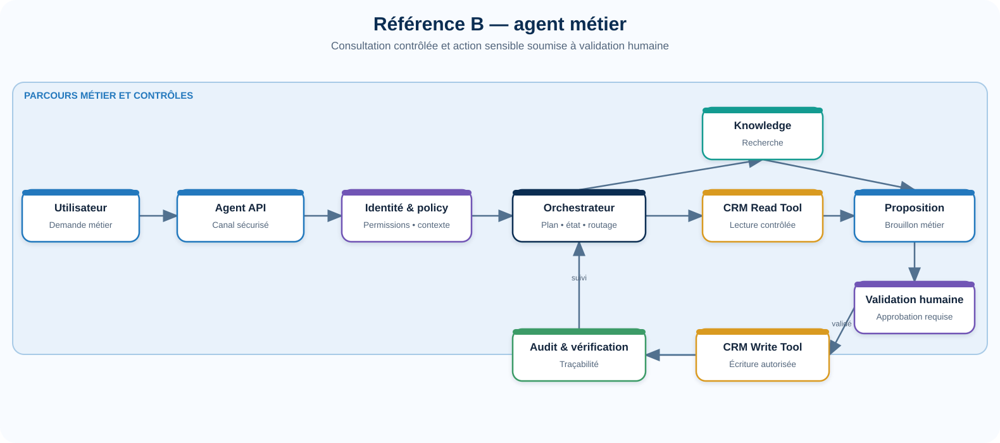
<figcaption>Architecture reference for a controlled business agent.</figcaption></figure>
<h3>11.3 Reference C – Predictive ML</h3>

Case: predict delay risk or future demand from historical data. The model provides decision support; users retain responsibility for the action.

Versioned ingestion and staging pipeline.

Feature Store or documented feature layer.

Reproducible training, testing, business validation and model registry.

Inference service with thresholds and missing value handling.

Performance, drift and bias monitoring.

Documented retraining and rollback process.

<h3>11.4 Reference D – Shared GenAI Platform</h3>

The shared platform provides common services to AI products: access to models, security, quotas, evaluation, observability, catalogs, prompt management and approved tools. Products remain responsible for their specific business value, data and controls.

<h3>11.5 Common thread example: intelligent invoice processing</h3>

<table><tr><td>
Step
</td><td>
Description
</td><td>
Control
</td></tr><tr><td>
1. Reception
</td><td>
Invoice received by GED or secure channel
</td><td>
Authenticity, antivirus, classification
</td></tr><tr><td>
2. Extraction
</td><td>
OCR / multimodal model extracts fields
</td><td>
Trust score, schema, validation
</td></tr><tr><td>
3. Enrichment
</td><td>
Supplier / order reconciliation
</td><td>
Business control and ERP access
</td></tr><tr><td>
4. Detection
</td><td>
ML reports inconsistencies or anomalies
</td><td>
Thresholds, explanation, false positive monitoring
</td></tr><tr><td>
5. Proposal
</td><td>
GenAI explains discrepancies and prepares a summary
</td><td>
Sources, structured format, filtering
</td></tr><tr><td>
6. Validation
</td><td>
Collaborator validates or corrects
</td><td>
Human-in-the-loop, separation of duties
</td></tr><tr><td>
7. Action
</td><td>
ERP update after validation
</td><td>
Secure API, idempotence, audit
</td></tr><tr><td>
8. Improvement
</td><td>
Feedback powers assessment
</td><td>
Data governance and controlled retraining
</td></tr></table>

<h2>12. Deliverables, operational governance and roadmap</h2>
<h3>12.1 Deliverables catalog</h3>

<table><tr><td>
Deliverable
</td><td>
Minimum content
</td><td>
Principal Responsible
</td></tr><tr><td>
AI Architecture Principles
</td><td>
Principles, Rationale, Consequences, Controls
</td><td>
Enterprise Architect
</td></tr><tr><td>
AI Capability Map
</td><td>
Business and AI Capabilities, Maturity, Proprietary
</td><td>
Business / Enterprise Architect
</td></tr><tr><td>
AI Use Case Canvas
</td><td>
Problem, value, data, risk, KPI, owner
</td><td>
Product Owner
</td></tr><tr><td>
AI System Context
</td><td>
Actors, external systems, boundaries
</td><td>
Solution Architect
</td></tr><tr><td>
AI Reference Architecture
</td><td>
Layers, services, patterns and standards
</td><td>
Domain / Solution Architect
</td></tr><tr><td>
AI Metamodel
</td><td>
Entities, attributes, relationships, rules
</td><td>
Enterprise Architect
</td></tr><tr><td>
Data &amp; Model Cards
</td><td>
Data and models, limits, provenance, evaluation
</td><td>
Data / Model Owner
</td></tr><tr><td>
AI Risk Assessment
</td><td>
Risks, controls, residual risk, evidence
</td><td>
Risk / Compliance
</td></tr><tr><td>
ArchiMate Views
</td><td>
Motivation, capabilities, processes, applications, technologies
</td><td>
Architect
</td></tr><tr><td>
C4 Diagrams
</td><td>
Context, containers, components
</td><td>
Solution Architect
</td></tr><tr><td>
Architecture Decision Records
</td><td>
Context, options, decision, consequences
</td><td>
Architect / team
</td></tr><tr><td>
AI Evaluation Report
</td><td>
Test sets, metrics, results, thresholds
</td><td>
AI / QA Lead
</td></tr><tr><td>
AI Operations Runbook
</td><td>
SLO, alerts, incidents, rollback, contacts
</td><td>
Platform / Operations
</td></tr><tr><td>
AI Roadmap
</td><td>
Work packages, dependencies, transitions, milestones
</td><td>
Architecture / Portfolio
</td></tr></table>

<h3>12.2 Decision Record (ADR) Architecture Model</h3>

<table><tr><td>
Field
</td><td>
Description
</td></tr><tr><td>
ADR ID / title
</td><td>
Unique identifier and summary decision
</td></tr><tr><td>
Status/date
</td><td>
Proposed, accepted, superseded, rejected
</td></tr><tr><td>
Background
</td><td>
Problem, constraints, requirements and assumptions
</td></tr><tr><td>
Options
</td><td>
Evaluated alternatives and criteria
</td></tr><tr><td>
Decision
</td><td>
Option chosen and justification
</td></tr><tr><td>
Consequences
</td><td>
Benefits, costs, risks and debt
</td></tr><tr><td>
Controls
</td><td>
Security, data, operation, compliance
</td></tr><tr><td>
Revision
</td><td>
Event or date triggering a reassessment
</td></tr></table>

<h3>12.3 Control indicators</h3>

<table><tr><td>
Dimension
</td><td>
Possible indicators
</td></tr><tr><td>
Business value
</td><td>
Time saved, automation rate, quality of service, satisfaction
</td></tr><tr><td>
AI quality
</td><td>
Accuracy, groundedness, relevance, refusal rate, rate of human correction
</td></tr><tr><td>
Security
</td><td>
Incidents, injection attempts, access violations, exfiltration avoided
</td></tr><tr><td>
Reliability
</td><td>
Availability, p95 latency, error rate, tool success
</td></tr><tr><td>
Costs
</td><td>
Cost per transaction, cost per user, tokens, GPU cost
</td></tr><tr><td>
Adoption
</td><td>
Active users, retention, useful usage rate
</td></tr><tr><td>
Governance
</td><td>
Coverage of files, models inventoried, reviews carried out, exemptions opened
</td></tr></table>

<h3>12.4 Implementation roadmap in 90 days</h3>

<table><tr><td>
Period
</td><td>
Objective
</td><td>
Actions and results
</td></tr><tr><td>
Days 1–15
</td><td>
Scoping
</td><td>
Sponsor, scope, stakeholders, initial inventory, principles
</td></tr><tr><td>
Days 16–30
</td><td>
Foundations
</td><td>
AI capability map, use case canvas, taxonomy, governance, risk model
</td></tr><tr><td>
Days 31–45
</td><td>
Target architecture
</td><td>
Metamodel, ArchiMate views, RAG/agent/ML patterns, platform criteria
</td></tr><tr><td>
Days 46–60
</td><td>
Industrialization
</td><td>
C4 of pilot solution, ADR, evaluation pipeline, security, observability
</td></tr><tr><td>
Days 61–75
</td><td>
Pilot controlled
</td><td>
Business and technical tests, evaluation, validation of controls, runbook
</td></tr><tr><td>
Days 76–90
</td><td>
Scaling up
</td><td>
Feedback, roadmap, building block catalog, architecture committee
</td></tr></table>

<h3>12.5 Target operating model</h3>

The operating model must avoid the architecture being solely responsible for AI quality. The profession carries purpose and value; Data carries data; AI/ML carries the models and evaluations; IT/Platform carries execution; Security/Privacy/Risk carries out the controls falling within its mandates; the architecture ensures consistency and alignment.

<table><tr><td>
Role
</td><td>
Responsibility
</td></tr><tr><td>
Business Owner
</td><td>
Purpose, value, business arbitrage and business risk acceptance
</td></tr><tr><td>
AI Product Owner
</td><td>
Backlog, experience, adoption, KPI and product lifecycle
</td></tr><tr><td>
Enterprise Architect
</td><td>
Consistency, capabilities, principles, roadmap and governance
</td></tr><tr><td>
Solution Architect
</td><td>
End-to-end design, integration, NFR, ADR and views
</td></tr><tr><td>
Data Owner / Steward
</td><td>
Quality, definition, rights, classification and lineage
</td></tr><tr><td>
ML / AI Engineer
</td><td>
Models, prompts, pipelines, evaluation and experimentation
</td></tr><tr><td>
Platform Engineer
</td><td>
Runtime, CI/CD, observability, availability and costs
</td></tr><tr><td>
Security / Privacy / Risk
</td><td>
Requirements, analyses, controls and specialist advice
</td></tr><tr><td>
Operations
</td><td>
Support, Incident, Change, Capacity and Continuity
</td></tr></table>

<h2>Appendix A – AI Use Case Canvas</h2>

<table><tr><td>
Field
</td><td>
To be filled in
</td></tr><tr><td>
Name / ID
</td><td></td></tr><tr><td>
Sponsor / Business Owner
</td><td></td></tr><tr><td>
Business problem
</td><td></td></tr><tr><td>
Processes and users concerned
</td><td></td></tr><tr><td>
Business capability supported
</td><td></td></tr><tr><td>
Result / target KPI
</td><td></td></tr><tr><td>
AI approach envisaged
</td><td></td></tr><tr><td>
Data / sources / classification
</td><td></td></tr><tr><td>
Model / supplier / hosting envisaged
</td><td></td></tr><tr><td>
Possible actions and level of autonomy
</td><td></td></tr><tr><td>
Initial risks and controls
</td><td></td></tr><tr><td>
SLO / cost / volume
</td><td></td></tr><tr><td>
Validation criteria / Go-No Go
</td><td></td></tr></table>

<h2>Appendix B – AI architecture review checklist</h2>

☐ The use case is linked to a business objective and capability.

☐ The business owner and technical manager are named.

☐ Data and corpora are inventoried, classified and authorized.

☐ Templates, prompts, embeddings and tools are versioned.

☐ Access rights are enforced down to the document and action level.

☐ Tool calls are throttled, authenticated, and logged.

☐ Impact actions are subject to appropriate validation.

☐ Tests evaluate quality, robustness, security and edge cases.

☐ Limits, uncertainties and rejection conditions are documented.

☐ Costs, quotas, latencies and shutdown conditions are defined.

☐ Production metrics and alerts are operational.

☐ Rollback and degraded mode are documented.

☐ Residual risks and waivers are approved.

☐ ArchiMate and C4 views are consistent and up to date.

<h2>Appendix C – Glossary</h2>

<table><tr><td>
Term
</td><td>
Synthetic definition
</td></tr><tr><td>
AI Gateway
</td><td>
Controlled entry point for calls to AI models.
</td></tr><tr><td>
Agent
</td><td>
Component that pursues an objective and can select steps or tools according to a state and rules.
</td></tr><tr><td>
Embedding
</td><td>
Vector representation of content in a semantic space.
</td></tr><tr><td>
Feature Store
</td><td>
Repository of reusable variables for ML models.
</td></tr><tr><td>
Groundedness
</td><td>
Extent to which an answer is supported by the sources or context provided.
</td></tr><tr><td>
LLMOps
</td><td>
Practices for industrialization, deployment, evaluation and operation of LLM applications.
</td></tr><tr><td>
MLOps
</td><td>
Machine learning model lifecycle industrialization practices.
</td></tr><tr><td>
Prompt injection
</td><td>
Attempt to hijack the behavior of a model via malicious instructions in the input or context.
</td></tr><tr><td>
RAG
</td><td>
Retrieval-Augmented Generation: generation augmented by the recovery of external content.
</td></tr><tr><td>
Vector Database
</td><td>
Base allowing you to store and search for vectors according to their proximity.
</td></tr><tr><td>
Model Card
</td><td>
Structured documentation of a model, its uses, limits and evaluations.
</td></tr><tr><td>
Human-in-the-loop
</td><td>
Human intervention in a control, validation or decision step.
</td></tr></table>

<h2>Appendix D – References to consult</h2>

The following references complete this guide. Systematically check the versions and texts applicable at the time of the project.

The Open Group – TOGAF Standard, 10th Edition: https://www.opengroup.org/togaf

The Open Group – ArchiMate: https://www.opengroup.org/archimate-forum/archimate-overview

NIST AI Risk Management Framework: https://www.nist.gov/itl/ai-risk-management-framework

ISO/IEC 42001 – Artificial intelligence management system: https://www.iso.org/standard/81230.html

ISO/IEC 23894 – Artificial intelligence — Guidance on risk management: https://www.iso.org/

European Commission – AI Act: https://digital-strategy.ec.europa.eu/en/policies/regulatory-framework-ai

C4 Model: https://c4model.com/

OWASP Top 10 for LLM Applications: https://owasp.org/www-project-top-10-for-large-language-model-applications/

<h2>Conclusion</h2>

The AI Enterprise Architecture Framework provides a structured way to bring artificial intelligence into enterprise architecture. Its value lies not in the accumulation of technologies, but in the traceability between strategy, capabilities, use cases, data, models, applications, platforms, risks and results.

To get started, it is recommended to select a concrete use case, produce its qualification sheet, model its Motivation/Capability view in ArchiMate, then its context and its containers in C4. This pilot will make it possible to test the metamodel, controls and deliverables before generalizing the framework.

