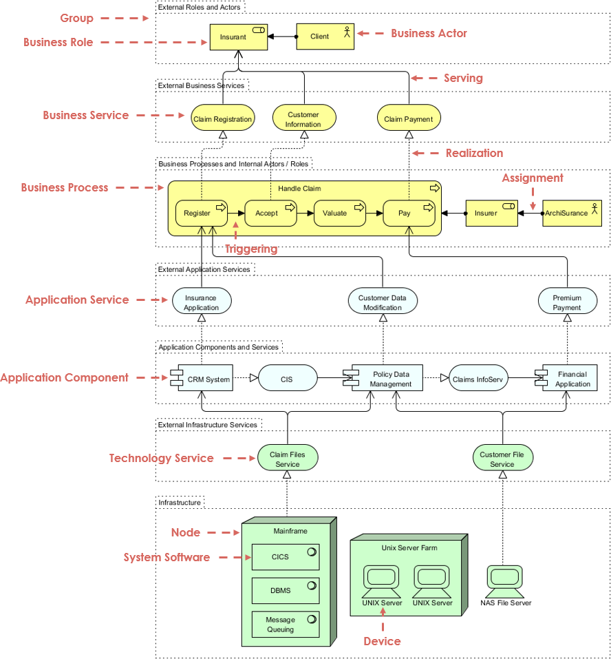
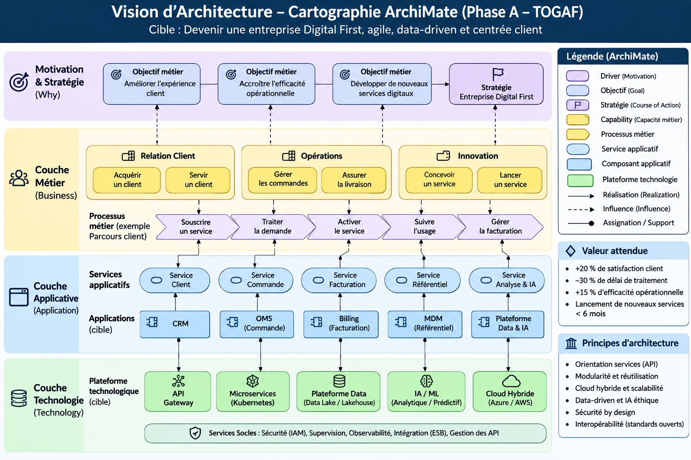
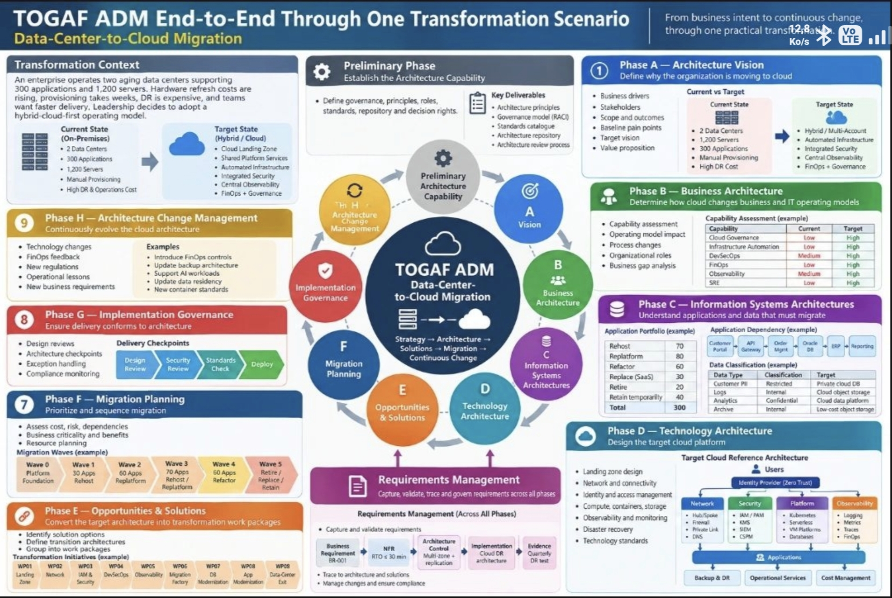
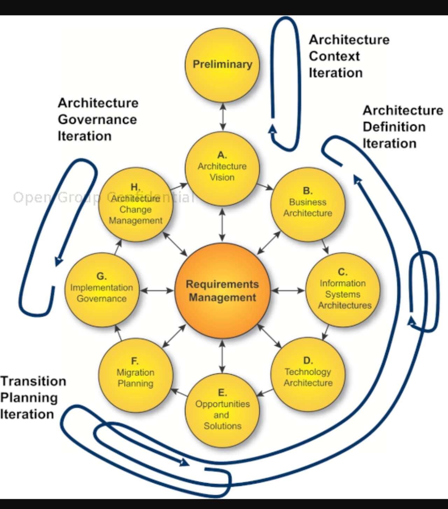
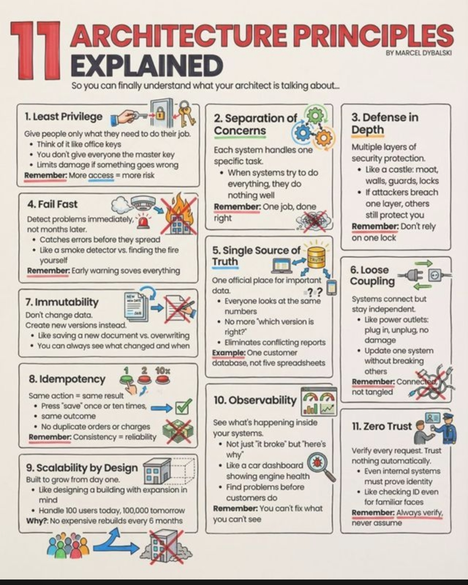

ENTERPRISE ARCHITECTURE · REFERENCE DOCUMENT

<h2>Summary</h2>
<ol>
<li><a href="#objectif-togaf">Understanding the objective of TOGAF</a></li>
<li><a href="#composants-togaf">The six components presented in the guide</a>
<ol><li><a href="#complementarite-composants">Example of complementarity</a></li></ol></li>
<li><a href="#domaines-architecture">The four domains of architecture</a>
<ol><li><a href="#exemple-virement">Design an instant transfer service</a></li></ol></li>
<li><a href="#outils-modelisation">TOGAF, ADM, ArchiMate and modeling tools</a></li>
<li><a href="#guidelines-techniques">ADM Guidelines and ADM Techniques</a>
<ol><li><a href="#adapter-adm">Adapt ADM to an architectural style</a></li></ol></li>
<li><a href="#techniques-architecture">The main techniques with a banking example</a>
<ol><li><a href="#principes-architecture">Architectural Principles</a></li><li><a href="#scenarios-metier">Business Scenarios</a></li><li><a href="#analyse-ecarts">Gap Analysis</a></li><li><a href="#interop">Interoperability Requirements</a></li><li><a href="#readiness">Transformation Readiness Assessment</a></li><li><a href="#risques">Risk Management</a></li><li><a href="#planification-capacites">Capability-Based Planning</a></li><li><a href="#migration">Migration Planning</a></li></ol></li>
<li><a href="#techniques-cycle-adm">Where to use techniques in the ADM cycle?</a></li>
<li><a href="#bonnes-pratiques">Good practices for the architect</a></li>
<li><a href="#revision-togaf">Revision sheet for TOGAF certification</a>
<ol><li><a href="#associations-clefs">The four associations to distinguish</a></li><li><a href="#mini-cas">Mini summary case</a></li></ol></li>
<li><a href="#sources">Sources and details</a></li>
</ol>
<h2 id="objectif-togaf">1. Understand the objective of TOGAF</h2>

TOGAF (The Open Group Architecture Framework) is a reference framework intended to help an organization design, plan, implement and govern its enterprise architecture. Its objective is in particular to align the technological capabilities of the information system with the objectives and business strategy.

A business generally has several dimensions that must evolve coherently:

strategy, objectives and business processes;

the data and information manipulated;

applications and their interactions;

infrastructures, platforms and technologies.

organizations, skills, governance rules and operating methods.

Example: a bank wants to digitalize its customer journeys, reduce time-to-market, migrate certain applications to the Cloud and modernize its monolithic applications. TOGAF provides a structured approach to link these ambitions to business, data, application and technological architectures, then organize their transformation.

<table><tr><td>
Takeaway — TOGAF is not a ready-made target technology or architecture. It is a framework that helps structure the architectural approach and its governance.
</td></tr></table>

<h2 id="composants-togaf">2. The six components presented in the guide</h2>

The first article from Visual Paradigm presents six components that contribute to the development and management of enterprise architecture. They answer different questions.

<table><tr><td>
Component
</td><td>
Key question
</td><td>
Role and example
</td></tr><tr><td>
ADM – Architecture Development Method
</td><td>
How to develop the architecture?
</td><td>
Core method and architecture development cycle, from vision to governance and change management.
</td></tr><tr><td>
ADM Guidelines and Techniques
</td><td>
How to apply ADM and what methods to use?
</td><td>
Recommendations for adapting the approach and techniques for carrying out the work: business scenarios, gap analysis, risk management, etc.
</td></tr><tr><td>
Content Framework Architecture
</td><td>
What content and artifacts to produce and how to structure them?
</td><td>
Structures architectural content: deliverables, artifacts and building blocks, as well as their relationships.
</td></tr><tr><td>
Reference Models
</td><td>
Which reference models should we rely on?
</td><td>
Provide reusable templates and references to accelerate and standardize design.
</td></tr><tr><td>
Enterprise Continuum
</td><td>
How to classify and reuse architecture assets?
</td><td>
Organizes assets from generic elements to organization-specific architectures.
</td></tr><tr><td>
Architecture Capability Framework
</td><td>
How to organize architecture capability?
</td><td>
Helps establish the roles, skills, processes, responsibilities and mechanisms necessary for the practice of architecture.
</td></tr></table>

<h3 id="complementarite-composants">2.1 Example of complementarity</h3>

Requirements management accompanies the ADM phases; the cycle can be iterated according to transformation needs.

Illustration – Representation of the ADM cycle and its phases.

This representation highlights the iterative nature of ADM and the central role of Requirements Management.

Illustration – ADM presented as a continuous cycle of change, planning, business and IT.

In a banking transformation towards the Cloud and microservices:

the ADM organizes the phases and activities of the approach;

the Guidelines and Techniques help to adapt the approach and conduct the analyses;

the Content Framework structures the deliverables and artifacts produced;

Reference Models provide reusable models;

Enterprise Continuum helps classify assets and find reusable elements;

The Architecture Capability Framework helps organize team, skills, and architecture governance.

<h2 id="domaines-architecture">3. The four domains of enterprise architecture</h2>

The guide presents four complementary domains. They are not four successive phases of ADM: they constitute four angles of description of the company.

<table><tr><td>
Domain
</td><td>
What it describes
</td><td>
Banking example
</td></tr><tr><td>
Business Architecture 
Business architecture
</td><td>
Strategy, objectives, organization, actors, capabilities and business processes.
</td><td>
Manage accounts, grant credits, process transfers and manage complaints.
</td></tr><tr><td>
Data Architecture 
Data Architecture
</td><td>
Data, conceptual/logical/physical models, storage, quality, governance and flow.
</td><td>
Customer, Account, Transaction, Loan; quality, safety and sharing rules.
</td></tr><tr><td>
Application Architecture 
Application Architecture
</td><td>
Applications, components, services, interfaces, APIs and interactions.
</td><td>
Customer Management, Account Management, Payment Service, API Gateway and Kafka.
</td></tr><tr><td>
Technology Architecture 
Technology Architecture
</td><td>
Infrastructure, platforms, networks, middleware, software and execution environments.
</td><td>
Cloud, Kubernetes, PostgreSQL, networking, storage, observability and technical security.
</td></tr></table>

<h3 id="exemple-virement">3.1 Example: designing an instant transfer service</h3>

Business needs and rules feed the conceptual model; the data types and structuring rules specify the logical model; keys, views and indexes contribute to the physical model.

Illustration – From the conceptual model to the logical then physical model of the data.

The map groups capabilities by business areas. It helps to discuss existing capabilities, their importance and developments to plan for.

Illustration – Example of Business Capabilities mapping.

<table><tr><td>
Domain
</td><td>
Architecture question
</td><td>
Example answer
</td></tr><tr><td>
Business
</td><td>
What business need must be covered?
</td><td>
Allow the customer to make an instant transfer.
</td></tr><tr><td>
Data
</td><td>
What data is required?
</td><td>
Customer, debit account, payee account, transaction, payment status.
</td></tr><tr><td>
Application
</td><td>
Which application services meet the need?
</td><td>
Payment Service, Account Service, fraud controls and payment API.
</td></tr><tr><td>
Technology
</td><td>
On which platforms do these services run?
</td><td>
Kubernetes cluster, Kafka platform, databases, network and security mechanisms.
</td></tr></table>

<table><tr><td>
Alignment principle — We start from the business need, we identify the necessary data and applications, then we choose the appropriate technologies. You don't choose Kafka or Kubernetes simply because these technologies are modern.
</td></tr></table>

<h2 id="outils-modelisation">4. TOGAF, ADM, ArchiMate and modeling tools</h2>

<table><tr><td>
Element
</td><td>
Nature
</td><td>
Role
</td></tr><tr><td>
TOGAF
</td><td>
Framework / reference frame
</td><td>
Provides a structured set of concepts, methods, content and practices for enterprise architecture.
</td></tr><tr><td>
ADM
</td><td>
Method at the heart of TOGAF
</td><td>
Describes the architecture development cycle and phases.
</td></tr><tr><td>
ArchiMate
</td><td>
Modeling language
</td><td>
Allows you to represent architectural elements and their relationships through views.
</td></tr><tr><td>
Visual Paradigm
</td><td>
Software tool
</td><td>
Allows you to create models, diagrams and deliverables; it also offers ADM support functions.
</td></tr><tr><td>
Archi
</td><td>
Modeling tool
</td><td>
Allows you to create and manipulate ArchiMate models.
</td></tr></table>

Example: to map a bank, the architect can represent a Business Capability, the processes that carry it out, the applications that support them, the data objects manipulated and the technological components that host the applications.

<table><tr><td>
Domain
</td><td>
Examples of ArchiMate elements
</td></tr><tr><td>
Business
</td><td>
Business Actor, Business Role, Business Process, Business Function, Business Capability, Business Service.
</td></tr><tr><td>
Data
</td><td>
Data Object.
</td></tr><tr><td>
Application
</td><td>
Application Component, Application Service, Application Interface, Application Function.
</td></tr><tr><td>
Technology
</td><td>
Node, Device, System Software, Technology Service.
</td></tr></table>

<table><tr><td>
Remember — TOGAF structures the approach; the ADM describes the process; ArchiMate provides a representation language; Visual Paradigm and Archi are tools for building models.
</td></tr></table>

<h2 id="guidelines-techniques">5. ADM Guidelines and ADM Techniques: the essential distinction</h2>

The second Visual Paradigm guide emphasizes a fundamental distinction between Guidelines and Techniques. Both help apply WMD, but they do not operate at the same level.

<table><tr><td>
Category
</td><td>
Question
</td><td>
Purpose
</td></tr><tr><td>
Guidelines – recommendations
</td><td>
How can I adapt the ADM process to my context?
</td><td>
Adapt the approach to the organizational context, architectural style or paradigm adopted.
</td></tr><tr><td>
Techniques – methods
</td><td>
How to actually carry out an architectural task?
</td><td>
Provide methods for discovering, analyzing, validating, evaluating or planning work.
</td></tr></table>

Analogy: when building a house, a guideline indicates how to adapt the project to the constraints of the land and the needs of the owner. A technique describes a concrete method for measuring terrain, calculating a structure or checking solidity.

<h3 id="adapter-adm">5.1 Adapt the ADM to an architectural style</h3>

The application core exposes ports; adapters connect external interfaces, databases, APIs and systems without making the core depend on their technologies.

Illustration – Hexagonal Architecture (Ports and Adapters).

This view combines access layer, services, storage, configuration, discovery, observability, and external integrations.

Illustration – Example of Cloud-native microservices architecture.

The diagram shows clusters, workloads, network, gateways, identity and security policies.

Illustration – Deployment of workloads on Kubernetes and Cloud platform services.

Infrastructure and platform components support microservices; databases are associated with services according to their responsibilities.

Illustration – Example of microservices architecture with API Gateway, service registry, load balancer, broker and observability.

TOGAF is deliberately generic. An organization can apply it to different styles: SOA, microservices, Cloud-native or data mesh. It is generally not necessary to rewrite the phases of the ADM. Adaptation rather involves the choice of models, viewpoints, notations and activities detailed in the phases concerned.

<table><tr><td>
Phase
</td><td>
Example of adaptation for a microservices transformation
</td></tr><tr><td>
A – Architecture Vision
</td><td>
Define the transformation vision, objectives, scope and stakeholders.
</td></tr><tr><td>
B – Business Architecture
</td><td>
Map business capabilities, processes and functional areas.
</td></tr><tr><td>
C – Information Systems
</td><td>
Define application services, bounded contexts, APIs, events and data responsibilities.
</td></tr><tr><td>
D – Technology Architecture
</td><td>
Define Cloud, container, network, security, observability and middleware platforms.
</td></tr><tr><td>
E – Opportunities &amp; Solutions
</td><td>
Define solutions, work packages and transition architectures.
</td></tr><tr><td>
F – Migration Planning
</td><td>
Plan phased migration and dependencies.
</td></tr><tr><td>
G – Implementation Governance
</td><td>
Verify compliance of the solutions produced with the approved architecture.
</td></tr><tr><td>
H – Architecture Change Management
</td><td>
Manage developments and determine if a new architecture cycle is necessary.
</td></tr></table>

<table><tr><td>
Nuance — Adaptation does not mean that every organization must adopt microservices or extend the metamodel. The style chosen depends on the context and needs.
</td></tr></table>

<h2 id="techniques-architecture">6. The main techniques explained with a banking example</h2>

Techniques are the architect's toolbox. They are selected according to the problem to be treated; they are not necessarily performed all together or in a rigid order.

<h3 id="principes-architecture">6.1 Architecture Principles – Architectural Principles</h3>

Question: What fundamental rules should guide architectural decisions?

<table><tr><td>
Part of principle
</td><td>
Role
</td><td>
Example: Data is a Shared Enterprise Asset
</td></tr><tr><td>
Name
</td><td>
Short, memorable name.
</td><td>
Data is a Shared Enterprise Asset.
</td></tr><tr><td>
Statement
</td><td>
Fundamental rule, clear and unambiguous.
</td><td>
All organizational data must be managed, secure, and accessible as a cohesive enterprise resource.
</td></tr><tr><td>
Rationale
</td><td>
Business justification and benefits.
</td><td>
Reduce silos, improve the quality of decisions and limit compliance risks.
</td></tr><tr><td>
Implications
</td><td>
Necessary actions, requirements, costs, resources and impacts.
</td><td>
Data governance, Data Owners, standardized metadata, access rules and integration of historical systems.
</td></tr></table>

<table><tr><td>
Exam memo — Name = memorizable; Statement = fundamental rule; Rational = why / benefits; Implications = consequences and required actions.
</td></tr></table>

<h3 id="scenarios-metier">6.2 Business Scenarios – Business scenarios</h3>

Question: what business problem are we trying to solve? This technique makes it possible to discover, document and validate needs with stakeholders, by describing a real situation, its actors, its environment and the expected results.

Example: customers abandon their credit applications because the process is too long.

<table><tr><td>
SMART criterion
</td><td>
Application
</td></tr><tr><td>
Specific
</td><td>
Simplify the credit subscription process.
</td></tr><tr><td>
Measurable
</td><td>
Reduce processing time from five days to one day.
</td></tr><tr><td>
Actionable
</td><td>
Digitize the route and automate controls.
</td></tr><tr><td>
Realistic
</td><td>
Build on existing APIs and services, taking into account constraints.
</td></tr><tr><td>
Time-bound
</td><td>
Deploy the first version within six months.
</td></tr></table>

Scenarios help build a shared vision in Phase A and specify business requirements in Phase B.

<h3 id="analyse-ecarts">6.3 Gap Analysis – Analysis of the gaps</h3>

Figure 6 – Comparison between the Baseline architecture and the Target architecture.

Question: What is missing to move from the existing architecture (Baseline) to the target architecture (Target)?

<table><tr><td>
Element
</td><td>
Baseline
</td><td>
Target
</td></tr><tr><td>
Applications
</td><td>
Banking monolith
</td><td>
Autonomous services by domain
</td></tr><tr><td>
Data
</td><td>
Centralized tightly coupled base
</td><td>
Clarified data responsibilities and mastered integrations
</td></tr><tr><td>
Communication
</td><td>
Dominant synchronous calls
</td><td>
REST and events as needed
</td></tr><tr><td>
Deployment
</td><td>
Manual operations
</td><td>
Automated CI/CD
</td></tr><tr><td>
Infrastructure
</td><td>
On-premise
</td><td>
Cloud or hybrid platform
</td></tr></table>

A structured analysis can classify Architecture Building Blocks (ABB) as follows:

Included: the element exists in the Baseline and remains present in the Target.

New: the element is necessary in the Target but does not exist in the Baseline.

Eliminated: the element exists in the Baseline but disappears from the Target.

New and deleted items should be reviewed to verify that no essential capabilities have been missed and that the deletions are intentional. Gap Analysis is used in the business, data, application and technological domains.

<h3 id="interop">6.4 Interoperability Requirements</h3>

The client accesses multiple microservices through a logical entry point; each service retains its business responsibility and storage.

Illustration – API Gateway Pattern.

Authentication, rate limiting, caching, discovery and routing contribute to the security and control of exchanges. The exact functions depend on the solution chosen.

Illustration – Possible functions of an API Gateway.

Producer services publish events to partitioned topics; consumer groups process them and track their progress using offsets.

Illustration – Event-driven exchanges with Apache Kafka.

Figure 7 – The four dimensions of interoperability.

Question: How should systems, processes and organizations exchange information and services? Interoperability is not limited to technical connectivity.

<table><tr><td>
Dimension
</td><td>
What it covers
</td><td>
Banking example
</td></tr><tr><td>
Business / Operational
</td><td>
Alignment of processes and operations.
</td><td>
Two banking entities coordinate the processing of a transfer.
</td></tr><tr><td>
Information
</td><td>
Data structure, semantics, sharing and governance.
</td><td>
Common payment information model and consistent identifiers.
</td></tr><tr><td>
Application
</td><td>
Functional integration between applications.
</td><td>
The payment system calls the accounts service via an API.
</td></tr><tr><td>
Technical
</td><td>
Infrastructure, networks, protocols and standards.
</td><td>
Secure connectivity, compatible protocols, exchange platform.
</td></tr></table>

Examples of possible technologies or standards: REST, SOAP, Kafka and ISO 20022. The choice depends on functional, non-functional, regulatory and operational requirements.

<h3 id="readiness">6.5 Business Transformation Readiness Assessment – ​​Transformation Readiness Assessment</h3>

Figure 8 – Organizational Readiness, Risk Control and Transformation.

Question: Is the organization really ready to adopt the changes proposed by the architecture?

<table><tr><td>
Assessed Dimension
</td><td>
State Example
</td></tr><tr><td>
Cloud Skills
</td><td>
Low: Need training and recruiting.
</td></tr><tr><td>
Management support
</td><td>
High: sponsor identified and objectives validated.
</td></tr><tr><td>
Budget
</td><td>
Available, but to be distributed in batches.
</td></tr><tr><td>
DevOps organization
</td><td>
To be built: roles and responsibilities to be defined.
</td></tr><tr><td>
Culture of transformation
</td><td>
Average: support for the necessary change.
</td></tr></table>

A target architecture may be technically relevant without the organization being ready to implement it. The evaluation must therefore result in actions: training, communication, pilots, support, role development and progressive planning.

<h3 id="risques">6.6 Risk Management – ​​Risk management</h3>

Question: what events can compromise the approach or the implementation of the architecture?

<table><tr><td>
Concept
</td><td>
Definition
</td><td>
Example
</td></tr><tr><td>
Initial Risk
</td><td>
Level of risk assessed before mitigation measures.
</td><td>
High risk of data corruption during migration.
</td></tr><tr><td>
Mitigation
</td><td>
Actions intended to reduce the likelihood or impact.
</td><td>
Migration tests, automatic checks, backups, repetitions and rollback.
</td></tr><tr><td>
Residual Risk
</td><td>
Level of risk remaining after measurements.
</td><td>
Low but not zero residual risk.
</td></tr><tr><td>
Monitoring
</td><td>
Monitoring and reassessment of risk.
</td><td>
Monitoring during implementation and compliance checks.
</td></tr></table>

The process can be summarized as follows: classification → identification → initial assessment → mitigation and residual assessment → monitoring. Risk management is continuous; the initial evaluation begins in particular in Phase A and monitoring is particularly important during Phase G.

<h3 id="planification-capacites">6.7 Capability-Based Planning – Planning based on capabilities</h3>

Figure 9 – A business capability mobilizes several architectural domains.

Question: What business capabilities need to be developed or improved to produce the expected results? This approach organizes changes around business outcomes rather than around isolated IT projects.

Example: Improve Payment Management capability.

<table><tr><td>
Domain
</td><td>
Capacity Contribution
</td></tr><tr><td>
Business
</td><td>
Optimize payment process and operational responsibilities.
</td></tr><tr><td>
Data
</td><td>
Unify and make transaction data more reliable.
</td></tr><tr><td>
Application
</td><td>
Develop or create Payment Service and its interfaces.
</td></tr><tr><td>
Technology
</td><td>
Provide execution, integration, security and observability platforms.
</td></tr></table>

Projects, investments, dependencies, milestones, and value metrics are coordinated to improve business capability. It's not just about launching a Kafka or Kubernetes project, but demonstrating how the changes contribute to the business outcome.

<h3 id="migration">6.8 Migration Planning – Migration planning</h3>

Figure 10 – Example of progressive migration trajectory.

Question: how to move from the existing to the target in a controlled manner? Planning organizes work packages, transition architectures, dependencies, priorities and the roadmap.

Lot 1: prepare the Cloud platform and security foundations.

Lot 2: modernize data and integration mechanisms.

Lot 3: extract the first services from the monolith.

Lot 4: gradually extend the decomposition by business domain.

Lot 5: Remove historical components when exit conditions are met.

Phases E and F are particularly important for structuring the solutions, batches and the migration plan.

<h2 id="techniques-cycle-adm">7. Where to use techniques in the ADM cycle?</h2>

The table below summarizes the main uses indicated by the Visual Paradigm guide. This is not an exclusive rule: several techniques are transversal and can be used in different phases.

<table><tr><td>
ADM phase
</td><td>
Guidelines / techniques mainly used
</td></tr><tr><td>
Preliminary
</td><td>
Definition of architectural principles; choice of style adaptations and implementation of capacity.
</td></tr><tr><td>
A – Architecture Vision
</td><td>
Business Scenarios; initial risk and readiness assessment; interoperability requirements.
</td></tr><tr><td>
B – Business Architecture
</td><td>
Detailed business scenarios; Business Gap Analysis; capacity mapping.
</td></tr><tr><td>
C – Information Systems Architectures
</td><td>
Gap Analysis of data and applications; interoperability; viewpoints adapted to the style.
</td></tr><tr><td>
D – Technology Architecture
</td><td>
Technological Gap Analysis; technical interoperability standards.
</td></tr><tr><td>
E – Opportunities &amp; Solutions
</td><td>
Detailed Readiness; mitigation plans; organization of work packages by capacity.
</td></tr><tr><td>
F – Migration Planning
</td><td>
Finalization of the roadmap according to risks, readiness, dependencies and priorities.
</td></tr><tr><td>
G – Implementation Governance
</td><td>
Monitor risks and verify compliance with interoperability principles and standards.
</td></tr><tr><td>
H – Architecture Change Management
</td><td>
Reassess readiness, manage change and determine whether to start a new cycle.
</td></tr></table>

<h2 id="bonnes-pratiques">8. Best practices for the architect</h2>

Start with the principles: define clear rules that will guide decisions before multiplying the diagrams.

Use business scenarios early to identify and validate requirements with stakeholders.

Carry out the Gap Analysis iteratively: do not wait for the end of all phases to detect omissions.

Treat readiness as a real indicator: if the organization is not ready, adapt the pace and the transformation plan.

Document risks in a register, update assessments and escalate major risks.

Link each project and technical decision to a business capability and a measurable outcome.

Adapt viewpoints and models to the context: produce the views necessary for decisions, without creating unnecessary documentation.

<h2 id="revision-togaf">9. Revision sheet for TOGAF certification</h2>

<table><tr><td>
Keyword of the question
</td><td>
Concept to recognize
</td><td>
Memo
</td></tr><tr><td>
How to develop enterprise architecture?
</td><td>
ADM
</td><td>
The process.
</td></tr><tr><td>
How to adapt the ADM to a context or style?
</td><td>
ADM Guidelines
</td><td>
Adapt the approach.
</td></tr><tr><td>
How to perform a defined architecture task?
</td><td>
ADM Techniques
</td><td>
The toolkit.
</td></tr><tr><td>
What content and artifacts should be produced?
</td><td>
Architecture Content Framework
</td><td>
Structure the content.
</td></tr><tr><td>
Reusable reference structures or models
</td><td>
Reference Models
</td><td>
Use reference models.
</td></tr><tr><td>
Classify and reuse architecture assets
</td><td>
Enterprise Continuum
</td><td>
Organize assets.
</td></tr><tr><td>
Establish architecture roles and capability
</td><td>
Architecture Capability Framework
</td><td>
Organize the architecture function.
</td></tr><tr><td>
Fundamental rule guiding decisions
</td><td>
Architecture Principle – Statement
</td><td>
Clear and unambiguous rule.
</td></tr><tr><td>
Business problem, actors and desired outcomes
</td><td>
Business Scenario
</td><td>
Identify and validate the need.
</td></tr><tr><td>
Difference between Baseline and Target
</td><td>
Gap Analysis
</td><td>
Identify the gaps.
</td></tr><tr><td>
Organizational preparedness for change
</td><td>
Business Transformation Readiness
</td><td>
Is the organization ready?
</td></tr><tr><td>
Initial Risk / Residual Risk
</td><td>
Risk Management
</td><td>
Before and after mitigation.
</td></tr><tr><td>
Business outcomes and capabilities
</td><td>
Capability-Based Planning
</td><td>
Plan by capacity.
</td></tr><tr><td>
Move from current state to target state
</td><td>
Migration Planning
</td><td>
Organize the transition.
</td></tr></table>

<h3 id="associations-clefs">9.1 The four associations not to be confused</h3>

<table><tr><td>
ADM — HOW – How to lead the development of architecture?
</td></tr></table>

<table><tr><td>
Content Framework — WHAT – What content, artifacts and deliverables should be structured?
</td></tr></table>

<table><tr><td>
Enterprise Continuum — CLASSIFY &amp; REUSE – How to classify and reuse assets?
</td></tr></table>

<table><tr><td>
ArchiMate — MODEL – How to represent architecture and its relationships?
</td></tr></table>

<h3 id="mini-cas">9.2 Mini-case summary</h3>

A bank wants to modernize its payment system. Management aims for faster processing, better availability and reduced technical debt.

Business Scenario: formalize the problem, the actors, the expected results and the indicators.

Architecture Principles: define the rules for security, data control, interoperability and reuse.

Capability-Based Planning: organize changes around Payment Management capacity.

Gap Analysis: Compare current monolith with target architecture.

Interoperability Requirements: define the exchanges between payment, accounts, fraud and external systems.

Risk Management: identify migration, availability, security and compliance risks.

Readiness Assessment: check skills, budget, sponsorship and operational capacity.

Migration Planning: divide the transformation into batches, transitions and milestones.

Implementation Governance: check that the delivered solutions respect the approved architecture.

<h2 id="sources">10. Sources and details</h2>

This document is an educational summary in French of the discussion, consolidated from the following two articles:

Visual Paradigm, “A Journey with TOGAF: A Quick Overview” (September 20, 2023): https://guides.visual-paradigm.com/a-journey-with-togaf-a-quick-overview/

Visual Paradigm, “A Comprehensive Guide to ADM Guidelines and Techniques”: https://www.visual-paradigm.com/guide/a-comprehensive-guide-to-adm-guidelines-and-techniques/

Accuracy: Visual Paradigm articles are educational resources. The banking examples and additional explanations have been reformulated to facilitate understanding and preparation for certification. For an examination question or normative interpretation, refer to the official text of the applicable TOGAF Standard.

<section class="resource-illustrations"><h2>Diagrams and illustrations</h2>
<figure class="resource-figure"><figcaption>Structure in business, application and technological layers of the ArchiMate language.</figcaption></figure>
<figure class="resource-figure"><figcaption>Enterprise Architecture Vision Mapping for TOGAF ADM Phase A.</figcaption></figure>
<figure class="resource-figure"><figcaption>TOGAF ADM cycle and main transformation phases.</figcaption></figure>
<figure class="resource-figure"><figcaption>Iterative loop of TOGAF ADM phases and requirements management.</figcaption></figure>
<figure class="resource-figure"><figcaption>Illustrated architectural principles: security, modularity, scalability and governance.</figcaption></figure>
</section>

