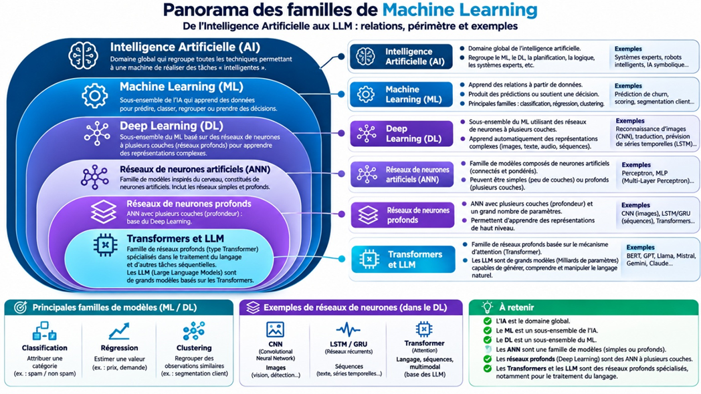
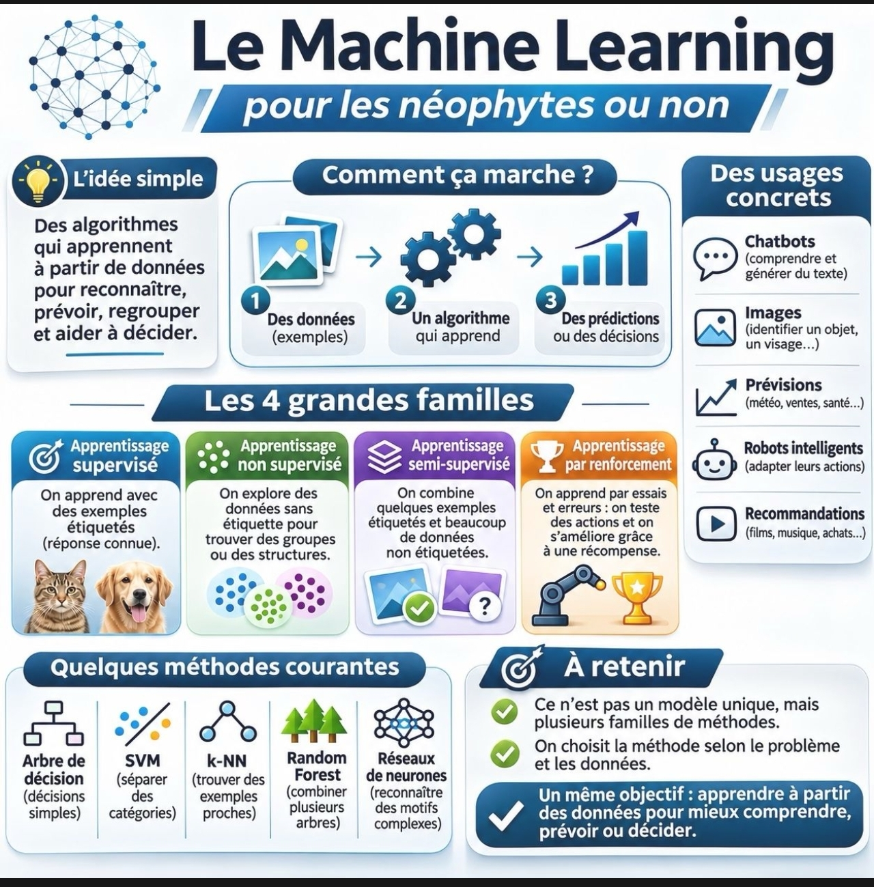
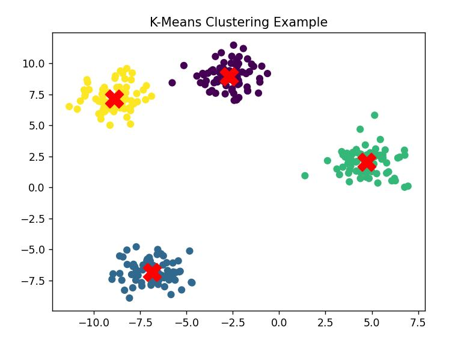
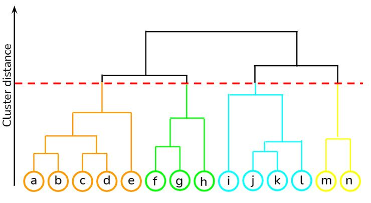
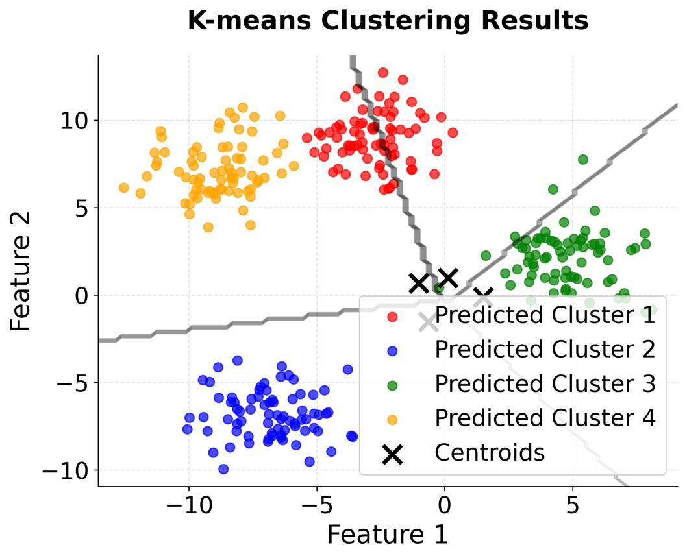
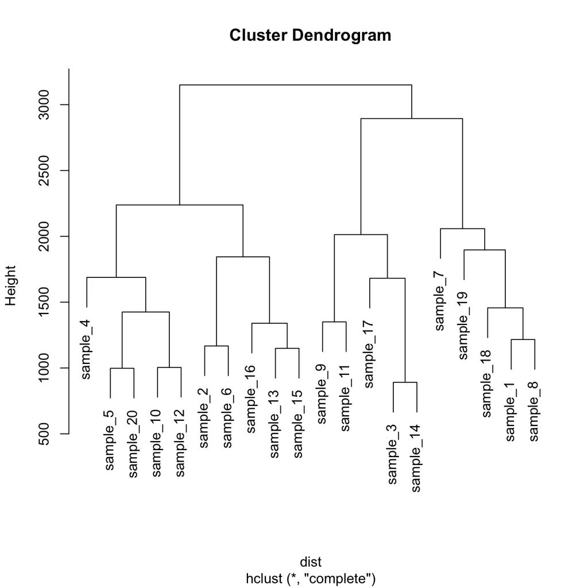

MACHINE LEARNING · BASIC ALGORITHMS

This page brings together the basic notions of Machine Learning, useful formulas, examples of algorithms and comments on the 17 visualizations. The explanations are grouped by topic to avoid repetition.

<figure class="resource-figure"><figcaption>Overview of Machine Learning families and their relationships.</figcaption></figure>
<h2>1. Benchmarks and families of Machine Learning</h2>

A general map locates artificial intelligence (AI), Machine Learning (ML), Deep Learning (DL), deep neural networks, then Transformers and large language models (LLM). Artificial neural networks (ANN) form a family of models; those that have several hidden layers generally fall under Deep Learning.

<h3>1.1 The three main categories of learning</h3>

<table><tr><th>Approach</th><th>Principle</th><th>Example</th></tr><tr><td>Supervised</td><td>Learn from data accompanied by labels.</td><td>Predict churn.</td></tr><tr><td>Unsupervised</td><td>Find structures in unlabeled data.</td><td>Segment customers.</td></tr><tr><td>Reinforcement</td><td>Learn a strategy from the rewards received.</td><td>Control an autonomous robot.</td></tr></table>

<h3>1.2 Classification of algorithms</h3>

<table><tr><th>Family</th><th>Algorithms</th><th>Objective</th></tr><tr><td>Regression</td><td>Linear, Ridge, Lasso</td><td>Predict a value.</td></tr><tr><td>Classification</td><td>Logistic, SVM, KNN, Naive Bayes</td><td>Predict a class.</td></tr><tr><td>Trees and Sets</td><td>Decision Tree, Random Forest, XGBoost</td><td>Predict from rules or sets of models.</td></tr><tr><td>Clustering</td><td>K-Means, DBSCAN, GMM</td><td>Identify groups.</td></tr><tr><td>Dimensional reduction</td><td>PCA, t-SNE, UMAP</td><td>Project or reduce variables.</td></tr><tr><td>Deep Learning</td><td>ANN, CNN, RNN, LSTM</td><td>Learn complex representations.</td></tr><tr><td>Generative</td><td>GAN, VAE, Transformers</td><td>Generate data or content.</td></tr><tr><td>Reinforcement</td><td>Q-Learning, PPO</td><td>Learn an action strategy.</td></tr></table>

<figure class="resource-figure"><figcaption>References to Machine Learning families.</figcaption></figure>

<h2>2. Fundamental mathematical functions</h2>
<h3>2.1 Linear function</h3>

<code>f(x) = ax + b</code>

Example: <code>Prix = 2 000 × Surface + 15 000</code>. For an area of ​​50 m², the estimated price is 115,000.

<h3>2.2 Cost functions</h3>

<code>MSE = (1/n) Σᵢ (yᵢ − ŷᵢ)²</code>

<code>MAE = (1/n) Σᵢ |yᵢ − ŷᵢ|</code>

<code>Binary Cross-Entropy = −(1/n) Σᵢ [yᵢ ln(pᵢ) + (1−yᵢ) ln(1−pᵢ)]</code>

The MSE strongly penalizes large errors; the MAE is less sensitive to extreme values; cross-entropy evaluates the predicted probabilities.

<h3>2.3 Gradient descent</h3>

<code>θₜ₊₁ = θₜ − α∇J(θₜ)</code>

θ represents the parameters, α the learning rate (*learning rate*) and ∇J the gradient. Variants include Batch, SGD, Mini-batch, Momentum, RMSProp and Adam.

<h3>2.4 Activation functions</h3>

<table><tr><th>Function</th><th>Formula</th><th>Commonly used</th></tr><tr><td>Sigmoid</td><td>1/(1+e⁻ˣ)</td><td>Binary classification.</td></tr><tr><td>Tanh</td><td>tanh(x)</td><td>Recurrent networks.</td></tr><tr><td>ReLU</td><td>max(0,x)</td><td>Hidden layers.</td></tr><tr><td>Leaky ReLU</td><td>max(0.01x,x)</td><td>Limit inactive neurons.</td></tr><tr><td>Softmax</td><td>eᶻⁱ / Σⱼeᶻʲ</td><td>Multiclass classification.</td></tr><tr><td>GELU</td><td>xΦ(x)</td><td>Transformers.</td></tr></table>

<h2>3. Supervised algorithms</h2>
<h3>3.1 Linear regression</h3>

Linear regression predicts a numerical value, such as price, consumption or sales.

<code>ŷ = w₁x₁ + … + wₙxₙ + b</code>

We minimize the MSE. Ridge adds an L2 penalty, Lasso an L1 penalty, and Elastic Net combines L1 and L2.

<h3>3.2 Logistic regression</h3>

Logistic regression is used for classification, for example to detect spam or predict churn. It transforms a score into probability: <code>z = wᵀx+b ; P(y=1|x) = 1/(1+e⁻ᶻ)</code>. It generally uses Binary Cross-Entropy and a decision threshold, for example 0.5.

<h3>3.3 Decision tree</h3>

A tree chains rules for classification or regression. The Gini index and entropy measure the impurity of the nodes: <code>Gini = 1 − Σₖpₖ²</code> and <code>H = −Σₖpₖ log₂(pₖ)</code>. The information gain compares the entropy of the parent to that of its children; in regression, we can use variance reduction or MSE.

<h3>3.4 Random Forest</h3>

Random Forest aggregates trees trained on bootstrap samples and subsets of variables. In regression, the tree predictions are averaged; in classification, they are combined by majority vote. This aggregation reduces the variance compared to an isolated tree.

<h3>3.5 Gradient Boosting, XGBoost and LightGBM</h3>

Gradient boosting successively adds trees to correct previous errors: <code>Fₘ(x) = F₀(x) + Σₘ ηhₘ(x)</code>. XGBoost exploits the gradient, the Hessian and the regularization; LightGBM promotes speed; CatBoost supports categorical variables.

<h3>3.6 K-Nearest Neighbors (KNN)</h3>

KNN classifies an observation according to its K nearest neighbors. The Euclidean distance is written <code>d(x,y) = √[Σᵢ(xᵢ−yᵢ)²]</code>. Classification uses a majority vote and regression uses an average. Standardization of variables is important.

<h3>3.7 Support Vector Machine (SVM)</h3>

SVM searches for a separator hyperplane with maximum margin. The linear boundary is described by <code>wᵀx+b=0</code> ; an RBF kernel can model non-linear separations: <code>K(x,x′)=exp(−γ||x−x′||²)</code>.

<h3>3.8 Naive Bayes</h3>

Naive Bayes performs probabilistic classification assuming conditional independence of variables: <code>P(A|B)=P(B|A)P(A)/P(B)</code>. Common variants are Gaussian, Multinomial and Bernoulli.

<h2>4. Unsupervised algorithms, dimension reduction and anomalies</h2>
<h3>4.1 K-Means</h3>

K-Means chooses K centroids, assigns each point to the nearest centroid, recalculates the centers and repeats these steps until stabilization. It minimizes the sum of quadratic distances: <code>J = Σₖ Σₓᵢ∈Cₖ ||xᵢ−μₖ||²</code>. The number of groups can in particular be chosen using the elbow method. K-Means is sensitive to outliers and is less suitable for groups of non-convex shapes.

The visualizations show partitions into three, four, and six groups. The crosses indicate the centroids and the borders represent the zones of allocation to the nearest center. Cluster labels identify groups without ranking them by quality.

<figure class="resource-figure"><figcaption>K-Means with four clusters.</figcaption></figure>
<figure class="resource-figure"><figcaption>Labels of K-Means clusters.</figcaption></figure>
<figure class="resource-figure"><figcaption>Clusters, isolated observations and centroids.</figcaption></figure>

<h3>4.2 DBSCAN</h3>

DBSCAN forms clusters from sufficiently dense areas. Its parameters are ε, the neighborhood radius, and MinPts, the minimum number of points. A point is central if <code>|Nε(p)| ≥ MinPts</code>, with <code>Nε(p) = {q ∈ D : d(p,q) ≤ ε}</code>. A border point is close to a central point without being central itself; isolated points are considered noise or outliers.

DBSCAN can detect groups of complex shapes and isolated points without fixing the number of clusters in advance. Unlike K-Means, it does not represent groups by centroids.

<h3>4.3 Hierarchical clustering</h3>

A dendrogram represents successive mergers between observations or groups. The vertical axis indicates the distance or dissimilarity at the time of the merger. A horizontal cut chosen at a given height determines the number of clusters: the lower branches indicate observations merged at a short distance, while the higher branches bring together more dissimilar sets.

<figure class="resource-figure"><figcaption>Hierarchical groupings and choice of cut.</figcaption></figure>

Other methods include GMM, Mean Shift, OPTICS, and Spectral Clustering.

<h3>4.4 PCA — principal component analysis</h3>

PCA transforms the initial variables into orthogonal principal components, ordered according to the variance explained. The steps include centering, calculating the covariance, finding the eigenvectors, choosing the components and projecting: <code>Xc = X − X̄ ; Σ = XcᵀXc/(n−1) ; Σv = λv ; Z = XcW</code>.

The visualizations compare the data before and after their projection onto two components, and show that a separation between classes can become more readable. PCA transforms variables and does not create classes.

<h3>4.5 UMAP and t-SNE</h3>

UMAP and t-SNE project many-dimensional data into a 2D map. Close groups suggest neighboring observations in the original space, but the projected axes do not necessarily have a direct business interpretation. t-SNE seeks above all to preserve local neighborhoods; distances between distant groups do not precisely measure their overall dissimilarity.

A visualization combines UMAP and K-Means: UMAP first reduces the dimension, then K-Means assigns the points to six groups. The projection facilitates inspection, but does not replace analysis in the original space.

<h3>4.6 Anomaly detection</h3>
<h4>Autoencoder</h4>

The encoder compresses the data into a latent representation called <em>bottleneck</em> ; the decoder attempts to reconstruct the original data. A high reconstruction error may signal an unusual observation, if the model was primarily trained on normal data.

<h4>LOF — Local Outlier Factor</h4>

LOF compares the local density of a point to that of its neighbors. A point located in an area that is much less dense than its neighborhood receives a high anomaly score. The visualizations show groups of normal observations and atypical points isolated or close to a group.

<h4>Isolation Forest</h4>

Isolation Forest builds trees using random splits. Atypical observations are generally isolated in few splits, while ordinary observations require more splits. The visualizations distinguish normal points from detected anomalies and illustrate their early isolation.

A statistical anomaly is not automatically an innovation. In technology monitoring, an expert must review the results to distinguish promising signals from false positives.

<h2>5. ANN — artificial neural networks</h2>

An ANN consists of an input layer, hidden layers and an output layer. Each neuron performs a weighted combination then applies an activation function: <code>z = Σᵢ wᵢxᵢ + b ; a = f(z)</code>.

Example: with <code>x₁=2</code>, <code>x₂=3</code>, <code>w₁=0,5</code>, <code>w₂=0,8</code> and <code>b=0,1</code>, we obtain <code>z=3,5</code> and <code>ReLU(z)=3,5</code>.

<h3>5.1 Forward propagation</h3>

<code>Z⁽ˡ⁾ = W⁽ˡ⁾A⁽ˡ⁻¹⁾ + b⁽ˡ⁾ ; A⁽ˡ⁾ = f(Z⁽ˡ⁾)</code>

<h3>5.2 Backpropagation</h3>

<code>∂L/∂w = (∂L/∂a)(∂a/∂z)(∂z/∂w)</code>

<code>wₜ₊₁ = wₜ − α ∂L/∂w</code>

Backpropagation calculates the gradients using the chained derivative rule and then updates the weights. An ANN can be shallow; several hidden layers generally characterize a Deep Learning network.

<h2>6. Which algorithm to use?</h2>

<table><tr><th>Objective</th><th>Possible methods</th><th>What to remember</th></tr><tr><td>Predict a price or value</td><td>Linear Regression, Ridge, Lasso</td><td>Numerical regression.</td></tr><tr><td>Predicting churn</td><td>Logistic Regression, XGBoost</td><td>Supervised classification.</td></tr><tr><td>Detect fraud</td><td>Random Forest, XGBoost, GNN</td><td>Compare performance and data quality.</td></tr><tr><td>Segment observations</td><td>K-Means, DBSCAN</td><td>Choose according to the shape of the groups and the treatment of noise.</td></tr><tr><td>Explore proximities or hierarchy</td><td>Dendrogram, UMAP, t-SNE</td><td>Visualize structure without overinterpreting projected distances.</td></tr><tr><td>Reduce dimension</td><td>PCA, UMAP, t-SNE</td><td>Project variables to facilitate analysis.</td></tr><tr><td>Detect anomalies</td><td>LOF, Isolation Forest, Autoencoder</td><td>Identify observations that deviate from usual behavior.</td></tr><tr><td>Analyze images</td><td>CNN, Vision Transformers</td><td>Learn visual representations.</td></tr><tr><td>Study time series</td><td>XGBoost, LSTM, Transformers</td><td>Take order and temporal dependence into account.</td></tr><tr><td>Process or generate text</td><td>Naive Bayes, BERT, LLM</td><td>Choose according to the classification or generation task.</td></tr><tr><td>Query documents</td><td>RAG + LLM</td><td>Retrieve document context at response time.</td></tr><tr><td>Exploit relationships</td><td>GNN, GraphRAG</td><td>Represent links as a graph.</td></tr><tr><td>Learning from decisions</td><td>Reinforcement Learning, Q-Learning, PPO</td><td>Learning from rewards.</td></tr></table>

<h2>7. Machine Learning Project Stages and Metrics</h2>

An ML project typically follows the stages below, from business understanding to production monitoring.

<table><tr><th>Step</th><th>Description</th></tr><tr><td>1</td><td>Business Understanding.</td></tr><tr><td>2</td><td>Data Collection.</td></tr><tr><td>3</td><td>Data Preparation.</td></tr><tr><td>4</td><td>Feature Engineering.</td></tr><tr><td>5</td><td>Model Selection.</td></tr><tr><td>6</td><td>Training.</td></tr><tr><td>7</td><td>Rating.</td></tr><tr><td>8</td><td>Deployment.</td></tr><tr><td>9</td><td>Monitoring.</td></tr></table>

<h3>7.1 Evaluation Metrics</h3>

<code>Accuracy = (TP+TN)/(TP+TN+FP+FN)</code>

<code>Precision = TP/(TP+FP)</code>

<code>Recall = TP/(TP+FN)</code>

<code>F1 = 2×Precision×Recall/(Precision+Recall)</code>

For classification, Accuracy, Precision, Recall, F1 and AUC-ROC can be used. For regression: MAE, MSE, RMSE and R². For clustering: Silhouette, Davies-Bouldin and Calinski-Harabasz.

<h2>8. Recommended learning path</h2>
<ol>
<li>Review the basics of Python, data tables and descriptive statistics.</li>
<li>Understand datasets, variables, labels and data preparation steps.</li>
<li>Study linear and logistic regression, then decision trees and ensemble methods.</li>
<li>Learn to choose suitable metrics and evaluate a model on data distinct from training data.</li>
<li>Explore clustering and dimensionality reduction to analyze data without labels.</li>
<li>Discover neural networks, forward propagation and backpropagation, then deep architectures.</li>
<li>Put these concepts into practice with small projects, and document the results and limitations of the models.</li>
</ol>

