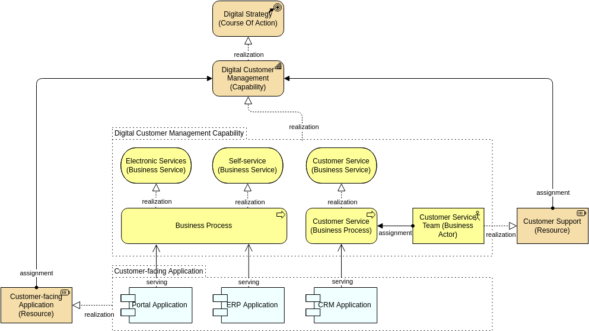
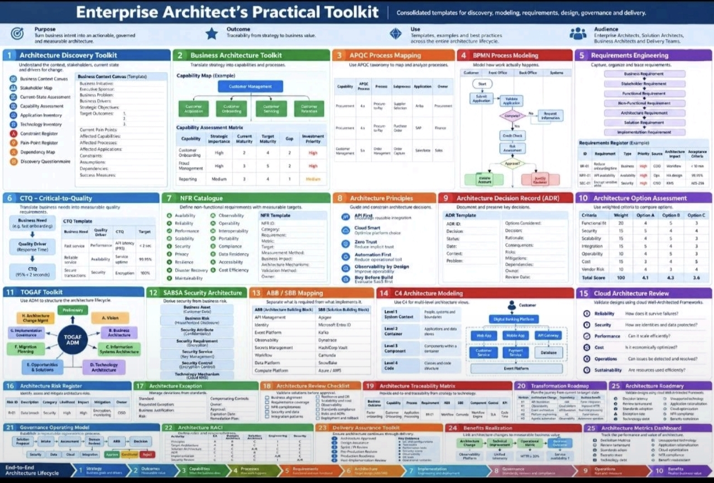
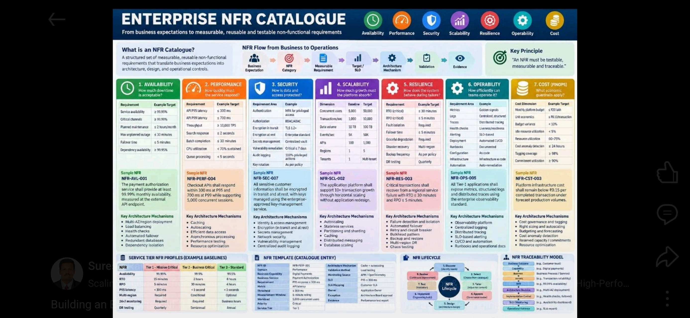
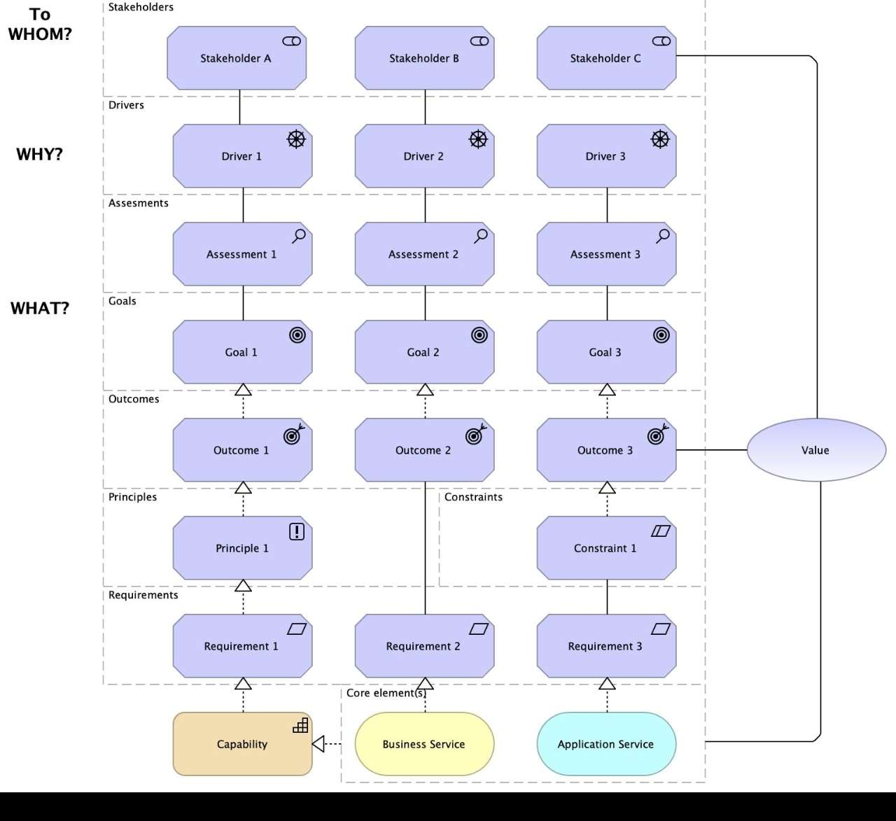
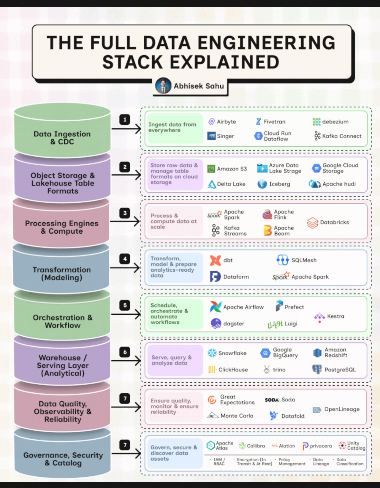

ENTERPRISE ARCHITECTURE · REFERENCE DOCUMENT

<h2>1. Understand what a catalog is</h2>

A catalog is a structured inventory of architectural elements. It describes objects, their characteristics and their owners. It answers the question: “What elements exist in architecture?” »

<table><tr><td>
Artifact
</td><td>
Role
</td><td>
Key question
</td><td>
Example
</td></tr><tr><td>
Catalog
</td><td>
Inventory elements and their attributes
</td><td>
What elements do we have?
</td><td>
Application Catalog
</td></tr><tr><td>
Matrix
</td><td>
Show relationships between sets
</td><td>
Which element is related to which other?
</td><td>
Application / Organization Matrix
</td></tr><tr><td>
Diagram
</td><td>
Represent a structure, flow or behavior
</td><td>
How does it work?
</td><td>
Application Communication Diagram
</td></tr></table>

<h3>Remember</h3>

Catalog = structured list of objects.

Matrix = table of correspondences between objects.

Diagram = visual representation of a structure or flow.

These artifacts are complementary: a catalog can serve as the basis for a matrix or a diagram.

<h2>2. The main catalogs by domain</h2>

The titles and groupings may vary depending on the edition, the metamodel and the adaptations of the organization. The function of each artifact remains the best benchmark for examination.

<h3>2.1 Governance, principles and requirements</h3>

<table><tr><td>
Catalog / registry
</td><td>
Typical content
</td><td>
Purpose
</td><td>
Example
</td></tr><tr><td>
Architecture Principles Catalog
</td><td>
Identifier, name, statement, rationale, implications, owner
</td><td>
Centralize the principles that guide decisions
</td><td>
“APIs secured by OAuth2/OIDC”
</td></tr><tr><td>
Architecture Requirements Catalog
</td><td>
Requirement, source, priority, status, acceptance criteria, traceability
</td><td>
Follow architecture requirements during ADM
</td><td>
“Any exposed API must be authenticated”
</td></tr><tr><td>
Stakeholder Map / stakeholder register
</td><td>
Actor, role, influence, concerns, expectations
</td><td>
Identify stakeholders and their concerns
</td><td>
CISO: security; business: processing time
</td></tr></table>

<h3>2.2 Business architecture — Phase B</h3>

<table><tr><td>
Catalog
</td><td>
Typical content
</td><td>
Objective
</td><td>
Example
</td></tr><tr><td>
Organization/Actor Catalog
</td><td>
Organization, unit, actor, reporting, responsibilities
</td><td>
Inventory business units and players
</td><td>
Payments Department; bank advisor
</td></tr><tr><td>
Driver/Goal/Objective Catalog
</td><td>
Change factor, objective, result, indicator, target
</td><td>
Connect motivations and business objectives
</td><td>
Reduce the deadline for a loan by 30%
</td></tr><tr><td>
Role Catalog
</td><td>
Role, responsibilities, skills, authorizations
</td><td>
Describe roles independently of people
</td><td>
Account manager
</td></tr><tr><td>
Business Service/Function Catalog
</td><td>
Business services and functions, description, owner
</td><td>
Describe what the business provides and the functions it performs
</td><td>
Service: open an account; function: check the customer
</td></tr><tr><td>
Location Catalog
</td><td>
Sites, agencies, centers, location, connection
</td><td>
List the locations concerned
</td><td>
Lyon bank branch
</td></tr></table>

<h3>2.3 Information systems architecture — Phase C</h3>

<table><tr><td>
Catalog
</td><td>
Typical Content
</td><td>
Purpose
</td><td>
Example
</td></tr><tr><td>
Data Entity / Data Component Catalog
</td><td>
Entity, definition, owner, sensitivity, lifecycle
</td><td>
Inventory data and data components
</td><td>
Customer, Account, Transfer
</td></tr><tr><td>
Application Portfolio Catalog
</td><td>
Application, function covered, owner, criticality, life cycle, technology
</td><td>
Know the application assets
</td><td>
Core Banking, CRM, Mobile Banking
</td></tr><tr><td>
Interface Catalog
</td><td>
Interface, source/target, protocol, format, frequency, security
</td><td>
Inventory exchanges and integration contracts
</td><td>
REST API between CRM and Core Banking
</td></tr></table>

<h3>2.4 Technological architecture — Phase D</h3>

<table><tr><td>
Catalog
</td><td>
Typical content
</td><td>
Objective
</td><td>
Example
</td></tr><tr><td>
Technology Standards Catalog
</td><td>
Standard, version, domain, status, support, waiver
</td><td>
Define allowed or recommended technologies
</td><td>
Java LTS, Kubernetes, TLS 1.3
</td></tr><tr><td>
Technology Portfolio Catalog
</td><td>
Technical component, use, location, owner, version, life cycle
</td><td>
Identify technical components and platforms
</td><td>
Kubernetes cluster, Linux, storage, load balancer
</td></tr></table>

<h2>3. Common thread example: modernization of a bank</h2>

A bank modernizes its transfer process and gradually replaces a monolithic system with distributed services.

<table><tr><td>
Catalog
</td><td>
Illustrative extract
</td></tr><tr><td>
Principles
</td><td>
P1: security by design; P2: contract-first API; P3: traceability of operations.
</td></tr><tr><td>
Requirements
</td><td>
REQ-01: strong authentication; REQ-02: logging; REQ-03: target availability.
</td></tr><tr><td>
Stakeholders
</td><td>
Director of Payments; compliance ; CISO; IS architect; exploitation.
</td></tr><tr><td>
Organization / actors
</td><td>
Payments Department; agency ; advise ; back office operator.
</td></tr><tr><td>
Drivers / objectives
</td><td>
Driver: growth of mobile payment; objective: to simplify the transfer.
</td></tr><tr><td>
Roles
</td><td>
Transfer initiator; controller; authorization administrator.
</td></tr><tr><td>
Services / functions
</td><td>
Service: make a transfer; functions: capture, control, execute, notify.
</td></tr><tr><td>
Data
</td><td>
Client; Account ; Payment ; Beneficiary.
</td></tr><tr><td>
Applications
</td><td>
Mobile Banking; API Gateway; Payment Hub; Core Banking; Notification Service.
</td></tr><tr><td>
Interfaces
</td><td>
Mobile Banking → API Gateway: REST/JSON; Payment Hub → Core Banking: API/event.
</td></tr><tr><td>
Technical standards
</td><td>
OAuth2/OIDC; TLS; OpenAPI; log standard; Java version supported.
</td></tr><tr><td>
Technology Portfolio
</td><td>
Kubernetes; Kafka; PostgreSQL; storage ; network ; firewall.
</td></tr></table>

<h2>4. Where do catalogs come into play in ADM?</h2>

<table><tr><td>
ADM stage
</td><td>
Catalogs / registers mainly concerned
</td><td>
Purpose
</td></tr><tr><td>
Preliminary
</td><td>
Architectural principles; standards; governance standards
</td><td>
Establish the framework and common rules
</td></tr><tr><td>
Phase A — Vision
</td><td>
Stakeholders; high-level requirements
</td><td>
Understand the concerns and frame the vision
</td></tr><tr><td>
Phase B — Business
</td><td>
Organization/stakeholders; roles; drivers/objectives; services/functions; locations
</td><td>
Describe the business architecture
</td></tr><tr><td>
Phase C — SI
</td><td>
Data entities/components; application portfolio; interfaces
</td><td>
Describe data, applications and exchanges
</td></tr><tr><td>
Phase D — Technology
</td><td>
Technological standards; technological portfolio
</td><td>
Describe the standards and infrastructure components
</td></tr><tr><td>
Phases E to H
</td><td>
Reuse and update the relevant catalogs
</td><td>
Design the solutions, govern the implementation and manage developments
</td></tr></table>

Important: the catalogs are not fixed at one phase. They are enriched over the course of iterations and can describe the existing (Baseline), the target (Target) and the intermediate states (Transition).

<h2>5. Do not confuse: mini-case</h2>

<table><tr><td>
Need
</td><td>
Adapted artifact
</td><td>
Reason
</td></tr><tr><td>
List applications, their owners and their criticality
</td><td>
Application Portfolio Catalog
</td><td>
Application inventory and attributes
</td></tr><tr><td>
Show which applications are used by which directions
</td><td>
Application/Organization Matrix
</td><td>
Relationship between applications and organizational units
</td></tr><tr><td>
Visualize exchanges between applications
</td><td>
Application Communication Diagram
</td><td>
Representation of interactions
</td></tr><tr><td>
List approved standards
</td><td>
Technology Standards Catalog
</td><td>
Inventory of rules and standards
</td></tr><tr><td>
Show which applications use which data entities
</td><td>
Application/Data Matrix
</td><td>
Relationship between applications and data
</td></tr><tr><td>
List the interfaces and their protocols
</td><td>
Interface Catalog
</td><td>
Interface inventory
</td></tr></table>

<h2>6. Common exam pitfalls</h2>

Application Portfolio Catalog = application assets; Interface Catalog = interfaces and exchanges between systems.

Technology Standards Catalog = authorized/recommended standards; Technology Portfolio Catalog = technological components identified.

Data Entity/Data Component Catalog = data; Portfolio Catalog app = apps.

Stakeholder concerns are not automatically technical requirements. They are analyzed then translated into architectural requirements.

A catalog alone does not explain interactions: use a matrix or diagram if the question concerns relationships or flows.

Catalogs can be adapted to the organization: always check the role of the artifact and do not rely only on its name.

<h2>7. Practice questions</h2>

Which catalog lists the applications, their owners and their life cycle?

Answer: Portfolio Catalog application.

Where are standards like TLS, Java LTS or Kubernetes located?

Answer: Technology Standards Catalog.

Which catalog lists the interfaces between applications?

Response: Interface Catalog.

Which catalog describes the actors and organizational units?

Answer: Organization/Actor Catalog.

What is the difference between Application Portfolio Catalog and Application/Organization Matrix?

Answer: The first inventories the applications; the second shows their relationships with organizational units.

Which catalog centralizes the principles, their justification and their implications?

Answer: Architecture Principles Catalog.

<h2>8. Final Memo</h2>

<table><tr><td>
Domain
</td><td>
Catalogs to Recognize
</td><td>
Keyword
</td></tr><tr><td>
Governance
</td><td>
Architecture Principles Catalog
</td><td>
Principles
</td></tr><tr><td>
Requirements
</td><td>
Architecture Requirements Catalog
</td><td>
Requirements
</td></tr><tr><td>
Stakeholders
</td><td>
Stakeholder Map
</td><td>
Concerns
</td></tr><tr><td>
Business
</td><td>
Organization/Actor; Role ; Driver/Goal/Objective; Business Service/Function; Location
</td><td>
Actors and profession
</td></tr><tr><td>
Data
</td><td>
Data Entity / Data Component
</td><td>
Data
</td></tr><tr><td>
Applications
</td><td>
Application Portfolio; Interface
</td><td>
Applications and exchanges
</td></tr><tr><td>
Technology
</td><td>
Technology Standards; Technology Portfolio
</td><td>
Standards and infrastructure
</td></tr></table>

CATALOG = WHAT?   • MATRIX = WHAT LINK?   • DIAGRAM = HOW?

<section class="resource-illustrations"><h2>Diagrams and illustrations</h2>
<figure class="resource-figure"><figcaption>Planning view of a business capacity and its services.</figcaption></figure>
<figure class="resource-figure"><figcaption>Overview of a practical enterprise architecture kit.</figcaption></figure>
<figure class="resource-figure"><figcaption>Visual example of an enterprise architecture catalog.</figcaption></figure>
<figure class="resource-figure"><figcaption>Example of business capacity planning and execution.</figcaption></figure>
<figure class="resource-figure"><figcaption>Visual repository of tools and deliverables for enterprise architects.</figcaption></figure>
</section>

