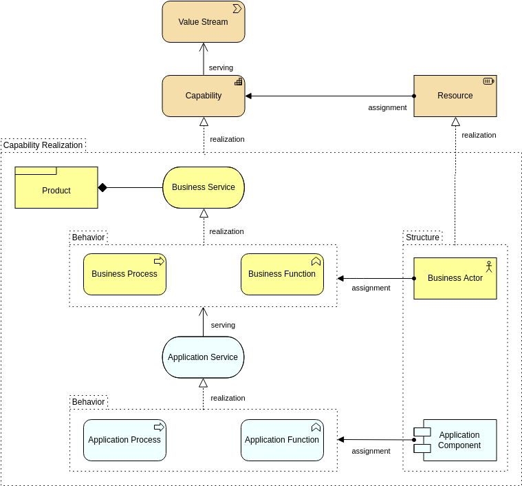
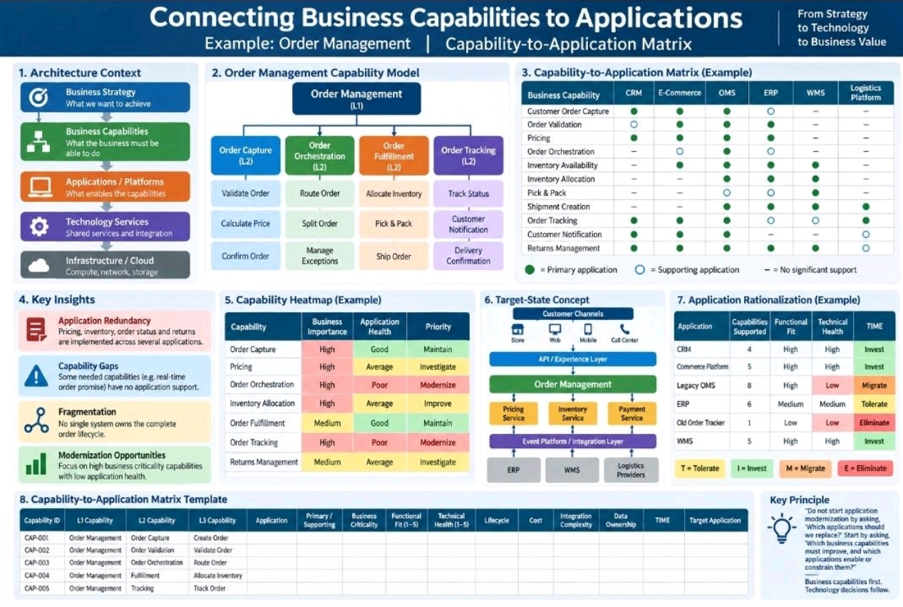
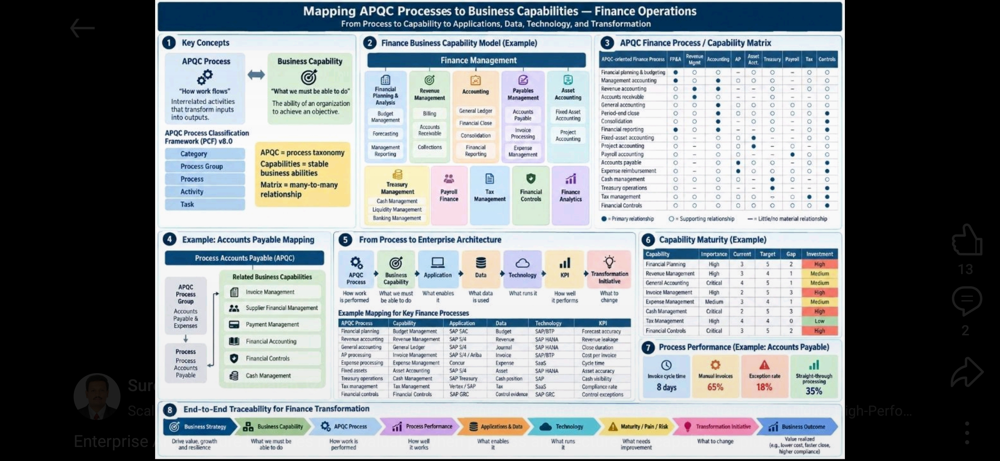
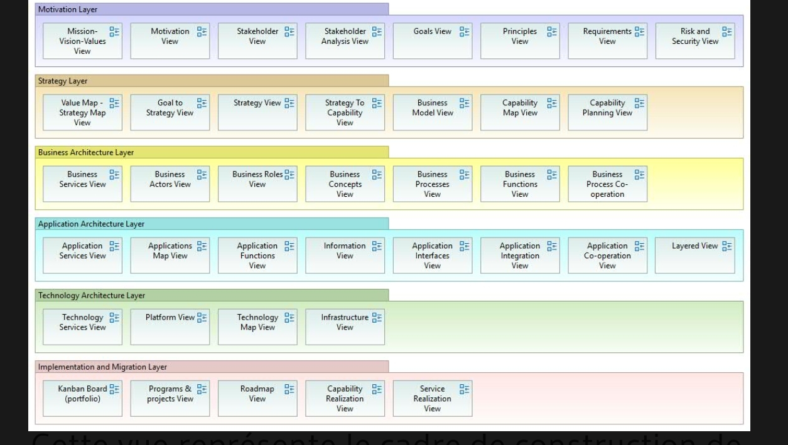
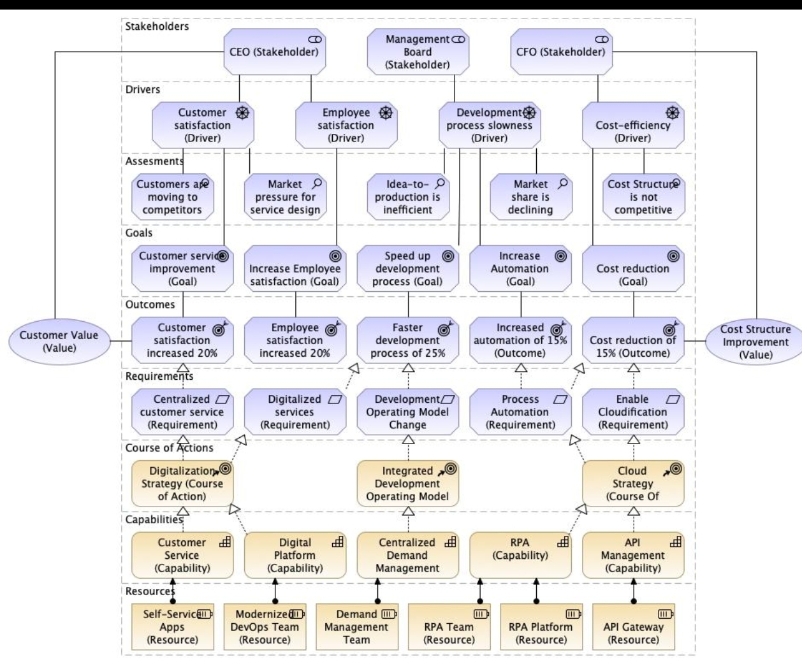
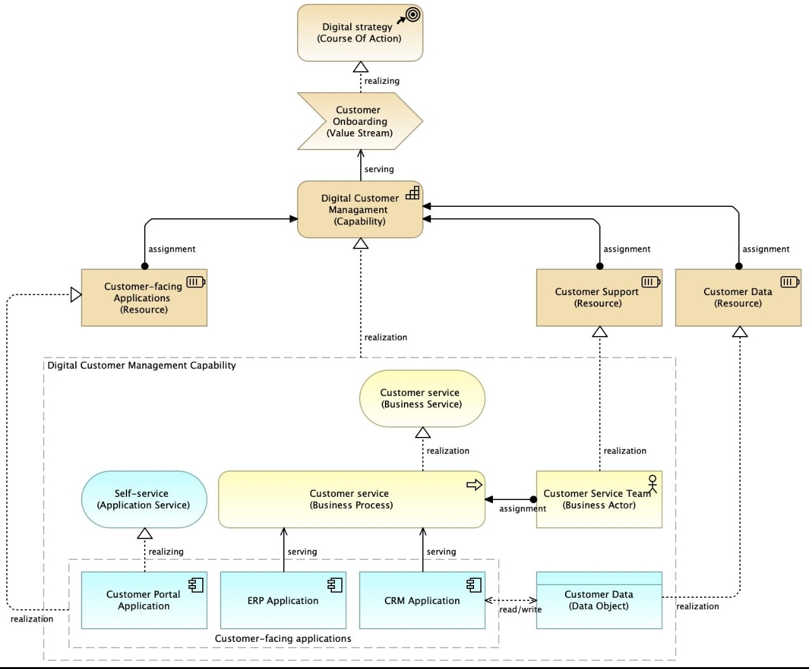

ENTERPRISE ARCHITECTURE · REFERENCE DOCUMENT

<h2>1. Essential benchmarks</h2>

<table><tr><td>
ADM phase
</td><td>
Domain
</td><td>
Guiding question
</td></tr><tr><td>
A – Architecture Vision
</td><td>
Vision and stakeholders
</td><td>
Who is affected and what transformation are we aiming for?
</td></tr><tr><td>
B – Business Architecture
</td><td>
Organization, actors, roles, functions, capacities
</td><td>
How does the business operate?
</td></tr><tr><td>
C – Information Systems Architecture
</td><td>
Data and applications
</td><td>
What data and applications support the business?
</td></tr><tr><td>
D – Technology Architecture
</td><td>
Technologies and platforms
</td><td>
What technologies are the applications based on?
</td></tr></table>

Matrices are representational artifacts. Their use depends on the scope, the concerns of the stakeholders and the level of detail sought. They are not all mandatory in each ADM cycle.

<h2>2. Phase A – Architecture Vision</h2>
<h3>Stakeholder Map / stakeholder analysis matrix</h3>

Phase A – Architecture Vision

Objective: Identify the actors, their influence, their interest and the communication strategy to adopt.

<table><tr><td>
Stakeholder
</td><td>
Influence
</td><td>
Interest
</td><td>
Approach
</td></tr><tr><td>
CIO
</td><td>
Forte
</td><td>
Strong
</td><td>
Involve closely
</td></tr><tr><td>
Business Director
</td><td>
Forte
</td><td>
Strong
</td><td>
Involve closely
</td></tr><tr><td>
CISO
</td><td>
Forte
</td><td>
Strong
</td><td>
Consult and validate
</td></tr><tr><td>
Developers
</td><td>
Average
</td><td>
Strong
</td><td>
Inform and consult
</td></tr><tr><td>
Users
</td><td>
Weak
</td><td>
Strong
</td><td>
Collect requirements
</td></tr></table>

Key question: Who is affected, what are their concerns and how can they be involved?

Please note: The Stakeholder Map is a mapping/analysis of stakeholders, rather than a single standardized matrix.

<h2>3. Phase B – Business Architecture</h2>
<h3>3.1 Business Interaction Matrix</h3>

Phase B – Business Architecture

Objective: Show the interactions between organizational units and the nature of their exchanges.

<table><tr><td>
Unit
</td><td>
Commercial
</td><td>
Finance
</td><td>
IT
</td></tr><tr><td>
Commercial
</td><td>
—
</td><td>
Sales data
</td><td>
CRM development request
</td></tr><tr><td>
Finance
</td><td>
Sales reporting
</td><td>
—
</td><td>
Need for reporting
</td></tr><tr><td>
IT
</td><td>
CRM support
</td><td>
Accounting support
</td><td>
—
</td></tr></table>

Key question: Which organizational units interact and for what exchanges?

<h3>3.2 Actor/Role Matrix</h3>

Phase B – Business Architecture

Objective: Connect the actors to the roles they play.

<table><tr><td>
Actor
</td><td>
Customer advisor
</td><td>
Credit manager
</td><td>
Agency manager
</td></tr><tr><td>
Ahmed
</td><td>
X
</td><td></td><td></td></tr><tr><td>
Sophie
</td><td>
X
</td><td>
X
</td><td></td></tr><tr><td>
Mark
</td><td></td><td></td><td>
X
</td></tr></table>

Key question: Who plays what role?

<h3>3.3 Value Stream/Capability Matrix</h3>

Phase B – Business Architecture

Objective: Link value chains to necessary business capabilities.

<table><tr><td>
Value Stream
</td><td>
Customer management
</td><td>
Credit analysis
</td><td>
Contract management
</td><td>
Billing
</td></tr><tr><td>
Open an account
</td><td>
X
</td><td></td><td>
X
</td><td></td></tr><tr><td>
Grant credit
</td><td>
X
</td><td>
X
</td><td>
X
</td><td></td></tr><tr><td>
Manage a refund
</td><td></td><td></td><td>
X
</td><td>
X
</td></tr></table>

Key question: What capabilities contribute to each value chain?

<h3>3.4 Strategy/Capability Matrix</h3>

Phase B – Business Architecture

Objective: Show which business capabilities contribute to strategic objectives.

<table><tr><td>
Strategic objective
</td><td>
Customer management
</td><td>
Digital payment
</td><td>
Risk analysis
</td></tr><tr><td>
Improve the customer experience
</td><td>
X
</td><td>
X
</td><td></td></tr><tr><td>
Reduce financial risks
</td><td></td><td></td><td>
X
</td></tr><tr><td>
Develop digital
</td><td>
X
</td><td>
X
</td><td></td></tr></table>

Key question: Which capabilities support which strategic objectives?

<h3>3.5 Capability/Organization Matrix</h3>

Phase B – Business Architecture

Objective: Identify the organizational units responsible or contributing to each capability.

<table><tr><td>
Ability
</td><td>
Commercial
</td><td>
Finance
</td><td>
IT
</td></tr><tr><td>
Customer management
</td><td>
X
</td><td></td><td></td></tr><tr><td>
Payment management
</td><td></td><td>
X
</td><td></td></tr><tr><td>
Risk management
</td><td></td><td>
X
</td><td></td></tr><tr><td>
IT infrastructure
</td><td></td><td></td><td>
X
</td></tr></table>

Key question: Which unit is responsible for which capacity?

<h3>3.6 Function/Organization Matrix</h3>

Phase B – Business Architecture

Objective: Link business functions to the organizational units that carry them out.

<table><tr><td>
Business function
</td><td>
Commercial
</td><td>
Finance
</td><td>
IT
</td></tr><tr><td>
Customer prospecting
</td><td>
X
</td><td></td><td></td></tr><tr><td>
Billing
</td><td></td><td>
X
</td><td></td></tr><tr><td>
IS operation
</td><td></td><td></td><td>
X
</td></tr></table>

Key question: Which unit performs which business function?

Please note: To be distinguished from a catalog of actors or a Business Interaction Matrix.

<h2>4. Phase C – Information Systems Architecture</h2>
<h3>4.1 Data Architecture</h3>
<h3>Data Entity/Business Function Matrix</h3>

Phase C – Data Architecture

Objective: Identify the data entities used or produced by business functions.

<table><tr><td>
Data Entity
</td><td>
Customer management
</td><td>
Credit management
</td><td>
Billing
</td></tr><tr><td>
Customer
</td><td>
X
</td><td>
X
</td><td>
X
</td></tr><tr><td>
CONTRACT
</td><td></td><td>
X
</td><td>
X
</td></tr><tr><td>
Bill
</td><td></td><td></td><td>
X
</td></tr><tr><td>
Credit application
</td><td></td><td>
X
</td><td></td></tr></table>

Key question: Which business functions use or produce which data entities?

<h3>Application/Data Matrix</h3>

Phase C – Data Architecture

Goal: Link applications to the data entities they create, read, modify, or delete.

<table><tr><td>
Application
</td><td>
Customer
</td><td>
CONTRACT
</td><td>
Bill
</td><td>
Payment
</td></tr><tr><td>
CRM
</td><td>
CRUD
</td><td>
R
</td><td></td><td></td></tr><tr><td>
Credit app
</td><td>
R
</td><td>
CRUD
</td><td></td><td></td></tr><tr><td>
ERP
</td><td>
R
</td><td>
R
</td><td>
CRUD
</td><td>
R
</td></tr><tr><td>
Payment Gateway
</td><td>
R
</td><td></td><td></td><td>
CRUD
</td></tr></table>

Key question: Which application accesses which data and with which operations?

Please note: CRUD stands for Create, Read, Update, Delete. Simplified example.

<h3>4.2 Application Architecture</h3>
<h3>Application/Organization Matrix</h3>

Phase C – Application Architecture

Objective: Show which organizational units use or manage applications.

<table><tr><td>
Application
</td><td>
Commercial
</td><td>
Finance
</td><td>
IT
</td></tr><tr><td>
CRM
</td><td>
X
</td><td></td><td>
X
</td></tr><tr><td>
ERP
</td><td></td><td>
X
</td><td>
X
</td></tr><tr><td>
Credit app
</td><td>
X
</td><td>
X
</td><td>
X
</td></tr><tr><td>
Monitoring
</td><td></td><td></td><td>
X
</td></tr></table>

Key question: Which unit uses or manages which application?

<h3>Role/Application Matrix</h3>

Phase C – Application Architecture

Objective: Connect business roles to the applications necessary for their activity.

<table><tr><td>
Role
</td><td>
CRM
</td><td>
ERP
</td><td>
Credit app
</td></tr><tr><td>
Customer advisor
</td><td>
X
</td><td></td><td>
X
</td></tr><tr><td>
An accountant
</td><td></td><td>
X
</td><td></td></tr><tr><td>
Credit manager
</td><td>
X
</td><td></td><td>
X
</td></tr><tr><td>
IT administrator
</td><td>
X
</td><td>
X
</td><td>
X
</td></tr></table>

Key question: What applications are used by each role?

<h3>Application/Function Matrix</h3>

Phase C – Application Architecture

Objective: Identify applications that support business functions and identify redundancies or uncovered functions.

<table><tr><td>
Application
</td><td>
Customer management
</td><td>
Credit management
</td><td>
Billing
</td><td>
Payment
</td></tr><tr><td>
CRM
</td><td>
X
</td><td></td><td></td><td></td></tr><tr><td>
Credit app
</td><td>
X
</td><td>
X
</td><td></td><td></td></tr><tr><td>
ERP
</td><td></td><td></td><td>
X
</td><td>
X
</td></tr><tr><td>
Payment Gateway
</td><td></td><td></td><td></td><td>
X
</td></tr></table>

Key question: Which applications support which business functions?

Please note: In the TOGAF catalog, favor Application/Function Matrix rather than Systems/Function Matrix.

<h3>Interaction Matrix app</h3>

Phase C – Application Architecture

Objective: Describe the exchanges and dependencies between applications.

<table><tr><td>
Source application
</td><td>
Target application
</td><td>
Exchange
</td></tr><tr><td>
CRM
</td><td>
Credit app
</td><td>
Customer information
</td></tr><tr><td>
Credit app
</td><td>
ERP
</td><td>
Credit agreement
</td></tr><tr><td>
ERP
</td><td>
Payment Gateway
</td><td>
Payment request
</td></tr><tr><td>
Payment Gateway
</td><td>
ERP
</td><td>
Payment confirmation
</td></tr><tr><td>
CRM
</td><td>
ERP
</td><td>
Billing information
</td></tr></table>

Key question: What applications communicate and what information do they exchange?

<h2>5. Phase D – Technology Architecture</h2>
<h3>Application/Technology Matrix</h3>

Phase D – Technology Architecture

Objective: Associate applications with the technologies and platforms that support them.

<table><tr><td>
Application
</td><td>
Java/Spring Boot
</td><td>
PostgreSQL
</td><td>
Kafka
</td><td>
Kubernetes
</td></tr><tr><td>
CRM
</td><td>
X
</td><td>
X
</td><td></td><td>
X
</td></tr><tr><td>
Credit app
</td><td>
X
</td><td>
X
</td><td>
X
</td><td>
X
</td></tr><tr><td>
ERP
</td><td>
X
</td><td>
X
</td><td>
X
</td><td>
X
</td></tr><tr><td>
Payment Gateway
</td><td>
X
</td><td></td><td>
X
</td><td>
X
</td></tr></table>

Key question: What technologies and platforms support each application?

Please note: Helps identify technical dependencies, standards, obsolescence and rationalization opportunities.

<h2>6. Do not confuse: matrices, catalogs and diagrams</h2>

<table><tr><td>
Artifact
</td><td>
Type/description
</td><td>
Phase
</td></tr><tr><td>
Business Service/Function
</td><td>
Catalog or correspondence matrix depending on the support; connects services and business functions
</td><td>
B
</td></tr><tr><td>
Organization/Actor Catalog
</td><td>
Catalog of organizational units and actors
</td><td>
B
</td></tr><tr><td>
Business Interaction Matrix
</td><td>
Matrix of interactions between organizational units
</td><td>
B
</td></tr><tr><td>
Communication Diagram app
</td><td>
Diagram of exchanges and communications between applications
</td><td>
C
</td></tr><tr><td>
Interaction Matrix app
</td><td>
Application Relationship Matrix
</td><td>
C
</td></tr><tr><td>
Application/Function Matrix
</td><td>
Applications/business functions matrix
</td><td>
C
</td></tr><tr><td>
Systems/Function Matrix
</td><td>
Name found in certain media or adaptations; don't automatically override Application/Function
</td><td>
According to model
</td></tr></table>

Clarification: the names and classification may vary depending on the TOGAF edition and the educational materials. For the exam, check if the question is for a catalog, matrix or diagram.

<h2>7. Quick memorization sheet</h2>

<table><tr><td>
Relationship
</td><td>
Question to ask yourself
</td><td>
Phase
</td></tr><tr><td>
Actor/Role
</td><td>
Who plays what role?
</td><td>
B
</td></tr><tr><td>
Business Interaction
</td><td>
Who exchanges with whom?
</td><td>
B
</td></tr><tr><td>
Function/Organization
</td><td>
Who performs what function?
</td><td>
B
</td></tr><tr><td>
Value Stream/Capability
</td><td>
What capabilities does the value chain achieve?
</td><td>
B
</td></tr><tr><td>
Strategy/Capability
</td><td>
What capabilities support the strategy?
</td><td>
B
</td></tr><tr><td>
Capability/Organization
</td><td>
Who carries what capacity?
</td><td>
B
</td></tr><tr><td>
Data Entity/Business Function
</td><td>
Which functions use which data?
</td><td>
C – Data
</td></tr><tr><td>
Application/Data
</td><td>
Which applications handle which data?
</td><td>
C – Data
</td></tr><tr><td>
Application/Organization
</td><td>
Who uses or manages which application?
</td><td>
C – Application
</td></tr><tr><td>
Role/Application
</td><td>
Which role uses which application?
</td><td>
C – Application
</td></tr><tr><td>
Application/Function
</td><td>
Which application supports which function?
</td><td>
C – Application
</td></tr><tr><td>
Application Interaction
</td><td>
Which applications communicate?
</td><td>
C – Application
</td></tr><tr><td>
Application/Technology
</td><td>
Which technology supports which application?
</td><td>
D
</td></tr></table>

<h2>8. Method for answering exam questions</h2>

Identify the two types of related elements: actors/roles, applications/functions, data/functions, applications/technologies.

Identify the implied verb: use, produce, support, communicate, be responsible for.

Associate the domain with the phase: business = B; data and applications = C; technology = D.

Check the requested artifact type: catalog, matrix or diagram.

Do not confuse a useful conceptual relationship with the exact name of an artifact in the TOGAF catalog.

<h2>9. Mini-glossary</h2>

<table><tr><td>
Term
</td><td>
Meaning
</td></tr><tr><td>
Business Function
</td><td>
Business function performed by the organization.
</td></tr><tr><td>
Business Capability
</td><td>
Ability of the company to realize a business capability.
</td></tr><tr><td>
Value Stream
</td><td>
Set of end-to-end activities that create value.
</td></tr><tr><td>
Data Entity
</td><td>
Business concept or information object about which the company maintains data.
</td></tr><tr><td>
Application Component
</td><td>
Application component offering functionalities.
</td></tr><tr><td>
Technology Component
</td><td>
Technology component providing infrastructure or platform services.
</td></tr><tr><td>
CRUD
</td><td>
Create, Read, Update, Delete: data operations.
</td></tr></table>

<section class="resource-illustrations"><h2>Diagrams and illustrations</h2>
<figure class="resource-figure"><figcaption>View of realizing a business capability through services, processes and components.</figcaption></figure>
<figure class="resource-figure"><figcaption>Mapping matrix between business capabilities and applications.</figcaption></figure>
<figure class="resource-figure"><figcaption>Summary view of architectural matrices and domains.</figcaption></figure>
<figure class="resource-figure"><figcaption>Examples of enterprise architecture mapping matrices.</figcaption></figure>
<figure class="resource-figure"><figcaption>Realization relationships between strategy, capabilities, services and applications.</figcaption></figure>
<figure class="resource-figure"><figcaption>ArchiMate example of realizing a customer management capability.</figcaption></figure>
</section>

