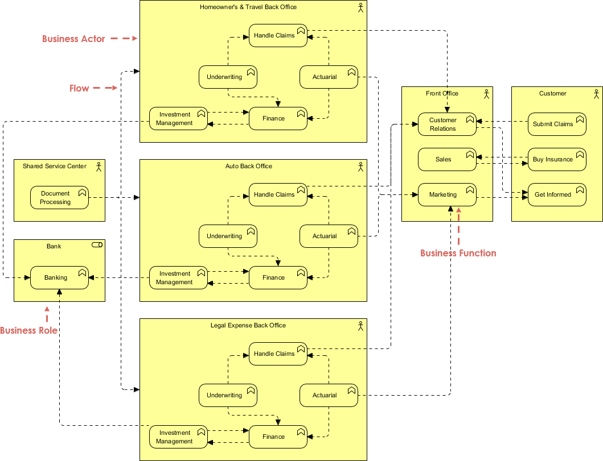
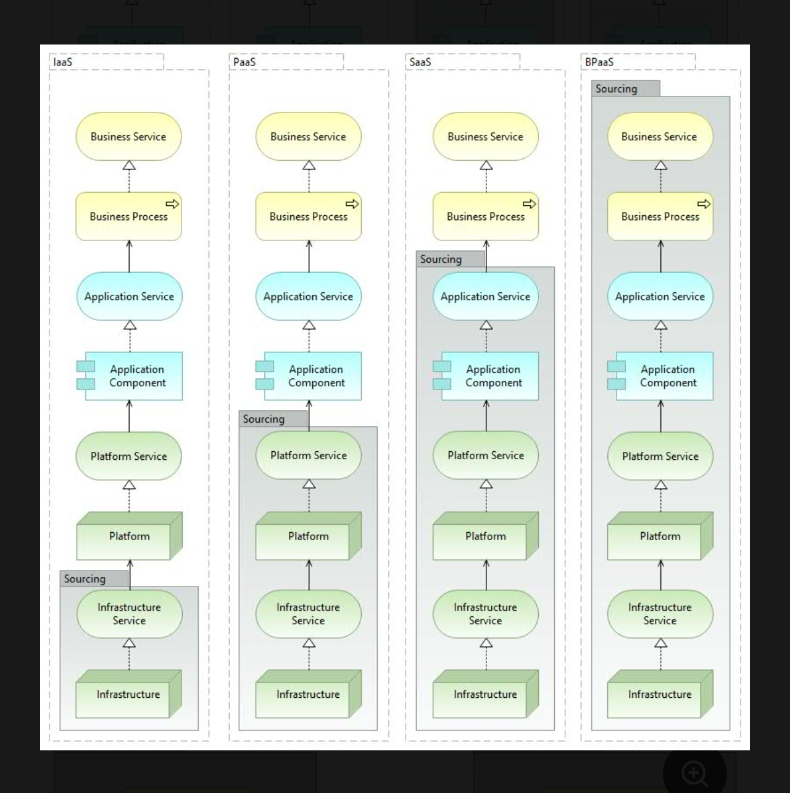
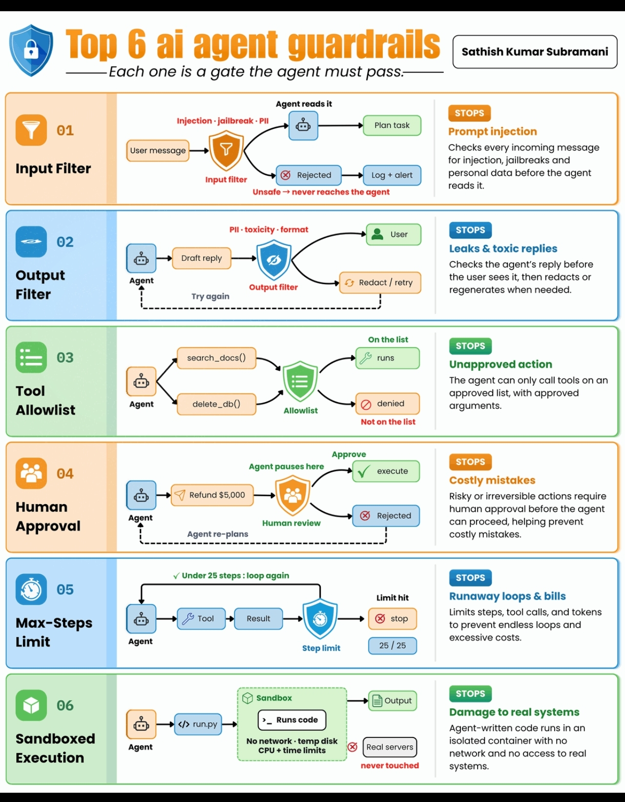

ENTERPRISE ARCHITECTURE · REFERENCE DOCUMENT

<h2>Introduction – Understanding the progression of Building Blocks</h2>

To fully understand this notion in TOGAF, let's take a concrete example of transforming a bank's information system towards a Cloud and microservices architecture.

The objective is to follow the same business need through the different phases of the ADM and to see how an abstract Building Block gradually becomes a concrete solution.

<h3>Context: digitalization of a bank</h3>

A bank wants to allow its customers to take out a mortgage loan entirely online.

In phase A (Architecture Vision), several necessary capabilities are identified:

Digital Loan Management (digital credit management)

Customer Data Management (customer data management)

Document Management (document management)

Credit Scoring (credit risk assessment)

Payment Management (payment management)

At this point, these are high-level architectural capabilities. The precise implementation methods have not yet been defined.

<h2>1. Phase B – Business Architecture</h2>

Objective: Transform abstract business capabilities into clearly defined business processes, functions, services and responsibilities.

Abstract Building Block: Digital Loan Management. In phase B, this capacity is broken down into business activities.

<h3>Example: process of subscribing to a real estate loan</h3>

Receipt of the customer's request

Verification of identity and eligibility

Collection of supporting documents

Solvency analysis

Validation or refusal of credit

Issuance of the credit offer

Business actors concerned:

Client

Bank advisor

Credit analyst

Risk manager

Possible deliverables of Phase B:

Business Capability Map

Business Process Diagram (BPMN)

Business Service Catalog

Organization/Actor Catalog

Gap Analysis between current and target business architecture

Takeaway: we move from a general “Credit Management” capability to a structured description of the way the bank should operate.

<h2>2. Phase C – Data Architecture</h2>

Objective: Transform business information needs into data entities, data models and logical data components.

Abstract Building Block: Customer Data Management. The underwriting process requires information about the client, their income and assets.

<h3>Example: breakdown of the Customer Data block</h3>

Possible business entities/data:

Customer

Loan Application

Income

Property

Bank Account

Repayment

Example logical data model:

<table><tr><td>
Entity
</td><td>
Possible attributes
</td></tr><tr><td>
Customer
</td><td>
Customer_ID, First_Name, Last_Name, Date_Of_Birth, Address
</td></tr><tr><td>
Loan_Application
</td><td>
Application_ID, Customer_ID, Requested_Amount, Duration, Status
</td></tr></table>

We can also define:

The relationships between the entities

The data owners (Data Owners)

Data quality rules

Security and confidentiality rules

Data creation, modification and consultation flows

Concerning storage, we can identify a logical data storage component, then define the concrete solutions in the technological phases: PostgreSQL, Oracle, object storage, etc.

Possible deliverables:

Conceptual Data Diagram

Logical Data Diagram

Data Entity/Data Component Catalog

Data Entity/Business Function Matrix

Application/Data Matrix

<h2>3. Phase C – Application Architecture</h2>

Objective: transform abstract application capabilities into logical application components and define their interactions.

Abstract Building Block: Digital Loan Management. From the business process defined in phase B, we identify the applications and logical components necessary to support it.

<h3>Example: application components</h3>

<table><tr><td>
Logical application component
</td><td>
Responsibility
</td></tr><tr><td>
Digital Banking Portal
</td><td>
Client user interface
</td></tr><tr><td>
Loan Management Component
</td><td>
Credit file management
</td></tr><tr><td>
Customer Management
</td><td>
Customer Information Management
</td></tr><tr><td>
Document Management
</td><td>
Supporting and Document Management
</td></tr><tr><td>
Credit Scoring
</td><td>
Credit Risk Assessment
</td></tr><tr><td>
Notification Service
</td><td>
Notifications to client
</td></tr></table>

<h3>Example of interaction</h3>

The client portal transmits a request to Loan Management.

Loan Management queries Customer Management.

Documents are transmitted to Document Management.

Loan Management requests Credit Scoring.

The decision is retrieved and communicated to the client.

We also define:

The responsibilities of each component

The interfaces and APIs

The interactions between the components

The data exchanges

The relationships between applications and business processes

Possible deliverables:

Application Portfolio Catalog

Interface Catalog

Application Communication Diagram

Application Interaction Matrix

Application Use-Case Diagram

Point of vigilance: the choice of a Serverless architecture, AWS Lambda, Azure Functions or Kubernetes mainly falls under Phase D – Technology Architecture. In Phase C, we define the logical application components and their interactions, independently of the technological choices.

<h2>4. Phase E – Opportunities &amp; Solutions</h2>

Objective: transform the architectures defined in phases B, C and D into feasible solutions, projects and work packages (Work Packages).

At this stage, we have a target business architecture, a target data architecture, a target application architecture and a target technology architecture (Phase D). We must determine how to make this architecture a reality.

<h3>Example: correspondence between needs and solutions</h3>

<table><tr><td>
Need / ABB
</td><td>
Envisioned solution / SBB
</td></tr><tr><td>
Loan management
</td><td>
Microservice Loan Management
</td></tr><tr><td>
Customer management
</td><td>
Microservice Customer
</td></tr><tr><td>
Document management
</td><td>
Alfresco or existing document solution
</td></tr><tr><td>
Communication between applications
</td><td>
Kafka
</td></tr><tr><td>
API Management
</td><td>
Kong or Apigee
</td></tr><tr><td>
Data storage
</td><td>
PostgreSQL and object storage
</td></tr><tr><td>
Serverless execution
</td><td>
AWS Lambda
</td></tr></table>

These technologies are examples of possible solutions, and not choices imposed by TOGAF.

<h3>Example of Work Packages / projects</h3>

Project 1 – Digitalization of the customer journey: implementation of the banking portal and the subscription process.

Project 2 – Modernization of the credit system: development of Loan Management and Credit Scoring microservices.

Project 3 – Data modernization: implementation of data models and migration of customer data.

Project 4 – Cloud infrastructure: implementation of the Cloud platform, APIs and event messaging.

Phase E makes it possible in particular to:

Consolidate the gaps (Gap Analysis) from phases B to D

Identify the dependencies between the projects

Study the possible solutions: buy, develop or reuse (Buy, Build, Reuse)

Define the Work Packages

Identify transition architectures

Build a first Architecture Roadmap

<h2>5. Summary – How does an ABB become a concrete solution?</h2>

<table><tr><td>
ADM phase
</td><td>
Example in the bank
</td><td>
Expected result
</td></tr><tr><td>
A – Vision Architecture
</td><td>
Digital Loan Management
</td><td>
Abstract need/capacity
</td></tr><tr><td>
B – Business Architecture
</td><td>
Subscription, verification, solvency, decision, offer
</td><td>
Business processes and actors
</td></tr><tr><td>
C – Data Architecture
</td><td>
Customer, Loan Application, Income, Property, Repayment
</td><td>
Data entities and models
</td></tr><tr><td>
C – Application Architecture
</td><td>
Loan Management, Customer Management, Credit Scoring
</td><td>
Application components and interactions
</td></tr><tr><td>
D – Technology Architecture
</td><td>
Kubernetes, Kafka, API Gateway, PostgreSQL, Cloud
</td><td>
Technological architecture
</td></tr><tr><td>
E – Opportunities &amp; Solutions
</td><td>
SBB, projects, Work Packages, Transition Architectures
</td><td>
Solutions and initial roadmap
</td></tr></table>

Fundamental logic:

Phase A: identify the necessary capabilities.

Phases B, C and D: detail the target architecture in each area.

Phase E: transform this architecture into feasible solutions and projects.

<h2>6. Kubernetes, Kafka, API Gateway, PostgreSQL and Cloud: are they solutions?</h2>

Yes, but we must distinguish the concepts. Kubernetes, Kafka, API Gateway, PostgreSQL and Cloud are technologies or platforms that can be used to implement Solution Building Blocks (SBB).

<h3>The three levels to distinguish</h3>

Architecture Building Block (ABB): describes an architectural capability or need, independent of technology.

Solution Building Block (SBB): Describes a concrete component that achieves this capability.

Product/Technology: Provides the technical implementation of the SBB.

<h3>Mapping Examples ABB → SBB → Technology</h3>

<table><tr><td>
ABB (Abstract Need)
</td><td>
SBB (Concrete Solution)
</td><td>
Possible Technology
</td></tr><tr><td>
Container Orchestration
</td><td>
Container Orchestration Platform
</td><td>
Kubernetes
</td></tr><tr><td>
Event Messaging
</td><td>
Event Messaging Platform
</td><td>
Apache Kafka
</td></tr><tr><td>
API Management
</td><td>
API Management Gateway
</td><td>
Kong, Apigee
</td></tr><tr><td>
Relational Data Storage
</td><td>
Relational Database Service
</td><td>
PostgreSQL, Oracle
</td></tr><tr><td>
Cloud Infrastructure
</td><td>
Cloud Infrastructure
</td><td>
AWS, Azure, GCP
</td></tr><tr><td>
Object Storage
</td><td>
Object storage service
</td><td>
AWS S3, Azure Blob
</td></tr><tr><td>
Identity Management
</td><td>
Identity management service
</td><td>
Keycloak, Okta
</td></tr></table>

<h3>Example: microservices architecture</h3>

In a bank building a microservices architecture, the mappings can be:

<table><tr><td>
Architectural Need (ABB)
</td><td>
Solution (SBB)
</td></tr><tr><td>
Expose Services to Consumers
</td><td>
API Gateway
</td></tr><tr><td>
Orchestrate Microservices
</td><td>
Kubernetes
</td></tr><tr><td>
Manage Asynchronous Communications
</td><td>
Kafka
</td></tr><tr><td>
Persist relational data
</td><td>
PostgreSQL
</td></tr><tr><td>
Host components
</td><td>
AWS / Azure / GCP
</td></tr></table>

<h3>Important subtlety for TOGAF</h3>

A technology product is not automatically a SBB. It is the architectural role that it plays that allows it to be considered as a solution component.

For example, Kubernetes alone is a technology product. A Kubernetes platform configured with deployment, monitoring, security, and container management mechanisms can constitute an SBB.

<h2>7. Things to remember</h2>

<table><tr><td>
Concept
</td><td>
Key question
</td><td>
Example
</td></tr><tr><td>
ABB
</td><td>
What do we need? / What do we need?
</td><td>
Event Messaging
</td></tr><tr><td>
SBB
</td><td>
How do we provide it? / Which solution meets the need?
</td><td>
Event Streaming Platform
</td></tr><tr><td>
Technology / Product
</td><td>
With what technology?
</td><td>
Apache Kafka
</td></tr></table>

Essential point: the ABB expresses the architectural need, the SBB describes the solution that meets this need, and the technology provides the means to implement it.

<h2>Conclusion</h2>

The progression of Building Blocks in ADM makes it possible to move from an abstract vision to a detailed architecture then to feasible solutions. Phase A identifies the necessary capabilities; Phases B, C and D detail the business, data, applications and technologies domains respectively; Phase E organizes the solutions and projects to realize the target architecture

<section class="resource-illustrations"><h2>Diagrams and illustrations</h2>
<figure class="resource-figure"><figcaption>Relations between actors, roles, processes, business services and application components in ArchiMate.</figcaption></figure>
<figure class="resource-figure"><figcaption>Domain-Driven Design for enterprise architects: domains, bounded contexts and context map.</figcaption></figure>
<figure class="resource-figure"><figcaption>Core, support and generic domain classification matrix.</figcaption></figure>
</section>

