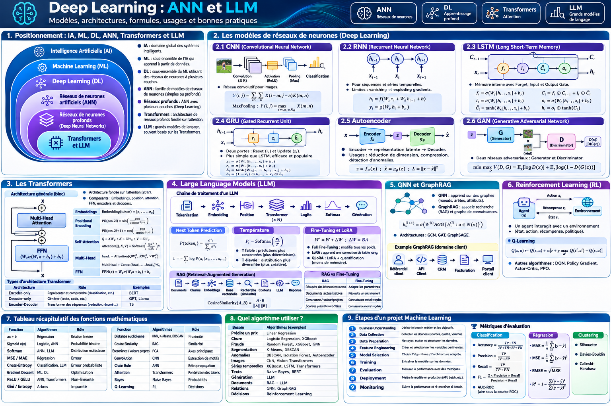

<h2>1. Neural network models</h2>
<figure class="resource-figure"><figcaption>Overview of neural network architectures, Transformers and LLM.</figcaption></figure>
<h3>1.1 CNN</h3>

Convolutional network for images: convolution, activation, pooling, classification.

Y(i,j) = ΣₘΣₙ X(i−m,j−n)K(m,n)

MaxPooling: Y(i,j) = max₍ₘ,ₙ₎∈Rᵢⱼ

<h3>1.2 RNN</h3>

Recurrent network for sequences and time series. Limits: vanishing and exploding gradients.

hₜ = f(Wₓxₜ + Wₕhₜ₋₁ + b); yₜ = g(Wᵧhₜ+bᵧ)

<h3>1.3 LSTM</h3>

Internal memory with Forget Gate, Input Gate and Output Gate.

fₜ = σ(Wf[hₜ₋₁,xₜ]+bf)

iₜ = σ(Wi[hₜ₋₁,xₜ]+bi)

C̃ₜ = tanh(Wc[hₜ₋₁,xₜ]+bc)

Cₜ = fₜ ⊙ Cₜ₋₁ + iₜ ⊙ C̃ₜ

oₜ = σ(Wo[hₜ₋₁,xₜ]+bo); hₜ = oₜ ⊙ tanh(Cₜ)

<h3>1.4 GRU</h3>

Recurrent network with two gates: Update and Reset; generally simpler than LSTM.

<h3>1.5 Autoencoder</h3>

Encode → latent representation → Decoder. Used for dimension reduction, compression and anomaly detection.

z = fθ(x); x̂ = gφ(z); L = ||x−x̂||²

<h3>1.6 GAN</h3>

Two adversarial networks: Generator and Discriminator.

minG maxD V(D,G) = Eₓ[log D(x)] + E𝓏[log(1−D(G(z)))].

<h2>2. Transformers</h2>

Attention-based architecture, presented in 2017. Embeddings, positional information, attention, FFN.

<h3>2.1 Embeddings</h3>

Embedding(token) = [e₁,e₂,…,e𝑑]

<h3>2.2 Positional Encoding</h3>

PE(pos,2i) = sin(pos/10000^(2i/d))

PE(pos,2i+1) = cos(pos/10000^(2i/d))

Other models use learned or relative positional encodings (RoPE).

<h3>2.3 Self-Attention</h3>

Q=XWQ ; K=XWK; V=XWV

Attention(Q,K,V) = Softmax(QKᵀ/√dₖ)V

Q: Query; K:Key; V: Value. Scores → normalization → Softmax → weighted sum of Values.

<h3>2.4 Multi-Head Caution</h3>

MultiHead(Q,K,V) = Concat(head₁,…,headₕ)WO

headᵢ = Attention(QWᵢQ, KWᵢK, VWᵢV)

<h3>2.5 Feed Forward Network</h3>

FFN(x) = W₂σ(W₁x+b₁)+b₂

<h3>2.6 Encode and Decode</h3>

<table><tr><td>
Architecture
</td><td>
Role
</td><td>
Examples
</td></tr><tr><td>
Encoder-only
</td><td>
Represent and understand
</td><td>
BERT
</td></tr><tr><td>
Decoder-only
</td><td>
Generate
</td><td>
GPT, Llama
</td></tr><tr><td>
Encoder-Decoder
</td><td>
Transform sequences
</td><td>
T5
</td></tr></table>

<h2>3. Large Language Models (LLM)</h2>

Processing chain: Tokenization → Embedding → Position → Transform → Logits → Softmax → Generation.

<h3>3.1 Next Token Prediction</h3>

P(tokenᵢ) = eᶻⁱ / Σⱼeᶻʲ

L = −Σᵢ log P(xᵢ | x₁,…,xᵢ₋₁)

<h3>3.2 Temperature</h3>

Pᵢ = Softmax(zᵢ/T)

Low temperature: more concentrated predictions; high temperature: more diversified distribution.

<h3>3.3 Fine-Tuning and LoRA</h3>

Full Fine-Tuning modifies all weights. LoRA learns low-rank correction. QLoRA combines LoRA and quantification.

W′ = W + ΔW; ΔW = BA

<h3>3.4 RAG</h3>

Documents → chunks → embeddings → vector base → question → search → context → LLM → answer.

CosineSimilarity(A,B) = (A·B)/(||A|| ||B||)

<table><tr><td>
RAG
</td><td>
Fine-Tuning
</td></tr><tr><td>
Retrieves external information
</td><td>
Adapt the settings
</td></tr><tr><td>
Updatable documents
</td><td>
Requires training
</td></tr><tr><td>
Potentially cited sources
</td><td>
Less traceable knowledge
</td></tr></table>

<h2>4. GNN and GraphRAG</h2>

Graph Neural Networks learn on graphs (nodes, edges, attributes); GraphRAG combines search and knowledge graph.

hᵥ⁽ˡ⁺¹⁾ = σ(W⁽ˡ⁾ AGG{hᵤ⁽ˡ⁾ : u∈N(v)})

Architectures: GCN, GAT, GraphSAGE. GraphRAG example: Customer repository → Customer API → CRM → Billing → Customer portal.

<h2>5. Reinforcement Learning</h2>

An agent interacts with an environment: state, action, reward and policy.

<h3>5.1 Q-Learning</h3>

Q(s,a) ← Q(s,a) + α[r + γ maxₐ′ Q(s′,a′) − Q(s,a)]

Other algorithms: DQN, Policy Gradient, Actor-Critic, PPO.

<h2>6. Summary table of mathematical functions</h2>

<table><tr><td>
Function
</td><td>
Algorithms
</td><td>
Role
</td></tr><tr><td>
ax+b
</td><td>
Regression
</td><td>
Linear relationship
</td></tr><tr><td>
Sigmoid
</td><td>
Logistics, ANN
</td><td>
Binary probability
</td></tr><tr><td>
Softmax
</td><td>
ANN, LLM
</td><td>
Multiclass distribution
</td></tr><tr><td>
MSE / MAE
</td><td>
Regression
</td><td>
Error
</td></tr><tr><td>
Cross-Entropy
</td><td>
Classification, LLM
</td><td>
Probabilistic error
</td></tr><tr><td>
Gradient Descent
</td><td>
ML, DL
</td><td>
Optimization
</td></tr><tr><td>
ReLU / GELU
</td><td>
ANN, Transformers
</td><td>
Nonlinearity
</td></tr><tr><td>
Gini / Entropy
</td><td>
Trees
</td><td>
Impurity
</td></tr><tr><td>
Euclidean distance
</td><td>
KNN, K-Means, DBSCAN
</td><td>
Proximity
</td></tr><tr><td>
Cosine Similarity
</td><td>
RAG
</td><td>
Similarity
</td></tr><tr><td>
Covariance / eigenvalues
</td><td>
PCA
</td><td>
Main axes
</td></tr><tr><td>
Convolution
</td><td>
CNN
</td><td>
Pattern extraction
</td></tr><tr><td>
Chain Rule
</td><td>
ANN
</td><td>
Backpropagation
</td></tr><tr><td>
Attention
</td><td>
Transformers
</td><td>
Token weighting
</td></tr><tr><td>
Bayes
</td><td>
Naive Bayes
</td><td>
Probabilities
</td></tr><tr><td>
Q-Learning
</td><td>
R.L.
</td><td>
Decisions
</td></tr></table>

<h2>7. Which algorithm to use?</h2>

<table><tr><td>
Need
</td><td>
Algorithms
</td></tr><tr><td>
Predict a price
</td><td>
Linear Regression
</td></tr><tr><td>
Churn
</td><td>
Logistic Regression, XGBoost
</td></tr><tr><td>
Fraud
</td><td>
Random Forest, XGBoost, GNN
</td></tr><tr><td>
Segmentation
</td><td>
K-Means, DBSCAN
</td></tr><tr><td>
Anomalies
</td><td>
DBSCAN, Forest Isolation, Autoencoder
</td></tr><tr><td>
Pictures
</td><td>
CNN, Vision Transformers
</td></tr><tr><td>
Time series
</td><td>
XGBoost, LSTM, Transformers
</td></tr><tr><td>
Text
</td><td>
Naive Bayes, BERT
</td></tr><tr><td>
Generation
</td><td>
LLM
</td></tr><tr><td>
Documents
</td><td>
RAG + LLM
</td></tr><tr><td>
Relationships
</td><td>
GNN, GraphRAG
</td></tr><tr><td>
Decisions
</td><td>
Reinforcement Learning
</td></tr></table>

<h2>8. Stages of a Machine Learning project</h2>

<table><tr><td>
Stage
</td><td>
Description
</td></tr><tr><td>
1
</td><td>
Business Understanding
</td></tr><tr><td>
2
</td><td>
Data Collection
</td></tr><tr><td>
3
</td><td>
Data Preparation
</td></tr><tr><td>
4
</td><td>
Feature Engineering
</td></tr><tr><td>
5
</td><td>
Model Selection
</td></tr><tr><td>
6
</td><td>
Training
</td></tr><tr><td>
7
</td><td>
Assessment
</td></tr><tr><td>
8
</td><td>
deployment
</td></tr><tr><td>
9
</td><td>
Monitoring
</td></tr></table>

<h3>8.1 Evaluation Metrics</h3>

Accuracy = (TP+TN)/(TP+TN+FP+FN)

Precision = TP/(TP+FP)

Recall = TP/(TP+FN)

F1 = 2×Precision×Recall/(Precision+Recall)

Classification: Accuracy, Precision, Recall, F1, AUC-ROC. Regression: MAE, MSE, RMSE, R². Clustering: Silhouette, Davies-Bouldin, Calinski-Harabasz.

