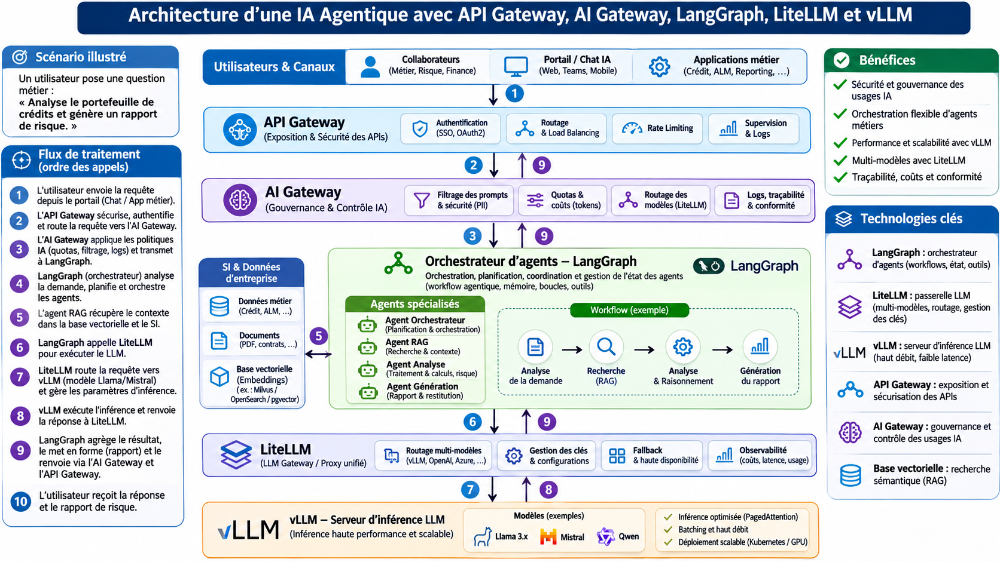
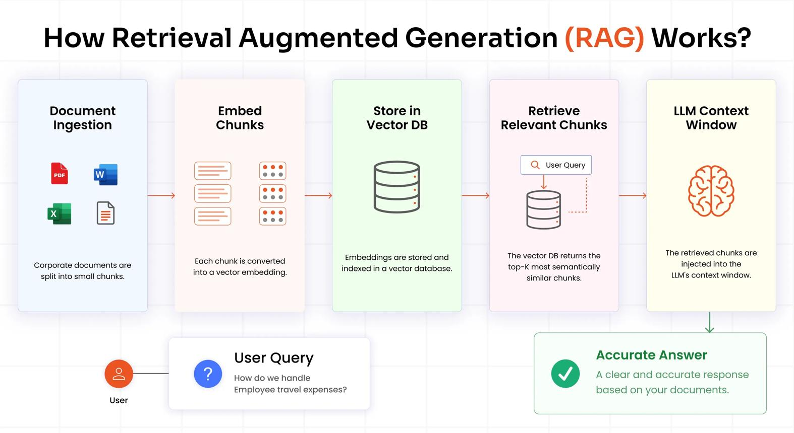

ARCHITECTURE IA · DOCUMENT DE RÉFÉRENCE

<h2>Sommaire</h2>

<a href="#comprendre-ia-agentique">1. Comprendre l’IA agentique</a>

<a href="#technologies-ecosysteme">2. Les 36 technologies de l’écosystème</a>

<a href="#architecture-technique-reference">3. Architecture technique de référence</a>

<a href="#rag-graphrag-neo4j">4. RAG, GraphRAG et Neo4j</a>

<a href="#exemple-bout-en-bout">5. Exemple de bout en bout : traitement d’une demande client</a>

<a href="#choisir-stack-technologique">6. Choisir une stack technologique</a>

<a href="#securite-gouvernance">7. Sécurité, gouvernance et exigences non fonctionnelles</a>

<a href="#demarche-realisation">8. Démarche de réalisation et industrialisation</a>

<a href="#glossaire-points-cles">9. Glossaire et points clés pour l’architecte</a>

<figure class="resource-figure"><figcaption>Architecture agentique avec API Gateway, AI Gateway, LangGraph, LiteLLM et vLLM.</figcaption></figure>
<h2 id="comprendre-ia-agentique">1. Comprendre l’IA agentique</h2>

Un LLM (Large Language Model) est un modèle capable de comprendre et de générer du contenu. Un agent IA utilise un ou plusieurs modèles pour poursuivre un objectif : il interprète une demande, planifie des étapes, sélectionne des outils, exécute des actions, observe les résultats et peut ajuster son plan. Un système multi-agents répartit le travail entre plusieurs agents spécialisés.

<table><tr><td>
Notion
</td><td>
Définition
</td><td>
Exemple
</td></tr><tr><td>
LLM
</td><td>
Modèle de langage qui génère ou analyse du contenu.
</td><td>
GPT répond à une question.
</td></tr><tr><td>
Agent IA
</td><td>
Boucle de décision qui associe modèle, instructions, état et outils.
</td><td>
Un agent consulte un dossier puis crée une tâche.
</td></tr><tr><td>
Multi-agent
</td><td>
Plusieurs agents coordonnés, avec des rôles distincts.
</td><td>
Recherche, analyse, validation et rédaction.
</td></tr><tr><td>
Workflow
</td><td>
Enchaînement explicite d’étapes, de règles et de transitions.
</td><td>
Vérifier un dossier puis demander une approbation.
</td></tr><tr><td>
RAG
</td><td>
Recherche de connaissances externes pour enrichir le contexte du modèle.
</td><td>
Retrouver les passages utiles d’un contrat.
</td></tr><tr><td>
GraphRAG
</td><td>
Recherche exploitant les entités et les relations d’un graphe de connaissances.
</td><td>
Identifier les dépendances entre client, contrat et garantie.
</td></tr></table>

<table><tr><td>
À retenir 
Un agent n’est pas simplement un chatbot. Dès qu’il peut agir sur un SI, il faut encadrer ses outils, ses droits, ses limites, ses validations, sa traçabilité et ses mécanismes de reprise.
</td></tr></table>

<h2 id="technologies-ecosysteme">2. Les 36 technologies de l’écosystème</h2>

La liste ci-dessous reprend les 36 éléments de l’infographie initiale. Elle les classe par rôle. Certains éléments sont des frameworks, d’autres des modèles, des moteurs d’inférence, des plateformes de mémoire ou des outils d’observabilité : ils ne sont donc pas tous concurrents.

<h3>2.1 Frameworks et orchestration — 12 technologies</h3>

<table><tr><td>
Technologie
</td><td>
Définition
</td><td>
Utilité principale
</td><td>
Exemple
</td></tr><tr><td>
1. LangGraph
</td><td>
Framework d’orchestration fondé sur des graphes et un état explicite.
</td><td>
Workflows avec branches, boucles, checkpoints, reprises et validations humaines.
</td><td>
Agent de traitement de sinistre avec étapes conditionnelles.
</td></tr><tr><td>
2. OpenAI Agents SDK
</td><td>
SDK pour créer des agents avec outils, délégation et garde-fous.
</td><td>
Handoffs entre agents, tool calling, sessions et traces.
</td><td>
Un agent support délègue l’analyse technique à un agent spécialisé.
</td></tr><tr><td>
3. Claude Agent SDK
</td><td>
SDK donnant accès aux capacités agentiques de Claude Code.
</td><td>
Agents manipulant fichiers, commandes et outils dans un cadre de permissions.
</td><td>
Analyse d’un dépôt de code et proposition de correctif.
</td></tr><tr><td>
4. Google ADK
</td><td>
Agent Development Kit de Google pour développer des agents et systèmes multi-agents.
</td><td>
Agents séquentiels, parallèles ou hiérarchiques, intégration Google Cloud.
</td><td>
Un superviseur distribue des recherches à plusieurs agents.
</td></tr><tr><td>
5. Microsoft Agent Framework
</td><td>
Framework Microsoft pour construire agents et workflows, dans la continuité d’AutoGen et Semantic Kernel.
</td><td>
Orchestration, middleware et intégration .NET/Python et Microsoft.
</td><td>
Agents intégrés à un SI Azure et .NET.
</td></tr><tr><td>
6. CrewAI
</td><td>
Framework d’équipes d’agents structurées par rôles et objectifs.
</td><td>
Collaboration de spécialistes avec tâches et responsabilités distinctes.
</td><td>
Analyste marché, analyste financier et rédacteur.
</td></tr><tr><td>
7. Pydantic AI
</td><td>
Framework Python mettant l’accent sur les types et les sorties structurées.
</td><td>
Validation des entrées/sorties, dépendances et contrats de données.
</td><td>
Génération d’un objet JSON conforme au modèle métier.
</td></tr><tr><td>
8. Mastra
</td><td>
Framework TypeScript pour agents, workflows, mémoire et évaluations.
</td><td>
Développement d’applications agentiques dans l’écosystème JavaScript.
</td><td>
Assistant métier dans une application Node.js.
</td></tr><tr><td>
9. Vercel AI SDK
</td><td>
Bibliothèque TypeScript pour intégrer modèles et interactions IA dans des applications.
</td><td>
Streaming, appels aux modèles, outils et interface utilisateur.
</td><td>
Assistant conversationnel Next.js.
</td></tr><tr><td>
10. LlamaIndex
</td><td>
Framework orienté données pour connecter les LLM aux sources d’information.
</td><td>
Ingestion, parsing, indexation, retrieval, RAG et agents orientés données.
</td><td>
Assistant interrogeant la documentation interne.
</td></tr><tr><td>
11. Strands Agents
</td><td>
Framework agentique open source d’AWS, piloté par une boucle d’agent.
</td><td>
Agents utilisant outils et modèles dans des environnements AWS ou hybrides.
</td><td>
Agent de diagnostic d’infrastructure cloud.
</td></tr><tr><td>
12. smolagents
</td><td>
Framework léger de Hugging Face pour créer des agents Python.
</td><td>
Prototypage d’agents qui peuvent utiliser des outils et exécuter du code.
</td><td>
Agent qui analyse un fichier CSV.
</td></tr></table>

<h3>2.2 Modèles et runtime — 12 éléments</h3>
<h4>Familles de modèles</h4>

<table><tr><td>
Modèle
</td><td>
Définition
</td><td>
Utilité
</td></tr><tr><td>
13. Claude
</td><td>
Famille de modèles d’Anthropic.
</td><td>
Raisonnement, programmation, analyse documentaire et utilisation d’outils.
</td></tr><tr><td>
14. GPT
</td><td>
Famille de modèles d’OpenAI.
</td><td>
Génération, raisonnement, multimodalité et appels de fonctions.
</td></tr><tr><td>
15. Gemini
</td><td>
Famille de modèles de Google.
</td><td>
Texte, image, audio, vidéo et contextes longs selon le modèle.
</td></tr><tr><td>
16. Qwen
</td><td>
Famille de modèles d’Alibaba.
</td><td>
Modèles ouverts ou accessibles pour langage, code, vision et raisonnement.
</td></tr><tr><td>
17. DeepSeek
</td><td>
Famille de modèles de DeepSeek.
</td><td>
Raisonnement, code et modèles à poids ouverts.
</td></tr><tr><td>
18. GLM
</td><td>
Famille de modèles de Zhipu AI.
</td><td>
Langage, raisonnement, programmation et usages agentiques.
</td></tr></table>

<h4>Serving, routage et exécution</h4>

<table><tr><td>
Technologie
</td><td>
Définition
</td><td>
Utilité
</td></tr><tr><td>
19. vLLM
</td><td>
Moteur performant de serving/inférence de LLM.
</td><td>
Servir des modèles sur GPU avec débit élevé et gestion de requêtes concurrentes.
</td></tr><tr><td>
20. Ollama
</td><td>
Outil simplifiant le téléchargement et l’exécution locale de modèles.
</td><td>
Développement, tests, PoC et inférence locale simple.
</td></tr><tr><td>
21. LiteLLM
</td><td>
SDK et proxy unifiant l’accès à de nombreux fournisseurs de modèles.
</td><td>
Routage, fallback, budgets, clés, quotas et interface commune.
</td></tr><tr><td>
22. OpenRouter
</td><td>
Service hébergé d’accès et de routage vers de nombreux modèles.
</td><td>
Expérimenter et sélectionner des modèles via une API unifiée.
</td></tr><tr><td>
23. Modal
</td><td>
Plateforme cloud d’exécution de workloads, notamment GPU.
</td><td>
Déployer des traitements IA sans administrer directement toute l’infrastructure GPU.
</td></tr><tr><td>
24. E2B
</td><td>
Environnements sandbox isolés pour exécuter du code.
</td><td>
Exécuter du code généré par un agent sans l’exécuter dans le serveur applicatif principal.
</td></tr></table>

<table><tr><td>
Distinction importante 
GPT, Claude, Gemini, Qwen, DeepSeek et GLM sont des familles de modèles. vLLM et Ollama servent à exécuter des modèles. LiteLLM et OpenRouter facilitent l’accès et le routage. Modal fournit des ressources cloud d’exécution et E2B des environnements isolés.
</td></tr></table>

<h3>2.3 Mémoire, évaluation et opérations — 12 éléments</h3>

<table><tr><td>
Technologie
</td><td>
Définition
</td><td>
Utilité
</td></tr><tr><td>
25. Mem0
</td><td>
Couche de mémoire qui extrait, stocke et retrouve des informations utiles.
</td><td>
Préférences et faits utiles d’un utilisateur ou d’une session.
</td></tr><tr><td>
26. Letta
</td><td>
Framework pour construire des agents persistants qui gèrent leur mémoire.
</td><td>
Agents capables de maintenir et mettre à jour un état mémoriel.
</td></tr><tr><td>
27. Zep
</td><td>
Plateforme de mémoire conversationnelle et de connaissances temporelles.
</td><td>
Retrouver des faits et relations qui évoluent dans le temps.
</td></tr><tr><td>
28. LangSmith
</td><td>
Plateforme de tracing, débogage et évaluation, associée à l’écosystème LangChain.
</td><td>
Comprendre les étapes, appels LLM, outils et erreurs.
</td></tr><tr><td>
29. Langfuse
</td><td>
Plateforme d’observabilité LLM/agents, disponible en open source.
</td><td>
Traces, prompts, tokens, coûts, latence et sessions.
</td></tr><tr><td>
30. Braintrust
</td><td>
Plateforme d’évaluation et d’amélioration des applications IA.
</td><td>
Comparer prompts, modèles et versions à partir de datasets.
</td></tr><tr><td>
31. Arize Phoenix
</td><td>
Outil d’observabilité et d’évaluation des applications LLM.
</td><td>
Analyser traces, RAG, pertinence et comportement agentique.
</td></tr><tr><td>
32. Ragas
</td><td>
Framework d’évaluation des systèmes RAG et applications IA.
</td><td>
Mesurer pertinence du contexte, fidélité et qualité des réponses.
</td></tr><tr><td>
33. DeepEval
</td><td>
Framework de tests pour applications LLM, proche de pytest.
</td><td>
Automatiser les tests de qualité et de comportement dans CI/CD.
</td></tr><tr><td>
34. promptfoo
</td><td>
Outil de tests de prompts, comparaison de modèles et red teaming.
</td><td>
Détecter injections de prompts, fuites et comportements indésirables.
</td></tr><tr><td>
35. Temporal
</td><td>
Plateforme d’exécution durable de workflows distribués.
</td><td>
Retries, timeouts, reprise après panne et processus de longue durée.
</td></tr><tr><td>
36. Composio
</td><td>
Plateforme de connexion d’agents à des applications et services externes.
</td><td>
Intégrer des outils SaaS et gérer les connexions/authentifications.
</td></tr></table>

<h2 id="architecture-technique-reference">3. Architecture technique de référence</h2>

L’architecture cible sépare les responsabilités afin de limiter le couplage entre l’orchestration, les modèles, les données, les outils métier et l’infrastructure. Les technologies sont des options de mise en œuvre : il n’est pas nécessaire de toutes les déployer.

Vue détaillée de l’architecture multi-agents avec RAG et GraphRAG

<table><tr><td>
Couche
</td><td>
Responsabilité
</td><td>
Technologies possibles
</td></tr><tr><td>
1. Canaux et utilisateurs
</td><td>
Interfaces web/mobile, API clientes, utilisateurs métier et support.
</td><td>
React, Angular, REST, GraphQL.
</td></tr><tr><td>
2. Exposition et sécurité
</td><td>
Point d’entrée, authentification, autorisation, quotas, validation et audit.
</td><td>
API Gateway, OAuth2/OIDC, RBAC/ABAC, rate limiting.
</td></tr><tr><td>
3. Orchestration multi-agents
</td><td>
Planification, état, délégation, conditions, boucle d’exécution et validation humaine.
</td><td>
LangGraph, OpenAI Agents SDK, Google ADK, CrewAI.
</td></tr><tr><td>
4. Modèles et inférence
</td><td>
Choix du modèle, accès cloud ou on-premise, serving et fallback.
</td><td>
LiteLLM, GPT/Claude/Gemini, Ollama, vLLM.
</td></tr><tr><td>
5. Connaissances et mémoire
</td><td>
Recherche documentaire, recherche relationnelle, mémoire conversationnelle et données métier.
</td><td>
LlamaIndex, Neo4j, pgvector/Milvus, Mem0/Zep, PostgreSQL.
</td></tr><tr><td>
6. Intégration SI
</td><td>
Accès contrôlé aux API, outils, événements et systèmes d’entreprise.
</td><td>
MCP, API REST, Spring Boot, Kafka, ERP/CRM.
</td></tr><tr><td>
7. Observabilité et qualité
</td><td>
Traces, métriques, logs, évaluation, tests de sécurité et audit.
</td><td>
Langfuse, LangSmith, Phoenix, Ragas, DeepEval, promptfoo.
</td></tr><tr><td>
8. Infrastructure et exploitation
</td><td>
Conteneurs, orchestration, workflows durables, CI/CD et supervision.
</td><td>
Docker, Kubernetes, Temporal, GitLab/GitHub CI/CD, Prometheus/Grafana.
</td></tr></table>

<h3>3.1 Rôle des composants structurants</h3>
<h4>LangGraph — orchestrateur</h4>

Gère le graphe d’exécution : état, transitions, boucles, conditions, checkpoints et éventuelle validation humaine. Il ne remplace pas les API métier.

<h4>LlamaIndex — couche data/RAG</h4>

Connecte les sources, parse et découpe les documents, construit les index et récupère les passages pertinents. Il peut participer à des workflows RAG et à des agents orientés données.

<h4>LiteLLM — passerelle de modèles</h4>

Fournit un point d’accès commun aux fournisseurs et modèles. Il peut appliquer routage, fallback, budgets et politiques. Il ne remplace pas l’orchestrateur agentique.

<h4>Ollama — exécution locale</h4>

Pratique pour développer et tester avec des modèles locaux. Il n’est pas automatiquement le meilleur choix pour une plateforme de serving GPU à grande échelle.

<h4>vLLM — serving de production</h4>

Adapté à l’exposition de modèles auto-hébergés sur GPU, notamment lorsque le débit et la concurrence sont importants. Il nécessite une capacité d’exploitation GPU.

<h4>MCP — intégration d’outils</h4>

Standardise la manière dont un client compatible découvre et invoque des outils ou ressources. Les API REST restent pertinentes pour les contrats métier et les intégrations classiques.

<h4>Kafka — événements</h4>

Découple les producteurs et consommateurs, transporte les événements métier et facilite les traitements asynchrones. Il ne remplace pas un moteur de workflow durable.

<h4>Temporal — durabilité</h4>

Gère les processus longs, reprises, retries et temporisations. LangGraph peut porter la logique agentique tandis que Temporal porte la durabilité d’un processus global.

<h2 id="rag-graphrag-neo4j">4. RAG, GraphRAG et Neo4j</h2>

Le RAG (Retrieval-Augmented Generation) enrichit le contexte transmis au modèle en recherchant des informations dans des sources externes. Le GraphRAG ajoute une représentation explicite des entités et de leurs relations. Les deux approches sont complémentaires.

<h3>4.1 RAG vectoriel</h3>

Collecte : récupérer les documents depuis GED, SharePoint, Confluence, bases de données ou fichiers.

Parsing : extraire le texte et les métadonnées.

Chunking : découper les contenus en segments adaptés à la recherche.

Embeddings : transformer les segments en vecteurs numériques.

Indexation : stocker les vecteurs et métadonnées dans pgvector, Milvus, Weaviate ou une autre base vectorielle.

Retrieval : rechercher les segments proches de la question, puis éventuellement reranker les résultats.

Augmentation : injecter les passages retenus dans le contexte du LLM avec leurs références.

Génération : produire une réponse fondée sur les éléments récupérés.

<h3>4.2 GraphRAG et Neo4j</h3>

Un Knowledge Graph représente des objets métier sous forme de nœuds et de relations. Neo4j est une base de données orientée graphe qui permet de stocker et d’interroger ces structures, notamment avec le langage Cypher.

<table><tr><td>
Élément
</td><td>
Exemple bancaire
</td></tr><tr><td>
Nœud
</td><td>
Client, Crédit, Contrat, Garantie, Taux, Agence.
</td></tr><tr><td>
Relation
</td><td>
CLIENT_DETIENT_CRÉDIT, CRÉDIT_GARANTI_PAR, TAUX_APPLICABLE À.
</td></tr><tr><td>
Propriété
</td><td>
Date de signature, montant, statut, échéance, taux.
</td></tr><tr><td>
Requête
</td><td>
Quels contrats liés à ce client sont exposés à une hausse de taux ?
</td></tr></table>

<h3>4.3 RAG vectoriel et GraphRAG : comparaison</h3>

<table><tr><td>
Critère
</td><td>
RAG vectoriel
</td><td>
GraphRAG / Knowledge Graph
</td></tr><tr><td>
Principe
</td><td>
Similarité sémantique entre requête et passages.
</td><td>
Exploration des entités et relations.
</td></tr><tr><td>
Données adaptées
</td><td>
Documents, paragraphes, FAQ, procédures.
</td><td>
Données relationnelles, dépendances, réseaux d’entités.
</td></tr><tr><td>
Question type
</td><td>
Où se trouve la règle de remboursement ?
</td><td>
Quels produits, contrats et garanties sont liés à ce client ?
</td></tr><tr><td>
Force
</td><td>
Retrouver des contenus pertinents même si les mots diffèrent.
</td><td>
Répondre à des questions multi-relations et contextualisées.
</td></tr><tr><td>
Limite
</td><td>
Peut manquer une relation implicite ou une chaîne de dépendances.
</td><td>
Nécessite un graphe de qualité et une modélisation cohérente.
</td></tr></table>

<h3>4.4 Architecture hybride RAG + GraphRAG</h3>

Le bloc « Connaissances &amp; Données IA » distingue recherche documentaire et graphe de connaissances.

LlamaIndex ingère les documents et prépare les index documentaires.

Le pipeline d’extraction identifie les entités, les relations et les métadonnées utiles.

Neo4j stocke le graphe de connaissances ; les requêtes Cypher explorent les relations pertinentes.

La base vectorielle stocke les embeddings pour la recherche sémantique.

Le composant de retrieval hybride combine les passages documentaires et les résultats du graphe.

LangGraph transmet le contexte consolidé à l’agent d’analyse ou à l’agent métier.

Le LLM formule une réponse avec les sources, les limites et les éléments justificatifs.

<table><tr><td>
Point de conception 
Neo4j ne remplace pas nécessairement pgvector ou Milvus. Le graphe répond aux questions relationnelles ; la base vectorielle répond à la recherche par similarité. Une architecture hybride peut utiliser les deux.
</td></tr></table>

<h3>4.5 Exemple de question GraphRAG</h3>

Question : « Quels risques sont associés au crédit immobilier de ce client si les taux augmentent ? »

Le RAG retrouve les clauses du contrat, les procédures de taux et les documents réglementaires.

Neo4j relie le client à son crédit, le crédit à son taux, le crédit à ses garanties et les garanties aux conditions contractuelles.

Le retrieval hybride assemble les extraits documentaires et les relations du graphe.

Un agent d’analyse examine les scénarios et un agent de conformité vérifie les règles applicables.

Un agent rédige une synthèse explicable, avec les références documentaires et les hypothèses.

<h2 id="exemple-bout-en-bout">5. Exemple de bout en bout : traitement d’une demande client</h2>

Cas d’usage : un client demande le remboursement d’une opération. L’agent doit analyser le dossier, consulter les données métier, vérifier les règles et éventuellement déclencher une action sous contrôle.

<table><tr><td>
Étape
</td><td>
Traitement
</td><td>
Composants
</td></tr><tr><td>
1. Réception
</td><td>
Le client soumet sa demande depuis le portail web ou l’application mobile.
</td><td>
Front web/mobile
</td></tr><tr><td>
2. Sécurité
</td><td>
L’API Gateway authentifie l’utilisateur, contrôle les droits et applique les quotas.
</td><td>
API Gateway, OIDC, RBAC
</td></tr><tr><td>
3. Orchestration
</td><td>
LangGraph initialise l’état du dossier et choisit les agents et étapes nécessaires.
</td><td>
LangGraph
</td></tr><tr><td>
4. Recherche documentaire
</td><td>
L’agent recherche les procédures et contrats utiles.
</td><td>
LlamaIndex + base vectorielle
</td></tr><tr><td>
5. Recherche relationnelle
</td><td>
L’agent identifie les relations entre client, commande, paiement et contrat.
</td><td>
Neo4j / GraphRAG
</td></tr><tr><td>
6. Raisonnement
</td><td>
Le modèle analyse les éléments récupérés et identifie les informations manquantes.
</td><td>
LiteLLM + modèle cloud ou local
</td></tr><tr><td>
7. Outils métier
</td><td>
L’agent consulte les API métier et peut préparer une opération.
</td><td>
MCP et API Spring Boot
</td></tr><tr><td>
8. Validation
</td><td>
Une opération sensible est soumise à une validation humaine.
</td><td>
Human-in-the-loop
</td></tr><tr><td>
9. Exécution
</td><td>
Le service métier autorisé réalise l’opération et publie un événement.
</td><td>
API métier + Kafka
</td></tr><tr><td>
10. Traçabilité
</td><td>
Les décisions, outils appelés, durées, coûts et résultats sont tracés et évalués.
</td><td>
Langfuse + évaluations
</td></tr></table>

<h2 id="choisir-stack-technologique">6. Choisir une stack technologique</h2>
<h3>6.1 Prototype / MVP</h3>

Python + LangGraph pour le workflow agentique.

LlamaIndex pour ingestion, indexation et RAG.

Ollama pour tester localement des modèles compatibles.

PostgreSQL + pgvector pour les données et vecteurs.

Neo4j seulement si le cas d’usage nécessite déjà des relations complexes.

Langfuse pour les premières traces et analyses.

<h3>6.2 Production d’entreprise hybride</h3>

Spring Boot pour les services métier et les contrats d’API.

Python + LangGraph pour l’orchestration agentique.

LlamaIndex pour la chaîne d’ingestion et de retrieval documentaire.

Neo4j pour les connaissances relationnelles lorsque la valeur métier est démontrée.

LiteLLM comme passerelle vers les modèles cloud et auto-hébergés.

GPT, Claude ou Gemini pour les modèles cloud ; vLLM pour servir les modèles auto-hébergés sur GPU.

Ollama pour le développement local et les tests, plutôt que comme choix automatique de serving de production.

PostgreSQL, Redis et base vectorielle selon les besoins de persistance, cache et recherche.

MCP et API REST pour l’accès aux outils et systèmes métier ; Kafka pour les événements.

Langfuse, Ragas, DeepEval et promptfoo pour observabilité, évaluation et tests de sécurité.

Docker, Kubernetes et Temporal selon les besoins de déploiement et de workflows durables.

<h3>6.3 Infrastructure souveraine / self-hosted</h3>

LangGraph pour l’orchestration.

Qwen, DeepSeek ou GLM selon les résultats d’évaluation, la licence et les contraintes.

vLLM pour servir les modèles sur GPU.

LlamaIndex pour les pipelines RAG.

Neo4j pour les relations métier et pgvector/Milvus pour la recherche vectorielle.

Langfuse et Phoenix pour la supervision.

Kubernetes avec gestion de GPU, secrets, stockage et réseau.

<table><tr><td>
Règle de choix 
Ne sélectionnez pas une technologie parce qu’elle figure dans une liste. Partez du cas d’usage, des données, du niveau de risque, de la latence, du volume, du coût, de la souveraineté et des compétences disponibles.
</td></tr></table>

<h2 id="securite-gouvernance">7. Sécurité, gouvernance et exigences non fonctionnelles</h2>

<table><tr><td>
Domaine
</td><td>
Mesures à prévoir
</td></tr><tr><td>
Identité et autorisation
</td><td>
Authentification forte, OAuth2/OIDC, RBAC/ABAC, identité technique par service et moindre privilège.
</td></tr><tr><td>
Droits des outils
</td><td>
Autoriser explicitement chaque outil, chaque action et chaque périmètre de données. Séparer lecture et écriture.
</td></tr><tr><td>
Validation humaine
</td><td>
Imposer une approbation pour les paiements, remboursements, changements de données sensibles ou actions irréversibles.
</td></tr><tr><td>
Protection contre prompt injection
</td><td>
Traiter les documents et contenus externes comme des données non fiables ; filtrer et contrôler les instructions.
</td></tr><tr><td>
Données personnelles
</td><td>
Minimisation, chiffrement, rétention, contrôle d’accès, journalisation et conformité RGPD.
</td></tr><tr><td>
Secrets
</td><td>
Ne jamais placer clés API, mots de passe ou tokens dans les prompts ou les traces ; utiliser un coffre de secrets.
</td></tr><tr><td>
Traçabilité
</td><td>
Conserver les identifiants de requête, versions de prompts/modèles, outils appelés, décisions et résultats, avec politique de rétention.
</td></tr><tr><td>
Résilience
</td><td>
Timeouts, retries bornés, idempotence, circuit breakers, fallback et reprise des workflows.
</td></tr><tr><td>
Qualité
</td><td>
Jeux de tests représentatifs, évaluations RAG, tests de non-régression, tests adversariaux et validation métier.
</td></tr><tr><td>
Coûts et performance
</td><td>
Suivre tokens, latence, taux d’échec, coût par tâche, utilisation GPU et taux de recours à l’humain.
</td></tr></table>

<h2 id="demarche-realisation">8. Démarche de réalisation et industrialisation</h2>

<table><tr><td>
Phase
</td><td>
Livrables / activités
</td></tr><tr><td>
Phase 1 — Cadrage
</td><td>
Définir les utilisateurs, objectifs, périmètre, risques, données, actions autorisées et critères de succès.
</td></tr><tr><td>
Phase 2 — Architecture
</td><td>
Définir les composants, flux, contrats API, modèle de sécurité, choix RAG/GraphRAG et stratégie cloud/on-premise.
</td></tr><tr><td>
Phase 3 — Prototype
</td><td>
Construire un agent simple, un premier retrieval documentaire et quelques outils en lecture seule.
</td></tr><tr><td>
Phase 4 — Évaluation
</td><td>
Créer un dataset de questions/réponses, mesurer pertinence, fidélité, exactitude, latence et coûts.
</td></tr><tr><td>
Phase 5 — Intégration SI
</td><td>
Connecter les API métier, MCP si pertinent, événements Kafka et gestion des identités.
</td></tr><tr><td>
Phase 6 — Industrialisation
</td><td>
Ajouter gestion des secrets, observabilité, tests de sécurité, CI/CD, conteneurs et scalabilité.
</td></tr><tr><td>
Phase 7 — Mise en production progressive
</td><td>
Commencer en lecture seule ou mode copilote, introduire les actions avec approbation, puis élargir les droits sur preuve.
</td></tr><tr><td>
Phase 8 — Amélioration continue
</td><td>
Analyser les traces, corriger les erreurs, enrichir les données et réévaluer chaque changement de modèle ou de prompt.
</td></tr></table>

<h2 id="glossaire-points-cles">9. Glossaire et points clés pour l’architecte</h2>

<table><tr><td>
Terme
</td><td>
Définition
</td></tr><tr><td>
Agent
</td><td>
Composant logiciel piloté par un modèle, un objectif, un état et des outils.
</td></tr><tr><td>
Embedding
</td><td>
Représentation numérique d’un contenu utilisée pour la recherche par similarité.
</td></tr><tr><td>
Vector store
</td><td>
Stockage et indexation de vecteurs, souvent associés à des métadonnées.
</td></tr><tr><td>
Knowledge Graph
</td><td>
Graphe d’entités, de relations et de propriétés représentant un domaine.
</td></tr><tr><td>
Cypher
</td><td>
Langage de requête de Neo4j.
</td></tr><tr><td>
Chunking
</td><td>
Découpage de documents en segments recherchables.
</td></tr><tr><td>
Reranking
</td><td>
Réordonnancement des résultats de recherche selon leur pertinence.
</td></tr><tr><td>
Tool calling
</td><td>
Mécanisme par lequel un modèle demande l’exécution d’un outil.
</td></tr><tr><td>
Handoff
</td><td>
Délégation d’une tâche ou du contrôle à un autre agent.
</td></tr><tr><td>
Checkpoint
</td><td>
État sauvegardé permettant de reprendre un workflow.
</td></tr><tr><td>
Human-in-the-loop
</td><td>
Intervention humaine dans le processus de décision ou d’approbation.
</td></tr><tr><td>
MCP
</td><td>
Model Context Protocol : protocole d’accès standardisé à des outils et ressources.
</td></tr><tr><td>
Inference
</td><td>
Exécution d’un modèle pour produire une sortie à partir d’une entrée.
</td></tr><tr><td>
Serving
</td><td>
Exposition d’un modèle via un service capable de traiter des requêtes.
</td></tr><tr><td>
Observabilité
</td><td>
Capacité à comprendre le comportement interne via traces, métriques et logs.
</td></tr><tr><td>
Guardrails
</td><td>
Contrôles qui limitent les entrées, sorties et actions des systèmes IA.
</td></tr></table>

<h3>Les 10 technologies à approfondir en priorité</h3>

<table><tr><td>
Priorité
</td><td>
Technologie
</td><td>
Pourquoi la maîtriser
</td></tr><tr><td>
1
</td><td>
LangGraph
</td><td>
Orchestration et contrôle des workflows.
</td></tr><tr><td>
2
</td><td>
OpenAI Agents SDK
</td><td>
Agents, outils, délégation et garde-fous.
</td></tr><tr><td>
3
</td><td>
MCP
</td><td>
Interopérabilité des outils.
</td></tr><tr><td>
4
</td><td>
LlamaIndex
</td><td>
RAG et exploitation des données.
</td></tr><tr><td>
5
</td><td>
Neo4j / GraphRAG
</td><td>
Connaissances relationnelles et raisonnement sur les liens.
</td></tr><tr><td>
6
</td><td>
LiteLLM
</td><td>
Abstraction et routage des modèles.
</td></tr><tr><td>
7
</td><td>
vLLM / Ollama
</td><td>
Serving de production et exécution locale.
</td></tr><tr><td>
8
</td><td>
Mem0
</td><td>
Mémoire persistante.
</td></tr><tr><td>
9
</td><td>
Langfuse
</td><td>
Observabilité et traçabilité.
</td></tr><tr><td>
10
</td><td>
DeepEval / Ragas
</td><td>
Évaluation et tests.
</td></tr></table>

<table><tr><td>
Conclusion 
Une plateforme agentique d’entreprise n’est pas une simple application Python connectée à un LLM. C’est un système distribué qui combine orchestration, modèles, données, outils métier, sécurité, observabilité et exploitation. La valeur de l’architecte consiste à maîtriser les frontières entre ces composants, à choisir les bonnes technologies et à garantir un système explicable, contrôlé, résilient et mesurable.
</td></tr></table>

Fin du guide

<section class="resource-illustrations"><h2>Schémas et illustrations</h2>
<figure class="resource-figure"><figcaption>Étapes du pipeline Retrieval-Augmented Generation.</figcaption></figure>
</section>

