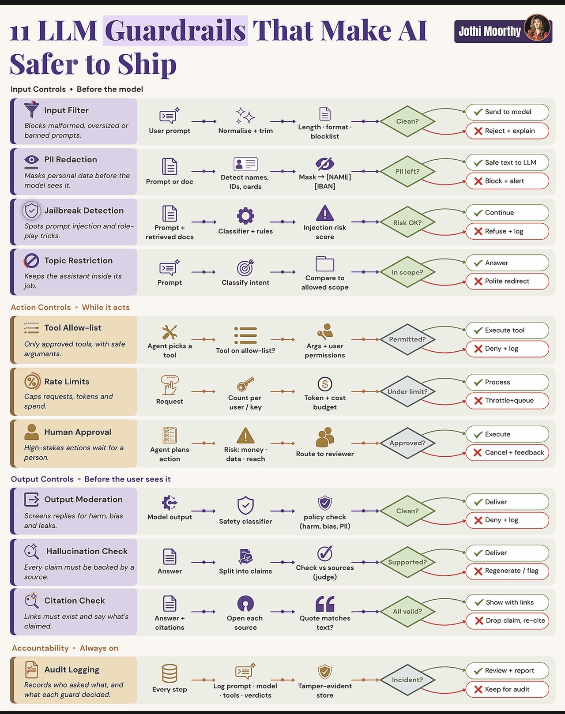

ARCHITECTURE IA · DOCUMENT DE RÉFÉRENCE

Cette page reprend le contenu du document de référence, dans son ordre d’origine. Les exemples fournis dans le document sont conservés avec les explications correspondantes.

Source : Synthese_IA_agentique_Architecture_C4_Agentic_Credit.docx

IA AGENTIQUE 
ET ARCHITECTURE C4

Conception d’une plateforme de crédit assistée par des agents IA

Synthèse structurée de l’échange : concepts, architecture, diagrammes C4, 
choix technologiques, workspace et mise en œuvre

Document de travail — 7 novembre 2026

<h2>Sommaire</h2>

1. De l’IA générative à l’IA agentique

2. Les briques d’une architecture agentique

3. Cas pratique : plateforme bancaire de demande de crédit

4. Embeddings, chunking et RAG

5. Architecture C4 : du contexte au code

6. Détail des conteneurs et composants

7. Workspace de développement : matériel et logiciels

8. Starter kit et organisation des sources

9. Démarrage, validation et trajectoire de réalisation

10. Sécurité, fiabilité et limites de la proposition

11. Galerie des images générées pendant la session

<h2>1. De l’IA générative à l’IA agentique</h2>

La première question de la session était formulée « Explique-moi l’IA argentique ». Le terme visé a été interprété comme « IA agentique » (Agentic AI).

<h3>1.1 IA générative</h3>

Une IA générative produit un contenu à partir d’une instruction et d’un contexte : texte, résumé, code, image ou réponse. Elle répond principalement à une requête, sans nécessairement conduire elle-même une suite d’actions métier.

<h3>1.2 IA agentique</h3>

Une IA agentique est un système dans lequel un ou plusieurs agents poursuivent un objectif, décomposent le travail en étapes, choisissent des outils, observent les résultats et adaptent leur exécution. Le modèle de langage contribue au raisonnement et à la production, tandis que le logiciel environnant contrôle les workflows, les autorisations, les données et les effets de bord.

<table><tr><td>
Dimension
</td><td>
IA générative
</td><td>
IA agentique
</td></tr><tr><td>
Finalité
</td><td>
Générer une réponse ou un contenu
</td><td>
Atteindre un objectif au moyen d’étapes et d’actions
</td></tr><tr><td>
Interaction
</td><td>
Souvent requête → réponse
</td><td>
Boucle planifier → agir → observer → ajuster
</td></tr><tr><td>
Outils
</td><td>
Facultatifs, généralement appelés à la demande
</td><td>
Intégrés au workflow et gouvernés
</td></tr><tr><td>
État
</td><td>
Contexte de conversation
</td><td>
État de tâche, historique, checkpoints et résultats
</td></tr><tr><td>
Exemple crédit
</td><td>
Résumer un dossier
</td><td>
Collecter les pièces, analyser, interroger des services et préparer une recommandation
</td></tr></table>

<h3>1.3 Boucle de fonctionnement</h3>

Recevoir un objectif ou un événement métier.

Analyser le contexte et déterminer les étapes nécessaires.

Sélectionner un agent ou un outil autorisé.

Exécuter l’action et récupérer son résultat.

Mettre à jour l’état du workflow et décider de la suite.

Terminer, demander une validation humaine ou signaler une erreur.

Point de vigilance : l’agent n’est pas un décideur autonome sans limites. Les politiques métier, les droits d’accès, les seuils de confiance, les validations humaines et les contrôles déterministes restent sous la responsabilité de l’application.

<h2>2. Les briques d’une architecture agentique</h2>

<table><tr><td>
Brique
</td><td>
Rôle dans la plateforme
</td></tr><tr><td>
LLM
</td><td>
Interprétation, raisonnement assisté, extraction structurée et génération de synthèses.
</td></tr><tr><td>
Orchestrateur
</td><td>
Pilote les étapes, les transitions, les agents et les reprises.
</td></tr><tr><td>
Agents spécialisés
</td><td>
Exécutent des tâches ciblées : client, documents, analyse financière, risque, conformité.
</td></tr><tr><td>
Mémoire / état
</td><td>
Conserve le contexte utile et l’état d’exécution ; ne remplace pas la base métier.
</td></tr><tr><td>
Outils
</td><td>
Permettent d’appeler les services métier de manière contrôlée.
</td></tr><tr><td>
RAG
</td><td>
Récupère des passages pertinents dans un corpus documentaire pour contextualiser les réponses.
</td></tr><tr><td>
Event broker
</td><td>
Découple les traitements et transporte les événements asynchrones.
</td></tr><tr><td>
Observabilité
</td><td>
Suit traces, métriques, logs, coûts, erreurs et décisions du workflow.
</td></tr></table>

<h3>2.1 Rôle de LangGraph</h3>

LangGraph est utilisé comme moteur de workflow agentique. Il permet de représenter les étapes sous forme de nœuds, de définir les transitions, de transporter un état partagé et de reprendre une exécution à partir de checkpoints. Les checkpoints techniques ne doivent pas être confondus avec l’état officiel d’un dossier de crédit.

<h3>2.2 Rôle de MCP</h3>

Le Model Context Protocol standardise l’exposition d’outils et de ressources à un client agentique. Dans le cas étudié, le MCP Tool Server expose des opérations comme la consultation client, la simulation, la récupération de pièces ou la consultation de règles. MCP ne remplace ni REST ni Kafka : il organise l’accès de l’agent aux outils.

<h3>2.3 REST, Kafka et MCP : ne pas les confondre</h3>

<table><tr><td>
Mécanisme
</td><td>
Mode
</td><td>
Usage
</td></tr><tr><td>
REST / HTTPS
</td><td>
Synchrone, requête-réponse
</td><td>
Le portail soumet une demande à la Credit API.
</td></tr><tr><td>
Kafka
</td><td>
Asynchrone, événementiel
</td><td>
La Credit API publie une demande ; l’orchestrateur la consomme.
</td></tr><tr><td>
MCP
</td><td>
Appel d’outil standardisé
</td><td>
L’agent demande au MCP Server d’exécuter une opération métier autorisée.
</td></tr></table>

<h2>3. Cas pratique : plateforme bancaire de demande de crédit</h2>

Le fil rouge de la session est une plateforme de gestion et de préparation de demandes de crédit. Le client ou le conseiller dépose une demande ; la plateforme orchestre des analyses assistées par IA et interroge les systèmes bancaires existants.

<h3>3.1 Acteurs et systèmes externes</h3>

Client particulier ou professionnel : soumet une demande et consulte son dossier.

Conseiller bancaire : accompagne le client, vérifie les éléments et participe à la validation.

Administrateur SI : gouverne les agents, modèles, outils et configurations.

CRM : fournit les informations de relation client.

Core Banking : fournit les données financières et les informations de compte.

GED / ECM : contient les pièces justificatives et documents.

Référentiel de règles : contient politiques de crédit et règles de conformité.

Fournisseur LLM : fournit le modèle de langage, en cloud ou sur infrastructure privée.

<h3>3.2 Scénario de bout en bout</h3>

Le client saisit sa demande dans le Web Portal React.

Le portail appelle la Credit API Spring Boot en REST/HTTPS.

La Credit API valide les données, enregistre la demande et publie un événement Kafka.

L’Agent Orchestrator Python/LangGraph consomme l’événement et démarre le workflow.

Les agents spécialisés collectent et analysent les informations nécessaires.

L’orchestrateur appelle les outils exposés par le MCP Tool Server.

Le MCP Tool Server interagit avec les services bancaires via des API sécurisées.

Le RAG récupère les passages utiles dans les politiques et documents indexés.

Les résultats sont consolidés ; une recommandation est préparée et une validation humaine peut être requise.

Le résultat est restitué à la Credit API, puis le dossier est mis à jour.

La plateforme assiste l’analyse et la préparation du dossier. Elle ne doit pas confier à un LLM la décision finale de crédit ni le calcul réglementaire sans règles métier explicites, traçabilité et contrôle approprié.

<h2>4. Embeddings, chunking et RAG</h2>
<h3>4.1 Chunking</h3>

Le chunking consiste à découper un document en fragments plus petits et exploitables. Un document de politique de crédit peut être séparé par titres, sections, paragraphes ou fenêtres de taille contrôlée. Les métadonnées (source, date, version, page, type de document) doivent être conservées.

<h3>4.2 Embeddings</h3>

Un embedding est une représentation numérique vectorielle d’un texte. Des textes proches par le sens peuvent avoir des vecteurs proches dans l’espace vectoriel. Ces vecteurs facilitent la recherche sémantique, mais ne sont ni des résumés ni des fragments documentaires.

<table><tr><td>
Notion
</td><td>
Question à laquelle elle répond
</td><td>
Exemple
</td></tr><tr><td>
Chunking
</td><td>
Comment découper le contenu ?
</td><td>
Séparer une politique de crédit en sections.
</td></tr><tr><td>
Embedding
</td><td>
Comment représenter le sens ?
</td><td>
Transformer chaque section en vecteur numérique.
</td></tr><tr><td>
Vector store
</td><td>
Où retrouver les vecteurs ?
</td><td>
Stocker les vecteurs et métadonnées dans pgvector.
</td></tr><tr><td>
RAG
</td><td>
Comment fournir un contexte fiable au LLM ?
</td><td>
Retrouver les passages pertinents et les inclure dans le prompt.
</td></tr></table>

<h3>4.3 Pipeline RAG envisagé</h3>

GED / PDF / DOCX 
      | 
Extraction de texte / OCR 
      | 
Nettoyage et enrichissement des métadonnées 
      | 
Chunking 
      | 
Modèle d&#x27;embeddings 
      | 
PostgreSQL + pgvector (ou vector store dédié) 
      | 
Recherche sémantique au moment de la question 
      | 
Passages sélectionnés + question 
      | 
LLM : réponse contextualisée avec références

Le RAG est une chaîne de traitement documentaire. MCP peut fournir à l’agent un outil de recherche RAG, mais MCP et RAG sont deux concepts distincts.

<h2>5. Architecture C4 : du contexte au code</h2>

Le modèle C4 décrit une architecture logicielle à plusieurs niveaux de zoom. Dans cette session, les diagrammes ont été construits autour de la plateforme Agentic Credit.

<table><tr><td>
Niveau
</td><td>
Vue
</td><td>
Ce qu’on représente
</td></tr><tr><td>
C1 — Context
</td><td>
Contexte système
</td><td>
Le système étudié, les utilisateurs et les systèmes externes.
</td></tr><tr><td>
C2 — Container
</td><td>
Conteneurs applicatifs
</td><td>
Les applications ou services déployables, leurs technologies et leurs échanges.
</td></tr><tr><td>
C3 — Component
</td><td>
Composants
</td><td>
Les blocs internes d’un conteneur et leurs responsabilités.
</td></tr><tr><td>
C4 — Code
</td><td>
Code
</td><td>
Classes, interfaces, méthodes et relations, généralement pour une partie ciblée.
</td></tr></table>

Dans C4, le mot « container » désigne une unité applicative exécutable/déployable au sens C4 ; il ne signifie pas nécessairement un conteneur Docker.

<h3>5.1 C1 — Context</h3>

Le diagramme C1 place Agentic Credit au centre. Il montre les clients, conseillers et administrateurs ainsi que le CRM, le Core Banking, la GED, le référentiel de règles et le fournisseur LLM.

<h3>5.2 C2 — Container</h3>

<table><tr><td>
Conteneur
</td><td>
Technologie
</td><td>
Responsabilité
</td></tr><tr><td>
Web Portal
</td><td>
React
</td><td>
Interaction utilisateur, création et suivi des demandes.
</td></tr><tr><td>
Credit API
</td><td>
Spring Boot
</td><td>
Gestion des demandes, validations métier et accès aux données.
</td></tr><tr><td>
Agent Orchestrator
</td><td>
Python + LangGraph
</td><td>
Orchestration des agents et workflows IA.
</td></tr><tr><td>
MCP Tool Server
</td><td>
Spring Boot + MCP
</td><td>
Exposition contrôlée des outils métier.
</td></tr><tr><td>
Event Broker
</td><td>
Apache Kafka
</td><td>
Échanges asynchrones par événements.
</td></tr><tr><td>
Credit Database
</td><td>
PostgreSQL
</td><td>
Données métier, suivi et persistance.
</td></tr></table>

<h3>5.3 C3 — Component</h3>

Le C3 de l’Agent Orchestrator a été détaillé autour de trois familles :

Orchestration : Workflow Controller, Graph Engine, Supervisor, State Manager, Checkpointer et Event Handler.

Agents spécialisés : Customer/Identity Agent, Document Agent, Financial Agent, Risk Agent, Compliance Agent et Decision Agent.

Services partagés : LLM Client, MCP Client, RAG Service, Vector Store Client, Event Publisher et Monitoring.

Un second C3 détaille la Credit API : couche Controller, Application/Service, Domain, Repository, Event Publisher, Event Consumer et Security Layer.

<h3>5.4 C4 — Code</h3>

Le diagramme de code proposé se concentre sur l’orchestrateur. Il présente notamment les classes CreditWorkflow, WorkflowState, SupervisorAgent, CustomerAgent, DocumentAgent, FinancialAgent, RiskAgent, ComplianceAgent, DecisionAgent, LLMClient, MCPClient, RAGService, CheckpointRepository, EventPublisher, CreditApiClient et HumanApprovalService.

CreditWorkflow 
  ├── WorkflowState 
  ├── SupervisorAgent 
  │     ├── CustomerAgent 
  │     ├── DocumentAgent 
  │     ├── FinancialAgent 
  │     ├── RiskAgent 
  │     ├── ComplianceAgent 
  │     └── DecisionAgent 
  ├── CheckpointRepository 
  ├── EventPublisher 
  └── CreditApiClient 
 
Agents -&gt; LLMClient / MCPClient / RAGService 
DecisionAgent -&gt; HumanApprovalService

Ces noms représentent une proposition de conception, et non des classes imposées par LangGraph. Le diagramme C4 Code est utile lorsqu’un zoom sur le code apporte une vraie valeur ; il n’est pas nécessaire de documenter chaque classe de chaque service.

<h3>5.5 Ne pas confondre C4 Code et vue de déploiement</h3>

Une des premières infographies générées a placé Kubernetes dans une section appelée C4 Code. Cette représentation est utile comme vue d’infrastructure/déploiement, mais elle ne constitue pas un diagramme C4 Code au sens strict. Le C4 Code décrit la structure du code ; Kubernetes décrit où et comment les conteneurs s’exécutent.

<h2>6. Détail des conteneurs et composants</h2>
<h3>6.1 Agent Orchestrator — Python / LangGraph</h3>

<table><tr><td>
Composant interne
</td><td>
Responsabilité
</td></tr><tr><td>
Workflow Controller
</td><td>
Démarre, pilote et termine les workflows.
</td></tr><tr><td>
Supervisor Agent
</td><td>
Planifie les tâches et coordonne les agents spécialisés.
</td></tr><tr><td>
Graph Engine
</td><td>
Exécute les nœuds et transitions LangGraph.
</td></tr><tr><td>
State Manager
</td><td>
Gère l’état partagé du workflow.
</td></tr><tr><td>
Checkpoint Repository
</td><td>
Sauvegarde et recharge les checkpoints.
</td></tr><tr><td>
MCP Client
</td><td>
Appelle les outils du MCP Tool Server.
</td></tr><tr><td>
LLM Client
</td><td>
Appelle le modèle de langage.
</td></tr><tr><td>
RAG Service
</td><td>
Recherche et prépare les extraits documentaires.
</td></tr><tr><td>
Event Handler / Publisher
</td><td>
Consomme et publie les événements Kafka.
</td></tr></table>

<h3>6.2 Credit API — Spring Boot</h3>

Controller Layer : endpoints REST et validation de la requête HTTP.

Application Layer : orchestration des cas d’usage et règles applicatives.

Domain Layer : objets métier et règles déterministes de gestion du dossier.

Repository Layer : persistance des données métier.

Event Publisher : publication des événements vers Kafka.

Event Consumer : traitement des résultats d’analyse et mise à jour du dossier.

Security Layer : authentification, autorisation et contrôle d’accès.

<h3>6.3 MCP Tool Server — Spring Boot + MCP</h3>

Le serveur regroupe un registre d’outils et des adaptateurs vers les API du CRM, du Core Banking, de la GED et du référentiel de règles. Chaque outil doit avoir un contrat clair, une validation des paramètres, des droits explicites, des limites de débit et une journalisation.

<h3>6.4 Kafka et PostgreSQL</h3>

Kafka transporte des événements tels que CreditApplicationSubmitted, DocumentReceived, ValidationCompleted ou CreditAnalysisCompleted. PostgreSQL conserve les données métier ; pgvector peut héberger les embeddings du corpus documentaire. Il est recommandé d’isoler logiquement les schémas métier, les données RAG et les checkpoints de l’orchestrateur.

<h2>7. Workspace de développement : matériel et logiciels</h2>
<h3>7.1 Matériel</h3>

<table><tr><td>
Ressource
</td><td>
Minimum pratique
</td><td>
Recommandé
</td></tr><tr><td>
CPU
</td><td>
4 cœurs
</td><td>
8 cœurs ou plus
</td></tr><tr><td>
RAM
</td><td>
16 Go
</td><td>
32 Go
</td></tr><tr><td>
Stockage
</td><td>
50 Go libres
</td><td>
100 Go SSD libres
</td></tr><tr><td>
GPU
</td><td>
Non requis avec LLM cloud
</td><td>
Utile pour modèle local
</td></tr></table>

La recommandation de 32 Go de RAM vise à exécuter simultanément plusieurs services Docker, IDE, navigateur et outils de test. Un GPU n’est pas nécessaire si le fournisseur LLM est distant.

<h3>7.2 Logiciels</h3>

<table><tr><td>
Outil
</td><td>
Version de référence de la proposition
</td><td>
Usage
</td></tr><tr><td>
Docker Desktop / Engine + Compose V2
</td><td>
Version récente
</td><td>
Exécution locale des services.
</td></tr><tr><td>
Java JDK
</td><td>
21
</td><td>
Applications Spring Boot.
</td></tr><tr><td>
Maven
</td><td>
3.9+
</td><td>
Compilation et dépendances Java.
</td></tr><tr><td>
Python
</td><td>
3.12
</td><td>
Agent Orchestrator.
</td></tr><tr><td>
Node.js
</td><td>
22 LTS
</td><td>
Frontend React.
</td></tr><tr><td>
Git
</td><td>
2.x
</td><td>
Gestion du code source.
</td></tr><tr><td>
VS Code / IntelliJ IDEA
</td><td>
Version récente
</td><td>
Développement et débogage.
</td></tr><tr><td>
Postman / Bruno
</td><td>
Version récente
</td><td>
Tests REST et MCP selon le client.
</td></tr></table>

<h3>7.3 Ports locaux proposés</h3>

<table><tr><td>
Service
</td><td>
Port local
</td><td>
Accès
</td></tr><tr><td>
React / Web Portal
</td><td>
3000
</td><td>
http://localhost:3000
</td></tr><tr><td>
Credit API
</td><td>
8080
</td><td>
http://localhost:8080
</td></tr><tr><td>
Agent Orchestrator
</td><td>
8000
</td><td>
http://localhost:8000/health
</td></tr><tr><td>
MCP Tool Server
</td><td>
8081
</td><td>
http://localhost:8081
</td></tr><tr><td>
Kafka
</td><td>
9092
</td><td>
localhost:9092
</td></tr><tr><td>
PostgreSQL
</td><td>
5432
</td><td>
localhost:5432
</td></tr></table>

Les ports et versions sont des valeurs de référence pour le starter kit. Ils doivent être vérifiés et ajustés selon les versions des dépendances et les contraintes du poste.

<h2>8. Starter kit et organisation des sources</h2>

Un workspace de démarrage a été généré sous forme d’archive ZIP. Il contient 23 fichiers de base répartis entre le frontend, les services Java, l’orchestrateur Python et l’infrastructure locale.

agentic-credit-workspace/ 
├── frontend/ 
│   ├── src.jsx 
│   ├── style.css 
│   ├── package.json 
│   └── Dockerfile 
├── credit-api/ 
│   ├── src/main/java/ 
│   ├── src/main/resources/application.yml 
│   ├── pom.xml 
│   └── Dockerfile 
├── agent-orchestrator/ 
│   ├── app/main.py 
│   ├── requirements.txt 
│   └── Dockerfile 
├── mcp-tool-server/ 
│   ├── src/main/java/ 
│   ├── src/main/resources/application.yml 
│   ├── pom.xml 
│   └── Dockerfile 
├── infra/postgres/init.sql 
├── docker-compose.yml 
├── .env.example 
└── README.md

<h3>8.1 Ce que contient le squelette</h3>

<table><tr><td>
Module
</td><td>
Éléments fournis
</td></tr><tr><td>
Frontend
</td><td>
Formulaire React de demande de crédit et appel REST vers la Credit API.
</td></tr><tr><td>
Credit API
</td><td>
Projet Spring Boot, endpoint de soumission et publication Kafka.
</td></tr><tr><td>
Agent Orchestrator
</td><td>
API FastAPI, graphe LangGraph simple et nœuds de démonstration.
</td></tr><tr><td>
MCP Tool Server
</td><td>
Projet Spring AI MCP et outil de simulation indicative de prêt.
</td></tr><tr><td>
Infrastructure
</td><td>
Docker Compose, Kafka, PostgreSQL/pgvector et script d’initialisation SQL.
</td></tr></table>

<h3>8.2 Configuration d’environnement</h3>

POSTGRES_DB=agentic_credit 
POSTGRES_USER=credit 
POSTGRES_PASSWORD=change_me_local_only 
KAFKA_BOOTSTRAP_SERVERS=kafka:9092 
OPENAI_API_KEY= 
OPENAI_MODEL=gpt-4.1-mini 
CREDIT_API_URL=http://credit-api:8080 
MCP_SERVER_URL=http://mcp-tool-server:8081

Le fichier .env.example est un modèle. Il faut le copier vers .env et remplacer les valeurs locales. Ne jamais versionner de secrets réels.

<h3>8.3 Démarrage local</h3>

cp .env.example .env 
docker compose up --build 
docker compose ps 
 
curl http://localhost:8000/health 
curl http://localhost:8080/actuator/health

Le frontend est accessible sur localhost:3000. La Credit API expose le endpoint de soumission. L’orchestrateur expose un endpoint de démonstration /analyze. Kafka et PostgreSQL sont accessibles sur les ports locaux indiqués.

<h2>9. Démarrage, validation et trajectoire de réalisation</h2>

<table><tr><td>
Phase
</td><td>
Travaux
</td><td>
Critère de sortie
</td></tr><tr><td>
1. Infrastructure
</td><td>
Docker Compose, PostgreSQL, Kafka, réseaux et healthchecks.
</td><td>
Services démarrés et joignables.
</td></tr><tr><td>
2. Backend métier
</td><td>
Credit API, schéma, validation, persistance, publication Kafka.
</td><td>
Une demande est enregistrée et un événement est publié.
</td></tr><tr><td>
3. Orchestration IA
</td><td>
LangGraph, état, agents, LLM et checkpoints.
</td><td>
Un workflow de démonstration s’exécute et peut être tracé.
</td></tr><tr><td>
4. MCP
</td><td>
Serveur MCP, outils métier, client MCP et sécurisation.
</td><td>
Un agent appelle un outil métier et exploite le résultat.
</td></tr><tr><td>
5. RAG
</td><td>
Extraction, OCR, chunking, embeddings, pgvector et retrieval.
</td><td>
Une question retrouve les bons passages documentaires.
</td></tr><tr><td>
6. Industrialisation
</td><td>
Tests, sécurité, observabilité, CI/CD et Kubernetes.
</td><td>
Déploiement reproductible et contrôlé.
</td></tr></table>

<h3>9.1 Tests à prévoir</h3>

Tests unitaires Java avec JUnit et tests Python avec pytest.

Tests d’API REST avec Postman, Bruno ou tests automatisés.

Tests de contrat des événements Kafka et compatibilité des schémas.

Tests d’intégration avec PostgreSQL et Kafka réels en environnement local.

Tests du workflow LangGraph : chemin nominal, erreurs, reprise et validation humaine.

Tests MCP : découverte des outils, validation des paramètres, autorisations et erreurs.

Tests RAG : pertinence de recherche, fraîcheur des documents et traçabilité des sources.

<h2>10. Sécurité, fiabilité et limites de la proposition</h2>
<h3>10.1 Principes de sécurité</h3>

Ne pas utiliser de données bancaires réelles dans le workspace pédagogique.

Protéger les API par authentification et autorisation ; appliquer le principe du moindre privilège.

Sécuriser les connexions réseau, les secrets, les journaux et les données personnelles.

Contrôler chaque outil MCP : identité appelante, périmètre, paramètres, quotas et audit.

Tracer les appels LLM et outils sans exposer les données sensibles dans les logs.

Mettre en place des validations humaines pour les décisions sensibles.

<h3>10.2 Fiabilité événementielle</h3>

Lorsque l’enregistrement en base et la publication Kafka doivent être cohérents, le pattern Transactional Outbox est recommandé. Les consommateurs doivent être idempotents ; les erreurs transitoires doivent être traitées par retry avec limites, puis Dead Letter Topic si nécessaire. Les événements doivent porter des identifiants de corrélation et des versions de schéma.

<h3>10.3 Ce qui reste à compléter dans le starter kit</h3>

Consommateur Kafka effectif dans l’orchestrateur et publication du résultat de workflow.

Intégration réelle du client MCP Python avec le SDK MCP approprié.

Persistance métier complète et gestion transactionnelle des événements.

RAG opérationnel : ingestion documentaire, embeddings, recherche et citations.

Gestion de checkpoints LangGraph durable et séparation des états métier.

Authentification, autorisation, gestion des secrets, audit et observabilité.

Tests automatisés, gestion des erreurs, retries, DLT et contrats d’événements.

Le code généré est un point de départ pédagogique. Les versions de bibliothèques, les images Docker, les configurations Spring AI/MCP et la compilation doivent être vérifiées dans l’environnement cible avant toute utilisation. Il ne constitue pas un système de production.

<h2>11. Galerie des images générées pendant la session</h2>

Les images ci-dessous reprennent les représentations visuelles produites au cours de l’échange. Elles sont conservées comme supports de discussion. Les libellés présents dans une image générée peuvent comporter des approximations ; les descriptions et distinctions architecturales de ce document font foi en cas de divergence.

Image 1 — Première vue d’ensemble : contexte, conteneurs et composants de la plateforme Agentic Credit.

Image 2 — Vue globale C1 à C4 avec une représentation de déploiement Kubernetes.

Image 3 — Détail des composants internes de l’Agent Orchestrator avec LangGraph.

Image 4 — Diagramme de composants LangGraph : agents, MCP Client, LLM Client, mémoire et événements.

Image 5 — Vue détaillée conjointe de l’Agent Orchestrator, du MCP Tool Server et de la Credit API.

<h2>Conclusion</h2>

La session a fait évoluer la discussion d’une découverte de l’IA agentique vers une architecture applicative concrète : une plateforme de crédit où les services métier restent maîtrisés par des API déterministes, tandis que LangGraph orchestre des agents spécialisés, MCP donne un accès contrôlé aux outils, Kafka assure les échanges asynchrones et RAG apporte le contexte documentaire.

La démarche de mise en œuvre recommandée est incrémentale : stabiliser d’abord l’infrastructure et la Credit API, introduire ensuite Kafka, puis LangGraph et MCP, ajouter le RAG et enfin industrialiser l’ensemble sur Kubernetes avec sécurité, tests, observabilité et gouvernance.

<section class="resource-illustrations"><h2>Schémas et illustrations</h2>
<figure class="resource-figure"><figcaption>Garde-fous pour agents IA : filtrage, liste d’outils autorisés, validation humaine et limites d’exécution.</figcaption></figure>
</section>

