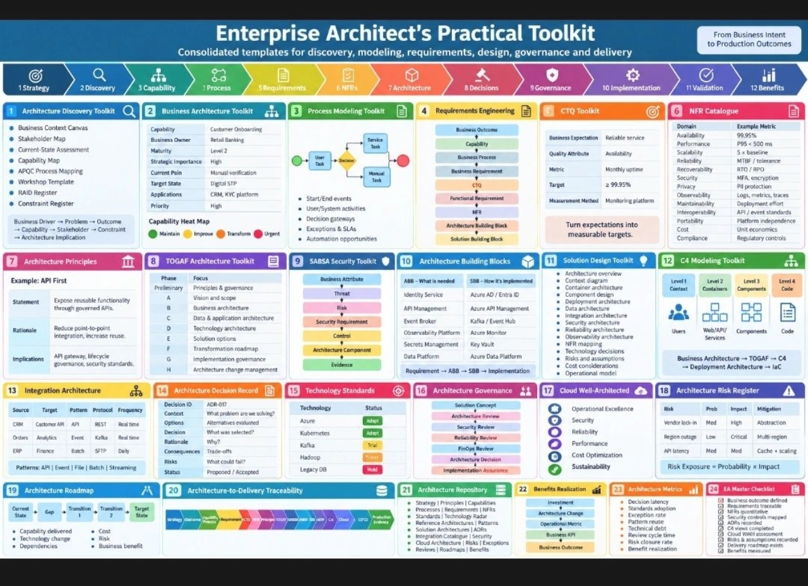

ARCHITECTURE D’ENTREPRISE · DATA

<h2>Une chaîne data de bout en bout</h2>

Une plateforme data combine l’ingestion, le stockage, le traitement, la transformation, l’orchestration, la restitution et la gouvernance. Cette vue synthétique situe les outils dans les différentes couches d’une chaîne de données.

Le schéma parcourt les couches de data engineering, depuis les sources et l’ingestion jusqu’au serving, à la qualité et à la gouvernance.

<figure class="resource-figure"><figcaption>Stack complète de data engineering.</figcaption></figure>
