
ARCHITECTURE IA · DOCUMENT DE RÉFÉRENCE

Guide méthodologique d&#x27;architecture d&#x27;entreprise IA — Fondé sur TOGAF ADM, ArchiMate et C4 Model

<strong>Positionnement :</strong> Référentiel proposé pour concevoir, documenter, gouverner et faire évoluer les systèmes d&#x27;information intégrant l&#x27;intelligence artificielle. Il s&#x27;agit d&#x27;une adaptation méthodologique proposée, et non d&#x27;une publication officielle ou d&#x27;une certification de The Open Group.

<h2>Sommaire</h2>

1. Objet, périmètre et principes directeurs

2. Fondamentaux de l&#x27;architecture d&#x27;entreprise IA

3. Stratégie IA et Business Architecture

4. Métamodèle d&#x27;architecture IA

5. Architecture Data &amp; AI

6. Architecture applicative IA et Agentic AI

7. Architecture technologique et plateformes

8. Sécurité, gouvernance, risques et conformité

9. Adaptation de TOGAF ADM aux projets IA

10. Modélisation ArchiMate et C4

11. Architectures de référence et cas pratiques

12. Livrables, gouvernance opérationnelle et roadmap

Annexes : modèles réutilisables, glossaire et références

<figure class="resource-figure">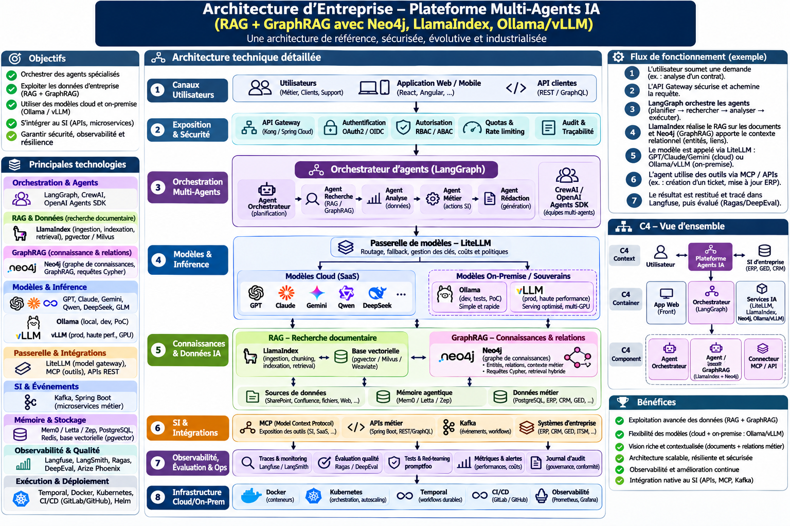<figcaption>Architecture de référence d’une plateforme multi-agents intégrant RAG, GraphRAG, orchestration, modèles et opérations.</figcaption></figure>
<h2>Synthèse exécutive</h2>

L&#x27;intelligence artificielle ne doit pas être traitée comme une simple technologie ajoutée au portefeuille applicatif. Elle introduit des actifs, des cycles de vie, des risques et des dépendances spécifiques : données d&#x27;entraînement et de contexte, modèles, prompts, embeddings, bases vectorielles, agents, outils, évaluations, garde-fous et mécanismes de supervision.

Le AI Enterprise Architecture Framework (AI-EAF) fournit un cadre cohérent pour relier la stratégie métier aux capacités IA, aux données, aux applications, aux modèles et aux plateformes techniques. Il s&#x27;appuie sur la logique de TOGAF ADM pour organiser la transformation, sur ArchiMate pour représenter les relations d&#x27;entreprise et sur C4 pour décrire les structures logicielles à différents niveaux de zoom.

<table><tr><td>
Idée centrale 
TOGAF organise la démarche et la gouvernance de l&#x27;architecture d&#x27;entreprise ; ArchiMate exprime les relations entre capacités, processus, données, services et technologies ; C4 décrit concrètement les frontières, conteneurs et composants logiciels. Les trois approches sont complémentaires.
</td></tr></table>

<h3>Décisions structurantes proposées</h3>

Traiter l&#x27;IA comme une capacité d&#x27;entreprise, pas seulement comme un portefeuille de modèles.

Créer un catalogue gouverné des cas d&#x27;usage IA et une cartographie des capacités métier concernées.

Séparer clairement les responsabilités Data, AI/ML, Application, Platform, Security et Business.

Industrialiser le cycle de vie des modèles et des applications IA (MLOps, LLMOps, AIOps selon les besoins).

Mettre en place une gouvernance fondée sur le risque, la traçabilité, l&#x27;évaluation et la supervision humaine.

Réutiliser des building blocks et architectures de référence plutôt que multiplier les solutions isolées.

<h2>1. Objet, périmètre et principes directeurs</h2>
<h3>1.1 Objectifs</h3>

Le référentiel vise à aider une organisation à passer d&#x27;expérimentations IA locales à un système de capacités IA cohérent, sécurisé, mesurable et industrialisable.

Aligner les investissements IA sur les objectifs stratégiques et les résultats métier.

Définir les architectures de référence et les standards technologiques.

Maîtriser les données, les modèles, les prompts, les agents et leurs dépendances.

Rendre les solutions observables, évaluables, explicables lorsque nécessaire et réversibles.

Organiser les décisions d&#x27;architecture et les contrôles de conformité.

Accélérer les projets grâce à des patterns et composants réutilisables.

<h3>1.2 Périmètre</h3>

<table><tr><td>
Inclus
</td><td>
Hors périmètre / traité par d&#x27;autres disciplines
</td></tr><tr><td>
IA prédictive et descriptive : ML, scoring, classification, prévision, détection d&#x27;anomalies
</td><td>
Définition détaillée des politiques métier indépendamment de l&#x27;IA
</td></tr><tr><td>
IA générative : LLM, RAG, génération multimodale, assistants
</td><td>
Recherche fondamentale et conception mathématique de nouveaux modèles
</td></tr><tr><td>
IA agentique : agents, orchestration, outils, mémoire, délégation
</td><td>
Gestion exhaustive des postes utilisateurs et du support bureautique
</td></tr><tr><td>
Données, pipelines, feature stores, vector stores, model registry
</td><td>
Remplacement des politiques globales de cybersécurité ou de gestion des données
</td></tr><tr><td>
Plateformes, intégration, APIs, observabilité, exploitation
</td><td>
Choix contractuels ou achats, qui restent soumis aux processus de sourcing
</td></tr></table>

<h3>1.3 Principes directeurs d&#x27;architecture IA</h3>

<table><tr><td>
ID
</td><td>
Principe
</td><td>
Conséquence vérifiable
</td></tr><tr><td>
AI-01
</td><td>
Business first
</td><td>
Chaque solution IA est rattachée à un objectif et à un indicateur métier.
</td></tr><tr><td>
AI-02
</td><td>
Data governance by design
</td><td>
La provenance, la qualité, les droits et la rétention des données sont connus.
</td></tr><tr><td>
AI-03
</td><td>
Model-agnostic where feasible
</td><td>
Les modèles sont accessibles via des interfaces et contrats standardisés lorsque cela est pertinent.
</td></tr><tr><td>
AI-04
</td><td>
Human accountability
</td><td>
Une responsabilité humaine est définie pour les décisions à impact.
</td></tr><tr><td>
AI-05
</td><td>
Secure by design
</td><td>
Identité, autorisation, chiffrement, filtrage et journalisation sont intégrés dès la conception.
</td></tr><tr><td>
AI-06
</td><td>
Observable and evaluable
</td><td>
Qualité, coût, latence, dérive, sécurité et utilité sont mesurés.
</td></tr><tr><td>
AI-07
</td><td>
Reusable building blocks
</td><td>
Les patterns, composants et plateformes communs sont privilégiés.
</td></tr><tr><td>
AI-08
</td><td>
Lifecycle management
</td><td>
Données, modèles, prompts, agents et configurations sont versionnés et gouvernés.
</td></tr><tr><td>
AI-09
</td><td>
Proportionate autonomy
</td><td>
Le niveau d&#x27;autonomie d&#x27;un agent est limité par le risque et les contrôles.
</td></tr><tr><td>
AI-10
</td><td>
Exit and portability
</td><td>
Les dépendances fournisseurs et les possibilités de migration sont documentées.
</td></tr></table>

<h3>1.4 Typologie des solutions</h3>

<table><tr><td>
Famille
</td><td>
Exemples
</td><td>
Questions architecturales dominantes
</td></tr><tr><td>
Analytique / BI augmentée
</td><td>
Prévision de ventes, segmentation, détection
</td><td>
Qualité des données, biais, explicabilité, performance
</td></tr><tr><td>
Machine Learning
</td><td>
Scoring, classification, recommandation
</td><td>
Feature engineering, entraînement, registry, drift
</td></tr><tr><td>
IA générative
</td><td>
Résumé, extraction, rédaction, Q&amp;A
</td><td>
Sélection LLM, prompts, grounding, évaluation
</td></tr><tr><td>
RAG
</td><td>
Recherche dans les corpus internes
</td><td>
Ingestion, chunking, embeddings, ACL, citations
</td></tr><tr><td>
Agentic AI
</td><td>
Assistant exécutant un processus multi-étapes
</td><td>
Outils autorisés, planification, mémoire, limites d&#x27;action
</td></tr><tr><td>
IA multimodale
</td><td>
Analyse image, audio, vidéo, documents
</td><td>
Formats, taille, confidentialité, coût, latence
</td></tr></table>

<h2>2. Fondamentaux de l&#x27;architecture d&#x27;entreprise IA</h2>
<h3>2.1 De l&#x27;architecture SI à l&#x27;architecture IA</h3>

Une architecture IA relie un besoin métier à un ensemble de capacités techniques et organisationnelles. Elle doit expliciter la chaîne de valeur complète : données sources, préparation, modèle, orchestration, service exposé, interaction utilisateur, supervision et mesure du résultat.

<h4>Carte Archimate d'une architecture type IA agentique</h4>
<figure class="resource-figure">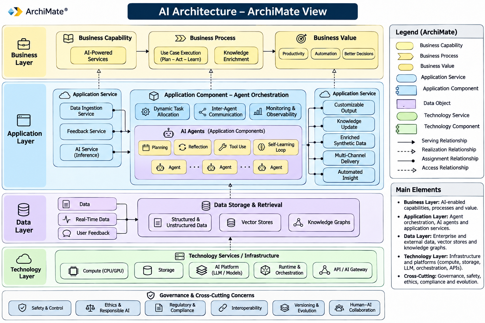</figure>
<h3>2.2 Les composants d&#x27;une solution IA</h3>

<table><tr><td>
Composant
</td><td>
Rôle
</td><td>
Exemples / points d&#x27;attention
</td></tr><tr><td>
Data source
</td><td>
Source d&#x27;information
</td><td>
ERP, CRM, GED, capteurs, bases relationnelles, événements
</td></tr><tr><td>
Data pipeline
</td><td>
Ingestion, transformation et contrôle
</td><td>
ETL/ELT, streaming, qualité, lineage
</td></tr><tr><td>
Dataset / corpus
</td><td>
Données exploitées par le modèle ou le RAG
</td><td>
Droits, classification, fraîcheur, version
</td></tr><tr><td>
Feature Store
</td><td>
Gestion des variables ML
</td><td>
Cohérence offline/online, réutilisation
</td></tr><tr><td>
Model / LLM
</td><td>
Moteur d&#x27;inférence
</td><td>
Modèle propriétaire, open weights, modèle spécialisé
</td></tr><tr><td>
Prompt / template
</td><td>
Instruction structurée pour un LLM
</td><td>
Version, tests, paramètres, sécurité
</td></tr><tr><td>
Embedding model
</td><td>
Projection sémantique des contenus
</td><td>
Dimension, version, compatibilité
</td></tr><tr><td>
Vector store
</td><td>
Index de recherche vectorielle
</td><td>
Filtrage, ACL, mise à jour, haute disponibilité
</td></tr><tr><td>
Orchestrator / Agent
</td><td>
Coordination des étapes et outils
</td><td>
LangGraph, workflows, règles d&#x27;arrêt
</td></tr><tr><td>
Tool / API
</td><td>
Action ou capacité appelée par l&#x27;agent
</td><td>
Contrat, authentification, autorisation, idempotence
</td></tr><tr><td>
AI Gateway
</td><td>
Point de contrôle d&#x27;accès aux modèles
</td><td>
Routage, quotas, logs, politiques, coût
</td></tr><tr><td>
Evaluation &amp; monitoring
</td><td>
Mesure de la qualité et du risque
</td><td>
Jeux de tests, métriques, alertes, revues humaines
</td></tr></table>

<h3>2.3 IA classique, générative et agentique</h3>

<table><tr><td>
Dimension
</td><td>
ML classique
</td><td>
IA générative
</td><td>
IA agentique
</td></tr><tr><td>
Finalité
</td><td>
Prédire / classer / optimiser
</td><td>
Générer ou transformer du contenu
</td><td>
Atteindre un objectif via plusieurs étapes et outils
</td></tr><tr><td>
Entrées
</td><td>
Variables structurées ou signaux
</td><td>
Texte, image, audio, contexte
</td><td>
Objectif, contexte, état, outils disponibles
</td></tr><tr><td>
Sortie
</td><td>
Score, classe, valeur
</td><td>
Texte, code, image, structure
</td><td>
Décision de prochaine étape, action ou résultat
</td></tr><tr><td>
Contrôle
</td><td>
Pipeline et seuils
</td><td>
Prompt, filtres, validation
</td><td>
Orchestration, permissions, limites et supervision
</td></tr><tr><td>
Risques
</td><td>
Biais, dérive, erreurs de prédiction
</td><td>
Hallucination, fuite, injection de prompt
</td><td>
Actions non voulues, escalade, boucle, délégation abusive
</td></tr></table>

<table><tr><td>
Distinction essentielle 
Un système qui utilise un LLM n&#x27;est pas automatiquement agentique. Il devient agentique lorsqu&#x27;il choisit ou planifie des étapes, utilise des outils, maintient un état ou adapte son comportement pour atteindre un objectif, dans des limites définies.
</td></tr></table>

<h2>3. Stratégie IA et Business Architecture</h2>
<h3>3.1 Partir des résultats métier</h3>

Le portefeuille IA doit être construit à partir de problèmes métier, et non à partir de la disponibilité d&#x27;une technologie. Chaque cas d&#x27;usage doit expliciter le processus concerné, les utilisateurs, la valeur attendue, les données nécessaires, le niveau de risque, les coûts et les conditions d&#x27;industrialisation.

<h3>3.2 Fiche de qualification d&#x27;un AI Use Case</h3>

<table><tr><td>
Rubrique
</td><td>
Contenu attendu
</td></tr><tr><td>
Identité
</td><td>
Nom, sponsor, propriétaire métier, domaine, version, statut
</td></tr><tr><td>
Problème
</td><td>
Situation actuelle, irritants, population concernée, processus
</td></tr><tr><td>
Résultat attendu
</td><td>
Bénéfice mesurable, KPI de référence et cible
</td></tr><tr><td>
Approche IA
</td><td>
ML, GenAI, RAG, agent, vision, audio ou combinaison
</td></tr><tr><td>
Données
</td><td>
Sources, sensibilité, qualité, droits, localisation, rétention
</td></tr><tr><td>
Décision / action
</td><td>
Recommandation, génération, décision assistée ou action automatisée
</td></tr><tr><td>
Risque
</td><td>
Impact potentiel, personnes concernées, sécurité, conformité
</td></tr><tr><td>
Exploitation
</td><td>
SLO, volumétrie, latence, coût, support, continuité
</td></tr><tr><td>
Validation
</td><td>
Métriques métier, tests techniques, validation humaine, critères go/no-go
</td></tr></table>

<h3>3.3 AI Capability Map</h3>

<table><tr><td>
Capacité métier
</td><td>
Capacité IA associée
</td><td>
Exemples de services
</td></tr><tr><td>
Relation client
</td><td>
Compréhension et assistance augmentées
</td><td>
Classification de demandes, assistant conseiller, résumé d&#x27;interaction
</td></tr><tr><td>
Finance / contrôle
</td><td>
Analyse et détection augmentées
</td><td>
Détection d&#x27;anomalies, prévision, extraction de factures
</td></tr><tr><td>
Ressources humaines
</td><td>
Traitement documentaire assisté
</td><td>
Recherche dans procédures, aide à la rédaction sous contrôle
</td></tr><tr><td>
Opérations
</td><td>
Optimisation et anticipation
</td><td>
Maintenance prédictive, prévision de charge
</td></tr><tr><td>
Juridique / conformité
</td><td>
Recherche et synthèse contrôlées
</td><td>
RAG documentaire, veille, extraction de clauses
</td></tr></table>

<h3>3.4 Priorisation du portefeuille</h3>

Évaluer chaque cas d&#x27;usage selon la valeur, la faisabilité, le risque, la disponibilité des données et le coût total. Une matrice de priorisation ne doit pas masquer les critères éliminatoires : absence de base légale, données non autorisées, risques non maîtrisés ou absence de propriétaire.

<table><tr><td>
Critère
</td><td>
Question
</td><td>
Échelle indicative
</td></tr><tr><td>
Valeur métier
</td><td>
Le gain est-il significatif et mesurable ?
</td><td>
1 à 5
</td></tr><tr><td>
Faisabilité data
</td><td>
Les données sont-elles accessibles et exploitables ?
</td><td>
1 à 5
</td></tr><tr><td>
Faisabilité technique
</td><td>
Les performances sont-elles atteignables ?
</td><td>
1 à 5
</td></tr><tr><td>
Adoption
</td><td>
Les utilisateurs peuvent-ils intégrer la solution ?
</td><td>
1 à 5
</td></tr><tr><td>
Risque
</td><td>
Le risque résiduel est-il acceptable ?
</td><td>
Faible / moyen / élevé
</td></tr><tr><td>
Coût complet
</td><td>
Le coût d&#x27;inférence, d&#x27;exploitation et de contrôle est-il soutenable ?
</td><td>
Budget estimé
</td></tr></table>

<h3>3.5 Exemple : assistant documentaire interne</h3>

Objectif : permettre aux collaborateurs de rechercher des réponses dans un corpus documentaire interne, avec sources citées et contrôle des habilitations.

Capability métier : accéder à une information fiable et à jour.

AI Use Case : assistant de recherche documentaire avec RAG.

Valeur : réduction du temps de recherche et amélioration de la cohérence des réponses.

KPI : taux de réponses correctement sourcées, temps moyen de recherche, taux d&#x27;escalade, satisfaction.

Limite : l&#x27;assistant ne prend pas de décision RH, juridique ou financière ; il fournit une aide à la recherche.

<h2>4. Métamodèle d&#x27;architecture IA</h2>
<h3>4.1 Finalité du métamodèle</h3>

Le métamodèle définit les objets d&#x27;architecture à inventorier et les relations à tracer. Il sert de socle aux modèles ArchiMate, au référentiel d&#x27;architecture, à la gouvernance des projets et à la traçabilité entre besoin métier et composants techniques.

<h3>4.2 Entités proposées</h3>

<table><tr><td>
Entité
</td><td>
Définition
</td><td>
Attributs clés
</td></tr><tr><td>
AI Strategy
</td><td>
Orientation stratégique IA
</td><td>
objectifs, principes, horizon, sponsor
</td></tr><tr><td>
AI Capability
</td><td>
Capacité organisationnelle à concevoir ou exploiter l&#x27;IA
</td><td>
maturité, propriétaire, niveau cible
</td></tr><tr><td>
AI Use Case
</td><td>
Cas d&#x27;usage métier mobilisant l&#x27;IA
</td><td>
valeur, risque, statut, KPI
</td></tr><tr><td>
AI Product
</td><td>
Produit ou service IA maintenu dans la durée
</td><td>
owner, utilisateurs, SLA, version
</td></tr><tr><td>
Data Asset
</td><td>
Donnée ou corpus exploité
</td><td>
source, classification, qualité, lineage, droits
</td></tr><tr><td>
Dataset
</td><td>
Ensemble de données préparé et versionné
</td><td>
schéma, période, provenance, qualité
</td></tr><tr><td>
Feature
</td><td>
Variable utilisée par un modèle ML
</td><td>
définition, calcul, fraîcheur
</td></tr><tr><td>
AI Model
</td><td>
Modèle entraîné ou modèle de fondation
</td><td>
famille, version, fournisseur, licence, métriques
</td></tr><tr><td>
Prompt Template
</td><td>
Instruction versionnée adressée à un modèle
</td><td>
version, variables, tests, propriétaire
</td></tr><tr><td>
Embedding Model
</td><td>
Modèle produisant des vecteurs
</td><td>
version, dimension, langue, compatibilité
</td></tr><tr><td>
Vector Store
</td><td>
Stockage et index de vecteurs
</td><td>
moteur, index, ACL, rétention
</td></tr><tr><td>
RAG Pipeline
</td><td>
Chaîne d&#x27;indexation et de récupération augmentée
</td><td>
étapes, corpus, stratégies de retrieval
</td></tr><tr><td>
AI Agent
</td><td>
Composant poursuivant un objectif avec état et outils
</td><td>
rôle, permissions, limites, mémoire
</td></tr><tr><td>
Tool
</td><td>
Fonction ou API qu&#x27;un agent peut appeler
</td><td>
contrat, scopes, propriétaire, risque
</td></tr><tr><td>
AI Service
</td><td>
Capacité IA exposée par API ou interface
</td><td>
contrat, version, SLO, consommateur
</td></tr><tr><td>
Evaluation Suite
</td><td>
Tests et jeux de référence
</td><td>
dataset, critères, seuils, résultats
</td></tr><tr><td>
AI Risk
</td><td>
Risque associé à un usage, modèle ou système
</td><td>
impact, probabilité, contrôle, résiduel
</td></tr><tr><td>
AI Control
</td><td>
Mesure technique ou organisationnelle
</td><td>
objectif, responsable, preuve, fréquence
</td></tr></table>

<h3>4.3 Relations principales</h3>
<figure class="resource-figure ai-relations-figure">
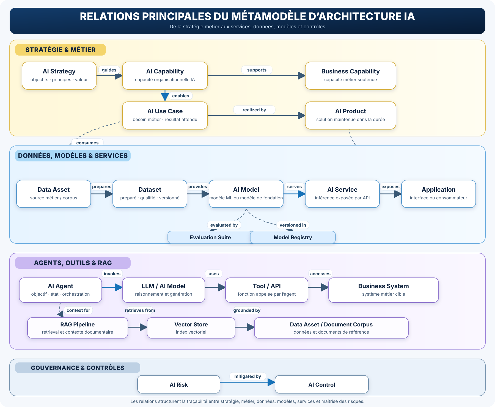<figcaption>Carte des relations principales du métamodèle d’architecture IA.</figcaption>
</figure>
<h3>4.4 Règles de modélisation</h3>

Chaque AI Use Case possède un propriétaire métier et un responsable de solution.

Chaque modèle en production possède un identifiant, une version, une provenance et un statut.

Chaque dataset ou corpus possède une classification, une source et des règles de conservation.

Chaque agent possède une liste explicite de tools autorisés et des permissions minimales.

Chaque AI Service documente son contrat, ses consommateurs, ses SLO et ses limites.

Chaque risque significatif est relié à un ou plusieurs contrôles et à une preuve vérifiable.

<h3>4.5 Mapping vers ArchiMate</h3>

<table><tr><td>
Concept du métamodèle IA
</td><td>
Éléments ArchiMate possibles
</td><td>
Remarque
</td></tr><tr><td>
AI Strategy
</td><td>
Goal, Outcome, Requirement, Principle, Course of Action
</td><td>
Utiliser Motivation pour le pourquoi.
</td></tr><tr><td>
AI Capability
</td><td>
Capability
</td><td>
Peut spécialiser le catalogue de capacités d&#x27;entreprise.
</td></tr><tr><td>
AI Use Case
</td><td>
Business Process, Business Service, Application Service selon le niveau
</td><td>
Un use case n&#x27;est pas un élément ArchiMate standard unique.
</td></tr><tr><td>
AI Product
</td><td>
Product, Business Service, Application Component
</td><td>
Choisir selon la nature et le point de vue.
</td></tr><tr><td>
Data Asset
</td><td>
Data Object, Business Object
</td><td>
Distinguer sens métier et représentation applicative.
</td></tr><tr><td>
AI Model
</td><td>
Application Component ou Technology Object selon l&#x27;abstraction
</td><td>
Documenter les métadonnées du modèle dans le référentiel.
</td></tr><tr><td>
AI Agent
</td><td>
Application Component / Application Function
</td><td>
Représenter ses comportements et interactions.
</td></tr><tr><td>
Tool/API
</td><td>
Application Service, Application Interface
</td><td>
Montrer le contrat et les consommateurs.
</td></tr><tr><td>
AI Platform
</td><td>
Node, System Software, Technology Service
</td><td>
Décrire l&#x27;environnement d&#x27;exécution.
</td></tr><tr><td>
AI Risk / Control
</td><td>
Assessment, Constraint, Requirement, Principle
</td><td>
Compléter par un registre de risques dédié.
</td></tr></table>

<h2>5. Architecture Data &amp; AI</h2>
<h3>5.1 Chaîne de valeur des données IA</h3>
<figure class="resource-figure ai-framework-diagram">
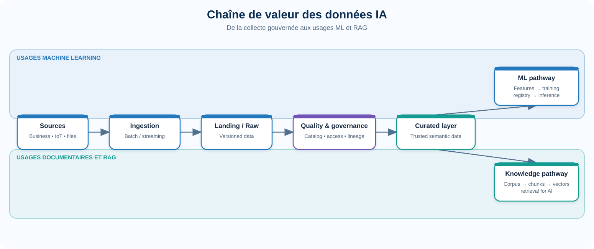
<figcaption>Chaîne de valeur des données IA, des sources aux usages ML et RAG.</figcaption></figure>
<h3>5.2 Architecture des données pour le ML</h3>

Définir les sources, les contrats de données et les règles de qualité.

Assurer la reproductibilité des datasets d&#x27;entraînement et de validation.

Contrôler les fuites de données entre entraînement et test.

Documenter les features, leur définition métier, leur calcul et leur fraîcheur.

Assurer la cohérence entre features offline et online lorsque les prédictions sont temps réel.

Tracer les versions des données, du code, des paramètres et du modèle.

<h3>5.3 Architecture RAG</h3>
<figure class="resource-figure ai-framework-diagram">
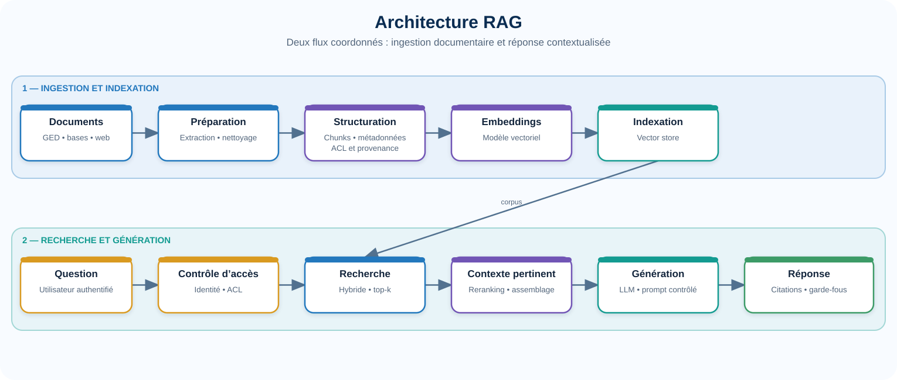
<figcaption>Architecture RAG : ingestion, indexation, recherche et génération contrôlée.</figcaption></figure>

Décisions d&#x27;architecture à documenter : stratégie de chunking, modèle d&#x27;embedding, dimension vectorielle, recherche hybride, filtres de métadonnées, reranking, seuil de pertinence, gestion des documents supprimés, synchronisation des droits et stratégie de citation.

<h3>5.4 Gouvernance des données pour RAG</h3>

Appliquer les droits d&#x27;accès au moment de la récupération, pas uniquement lors de l&#x27;indexation.

Empêcher qu&#x27;un utilisateur obtienne un extrait d&#x27;un document qu&#x27;il ne peut pas consulter.

Conserver la provenance, la version, la date et l&#x27;identifiant du document source.

Retirer ou réindexer les contenus supprimés ou dont les droits ont changé.

Évaluer la fraîcheur, la couverture et la pertinence du corpus.

Ne pas considérer les documents récupérés comme des instructions fiables : ils sont des données non fiables.

<h3>5.5 Architecture de données et cycle de vie</h3>

<table><tr><td>
Étape
</td><td>
Contrôles attendus
</td></tr><tr><td>
Collecte
</td><td>
Base légale, droits, finalité, minimisation, sécurité du transfert
</td></tr><tr><td>
Préparation
</td><td>
Qualité, déduplication, normalisation, détection de données sensibles
</td></tr><tr><td>
Enrichissement
</td><td>
Traçabilité des transformations et provenance
</td></tr><tr><td>
Stockage
</td><td>
Classification, chiffrement, accès, rétention, localisation
</td></tr><tr><td>
Consommation
</td><td>
Contrôle d&#x27;accès, minimisation, journalisation, contrat de données
</td></tr><tr><td>
Archivage / suppression
</td><td>
Durées de conservation, propagation de suppression, preuve
</td></tr></table>

<h2>6. Architecture applicative IA et Agentic AI</h2>
<h3>6.1 Patterns applicatifs</h3>

<table><tr><td>
Pattern
</td><td>
Description
</td><td>
À privilégier lorsque
</td></tr><tr><td>
LLM direct
</td><td>
Application appelle un LLM via API
</td><td>
Tâche simple, faible orchestration, contexte limité
</td></tr><tr><td>
Prompt chain
</td><td>
Plusieurs prompts / transformations séquentiels
</td><td>
Pipeline déterministe et testable
</td></tr><tr><td>
RAG
</td><td>
Récupération de connaissances avant génération
</td><td>
Réponses fondées sur corpus métier évolutif
</td></tr><tr><td>
Tool calling
</td><td>
Le modèle choisit parmi des fonctions définies
</td><td>
Accès contrôlé à des données ou actions externes
</td></tr><tr><td>
Workflow agentique
</td><td>
Orchestration d&#x27;étapes, état et conditions
</td><td>
Processus complexe mais encadré
</td></tr><tr><td>
Multi-agent
</td><td>
Agents spécialisés coopèrent
</td><td>
Besoin réel de séparation de rôles ; complexité justifiée
</td></tr><tr><td>
Human-in-the-loop
</td><td>
Validation humaine avant action ou décision
</td><td>
Impact élevé, ambiguïté ou action irréversible
</td></tr></table>

<h3>6.2 Architecture de référence d&#x27;un agent</h3>
<figure class="resource-figure ai-framework-diagram">
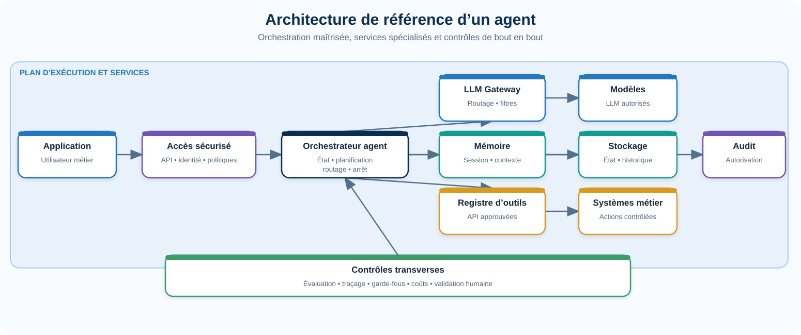
<figcaption>Architecture agentique avec orchestration, services spécialisés et contrôles transverses.</figcaption></figure>
<h3>6.3 Agent, workflow et orchestrateur</h3>

Un workflow classique suit un enchaînement prédéfini. Un agent peut sélectionner une action ou un outil en fonction du contexte et de l&#x27;état courant. Une architecture robuste utilise souvent une orchestration hybride : étapes déterministes pour les opérations critiques, raisonnement du modèle pour les tâches ouvertes, et points de contrôle explicites.

<table><tr><td>
Question
</td><td>
Décision d&#x27;architecture
</td></tr><tr><td>
L&#x27;agent peut-il agir ?
</td><td>
Définir une liste blanche d&#x27;outils et des permissions minimales.
</td></tr><tr><td>
L&#x27;action est-elle réversible ?
</td><td>
Exiger confirmation humaine pour les actions irréversibles ou sensibles.
</td></tr><tr><td>
Comment éviter les boucles ?
</td><td>
Définir nombre maximal d&#x27;étapes, timeout, budget tokens et conditions d&#x27;arrêt.
</td></tr><tr><td>
Comment gérer l&#x27;état ?
</td><td>
Séparer état de session, mémoire métier et historique auditable.
</td></tr><tr><td>
Comment gérer les erreurs ?
</td><td>
Retries bornés, idempotence, circuit breaker, fallback et escalade.
</td></tr><tr><td>
Comment vérifier la qualité ?
</td><td>
Tests de scénarios, trajectoires, outils appelés, résultats et refus.
</td></tr></table>

<h3>6.4 Exemple LangGraph</h3>

Exemple conceptuel d&#x27;un assistant de traitement de demande. Le graphe orchestre des étapes contrôlées ; l&#x27;utilisation de LangGraph est un choix d&#x27;implémentation possible, pas une obligation du framework.

<figure class="resource-figure ai-framework-diagram">
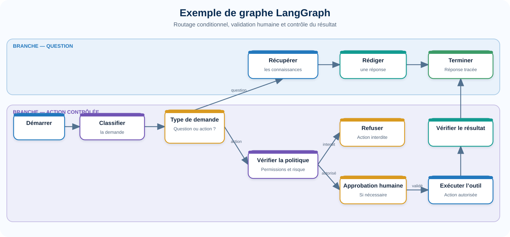
<figcaption>Exemple de graphe LangGraph pour traiter une demande.</figcaption></figure>
<h3>6.5 Contrats d&#x27;API IA</h3>

Définir schéma d&#x27;entrée et de sortie, erreurs, version et limites de taille.

Indiquer si la réponse est probabiliste et quelles garanties ne sont pas fournies.

Documenter latence cible, quotas, coût, disponibilité et politique de retry.

Retourner des métadonnées utiles : model_id, version, sources, correlation_id, evaluation status si pertinent.

Ne jamais exposer les secrets ou détails internes du fournisseur dans les réponses.

<h2>7. Architecture technologique et plateformes</h2>
<h3>7.1 Vue logique de plateforme</h3>
<figure class="resource-figure ai-framework-diagram">
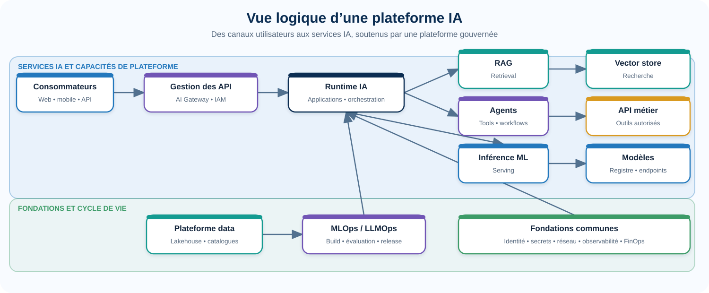
<figcaption>Vue logique des capacités d’une plateforme IA.</figcaption></figure>
<h3>7.2 Capacités de plateforme</h3>

<table><tr><td>
Domaine
</td><td>
Capacités attendues
</td></tr><tr><td>
Model access
</td><td>
Catalogue de modèles, routage, versionnement, quotas, fallback
</td></tr><tr><td>
Model development
</td><td>
Environnements, notebooks, entraînement, expérimentation, registry
</td></tr><tr><td>
Data platform
</td><td>
Ingestion, lakehouse, gouvernance, catalogage, qualité, lineage
</td></tr><tr><td>
RAG services
</td><td>
Parsing, chunking, embedding, indexation, retrieval, reranking
</td></tr><tr><td>
Agent runtime
</td><td>
Orchestration, state store, tool registry, sandbox, policy enforcement
</td></tr><tr><td>
Security
</td><td>
IAM, secrets, chiffrement, réseau privé, DLP, audit
</td></tr><tr><td>
Observability
</td><td>
Logs, traces, métriques, qualité, latence, coût, dérive
</td></tr><tr><td>
Delivery
</td><td>
CI/CD, tests, scans, validation, promotion et rollback
</td></tr><tr><td>
FinOps
</td><td>
Budgets, coûts par produit, quotas, optimisation modèles et tokens
</td></tr></table>

<h3>7.3 Choix technologiques : critères plutôt que catalogue</h3>

Le framework ne prescrit pas un fournisseur unique. Azure AI Foundry, Azure Machine Learning, AWS Bedrock, SageMaker, Google Vertex AI, plateformes open source ou solutions internes peuvent être évalués à partir d&#x27;un même ensemble de critères.

Adéquation aux cas d&#x27;usage et aux modèles requis.

Région d&#x27;hébergement, résidence des données et exigences contractuelles.

Gestion des identités, des réseaux, des clés et des secrets.

Portabilité des modèles, formats, APIs et données.

Capacités d&#x27;évaluation, observabilité et gouvernance.

Coût total : entraînement, inférence, stockage, transfert, exploitation et contrôle.

Disponibilité, montée en charge, quotas, reprise et continuité.

Compétences internes, support et maturité de l&#x27;écosystème.

<h3>7.4 MLOps et LLMOps</h3>

<table><tr><td>
Pratique
</td><td>
ML / MLOps
</td><td>
GenAI / LLMOps
</td></tr><tr><td>
Versionnement
</td><td>
Code, données, features, paramètres, modèle
</td><td>
Prompts, modèles, corpus, embeddings, outils, graphes
</td></tr><tr><td>
Tests
</td><td>
Performance, robustesse, biais, dérive
</td><td>
Groundedness, pertinence, hallucination, sécurité, injection
</td></tr><tr><td>
Déploiement
</td><td>
Batch, temps réel, edge
</td><td>
API, streaming, orchestration, agents
</td></tr><tr><td>
Monitoring
</td><td>
Drift, précision, latence, disponibilité
</td><td>
Qualité réponse, coût tokens, latence, refus, traces d&#x27;outils
</td></tr><tr><td>
Rollback
</td><td>
Retour à modèle précédent
</td><td>
Retour à modèle, prompt, corpus ou configuration précédente
</td></tr></table>

<h2>8. Sécurité, gouvernance, risques et conformité</h2>
<h3>8.1 Gouvernance à plusieurs niveaux</h3>

<table><tr><td>
Instance
</td><td>
Responsabilités
</td></tr><tr><td>
AI Steering Committee
</td><td>
Priorités, appétence au risque, arbitrages, financement
</td></tr><tr><td>
Architecture Board
</td><td>
Principes, standards, dérogations, cohérence SI
</td></tr><tr><td>
AI Risk / Compliance Committee
</td><td>
Qualification des risques, exigences réglementaires, contrôles
</td></tr><tr><td>
Data Governance
</td><td>
Propriété, qualité, accès, conservation et provenance des données
</td></tr><tr><td>
AI Product Owner
</td><td>
Valeur, périmètre, utilisateurs, qualité métier et cycle de vie
</td></tr><tr><td>
Model Owner
</td><td>
Version, performances, documentation, validation et surveillance
</td></tr><tr><td>
Platform Owner
</td><td>
Disponibilité, sécurité, capacité, coûts et exploitation
</td></tr></table>

<h3>8.2 Cycle de gestion des risques</h3>
<figure class="resource-figure ai-framework-diagram">
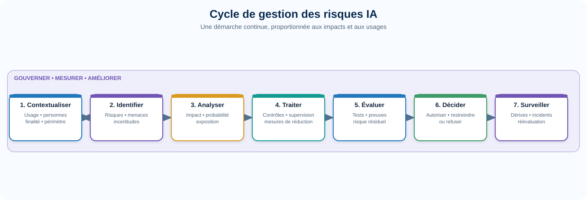
<figcaption>Cycle de gestion des risques IA.</figcaption></figure>
<h3>8.3 Catalogue de risques IA</h3>

<table><tr><td>
Risque
</td><td>
Exemple
</td><td>
Contrôles possibles
</td></tr><tr><td>
Données non autorisées
</td><td>
Données personnelles envoyées à un service externe
</td><td>
Classification, minimisation, DLP, contrats, filtrage
</td></tr><tr><td>
Biais
</td><td>
Résultat défavorable à un groupe
</td><td>
Tests de biais, analyse d&#x27;impact, revue humaine
</td></tr><tr><td>
Hallucination
</td><td>
Réponse inventée présentée comme factuelle
</td><td>
RAG, citations, seuils, abstention, validation
</td></tr><tr><td>
Prompt injection
</td><td>
Document ou utilisateur tente de détourner le modèle
</td><td>
Séparation instructions/données, filtrage, sandbox, tests
</td></tr><tr><td>
Exfiltration
</td><td>
L&#x27;agent extrait des données via un outil
</td><td>
Least privilege, scopes, DLP, contrôle de sortie
</td></tr><tr><td>
Action non autorisée
</td><td>
L&#x27;agent modifie un dossier sans approbation
</td><td>
Allowlist, validation humaine, idempotence, audit
</td></tr><tr><td>
Dérive
</td><td>
Dégradation de performance dans le temps
</td><td>
Monitoring, réévaluation, réentraînement ou changement de modèle
</td></tr><tr><td>
Dépendance fournisseur
</td><td>
Arrêt ou changement d&#x27;API / modèle
</td><td>
Abstraction, stratégie de sortie, tests de portabilité
</td></tr><tr><td>
Coût incontrôlé
</td><td>
Boucles agentiques ou prompts trop longs
</td><td>
Budgets, quotas, limites d&#x27;étapes, alertes
</td></tr><tr><td>
Indisponibilité
</td><td>
Service LLM ou plateforme indisponible
</td><td>
Fallback, cache, circuit breaker, mode dégradé
</td></tr></table>

<h3>8.4 Sécurité spécifique aux agents</h3>

Identité distincte par agent ou workload ; éviter les identifiants partagés.

Permissions minimales, limitées dans le temps et au contexte.

Tools enregistrés, approuvés, typés et soumis à contrôle d&#x27;accès.

Validation humaine pour les paiements, suppressions, communications externes ou décisions à fort impact.

Sandbox pour l&#x27;exécution de code et les contenus non fiables.

Traçabilité des décisions, appels d&#x27;outils, entrées/sorties pertinentes et approbations.

Limites de budget, durée, nombre d&#x27;itérations et taille des données manipulées.

<h3>8.5 Référentiels de gouvernance à articuler</h3>

NIST AI Risk Management Framework : approche de gestion des risques IA.

ISO/IEC 42001 : système de management de l&#x27;intelligence artificielle.

ISO/IEC 23894 : lignes directrices de gestion des risques IA.

Réglementation européenne sur l&#x27;IA (AI Act) : obligations à déterminer selon le rôle, le système et sa qualification.

RGPD et règles de protection des données : finalité, base légale, minimisation, droits, sécurité et transferts.

<table><tr><td>
Prudence réglementaire 
La qualification réglementaire d&#x27;un système dépend du cas d&#x27;usage, du contexte, du rôle de l&#x27;organisation et des textes applicables. Le présent guide ne remplace pas une analyse juridique ni une analyse d&#x27;impact formelle.
</td></tr></table>

<h2>9. Adaptation de TOGAF ADM aux projets IA</h2>

Le cycle ADM reste le fil conducteur. L&#x27;adaptation consiste à ajouter des questions, contrôles et livrables propres à l&#x27;IA, sans créer une méthode parallèle qui ferait doublon avec les processus existants.

<table><tr><td>
Phase ADM
</td><td>
Travaux IA complémentaires
</td><td>
Livrables recommandés
</td></tr><tr><td>
Preliminary
</td><td>
Maturité IA, principes, gouvernance, capacités et standards
</td><td>
AI Architecture Principles, mandat, modèle de gouvernance
</td></tr><tr><td>
A – Architecture Vision
</td><td>
Vision IA, parties prenantes, valeur, risques de haut niveau
</td><td>
AI Vision, concept cible, business case, stakeholder map
</td></tr><tr><td>
B – Business Architecture
</td><td>
Capacités métier, processus, rôles, impacts humains
</td><td>
AI Capability Map, processus cible, operating model
</td></tr><tr><td>
C – Data Architecture
</td><td>
Sources, qualité, lineage, corpus, droits et cycle de vie
</td><td>
Data/AI Data Architecture, data contracts, corpus map
</td></tr><tr><td>
C – Application Architecture
</td><td>
Produits IA, agents, RAG, APIs, systèmes consommateurs
</td><td>
AI Application Portfolio, interactions, contrats
</td></tr><tr><td>
D – Technology Architecture
</td><td>
Plateforme, modèles, GPU, réseau, sécurité, observabilité
</td><td>
AI Technology Reference Architecture, standards
</td></tr><tr><td>
E – Opportunities &amp; Solutions
</td><td>
Work packages, solutions candidates, dépendances et risques
</td><td>
Solution Building Blocks, architecture options
</td></tr><tr><td>
F – Migration Planning
</td><td>
Priorisation, trajectoires, capacités à construire
</td><td>
AI Roadmap, Transition Architectures, business case
</td></tr><tr><td>
G – Implementation Governance
</td><td>
Revues, conformité, tests, preuves et dérogations
</td><td>
Architecture Compliance Assessment, décisions
</td></tr><tr><td>
H – Architecture Change Management
</td><td>
Surveillance, évolution des modèles, coûts, risques et usages
</td><td>
Change Request, Model Change Assessment, mise à jour repository
</td></tr></table>

<h3>9.1 Phase Preliminary : préparer l&#x27;entreprise</h3>

Évaluer la maturité des données, de l&#x27;architecture, de la sécurité et de l&#x27;exploitation.

Définir le périmètre de gouvernance IA et les instances de décision.

Établir les principes IA et les standards de modélisation.

Créer les premières taxonomies : use cases, modèles, agents, données et risques.

Définir les critères d&#x27;entrée et de sortie des revues d&#x27;architecture.

<h3>9.2 Phase A : vision d&#x27;architecture</h3>

La vision doit expliciter le problème métier, la valeur attendue, les parties prenantes, les contraintes, les options de solution et les risques majeurs. Elle ne doit pas imposer prématurément un modèle ou un fournisseur.

<h3>9.3 Phases B et C : métier, données et applications</h3>

La phase B décrit les changements de capacités, processus, rôles et contrôles humains. La phase C décrit les données et applications nécessaires, notamment les corpus RAG, les modèles, les services IA et les intégrations avec le SI.

<h3>9.4 Phase D : technologie</h3>

La phase D compare les options d&#x27;hébergement et d&#x27;exécution : service managé, plateforme cloud, modèle auto-hébergé, GPU, Kubernetes, réseau privé, stockage vectoriel et outils d&#x27;observabilité.

<h3>9.5 Phases E et F : solutions et migration</h3>

Décomposer la cible en Solution Building Blocks et Transition Architectures. Prioriser les fondations communes : identité, AI Gateway, catalogue de modèles, pipeline d&#x27;évaluation, observabilité et gouvernance des données.

<h3>9.6 Phases G et H : contrôle et évolution</h3>

La conformité ne s&#x27;arrête pas à la mise en production. Tout changement de modèle, de prompt, de corpus, de tool, de fournisseur ou de niveau d&#x27;autonomie peut modifier le risque et doit déclencher une évaluation proportionnée.

<h3>9.7 Gates de décision</h3>

<table><tr><td>
Gate
</td><td>
Question de décision
</td><td>
Preuve minimale
</td></tr><tr><td>
G0 – Intake
</td><td>
Le besoin est-il légitime et sponsorisé ?
</td><td>
Fiche use case, owner, objectif
</td></tr><tr><td>
G1 – Qualification
</td><td>
Les données et risques sont-ils suffisamment connus ?
</td><td>
Data assessment, risque initial, option IA
</td></tr><tr><td>
G2 – Architecture
</td><td>
La solution est-elle cohérente et sécurisée ?
</td><td>
Vues ArchiMate/C4, ADR, contrôles
</td></tr><tr><td>
G3 – Préproduction
</td><td>
La qualité et la sécurité sont-elles démontrées ?
</td><td>
Résultats d&#x27;évaluation, tests, plan de reprise
</td></tr><tr><td>
G4 – Production
</td><td>
Le service est-il exploitable et gouverné ?
</td><td>
SLO, runbook, ownership, monitoring
</td></tr><tr><td>
G5 – Revue continue
</td><td>
Les performances et risques restent-ils acceptables ?
</td><td>
KPI, incidents, drift, coûts, réévaluation
</td></tr></table>

<h2>10. Modélisation ArchiMate et C4</h2>
<h3>10.1 Quand utiliser ArchiMate ?</h3>

ArchiMate est adapté à la représentation des motivations, capacités métier, processus, services, applications, données et technologies à l&#x27;échelle de l&#x27;entreprise. Il permet de montrer pourquoi une solution existe, quelles capacités elle soutient, quels services elle expose et sur quelles plateformes elle repose.

<h3>10.2 Vues ArchiMate recommandées</h3>

<table><tr><td>
Vue
</td><td>
Question traitée
</td><td>
Éléments principaux
</td></tr><tr><td>
Motivation
</td><td>
Pourquoi investir dans l&#x27;IA ?
</td><td>
Stakeholder, Driver, Goal, Outcome, Requirement, Constraint
</td></tr><tr><td>
Capability
</td><td>
Quelles capacités métier sont augmentées ?
</td><td>
Capability, Value Stream, Resource
</td></tr><tr><td>
Business Process
</td><td>
Comment le processus change-t-il ?
</td><td>
Business Actor, Role, Process, Service, Event
</td></tr><tr><td>
Information Structure
</td><td>
Quelles informations sont consommées ?
</td><td>
Business Object, Data Object, Representation
</td></tr><tr><td>
Application Cooperation
</td><td>
Comment les applications collaborent-elles ?
</td><td>
Application Component, Interface, Service, Data Object
</td></tr><tr><td>
Technology
</td><td>
Où et comment s&#x27;exécute la solution ?
</td><td>
Node, System Software, Technology Service, Artifact
</td></tr><tr><td>
Implementation &amp; Migration
</td><td>
Comment atteindre la cible ?
</td><td>
Work Package, Deliverable, Plateau, Gap
</td></tr><tr><td>
Risk &amp; Compliance
</td><td>
Quels contrôles répondent aux risques ?
</td><td>
Assessment, Requirement, Constraint, Principle
</td></tr></table>

<h3>10.3 Exemple de vue ArchiMate – assistant RAG</h3>
<figure class="resource-figure ai-framework-diagram">
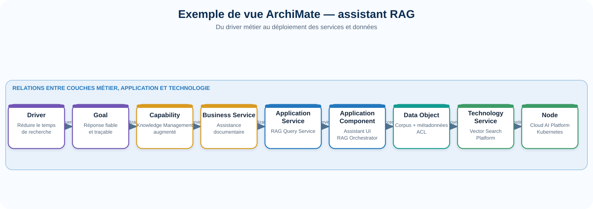
<figcaption>Exemple de chaîne de relations ArchiMate pour un assistant RAG.</figcaption></figure>

Ce schéma est une vue logique simplifiée. Dans un modèle ArchiMate formel, les relations exactes (realization, serving, access, assignment, deployment, influence) doivent être choisies selon la sémantique des éléments et la version du langage utilisée.

<h3>10.4 Quand utiliser C4 ?</h3>

C4 complète ArchiMate en décrivant la structure logicielle d&#x27;une solution. Il est particulièrement utile pour aligner architectes, développeurs, équipes plateforme et sécurité.

<table><tr><td>
Niveau C4
</td><td>
Usage pour l&#x27;IA
</td><td>
Exemple
</td></tr><tr><td>
L1 – System Context
</td><td>
Acteurs, système IA, systèmes externes
</td><td>
Collaborateur, Assistant IA, GED, IAM
</td></tr><tr><td>
L2 – Container
</td><td>
Applications et services déployables
</td><td>
Frontend, API, orchestrateur, vector DB, LLM Gateway
</td></tr><tr><td>
L3 – Component
</td><td>
Composants internes d&#x27;un conteneur
</td><td>
Retriever, reranker, prompt builder, policy checker
</td></tr><tr><td>
L4 – Code
</td><td>
Détails d&#x27;implémentation utiles
</td><td>
Classes, modules, interfaces ; optionnel
</td></tr></table>

<h3>10.5 Exemple C4 – L2 conteneurs RAG</h3>
<figure class="resource-figure ai-framework-diagram">
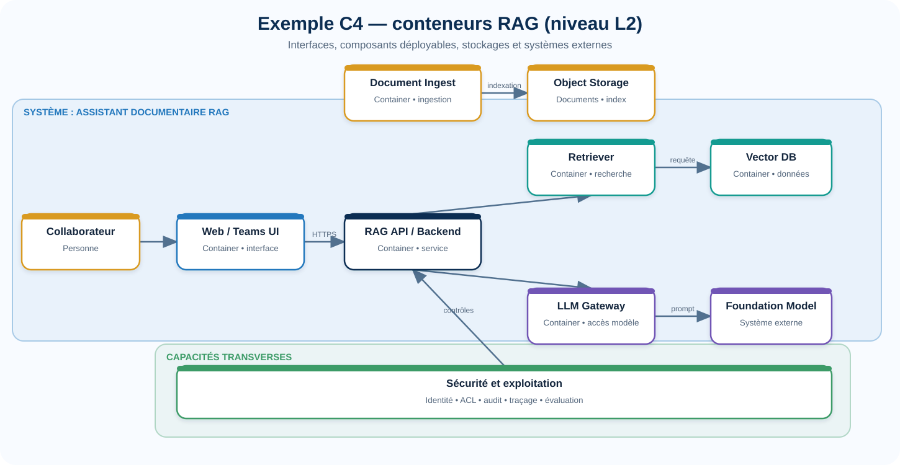
<figcaption>Exemple C4 niveau L2 pour un assistant RAG.</figcaption></figure>
<h3>10.6 Règles de cohérence ArchiMate / C4</h3>

ArchiMate décrit l&#x27;entreprise et les relations entre domaines ; C4 détaille une solution logicielle.

Les noms des systèmes, services et conteneurs doivent être cohérents entre les vues.

Un Application Component ArchiMate peut correspondre à un système ou un conteneur C4 selon le niveau de granularité.

Les vues doivent porter un objectif, un public cible, un périmètre et une date de validité.

Ne pas chercher à représenter tous les détails dans un seul diagramme : produire plusieurs vues complémentaires.

<h2>11. Architectures de référence et cas pratiques</h2>
<h3>11.1 Référence A – RAG d&#x27;entreprise</h3>

Cas : assistant interne qui répond à des questions à partir d&#x27;un corpus de procédures et documents. Les réponses doivent être accompagnées de références et respecter les habilitations.

<table><tr><td>
Zone
</td><td>
Composants
</td><td>
Décisions / contrôles
</td></tr><tr><td>
Canal
</td><td>
Portail ou Teams
</td><td>
SSO, contexte utilisateur, expérience et feedback
</td></tr><tr><td>
API
</td><td>
Backend RAG
</td><td>
Validation entrée, rate limit, correlation ID
</td></tr><tr><td>
Retrieval
</td><td>
Hybrid search, reranker, vector store
</td><td>
ACL, seuil, top-k, fraîcheur, suppression
</td></tr><tr><td>
Generation
</td><td>
LLM Gateway, prompt template
</td><td>
Modèle autorisé, prompt versionné, filtrage
</td></tr><tr><td>
Knowledge
</td><td>
Ingestion, parsing, chunking
</td><td>
Provenance, métadonnées, déduplication
</td></tr><tr><td>
Governance
</td><td>
Evaluation, tracing, audit
</td><td>
Groundedness, citation, sécurité, coût
</td></tr></table>

<h3>11.2 Référence B – Agent métier</h3>

Cas : agent qui qualifie une demande, consulte des systèmes et prépare une proposition de réponse. L&#x27;agent ne réalise pas d&#x27;action sensible sans validation.

<figure class="resource-figure ai-framework-diagram">
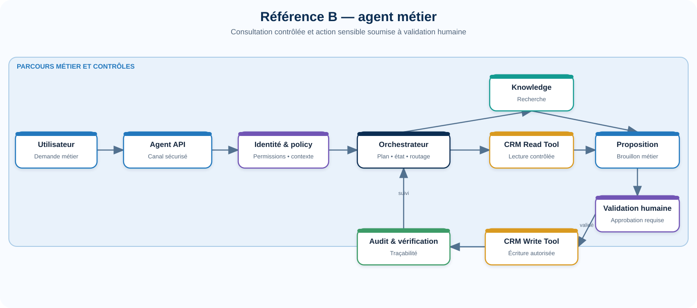
<figcaption>Référence d’architecture pour un agent métier contrôlé.</figcaption></figure>
<h3>11.3 Référence C – ML prédictif</h3>

Cas : prédire un risque de retard ou une demande future à partir de données historiques. Le modèle alimente une aide à la décision ; les utilisateurs conservent la responsabilité de l&#x27;action.

Pipeline d&#x27;ingestion et de préparation versionné.

Feature Store ou couche de features documentée.

Entraînement reproductible, tests, validation métier et registre de modèle.

Service d&#x27;inférence avec seuils et gestion des valeurs manquantes.

Monitoring de la performance, de la dérive et des biais.

Processus de réentraînement et rollback documenté.

<h3>11.4 Référence D – Plateforme GenAI mutualisée</h3>

La plateforme mutualisée fournit des services communs aux produits IA : accès aux modèles, sécurité, quotas, évaluation, observabilité, catalogues, gestion des prompts et outils approuvés. Les produits restent responsables de leur valeur métier, de leurs données et de leurs contrôles spécifiques.

<h3>11.5 Exemple fil rouge : traitement intelligent de factures</h3>

<table><tr><td>
Étape
</td><td>
Description
</td><td>
Contrôle
</td></tr><tr><td>
1. Réception
</td><td>
Facture reçue par GED ou canal sécurisé
</td><td>
Authenticité, antivirus, classification
</td></tr><tr><td>
2. Extraction
</td><td>
OCR / modèle multimodal extrait les champs
</td><td>
Score de confiance, schéma, validation
</td></tr><tr><td>
3. Enrichissement
</td><td>
Rapprochement fournisseur / commande
</td><td>
Contrôle métier et accès ERP
</td></tr><tr><td>
4. Détection
</td><td>
ML signale incohérences ou anomalies
</td><td>
Seuils, explication, suivi faux positifs
</td></tr><tr><td>
5. Proposition
</td><td>
GenAI explique les écarts et prépare une synthèse
</td><td>
Sources, format structuré, filtrage
</td></tr><tr><td>
6. Validation
</td><td>
Collaborateur valide ou corrige
</td><td>
Human-in-the-loop, séparation des tâches
</td></tr><tr><td>
7. Action
</td><td>
Mise à jour ERP après validation
</td><td>
API sécurisée, idempotence, audit
</td></tr><tr><td>
8. Amélioration
</td><td>
Feedback alimente l&#x27;évaluation
</td><td>
Gouvernance des données et réentraînement contrôlé
</td></tr></table>

<h2>12. Livrables, gouvernance opérationnelle et roadmap</h2>
<h3>12.1 Catalogue des livrables</h3>

<table><tr><td>
Livrable
</td><td>
Contenu minimal
</td><td>
Responsable principal
</td></tr><tr><td>
AI Architecture Principles
</td><td>
Principes, justification, conséquences, contrôles
</td><td>
Enterprise Architect
</td></tr><tr><td>
AI Capability Map
</td><td>
Capacités métier et IA, maturité, propriétaires
</td><td>
Business / Enterprise Architect
</td></tr><tr><td>
AI Use Case Canvas
</td><td>
Problème, valeur, données, risque, KPI, owner
</td><td>
Product Owner
</td></tr><tr><td>
AI System Context
</td><td>
Acteurs, systèmes externes, frontières
</td><td>
Solution Architect
</td></tr><tr><td>
AI Reference Architecture
</td><td>
Couches, services, patterns et standards
</td><td>
Domain / Solution Architect
</td></tr><tr><td>
AI Metamodel
</td><td>
Entités, attributs, relations, règles
</td><td>
Enterprise Architect
</td></tr><tr><td>
Data &amp; Model Cards
</td><td>
Données et modèles, limites, provenance, évaluation
</td><td>
Data / Model Owner
</td></tr><tr><td>
AI Risk Assessment
</td><td>
Risques, contrôles, risque résiduel, preuves
</td><td>
Risk / Compliance
</td></tr><tr><td>
ArchiMate Views
</td><td>
Motivation, capacités, processus, applications, technologies
</td><td>
Architecte
</td></tr><tr><td>
C4 Diagrams
</td><td>
Context, containers, components
</td><td>
Solution Architect
</td></tr><tr><td>
Architecture Decision Records
</td><td>
Contexte, options, décision, conséquences
</td><td>
Architecte / équipe
</td></tr><tr><td>
AI Evaluation Report
</td><td>
Jeux de tests, métriques, résultats, seuils
</td><td>
AI / QA Lead
</td></tr><tr><td>
AI Operations Runbook
</td><td>
SLO, alertes, incidents, rollback, contacts
</td><td>
Platform / Operations
</td></tr><tr><td>
AI Roadmap
</td><td>
Work packages, dépendances, transitions, jalons
</td><td>
Architecture / Portfolio
</td></tr></table>

<h3>12.2 Modèle d&#x27;Architecture Decision Record (ADR)</h3>

<table><tr><td>
Champ
</td><td>
Description
</td></tr><tr><td>
ADR ID / titre
</td><td>
Identifiant unique et décision résumée
</td></tr><tr><td>
Statut / date
</td><td>
Proposée, acceptée, remplacée, rejetée
</td></tr><tr><td>
Contexte
</td><td>
Problème, contraintes, exigences et hypothèses
</td></tr><tr><td>
Options
</td><td>
Alternatives évaluées et critères
</td></tr><tr><td>
Décision
</td><td>
Option retenue et justification
</td></tr><tr><td>
Conséquences
</td><td>
Bénéfices, coûts, risques et dette
</td></tr><tr><td>
Contrôles
</td><td>
Sécurité, données, exploitation, conformité
</td></tr><tr><td>
Révision
</td><td>
Événement ou date déclenchant une réévaluation
</td></tr></table>

<h3>12.3 Indicateurs de pilotage</h3>

<table><tr><td>
Dimension
</td><td>
Indicateurs possibles
</td></tr><tr><td>
Valeur métier
</td><td>
Temps gagné, taux d&#x27;automatisation, qualité de service, satisfaction
</td></tr><tr><td>
Qualité IA
</td><td>
Exactitude, groundedness, pertinence, taux de refus, taux de correction humaine
</td></tr><tr><td>
Sécurité
</td><td>
Incidents, tentatives d&#x27;injection, violations d&#x27;accès, exfiltration évitée
</td></tr><tr><td>
Fiabilité
</td><td>
Disponibilité, latence p95, taux d&#x27;erreur, succès des outils
</td></tr><tr><td>
Coûts
</td><td>
Coût par transaction, coût par utilisateur, tokens, coût GPU
</td></tr><tr><td>
Adoption
</td><td>
Utilisateurs actifs, rétention, taux d&#x27;usage utile
</td></tr><tr><td>
Gouvernance
</td><td>
Couverture des fiches, modèles inventoriés, revues réalisées, dérogations ouvertes
</td></tr></table>

<h3>12.4 Roadmap de mise en place en 90 jours</h3>

<table><tr><td>
Période
</td><td>
Objectif
</td><td>
Actions et résultats
</td></tr><tr><td>
Jours 1–15
</td><td>
Cadrage
</td><td>
Sponsor, périmètre, parties prenantes, inventaire initial, principes
</td></tr><tr><td>
Jours 16–30
</td><td>
Fondations
</td><td>
AI capability map, use case canvas, taxonomie, gouvernance, modèle de risques
</td></tr><tr><td>
Jours 31–45
</td><td>
Architecture cible
</td><td>
Métamodèle, vues ArchiMate, patterns RAG/agent/ML, critères plateforme
</td></tr><tr><td>
Jours 46–60
</td><td>
Industrialisation
</td><td>
C4 de la solution pilote, ADR, pipeline d&#x27;évaluation, sécurité, observabilité
</td></tr><tr><td>
Jours 61–75
</td><td>
Pilote contrôlé
</td><td>
Tests métier et techniques, évaluation, validation des contrôles, runbook
</td></tr><tr><td>
Jours 76–90
</td><td>
Passage à l&#x27;échelle
</td><td>
Retour d&#x27;expérience, roadmap, catalogue de building blocks, comité d&#x27;architecture
</td></tr></table>

<h3>12.5 Modèle opératoire cible</h3>

Le modèle opératoire doit éviter que l&#x27;architecture soit seule responsable de la qualité IA. Le métier porte la finalité et la valeur ; Data porte les données ; AI/ML porte les modèles et évaluations ; IT/Platform porte l&#x27;exécution ; Security/Privacy/Risk porte les contrôles relevant de ses mandats ; l&#x27;architecture garantit la cohérence et l&#x27;alignement.

<table><tr><td>
Rôle
</td><td>
Responsabilité
</td></tr><tr><td>
Business Owner
</td><td>
Finalité, valeur, arbitrage métier et acceptation du risque métier
</td></tr><tr><td>
AI Product Owner
</td><td>
Backlog, expérience, adoption, KPI et cycle de vie produit
</td></tr><tr><td>
Enterprise Architect
</td><td>
Cohérence, capacités, principes, roadmap et gouvernance
</td></tr><tr><td>
Solution Architect
</td><td>
Conception de bout en bout, intégration, NFR, ADR et vues
</td></tr><tr><td>
Data Owner / Steward
</td><td>
Qualité, définition, droits, classification et lineage
</td></tr><tr><td>
ML / AI Engineer
</td><td>
Modèles, prompts, pipelines, évaluation et expérimentation
</td></tr><tr><td>
Platform Engineer
</td><td>
Runtime, CI/CD, observabilité, disponibilité et coûts
</td></tr><tr><td>
Security / Privacy / Risk
</td><td>
Exigences, analyses, contrôles et avis spécialisés
</td></tr><tr><td>
Operations
</td><td>
Support, incident, changement, capacité et continuité
</td></tr></table>

<h2>Annexe A – Canevas AI Use Case</h2>

<table><tr><td>
Champ
</td><td>
À renseigner
</td></tr><tr><td>
Nom / ID
</td><td></td></tr><tr><td>
Sponsor / Business Owner
</td><td></td></tr><tr><td>
Problème métier
</td><td></td></tr><tr><td>
Processus et utilisateurs concernés
</td><td></td></tr><tr><td>
Capability métier soutenue
</td><td></td></tr><tr><td>
Résultat / KPI cible
</td><td></td></tr><tr><td>
Approche IA envisagée
</td><td></td></tr><tr><td>
Données / sources / classification
</td><td></td></tr><tr><td>
Modèle / fournisseur / hébergement envisagé
</td><td></td></tr><tr><td>
Actions possibles et niveau d&#x27;autonomie
</td><td></td></tr><tr><td>
Risques initiaux et contrôles
</td><td></td></tr><tr><td>
SLO / coût / volumétrie
</td><td></td></tr><tr><td>
Critères de validation / Go-No Go
</td><td></td></tr></table>

<h2>Annexe B – Checklist de revue d&#x27;architecture IA</h2>

☐  Le cas d&#x27;usage est relié à un objectif et à une capacité métier.

☐  Le propriétaire métier et le responsable technique sont nommés.

☐  Les données et corpus sont inventoriés, classifiés et autorisés.

☐  Les modèles, prompts, embeddings et outils sont versionnés.

☐  Les droits d&#x27;accès sont appliqués jusqu&#x27;au niveau des documents et des actions.

☐  Les appels d&#x27;outils sont limités, authentifiés et journalisés.

☐  Les actions à impact sont soumises à une validation adaptée.

☐  Les tests évaluent qualité, robustesse, sécurité et cas limites.

☐  Les limites, incertitudes et conditions de refus sont documentées.

☐  Les coûts, quotas, latences et conditions d&#x27;arrêt sont définis.

☐  Les métriques et alertes de production sont opérationnelles.

☐  Le rollback et le mode dégradé sont documentés.

☐  Les risques résiduels et dérogations sont approuvés.

☐  Les vues ArchiMate et C4 sont cohérentes et à jour.

<h2>Annexe C – Glossaire</h2>

<table><tr><td>
Terme
</td><td>
Définition synthétique
</td></tr><tr><td>
AI Gateway
</td><td>
Point d&#x27;entrée contrôlé pour les appels aux modèles IA.
</td></tr><tr><td>
Agent
</td><td>
Composant qui poursuit un objectif et peut sélectionner des étapes ou outils selon un état et des règles.
</td></tr><tr><td>
Embedding
</td><td>
Représentation vectorielle d&#x27;un contenu dans un espace sémantique.
</td></tr><tr><td>
Feature Store
</td><td>
Référentiel de variables réutilisables pour les modèles ML.
</td></tr><tr><td>
Groundedness
</td><td>
Mesure dans laquelle une réponse est étayée par les sources ou le contexte fourni.
</td></tr><tr><td>
LLMOps
</td><td>
Pratiques d&#x27;industrialisation, de déploiement, d&#x27;évaluation et d&#x27;exploitation des applications LLM.
</td></tr><tr><td>
MLOps
</td><td>
Pratiques d&#x27;industrialisation du cycle de vie des modèles de machine learning.
</td></tr><tr><td>
Prompt injection
</td><td>
Tentative de détourner le comportement d&#x27;un modèle via des instructions malveillantes dans l&#x27;entrée ou le contexte.
</td></tr><tr><td>
RAG
</td><td>
Retrieval-Augmented Generation : génération augmentée par la récupération de contenus externes.
</td></tr><tr><td>
Vector Database
</td><td>
Base permettant de stocker et rechercher des vecteurs selon leur proximité.
</td></tr><tr><td>
Model Card
</td><td>
Documentation structurée d&#x27;un modèle, de ses usages, limites et évaluations.
</td></tr><tr><td>
Human-in-the-loop
</td><td>
Intervention humaine dans une étape de contrôle, validation ou décision.
</td></tr></table>

<h2>Annexe D – Références à consulter</h2>

Les références suivantes complètent ce guide. Vérifier systématiquement les versions et textes applicables au moment du projet.

The Open Group – TOGAF Standard, 10th Edition : https://www.opengroup.org/togaf

The Open Group – ArchiMate : https://www.opengroup.org/archimate-forum/archimate-overview

NIST AI Risk Management Framework : https://www.nist.gov/itl/ai-risk-management-framework

ISO/IEC 42001 – Artificial intelligence management system : https://www.iso.org/standard/81230.html

ISO/IEC 23894 – Artificial intelligence — Guidance on risk management : https://www.iso.org/

European Commission – AI Act : https://digital-strategy.ec.europa.eu/en/policies/regulatory-framework-ai

C4 Model : https://c4model.com/

OWASP Top 10 for LLM Applications : https://owasp.org/www-project-top-10-for-large-language-model-applications/

<h2>Conclusion</h2>

Le AI Enterprise Architecture Framework propose une manière structurée de faire entrer l&#x27;intelligence artificielle dans l&#x27;architecture d&#x27;entreprise. Sa valeur ne réside pas dans l&#x27;accumulation de technologies, mais dans la traçabilité entre stratégie, capacités, cas d&#x27;usage, données, modèles, applications, plateformes, risques et résultats.

Pour démarrer, il est recommandé de sélectionner un cas d&#x27;usage concret, de produire sa fiche de qualification, de modéliser sa vue Motivation/Capability en ArchiMate, puis son contexte et ses conteneurs en C4. Ce pilote permettra de tester le métamodèle, les contrôles et les livrables avant de généraliser le référentiel.

