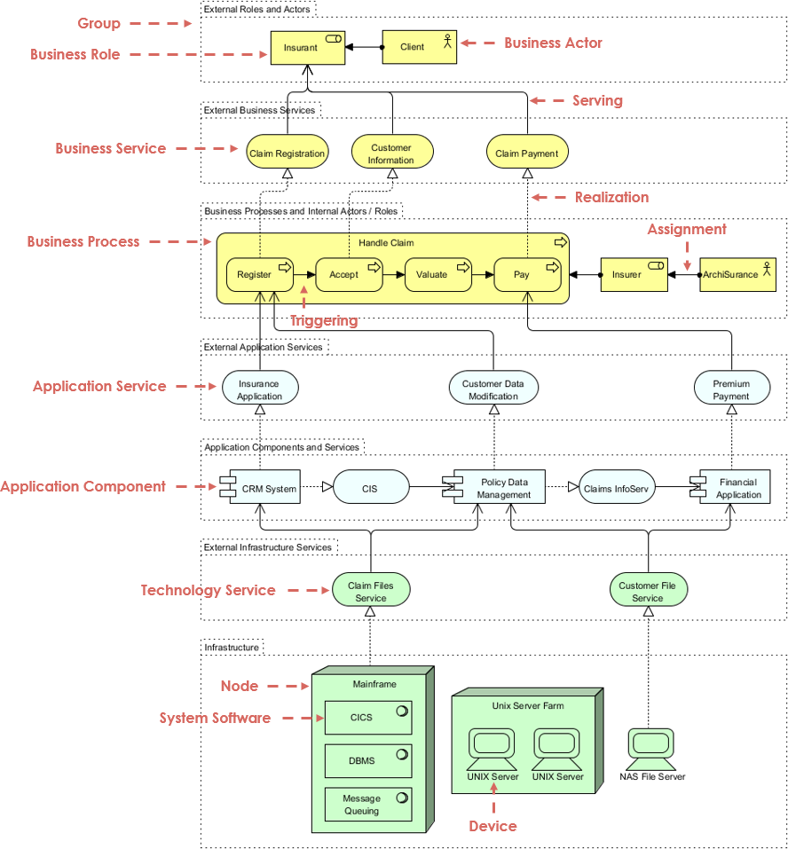
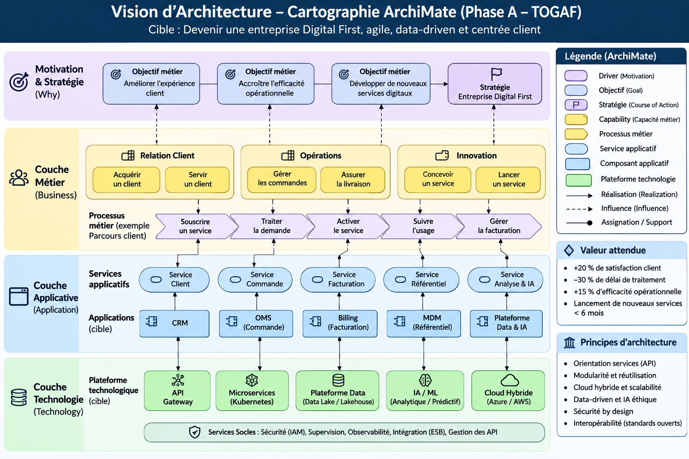
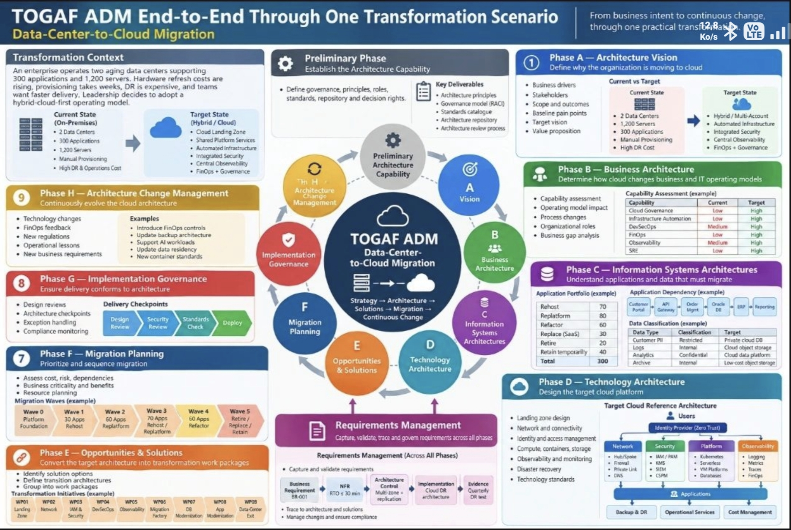
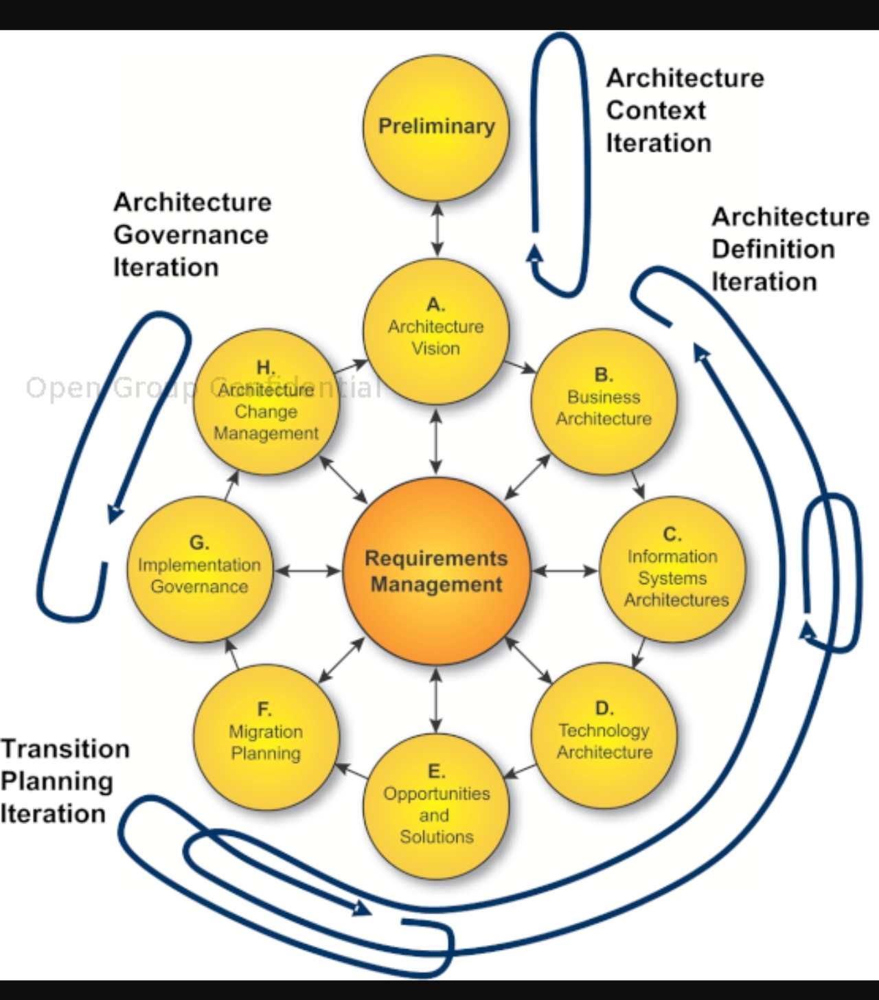
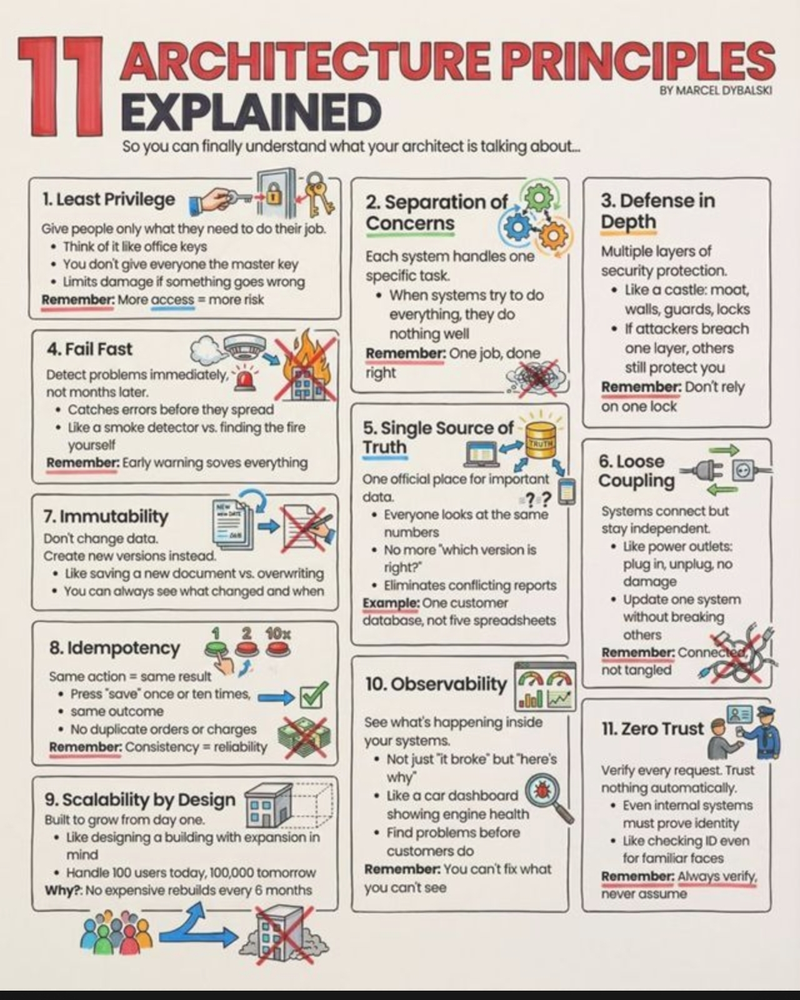

ARCHITECTURE D’ENTREPRISE · DOCUMENT DE RÉFÉRENCE

<h2>Sommaire</h2>
<ol>
<li><a href="#objectif-togaf">Comprendre l’objectif de TOGAF</a></li>
<li><a href="#composants-togaf">Les six composants présentés dans le guide</a>
<ol><li><a href="#complementarite-composants">Exemple de complémentarité</a></li></ol></li>
<li><a href="#domaines-architecture">Les quatre domaines de l’architecture d’entreprise</a>
<ol><li><a href="#exemple-virement">Concevoir un service de virement instantané</a></li></ol></li>
<li><a href="#outils-modelisation">TOGAF, ADM, ArchiMate et les outils de modélisation</a></li>
<li><a href="#guidelines-techniques">ADM Guidelines et ADM Techniques</a>
<ol><li><a href="#adapter-adm">Adapter l’ADM à un style architectural</a></li></ol></li>
<li><a href="#techniques-architecture">Les principales techniques avec un exemple bancaire</a>
<ol><li><a href="#principes-architecture">Principes d’architecture</a></li><li><a href="#scenarios-metier">Scénarios métier</a></li><li><a href="#analyse-ecarts">Analyse des écarts</a></li><li><a href="#interop">Exigences d’interopérabilité</a></li><li><a href="#readiness">Évaluation de la préparation à la transformation</a></li><li><a href="#risques">Gestion des risques</a></li><li><a href="#planification-capacites">Planification basée sur les capacités</a></li><li><a href="#migration">Planification de la migration</a></li></ol></li>
<li><a href="#techniques-cycle-adm">Où utiliser les techniques dans le cycle ADM ?</a></li>
<li><a href="#bonnes-pratiques">Bonnes pratiques pour l’architecte</a></li>
<li><a href="#revision-togaf">Fiche de révision pour la certification TOGAF</a>
<ol><li><a href="#associations-clefs">Les quatre associations à distinguer</a></li><li><a href="#mini-cas">Mini-cas de synthèse</a></li></ol></li>
<li><a href="#sources">Sources et précisions</a></li>
</ol>
<h2 id="objectif-togaf">1. Comprendre l’objectif de TOGAF</h2>

TOGAF (The Open Group Architecture Framework) est un cadre de référence destiné à aider une organisation à concevoir, planifier, mettre en œuvre et gouverner son architecture d’entreprise. Son objectif est notamment d’aligner les capacités technologiques du système d’information sur les objectifs et la stratégie métier.

Une entreprise possède généralement plusieurs dimensions qui doivent évoluer de manière cohérente :

la stratégie, les objectifs et les processus métier ;

les données et les informations manipulées ;

les applications et leurs interactions ;

les infrastructures, plateformes et technologies.

les organisations, compétences, règles de gouvernance et modes de fonctionnement.

Exemple : une banque souhaite digitaliser ses parcours clients, réduire le time-to-market, migrer certaines applications vers le Cloud et moderniser ses applications monolithiques. TOGAF fournit une démarche structurée pour relier ces ambitions aux architectures métier, données, applicatives et technologiques, puis organiser leur transformation.

<table><tr><td>
À retenir — TOGAF n’est pas une technologie ni une architecture cible toute faite. C’est un cadre qui aide à structurer la démarche d’architecture et sa gouvernance.
</td></tr></table>

<h2 id="composants-togaf">2. Les six composants présentés dans le guide</h2>

Le premier article de Visual Paradigm présente six composants qui contribuent au développement et à la gestion de l’architecture d’entreprise. Ils répondent à des questions différentes.

<table><tr><td>
Composant
</td><td>
Question clé
</td><td>
Rôle et exemple
</td></tr><tr><td>
ADM – Architecture Development Method
</td><td>
Comment développer l’architecture ?
</td><td>
Méthode centrale et cycle de développement de l’architecture, de la vision à la gouvernance et à la gestion du changement.
</td></tr><tr><td>
ADM Guidelines and Techniques
</td><td>
Comment appliquer l’ADM et quelles méthodes utiliser ?
</td><td>
Recommandations pour adapter la démarche et techniques pour réaliser les travaux : scénarios métier, analyse des écarts, gestion des risques, etc.
</td></tr><tr><td>
Architecture Content Framework
</td><td>
Quels contenus et artefacts produire et comment les structurer ?
</td><td>
Structure les contenus d’architecture : livrables, artefacts et building blocks, ainsi que leurs relations.
</td></tr><tr><td>
Reference Models
</td><td>
Sur quels modèles de référence s’appuyer ?
</td><td>
Fournissent des modèles et des références réutilisables pour accélérer et standardiser la conception.
</td></tr><tr><td>
Enterprise Continuum
</td><td>
Comment classer et réutiliser les actifs d’architecture ?
</td><td>
Organise les actifs depuis les éléments génériques jusqu’aux architectures spécifiques à une organisation.
</td></tr><tr><td>
Architecture Capability Framework
</td><td>
Comment organiser la capacité d’architecture ?
</td><td>
Aide à mettre en place les rôles, compétences, processus, responsabilités et mécanismes nécessaires à la pratique de l’architecture.
</td></tr></table>

<h3 id="complementarite-composants">2.1 Exemple de complémentarité</h3>

La gestion des exigences accompagne les phases de l’ADM ; le cycle peut être itéré selon les besoins de transformation.

Illustration – Représentation du cycle ADM et de ses phases.

Cette représentation met en évidence le caractère itératif de l’ADM et le rôle central du Requirements Management.

Illustration – ADM présenté comme un cycle continu de changement, de planification, de métier et d’IT.

Dans une transformation bancaire vers le Cloud et les microservices :

l’ADM organise les phases et les activités de la démarche ;

les Guidelines et Techniques aident à adapter la démarche et à conduire les analyses ;

le Content Framework structure les livrables et les artefacts produits ;

les Reference Models fournissent des modèles réutilisables ;

l’Enterprise Continuum aide à classer les actifs et à retrouver des éléments réutilisables ;

l’Architecture Capability Framework aide à organiser l’équipe, les compétences et la gouvernance d’architecture.

<h2 id="domaines-architecture">3. Les quatre domaines de l’architecture d’entreprise</h2>

Le guide présente quatre domaines complémentaires. Ils ne sont pas quatre phases successives de l’ADM : ils constituent quatre angles de description de l’entreprise.

<table><tr><td>
Domaine
</td><td>
Ce qu’il décrit
</td><td>
Exemple bancaire
</td></tr><tr><td>
Business Architecture 
Architecture métier
</td><td>
Stratégie, objectifs, organisation, acteurs, capacités et processus métier.
</td><td>
Gérer les comptes, accorder des crédits, traiter les virements et gérer les réclamations.
</td></tr><tr><td>
Data Architecture 
Architecture des données
</td><td>
Données, modèles conceptuels/logiques/physiques, stockage, qualité, gouvernance et flux.
</td><td>
Customer, Account, Transaction, Loan ; règles de qualité, sécurité et partage.
</td></tr><tr><td>
Application Architecture 
Architecture applicative
</td><td>
Applications, composants, services, interfaces, API et interactions.
</td><td>
Customer Management, Account Management, Payment Service, API Gateway et Kafka.
</td></tr><tr><td>
Technology Architecture 
Architecture technologique
</td><td>
Infrastructure, plateformes, réseaux, middleware, logiciels et environnements d’exécution.
</td><td>
Cloud, Kubernetes, PostgreSQL, réseau, stockage, observabilité et sécurité technique.
</td></tr></table>

<h3 id="exemple-virement">3.1 Exemple : concevoir un service de virement instantané</h3>

Les besoins et règles métier alimentent le modèle conceptuel ; les types de données et règles de structuration précisent le modèle logique ; les clés, vues et index contribuent au modèle physique.

Illustration – Du modèle conceptuel au modèle logique puis physique des données.

La cartographie regroupe des capacités par domaines métier. Elle aide à discuter des capacités existantes, de leur importance et des évolutions à planifier.

Illustration – Exemple de cartographie de Business Capabilities.

<table><tr><td>
Domaine
</td><td>
Question d’architecture
</td><td>
Exemple de réponse
</td></tr><tr><td>
Business
</td><td>
Quel besoin métier doit être couvert ?
</td><td>
Permettre au client d’effectuer un virement instantané.
</td></tr><tr><td>
Data
</td><td>
Quelles données sont nécessaires ?
</td><td>
Client, compte débiteur, compte bénéficiaire, transaction, statut du paiement.
</td></tr><tr><td>
Application
</td><td>
Quels services applicatifs réalisent le besoin ?
</td><td>
Payment Service, Account Service, contrôles de fraude et API de paiement.
</td></tr><tr><td>
Technology
</td><td>
Sur quelles plateformes ces services s’exécutent-ils ?
</td><td>
Cluster Kubernetes, plateforme Kafka, bases de données, réseau et mécanismes de sécurité.
</td></tr></table>

<table><tr><td>
Principe d’alignement — On part du besoin métier, on identifie les données et les applications nécessaires, puis on choisit les technologies adaptées. On ne choisit pas Kafka ou Kubernetes simplement parce que ces technologies sont modernes.
</td></tr></table>

<h2 id="outils-modelisation">4. TOGAF, ADM, ArchiMate et les outils de modélisation</h2>

<table><tr><td>
Élément
</td><td>
Nature
</td><td>
Rôle
</td></tr><tr><td>
TOGAF
</td><td>
Framework / cadre de référence
</td><td>
Fournit un ensemble structuré de concepts, méthodes, contenus et pratiques pour l’architecture d’entreprise.
</td></tr><tr><td>
ADM
</td><td>
Méthode au cœur de TOGAF
</td><td>
Décrit le cycle et les phases de développement de l’architecture.
</td></tr><tr><td>
ArchiMate
</td><td>
Langage de modélisation
</td><td>
Permet de représenter les éléments d’architecture et leurs relations au travers de vues.
</td></tr><tr><td>
Visual Paradigm
</td><td>
Outil logiciel
</td><td>
Permet de créer des modèles, diagrammes et livrables ; il propose aussi des fonctions d’accompagnement de l’ADM.
</td></tr><tr><td>
Archi
</td><td>
Outil de modélisation
</td><td>
Permet de créer et manipuler des modèles ArchiMate.
</td></tr></table>

Exemple : pour cartographier une banque, l’architecte peut représenter une Business Capability, les processus qui la réalisent, les applications qui les supportent, les objets de données manipulés et les composants technologiques qui hébergent les applications.

<table><tr><td>
Domaine
</td><td>
Exemples d’éléments ArchiMate
</td></tr><tr><td>
Business
</td><td>
Business Actor, Business Role, Business Process, Business Function, Business Capability, Business Service.
</td></tr><tr><td>
Data
</td><td>
Data Object.
</td></tr><tr><td>
Application
</td><td>
Application Component, Application Service, Application Interface, Application Function.
</td></tr><tr><td>
Technology
</td><td>
Node, Device, System Software, Technology Service.
</td></tr></table>

<table><tr><td>
À retenir — TOGAF structure la démarche ; l’ADM décrit le processus ; ArchiMate fournit un langage de représentation ; Visual Paradigm et Archi sont des outils pour construire les modèles.
</td></tr></table>

<h2 id="guidelines-techniques">5. ADM Guidelines et ADM Techniques : la distinction essentielle</h2>

Le deuxième guide de Visual Paradigm insiste sur une distinction fondamentale entre Guidelines et Techniques. Les deux aident à appliquer l’ADM, mais elles n’interviennent pas au même niveau.

<table><tr><td>
Catégorie
</td><td>
Question
</td><td>
Finalité
</td></tr><tr><td>
Guidelines – recommandations
</td><td>
Comment adapter le processus ADM à mon contexte ?
</td><td>
Adapter la démarche au contexte organisationnel, au style architectural ou au paradigme retenu.
</td></tr><tr><td>
Techniques – méthodes
</td><td>
Comment réaliser concrètement une tâche d’architecture ?
</td><td>
Fournir des méthodes pour découvrir, analyser, valider, évaluer ou planifier les travaux.
</td></tr></table>

Analogie : lors de la construction d’une maison, une guideline indique comment adapter le projet aux contraintes du terrain et aux besoins du propriétaire. Une technique décrit une méthode concrète pour mesurer le terrain, calculer une structure ou vérifier la solidité.

<h3 id="adapter-adm">5.1 Adapter l’ADM à un style architectural</h3>

Le cœur applicatif expose des ports ; les adaptateurs connectent les interfaces, bases de données, API et systèmes externes sans faire dépendre le cœur de leurs technologies.

Illustration – Hexagonal Architecture (Ports and Adapters).

Cette vue combine couche d’accès, services, stockage, configuration, découverte, observabilité et intégrations externes.

Illustration – Exemple d’architecture microservices Cloud-native.

Le schéma présente notamment les clusters, workloads, réseau, passerelles, identité et politiques de sécurité.

Illustration – Déploiement de workloads sur Kubernetes et services de plateforme Cloud.

Les composants d’infrastructure et de plateforme soutiennent les microservices ; les bases de données sont associées aux services selon leurs responsabilités.

Illustration – Exemple d’architecture microservices avec API Gateway, registre de services, load balancer, broker et observabilité.

TOGAF est volontairement générique. Une organisation peut l’appliquer à différents styles : SOA, microservices, Cloud-native ou data mesh. Il n’est généralement pas nécessaire de réécrire les phases de l’ADM. L’adaptation passe plutôt par le choix des modèles, viewpoints, notations et activités détaillées dans les phases concernées.

<table><tr><td>
Phase
</td><td>
Exemple d’adaptation pour une transformation microservices
</td></tr><tr><td>
A – Architecture Vision
</td><td>
Définir la vision de transformation, les objectifs, le périmètre et les parties prenantes.
</td></tr><tr><td>
B – Business Architecture
</td><td>
Cartographier les capacités métier, processus et domaines fonctionnels.
</td></tr><tr><td>
C – Information Systems
</td><td>
Définir les services applicatifs, bounded contexts, API, événements et responsabilités sur les données.
</td></tr><tr><td>
D – Technology Architecture
</td><td>
Définir les plateformes Cloud, conteneurs, réseau, sécurité, observabilité et middleware.
</td></tr><tr><td>
E – Opportunities &amp; Solutions
</td><td>
Définir les solutions, work packages et architectures de transition.
</td></tr><tr><td>
F – Migration Planning
</td><td>
Planifier la migration progressive et les dépendances.
</td></tr><tr><td>
G – Implementation Governance
</td><td>
Vérifier la conformité des solutions réalisées à l’architecture approuvée.
</td></tr><tr><td>
H – Architecture Change Management
</td><td>
Gérer les évolutions et déterminer si un nouveau cycle d’architecture est nécessaire.
</td></tr></table>

<table><tr><td>
Nuance — L’adaptation ne signifie pas que chaque organisation doit obligatoirement adopter les microservices ou étendre le métamodèle. Le style retenu dépend du contexte et des besoins.
</td></tr></table>

<h2 id="techniques-architecture">6. Les principales techniques expliquées avec un exemple bancaire</h2>

Les techniques sont la boîte à outils de l’architecte. Elles sont sélectionnées en fonction du problème à traiter ; elles ne sont pas nécessairement exécutées toutes ensemble ni dans un ordre rigide.

<h3 id="principes-architecture">6.1 Architecture Principles – Principes d’architecture</h3>

Question : quelles règles fondamentales doivent guider les décisions d’architecture ?

<table><tr><td>
Partie du principe
</td><td>
Rôle
</td><td>
Exemple : Data is a Shared Enterprise Asset
</td></tr><tr><td>
Name
</td><td>
Nom court et mémorisable.
</td><td>
Data is a Shared Enterprise Asset.
</td></tr><tr><td>
Statement
</td><td>
Règle fondamentale, claire et sans ambiguïté.
</td><td>
Toutes les données de l’organisation doivent être gérées, sécurisées et accessibles comme une ressource d’entreprise cohérente.
</td></tr><tr><td>
Rationale
</td><td>
Justification et bénéfices métier.
</td><td>
Réduire les silos, améliorer la qualité des décisions et limiter les risques de conformité.
</td></tr><tr><td>
Implications
</td><td>
Actions, exigences, coûts, ressources et impacts nécessaires.
</td><td>
Gouvernance des données, Data Owners, métadonnées standardisées, règles d’accès et intégration des systèmes historiques.
</td></tr></table>

<table><tr><td>
Mémo examen — Name = mémorisable ; Statement = règle fondamentale ; Rationale = pourquoi / bénéfices ; Implications = conséquences et actions requises.
</td></tr></table>

<h3 id="scenarios-metier">6.2 Business Scenarios – Scénarios métier</h3>

Question : quel problème métier cherche-t-on à résoudre ? Cette technique permet de découvrir, documenter et valider les besoins avec les parties prenantes, en décrivant une situation réelle, ses acteurs, son environnement et les résultats attendus.

Exemple : les clients abandonnent leurs demandes de crédit parce que le parcours est trop long.

<table><tr><td>
Critère SMART
</td><td>
Application
</td></tr><tr><td>
Specific
</td><td>
Simplifier le parcours de souscription de crédit.
</td></tr><tr><td>
Measurable
</td><td>
Réduire le délai de traitement de cinq jours à un jour.
</td></tr><tr><td>
Actionable
</td><td>
Digitaliser le parcours et automatiser les contrôles.
</td></tr><tr><td>
Realistic
</td><td>
S’appuyer sur les API et services existants, en tenant compte des contraintes.
</td></tr><tr><td>
Time-bound
</td><td>
Déployer la première version sous six mois.
</td></tr></table>

Les scénarios aident à construire une vision partagée en Phase A et à préciser les exigences métier en Phase B.

<h3 id="analyse-ecarts">6.3 Gap Analysis – Analyse des écarts</h3>

Figure 6 – Comparaison entre l’architecture Baseline et l’architecture Target.

Question : qu’est-ce qui manque pour passer de l’architecture existante (Baseline) à l’architecture cible (Target) ?

<table><tr><td>
Élément
</td><td>
Baseline
</td><td>
Target
</td></tr><tr><td>
Applications
</td><td>
Monolithe bancaire
</td><td>
Services autonomes par domaine
</td></tr><tr><td>
Données
</td><td>
Base centralisée fortement couplée
</td><td>
Responsabilités de données clarifiées et intégrations maîtrisées
</td></tr><tr><td>
Communication
</td><td>
Appels synchrones dominants
</td><td>
REST et événements selon les besoins
</td></tr><tr><td>
Déploiement
</td><td>
Opérations manuelles
</td><td>
CI/CD automatisée
</td></tr><tr><td>
Infrastructure
</td><td>
On-premise
</td><td>
Plateforme Cloud ou hybride
</td></tr></table>

Une analyse structurée peut classer les Architecture Building Blocks (ABB) comme suit :

Included : l’élément existe dans la Baseline et reste présent dans la Target.

New : l’élément est nécessaire dans la Target mais n’existe pas dans la Baseline.

Eliminated : l’élément existe dans la Baseline mais disparaît de la Target.

Il faut examiner les éléments nouveaux et supprimés pour vérifier qu’aucune capacité indispensable n’a été oubliée et que les suppressions sont intentionnelles. La Gap Analysis est utilisée dans les domaines métier, données, applicatif et technologique.

<h3 id="interop">6.4 Interoperability Requirements – Exigences d’interopérabilité</h3>

Le client accède à plusieurs microservices par un point d’entrée logique ; chaque service conserve sa responsabilité métier et son stockage.

Illustration – API Gateway Pattern.

Authentification, limitation de débit, cache, découverte et routage contribuent à la sécurisation et à la maîtrise des échanges. Les fonctions exactes dépendent de la solution retenue.

Illustration – Fonctions possibles d’un API Gateway.

Les services producteurs publient des événements dans des topics partitionnés ; les groupes de consommateurs les traitent et suivent leur progression à l’aide des offsets.

Illustration – Échanges événementiels avec Apache Kafka.

Figure 7 – Les quatre dimensions de l’interopérabilité.

Question : comment les systèmes, processus et organisations doivent-ils échanger des informations et des services ? L’interopérabilité ne se limite pas à la connectivité technique.

<table><tr><td>
Dimension
</td><td>
Ce qu’elle couvre
</td><td>
Exemple bancaire
</td></tr><tr><td>
Business / Operational
</td><td>
Alignement des processus et opérations.
</td><td>
Deux entités bancaires coordonnent le traitement d’un virement.
</td></tr><tr><td>
Information
</td><td>
Structure, sémantique, partage et gouvernance des données.
</td><td>
Modèle commun des informations de paiement et identifiants cohérents.
</td></tr><tr><td>
Application
</td><td>
Intégration fonctionnelle entre applications.
</td><td>
Le système de paiement appelle le service de comptes via une API.
</td></tr><tr><td>
Technical
</td><td>
Infrastructure, réseaux, protocoles et standards.
</td><td>
Connectivité sécurisée, protocoles compatibles, plateforme d’échange.
</td></tr></table>

Exemples de technologies ou standards possibles : REST, SOAP, Kafka et ISO 20022. Le choix dépend des exigences fonctionnelles, non fonctionnelles, réglementaires et opérationnelles.

<h3 id="readiness">6.5 Business Transformation Readiness Assessment – Évaluation de la préparation à la transformation</h3>

Figure 8 – Préparation organisationnelle, maîtrise des risques et transformation.

Question : l’organisation est-elle réellement prête à adopter les changements proposés par l’architecture ?

<table><tr><td>
Dimension évaluée
</td><td>
Exemple d’état
</td></tr><tr><td>
Compétences Cloud
</td><td>
Faibles : besoin de formation et de recrutement.
</td></tr><tr><td>
Soutien de la direction
</td><td>
Élevé : sponsor identifié et objectifs validés.
</td></tr><tr><td>
Budget
</td><td>
Disponible, mais à répartir par lots.
</td></tr><tr><td>
Organisation DevOps
</td><td>
À construire : rôles et responsabilités à définir.
</td></tr><tr><td>
Culture de transformation
</td><td>
Moyenne : accompagnement du changement nécessaire.
</td></tr></table>

Une architecture cible peut être techniquement pertinente sans que l’organisation soit prête à la mettre en œuvre. L’évaluation doit donc se traduire par des actions : formation, communication, pilotes, accompagnement, évolution des rôles et planification progressive.

<h3 id="risques">6.6 Risk Management – Gestion des risques</h3>

Question : quels événements peuvent compromettre la démarche ou la réalisation de l’architecture ?

<table><tr><td>
Notion
</td><td>
Définition
</td><td>
Exemple
</td></tr><tr><td>
Initial Risk
</td><td>
Niveau de risque évalué avant les mesures de mitigation.
</td><td>
Risque élevé de corruption de données lors de la migration.
</td></tr><tr><td>
Mitigation
</td><td>
Actions destinées à réduire la probabilité ou l’impact.
</td><td>
Tests de migration, contrôles automatiques, sauvegardes, répétitions et rollback.
</td></tr><tr><td>
Residual Risk
</td><td>
Niveau de risque restant après les mesures.
</td><td>
Risque résiduel faible mais non nul.
</td></tr><tr><td>
Monitoring
</td><td>
Surveillance et réévaluation du risque.
</td><td>
Suivi pendant la mise en œuvre et les contrôles de conformité.
</td></tr></table>

Le processus peut être résumé ainsi : classification → identification → évaluation initiale → mitigation et évaluation résiduelle → suivi. La gestion des risques est continue ; l’évaluation initiale commence notamment en Phase A et le suivi est particulièrement important pendant la Phase G.

<h3 id="planification-capacites">6.7 Capability-Based Planning – Planification basée sur les capacités</h3>

Figure 9 – Une capacité métier mobilise plusieurs domaines d’architecture.

Question : quelles capacités métier faut-il développer ou améliorer pour produire les résultats attendus ? Cette approche organise les changements autour des résultats métier plutôt qu’autour de projets IT isolés.

Exemple : améliorer la capacité Payment Management (gestion des paiements).

<table><tr><td>
Domaine
</td><td>
Contribution à la capacité
</td></tr><tr><td>
Business
</td><td>
Optimiser le processus de paiement et les responsabilités opérationnelles.
</td></tr><tr><td>
Data
</td><td>
Unifier et fiabiliser les données de transaction.
</td></tr><tr><td>
Application
</td><td>
Faire évoluer ou créer Payment Service et ses interfaces.
</td></tr><tr><td>
Technology
</td><td>
Fournir les plateformes d’exécution, d’intégration, de sécurité et d’observabilité.
</td></tr></table>

Les projets, investissements, dépendances, jalons et mesures de valeur sont coordonnés pour améliorer la capacité métier. Il ne s’agit pas simplement de lancer un projet Kafka ou Kubernetes, mais de démontrer comment les changements contribuent au résultat métier.

<h3 id="migration">6.8 Migration Planning – Planification de la migration</h3>

Figure 10 – Exemple de trajectoire de migration progressive.

Question : comment passer de l’existant à la cible de manière maîtrisée ? La planification organise les work packages, les architectures de transition, les dépendances, les priorités et la feuille de route.

Lot 1 : préparer la plateforme Cloud et les fondations de sécurité.

Lot 2 : moderniser les données et les mécanismes d’intégration.

Lot 3 : extraire les premiers services du monolithe.

Lot 4 : étendre progressivement la décomposition par domaine métier.

Lot 5 : retirer les composants historiques lorsque les conditions de sortie sont remplies.

Les phases E et F sont particulièrement importantes pour structurer les solutions, les lots et le plan de migration.

<h2 id="techniques-cycle-adm">7. Où utiliser les techniques dans le cycle ADM ?</h2>

Le tableau ci-dessous synthétise les usages principaux indiqués par le guide Visual Paradigm. Il ne s’agit pas d’une règle exclusive : plusieurs techniques sont transverses et peuvent être mobilisées dans différentes phases.

<table><tr><td>
Phase ADM
</td><td>
Guidelines / techniques principalement mobilisées
</td></tr><tr><td>
Preliminary
</td><td>
Définition des principes d’architecture ; choix des adaptations de style et mise en place de la capacité.
</td></tr><tr><td>
A – Architecture Vision
</td><td>
Business Scenarios ; première évaluation des risques et de la readiness ; exigences d’interopérabilité.
</td></tr><tr><td>
B – Business Architecture
</td><td>
Scénarios métier détaillés ; Gap Analysis métier ; cartographie des capacités.
</td></tr><tr><td>
C – Information Systems Architectures
</td><td>
Gap Analysis des données et applications ; interopérabilité ; viewpoints adaptés au style.
</td></tr><tr><td>
D – Technology Architecture
</td><td>
Gap Analysis technologique ; standards d’interopérabilité technique.
</td></tr><tr><td>
E – Opportunities &amp; Solutions
</td><td>
Readiness détaillée ; plans de mitigation ; organisation des work packages par capacité.
</td></tr><tr><td>
F – Migration Planning
</td><td>
Finalisation de la feuille de route selon les risques, la readiness, les dépendances et les priorités.
</td></tr><tr><td>
G – Implementation Governance
</td><td>
Suivi des risques ; contrôle de conformité aux principes et standards d’interopérabilité.
</td></tr><tr><td>
H – Architecture Change Management
</td><td>
Réévaluation de la readiness ; gestion des changements ; déclenchement éventuel d’un nouveau cycle.
</td></tr></table>

<h2 id="bonnes-pratiques">8. Bonnes pratiques pour l’architecte</h2>

Commencer par les principes : définir des règles claires qui guideront les décisions avant de multiplier les diagrammes.

Utiliser les Business Scenarios tôt : ne pas supposer les besoins ; les découvrir et les valider avec les parties prenantes.

Réaliser la Gap Analysis de manière itérative : ne pas attendre la fin de toutes les phases pour détecter les omissions.

Traiter la readiness comme un indicateur réel : si l’organisation n’est pas prête, adapter le rythme et le plan de transformation.

Documenter les risques de façon transparente : tenir un registre, actualiser les évaluations et escalader les risques majeurs.

Raisonner par capacités métier : relier chaque projet et chaque choix technique à un résultat métier mesurable.

Adapter les viewpoints et les modèles au contexte : produire les vues nécessaires aux décisions, sans créer de documentation inutile.

<h2 id="revision-togaf">9. Fiche de révision pour la certification TOGAF</h2>

<table><tr><td>
Mot-clé de la question
</td><td>
Notion à reconnaître
</td><td>
Mémo
</td></tr><tr><td>
How to develop enterprise architecture?
</td><td>
ADM
</td><td>
Le processus.
</td></tr><tr><td>
How to adapt the ADM to a context or style?
</td><td>
ADM Guidelines
</td><td>
Adapter la démarche.
</td></tr><tr><td>
How to perform a defined architecture task?
</td><td>
ADM Techniques
</td><td>
La boîte à outils.
</td></tr><tr><td>
What content and artifacts should be produced?
</td><td>
Architecture Content Framework
</td><td>
Structurer les contenus.
</td></tr><tr><td>
Reusable reference structures or models
</td><td>
Reference Models
</td><td>
S’appuyer sur des références.
</td></tr><tr><td>
Classify and reuse architecture assets
</td><td>
Enterprise Continuum
</td><td>
Organiser les actifs.
</td></tr><tr><td>
Establish architecture roles and capability
</td><td>
Architecture Capability Framework
</td><td>
Organiser la fonction architecture.
</td></tr><tr><td>
Fundamental rule guiding decisions
</td><td>
Architecture Principle – Statement
</td><td>
Règle claire et sans ambiguïté.
</td></tr><tr><td>
Business problem, actors and desired outcomes
</td><td>
Business Scenario
</td><td>
Découvrir et valider le besoin.
</td></tr><tr><td>
Difference between Baseline and Target
</td><td>
Gap Analysis
</td><td>
Identifier les écarts.
</td></tr><tr><td>
Organizational preparedness for change
</td><td>
Business Transformation Readiness
</td><td>
L’entreprise est-elle prête ?
</td></tr><tr><td>
Initial Risk / Residual Risk
</td><td>
Risk Management
</td><td>
Avant et après mitigation.
</td></tr><tr><td>
Business outcomes and capabilities
</td><td>
Capability-Based Planning
</td><td>
Planifier par capacité.
</td></tr><tr><td>
Move from current state to target state
</td><td>
Migration Planning
</td><td>
Organiser la transition.
</td></tr></table>

<h3 id="associations-clefs">9.1 Les quatre associations à ne pas confondre</h3>

<table><tr><td>
ADM — HOW – Comment conduire le développement de l’architecture ?
</td></tr></table>

<table><tr><td>
Content Framework — WHAT – Quels contenus, artefacts et livrables structurer ?
</td></tr></table>

<table><tr><td>
Enterprise Continuum — CLASSIFY &amp; REUSE – Comment classifier et réutiliser les actifs ?
</td></tr></table>

<table><tr><td>
ArchiMate — MODEL – Comment représenter l’architecture et ses relations ?
</td></tr></table>

<h3 id="mini-cas">9.2 Mini-cas de synthèse</h3>

Une banque veut moderniser son système de paiement. La direction vise un traitement plus rapide, une meilleure disponibilité et une réduction de la dette technique.

Business Scenario : formaliser le problème, les acteurs, les résultats attendus et les indicateurs.

Architecture Principles : définir les règles de sécurité, de maîtrise des données, d’interopérabilité et de réutilisation.

Capability-Based Planning : organiser les changements autour de la capacité Payment Management.

Gap Analysis : comparer le monolithe actuel avec l’architecture cible.

Interoperability Requirements : définir les échanges entre paiement, comptes, fraude et systèmes externes.

Risk Management : identifier les risques de migration, de disponibilité, de sécurité et de conformité.

Readiness Assessment : vérifier les compétences, le budget, le sponsoring et la capacité opérationnelle.

Migration Planning : découper la transformation en lots, transitions et jalons.

Implementation Governance : contrôler que les solutions livrées respectent l’architecture approuvée.

<h2 id="sources">10. Sources et précisions</h2>

Ce document est une synthèse pédagogique en français de la discussion, consolidée à partir des deux articles suivants :

Visual Paradigm, “A Journey with TOGAF: A Quick Overview” (20 septembre 2023) : https://guides.visual-paradigm.com/a-journey-with-togaf-a-quick-overview/

Visual Paradigm, “A Comprehensive Guide to ADM Guidelines and Techniques” : https://www.visual-paradigm.com/guide/a-comprehensive-guide-to-adm-guidelines-and-techniques/

Précision : les articles Visual Paradigm sont des ressources pédagogiques. Les exemples bancaires et les explications complémentaires ont été reformulés pour faciliter la compréhension et la préparation à la certification. Pour une question d’examen ou une interprétation normative, se référer au texte officiel du TOGAF Standard applicable.

<section class="resource-illustrations"><h2>Schémas et illustrations</h2>
<figure class="resource-figure"><figcaption>Structure en couches métier, applicative et technologique du langage ArchiMate.</figcaption></figure>
<figure class="resource-figure"><figcaption>Cartographie de vision d’architecture d’entreprise pour la phase A de TOGAF ADM.</figcaption></figure>
<figure class="resource-figure"><figcaption>Cycle TOGAF ADM et principales phases de transformation.</figcaption></figure>
<figure class="resource-figure"><figcaption>Boucle itérative des phases TOGAF ADM et gestion des exigences.</figcaption></figure>
<figure class="resource-figure"><figcaption>Principes d’architecture illustrés : sécurité, modularité, évolutivité et gouvernance.</figcaption></figure>
</section>

