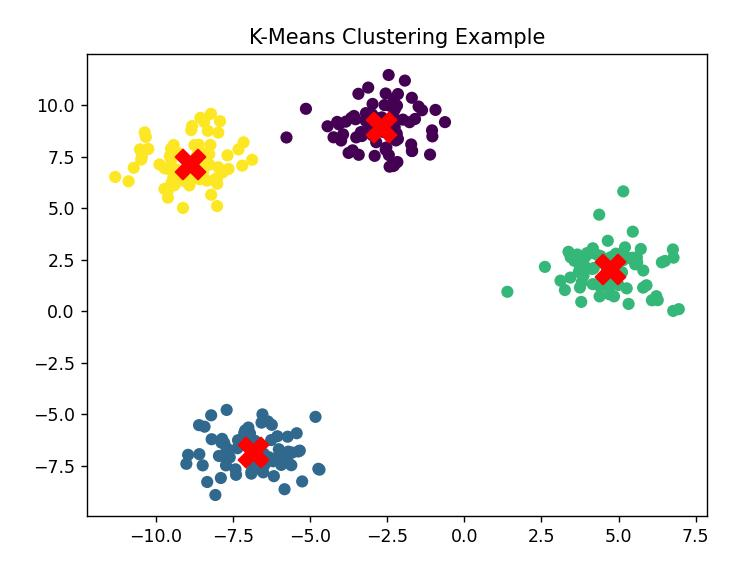
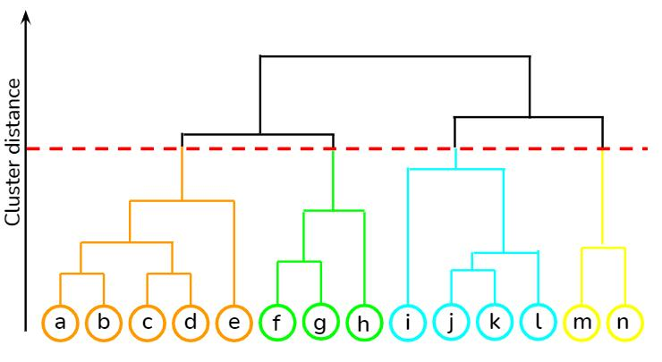
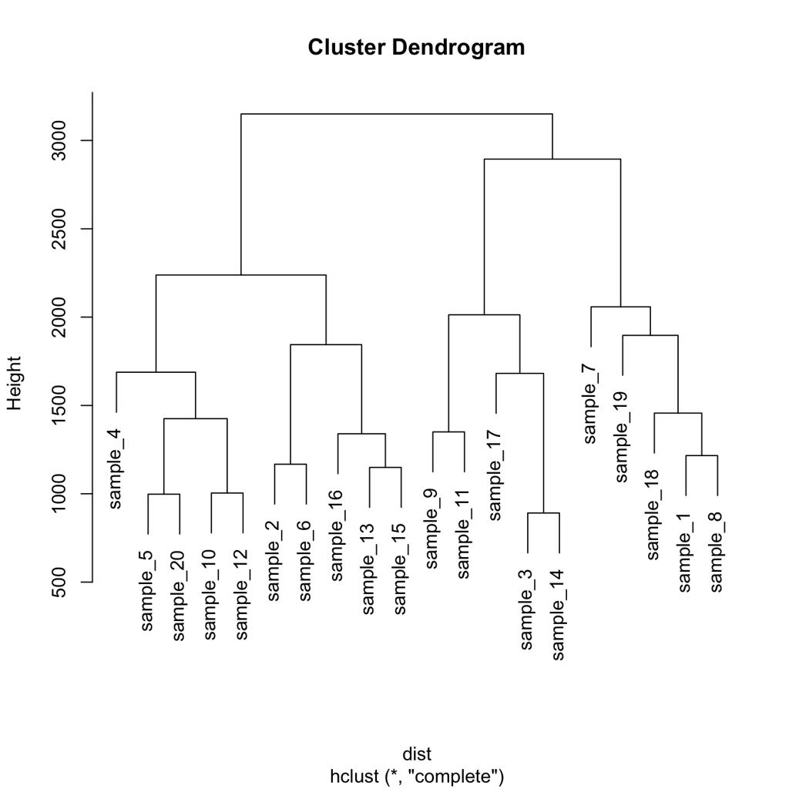

MACHINE LEARNING · ALGORITHMES DE BASE

Cette page rassemble les notions de base du Machine Learning, les formules utiles, des exemples d’algorithmes et les commentaires des 17 visualisations. Les explications sont regroupées par sujet pour éviter les répétitions.

<figure class="resource-figure"><figcaption>Panorama des familles du Machine Learning et de leurs relations.</figcaption></figure>
<h2>1. Repères et familles du Machine Learning</h2>

Une cartographie générale situe l’intelligence artificielle (IA), le Machine Learning (ML), le Deep Learning (DL), les réseaux de neurones profonds, puis les Transformers et les grands modèles de langage (LLM). Les réseaux de neurones artificiels (ANN) forment une famille de modèles ; ceux qui comportent plusieurs couches cachées relèvent généralement du Deep Learning.

<h3>1.1 Les trois grandes catégories d’apprentissage</h3>

<table><tr><th>Approche</th><th>Principe</th><th>Exemple</th></tr><tr><td>Supervisé</td><td>Apprendre à partir de données accompagnées de labels.</td><td>Prédire le churn.</td></tr><tr><td>Non supervisé</td><td>Rechercher des structures dans des données sans labels.</td><td>Segmenter des clients.</td></tr><tr><td>Renforcement</td><td>Apprendre une stratégie à partir des récompenses reçues.</td><td>Contrôler un robot autonome.</td></tr></table>

<h3>1.2 Classification des algorithmes</h3>

<table><tr><th>Famille</th><th>Algorithmes</th><th>Objectif</th></tr><tr><td>Régression</td><td>Linear, Ridge, Lasso</td><td>Prédire une valeur.</td></tr><tr><td>Classification</td><td>Logistic, SVM, KNN, Naive Bayes</td><td>Prédire une classe.</td></tr><tr><td>Arbres et ensembles</td><td>Decision Tree, Random Forest, XGBoost</td><td>Prédire à partir de règles ou d’ensembles de modèles.</td></tr><tr><td>Clustering</td><td>K-Means, DBSCAN, GMM</td><td>Identifier des groupes.</td></tr><tr><td>Réduction dimensionnelle</td><td>PCA, t-SNE, UMAP</td><td>Projeter ou réduire les variables.</td></tr><tr><td>Deep Learning</td><td>ANN, CNN, RNN, LSTM</td><td>Apprendre des représentations complexes.</td></tr><tr><td>Génératif</td><td>GAN, VAE, Transformers</td><td>Générer des données ou des contenus.</td></tr><tr><td>Renforcement</td><td>Q-Learning, PPO</td><td>Apprendre une stratégie d’action.</td></tr></table>

<figure class="resource-figure"><figcaption>Repères sur les familles du Machine Learning.</figcaption></figure>

<h2>2. Fonctions mathématiques fondamentales</h2>
<h3>2.1 Fonction linéaire</h3>

<code>f(x) = ax + b</code>

Exemple : <code>Prix = 2 000 × Surface + 15 000</code>. Pour une surface de 50 m², le prix estimé est 115 000.

<h3>2.2 Fonctions de coût</h3>

<code>MSE = (1/n) Σᵢ (yᵢ − ŷᵢ)²</code>

<code>MAE = (1/n) Σᵢ |yᵢ − ŷᵢ|</code>

<code>Binary Cross-Entropy = −(1/n) Σᵢ [yᵢ ln(pᵢ) + (1−yᵢ) ln(1−pᵢ)]</code>

La MSE pénalise fortement les grandes erreurs ; la MAE est moins sensible aux valeurs extrêmes ; la cross-entropy évalue les probabilités prédites.

<h3>2.3 Descente de gradient</h3>

<code>θₜ₊₁ = θₜ − α∇J(θₜ)</code>

θ représente les paramètres, α le taux d’apprentissage (*learning rate*) et ∇J le gradient. Les variantes comprennent Batch, SGD, Mini-batch, Momentum, RMSProp et Adam.

<h3>2.4 Fonctions d’activation</h3>

<table><tr><th>Fonction</th><th>Formule</th><th>Usage fréquent</th></tr><tr><td>Sigmoid</td><td>1/(1+e⁻ˣ)</td><td>Classification binaire.</td></tr><tr><td>Tanh</td><td>tanh(x)</td><td>Réseaux récurrents.</td></tr><tr><td>ReLU</td><td>max(0,x)</td><td>Couches cachées.</td></tr><tr><td>Leaky ReLU</td><td>max(0,01x,x)</td><td>Limiter les neurones inactifs.</td></tr><tr><td>Softmax</td><td>eᶻⁱ / Σⱼeᶻʲ</td><td>Classification multiclasse.</td></tr><tr><td>GELU</td><td>xΦ(x)</td><td>Transformers.</td></tr></table>

<h2>3. Algorithmes supervisés</h2>
<h3>3.1 Régression linéaire</h3>

La régression linéaire prédit une valeur numérique, comme un prix, une consommation ou des ventes.

<code>ŷ = w₁x₁ + … + wₙxₙ + b</code>

On minimise la MSE. Ridge ajoute une pénalité L2, Lasso une pénalité L1, et Elastic Net combine L1 et L2.

<h3>3.2 Régression logistique</h3>

La régression logistique sert à la classification, par exemple pour détecter un spam ou prédire un churn. Elle transforme un score en probabilité : <code>z = wᵀx+b ; P(y=1|x) = 1/(1+e⁻ᶻ)</code>. Elle utilise généralement la Binary Cross-Entropy et un seuil de décision, par exemple 0,5.

<h3>3.3 Arbre de décision</h3>

Un arbre enchaîne des règles pour la classification ou la régression. L’indice de Gini et l’entropie mesurent l’impureté des nœuds : <code>Gini = 1 − Σₖpₖ²</code> et <code>H = −Σₖpₖ log₂(pₖ)</code>. Le gain d’information compare l’entropie du parent à celle de ses enfants ; en régression, on peut utiliser la réduction de variance ou de MSE.

<h3>3.4 Random Forest</h3>

Random Forest agrège des arbres entraînés sur des échantillons bootstrap et des sous-ensembles de variables. En régression, les prédictions des arbres sont moyennées ; en classification, elles sont combinées par vote majoritaire. Cette agrégation réduit la variance par rapport à un arbre isolé.

<h3>3.5 Gradient Boosting, XGBoost et LightGBM</h3>

Le gradient boosting ajoute successivement des arbres pour corriger les erreurs précédentes : <code>Fₘ(x) = F₀(x) + Σₘ ηhₘ(x)</code>. XGBoost exploite le gradient, la Hessienne et la régularisation ; LightGBM favorise la rapidité ; CatBoost prend en charge les variables catégorielles.

<h3>3.6 K-Nearest Neighbors (KNN)</h3>

KNN classe une observation selon ses K voisins les plus proches. La distance euclidienne s’écrit <code>d(x,y) = √[Σᵢ(xᵢ−yᵢ)²]</code>. La classification utilise un vote majoritaire et la régression une moyenne. La normalisation des variables est importante.

<h3>3.7 Support Vector Machine (SVM)</h3>

SVM recherche un hyperplan séparateur à marge maximale. La frontière linéaire est décrite par <code>wᵀx+b=0</code> ; un noyau RBF peut modéliser des séparations non linéaires : <code>K(x,x′)=exp(−γ||x−x′||²)</code>.

<h3>3.8 Naive Bayes</h3>

Naive Bayes réalise une classification probabiliste en supposant l’indépendance conditionnelle des variables : <code>P(A|B)=P(B|A)P(A)/P(B)</code>. Les variantes courantes sont Gaussian, Multinomial et Bernoulli.

<h2>4. Algorithmes non supervisés, réduction dimensionnelle et anomalies</h2>
<h3>4.1 K-Means</h3>

K-Means choisit K centroïdes, affecte chaque point au centroïde le plus proche, recalcule les centres et répète ces étapes jusqu’à stabilisation. Il minimise la somme des distances quadratiques : <code>J = Σₖ Σₓᵢ∈Cₖ ||xᵢ−μₖ||²</code>. Le nombre de groupes peut notamment être choisi avec la méthode du coude. K-Means est sensible aux valeurs aberrantes et convient moins aux groupes de formes non convexes.

Les visualisations montrent des partitions en trois, quatre et six groupes. Les croix indiquent les centroïdes et les frontières représentent les zones d’affectation au centre le plus proche. Les étiquettes de cluster identifient les groupes sans les classer par qualité.

<figure class="resource-figure"><figcaption>K-Means avec quatre groupes.</figcaption></figure>
<figure class="resource-figure"><figcaption>Étiquettes des clusters K-Means.</figcaption></figure>
<figure class="resource-figure"><figcaption>Clusters, observations isolées et centroïdes.</figcaption></figure>

<h3>4.2 DBSCAN</h3>

DBSCAN forme des clusters à partir de zones suffisamment denses. Ses paramètres sont ε, le rayon du voisinage, et MinPts, le nombre minimal de points. Un point est central si <code>|Nε(p)| ≥ MinPts</code>, avec <code>Nε(p) = {q ∈ D : d(p,q) ≤ ε}</code>. Un point frontière est proche d’un point central sans être central lui-même ; les points isolés sont considérés comme du bruit ou des outliers.

DBSCAN peut détecter des groupes de formes complexes et des points isolés sans fixer à l’avance le nombre de clusters. Contrairement à K-Means, il ne représente pas les groupes par des centroïdes.

<h3>4.3 Clustering hiérarchique</h3>

Un dendrogramme représente les fusions successives entre observations ou groupes. L’axe vertical indique la distance ou la dissimilarité au moment de la fusion. Une coupe horizontale choisie à une hauteur donnée détermine le nombre de clusters : les branches basses indiquent des observations fusionnées à faible distance, tandis que les branches hautes réunissent des ensembles plus dissemblables.

<figure class="resource-figure"><figcaption>Regroupements hiérarchiques et choix de la coupe.</figcaption></figure>

Parmi les autres méthodes figurent GMM, Mean Shift, OPTICS et Spectral Clustering.

<h3>4.4 PCA — analyse en composantes principales</h3>

La PCA transforme les variables initiales en composantes principales orthogonales, ordonnées selon la variance expliquée. Les étapes comprennent le centrage, le calcul de la covariance, la recherche des vecteurs propres, le choix des composantes et la projection : <code>Xc = X − X̄ ; Σ = XcᵀXc/(n−1) ; Σv = λv ; Z = XcW</code>.

Les visualisations comparent les données avant et après leur projection sur deux composantes, et montrent qu’une séparation entre classes peut devenir plus lisible. La PCA transforme les variables et ne crée pas les classes.

<h3>4.5 UMAP et t-SNE</h3>

UMAP et t-SNE projettent des données à nombreuses dimensions dans une carte 2D. Les groupes proches suggèrent des observations voisines dans l’espace d’origine, mais les axes projetés n’ont pas nécessairement une interprétation métier directe. t-SNE cherche surtout à préserver les voisinages locaux ; les distances entre groupes éloignés ne mesurent pas précisément leur dissimilarité globale.

Une visualisation combine UMAP et K-Means : UMAP réduit d’abord la dimension, puis K-Means affecte les points à six groupes. La projection facilite l’inspection, mais ne remplace pas l’analyse dans l’espace d’origine.

<h3>4.6 Détection d’anomalies</h3>
<h4>Autoencoder</h4>

L’encodeur compresse les données dans une représentation latente appelée <em>bottleneck</em> ; le décodeur tente de reconstruire les données d’origine. Une erreur de reconstruction élevée peut signaler une observation inhabituelle, si le modèle a principalement été entraîné sur des données normales.

<h4>LOF — Local Outlier Factor</h4>

LOF compare la densité locale d’un point à celle de ses voisins. Un point situé dans une zone beaucoup moins dense que son voisinage reçoit un score d’anomalie élevé. Les visualisations montrent des groupes d’observations normales et des points atypiques isolés ou proches d’un groupe.

<h4>Isolation Forest</h4>

Isolation Forest construit des arbres au moyen de séparations aléatoires. Les observations atypiques sont généralement isolées en peu de séparations, tandis que les observations ordinaires nécessitent davantage de découpages. Les visualisations distinguent les points normaux des anomalies détectées et illustrent leur isolation précoce.

Une anomalie statistique n’est pas automatiquement une innovation. En veille technologique, un expert doit examiner les résultats pour distinguer les signaux prometteurs des faux positifs.

<h2>5. ANN — réseaux de neurones artificiels</h2>

Un ANN comprend une couche d’entrée, des couches cachées et une couche de sortie. Chaque neurone réalise une combinaison pondérée puis applique une fonction d’activation : <code>z = Σᵢ wᵢxᵢ + b ; a = f(z)</code>.

Exemple : avec <code>x₁=2</code>, <code>x₂=3</code>, <code>w₁=0,5</code>, <code>w₂=0,8</code> et <code>b=0,1</code>, on obtient <code>z=3,5</code> et <code>ReLU(z)=3,5</code>.

<h3>5.1 Propagation avant</h3>

<code>Z⁽ˡ⁾ = W⁽ˡ⁾A⁽ˡ⁻¹⁾ + b⁽ˡ⁾ ; A⁽ˡ⁾ = f(Z⁽ˡ⁾)</code>

<h3>5.2 Rétropropagation</h3>

<code>∂L/∂w = (∂L/∂a)(∂a/∂z)(∂z/∂w)</code>

<code>wₜ₊₁ = wₜ − α ∂L/∂w</code>

La rétropropagation calcule les gradients à l’aide de la règle de dérivation en chaîne, puis met à jour les poids. Un ANN peut être peu profond ; plusieurs couches cachées caractérisent généralement un réseau de Deep Learning.

<h2>6. Quel algorithme utiliser ?</h2>

<table><tr><th>Objectif</th><th>Méthodes possibles</th><th>À retenir</th></tr><tr><td>Prédire un prix ou une valeur</td><td>Linear Regression, Ridge, Lasso</td><td>Régression numérique.</td></tr><tr><td>Prédire un churn</td><td>Logistic Regression, XGBoost</td><td>Classification supervisée.</td></tr><tr><td>Détecter une fraude</td><td>Random Forest, XGBoost, GNN</td><td>Comparer les performances et la qualité des données.</td></tr><tr><td>Segmenter des observations</td><td>K-Means, DBSCAN</td><td>Choisir selon la forme des groupes et le traitement du bruit.</td></tr><tr><td>Explorer des proximités ou une hiérarchie</td><td>Dendrogramme, UMAP, t-SNE</td><td>Visualiser la structure sans surinterpréter les distances projetées.</td></tr><tr><td>Réduire la dimension</td><td>PCA, UMAP, t-SNE</td><td>Projeter des variables pour faciliter l’analyse.</td></tr><tr><td>Détecter des anomalies</td><td>LOF, Isolation Forest, Autoencoder</td><td>Repérer les observations qui s’écartent du comportement habituel.</td></tr><tr><td>Analyser des images</td><td>CNN, Vision Transformers</td><td>Apprendre des représentations visuelles.</td></tr><tr><td>Étudier des séries temporelles</td><td>XGBoost, LSTM, Transformers</td><td>Tenir compte de l’ordre et de la dépendance temporelle.</td></tr><tr><td>Traiter ou générer du texte</td><td>Naive Bayes, BERT, LLM</td><td>Choisir selon la tâche de classification ou de génération.</td></tr><tr><td>Interroger des documents</td><td>RAG + LLM</td><td>Récupérer du contexte documentaire au moment de la réponse.</td></tr><tr><td>Exploiter des relations</td><td>GNN, GraphRAG</td><td>Représenter les liens sous forme de graphe.</td></tr><tr><td>Apprendre des décisions</td><td>Reinforcement Learning, Q-Learning, PPO</td><td>Apprendre à partir des récompenses.</td></tr></table>

<h2>7. Étapes d’un projet Machine Learning et métriques</h2>

Un projet ML suit généralement les étapes ci-dessous, de la compréhension métier à la surveillance en production.

<table><tr><th>Étape</th><th>Description</th></tr><tr><td>1</td><td>Business Understanding.</td></tr><tr><td>2</td><td>Data Collection.</td></tr><tr><td>3</td><td>Data Preparation.</td></tr><tr><td>4</td><td>Feature Engineering.</td></tr><tr><td>5</td><td>Model Selection.</td></tr><tr><td>6</td><td>Training.</td></tr><tr><td>7</td><td>Evaluation.</td></tr><tr><td>8</td><td>Deployment.</td></tr><tr><td>9</td><td>Monitoring.</td></tr></table>

<h3>7.1 Métriques d’évaluation</h3>

<code>Accuracy = (TP+TN)/(TP+TN+FP+FN)</code>

<code>Precision = TP/(TP+FP)</code>

<code>Recall = TP/(TP+FN)</code>

<code>F1 = 2×Precision×Recall/(Precision+Recall)</code>

Pour la classification, on peut utiliser Accuracy, Precision, Recall, F1 et AUC-ROC. Pour la régression : MAE, MSE, RMSE et R². Pour le clustering : Silhouette, Davies-Bouldin et Calinski-Harabasz.

<h2>8. Parcours d’apprentissage conseillé</h2>
<ol>
<li>Revoir les bases de Python, les tableaux de données et les statistiques descriptives.</li>
<li>Comprendre les jeux de données, les variables, les labels et les étapes de préparation des données.</li>
<li>Étudier la régression linéaire et logistique, puis les arbres de décision et les méthodes d’ensemble.</li>
<li>Apprendre à choisir des métriques adaptées et à évaluer un modèle sur des données distinctes de celles d’entraînement.</li>
<li>Explorer le clustering et la réduction dimensionnelle pour analyser des données sans labels.</li>
<li>Découvrir les réseaux de neurones, la propagation avant et la rétropropagation, puis les architectures profondes.</li>
<li>Mettre en pratique ces notions avec de petits projets, et documenter les résultats et les limites des modèles.</li>
</ol>

