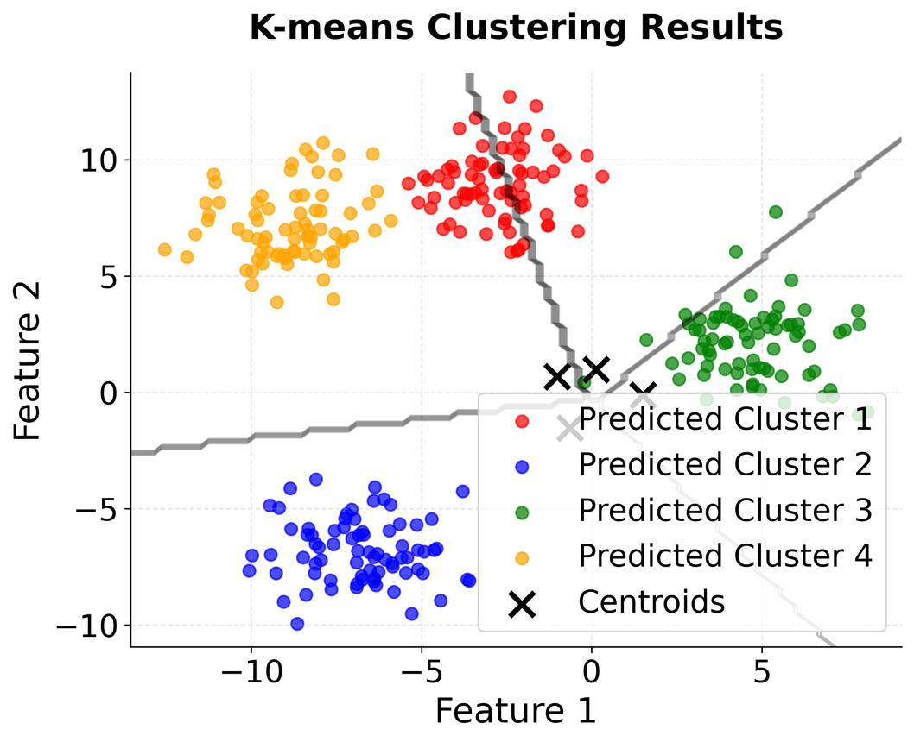
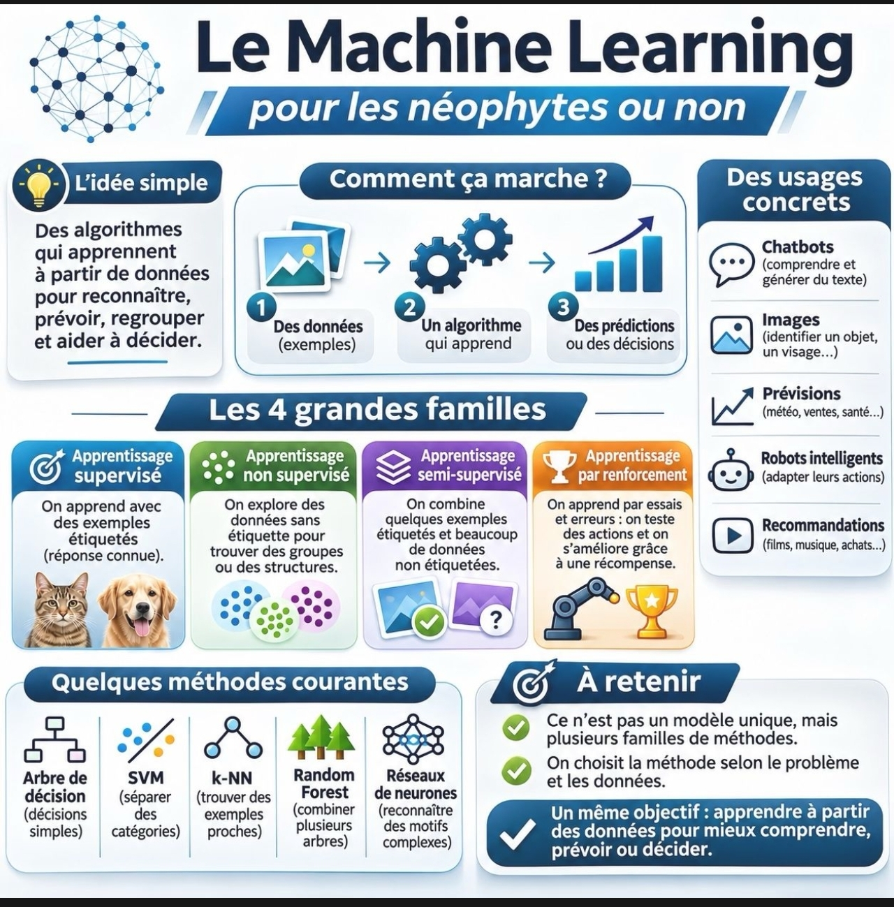

MACHINE LEARNING · DOCUMENT DE RÉFÉRENCE

Cette page reprend le contenu du document de référence, dans son ordre d’origine. Les exemples fournis dans le document sont conservés avec les explications correspondantes.

Source : Support_revision_ML_17_images.docx

Clustering, réduction de dimension 
et détection d’anomalies

Support de révision – 17 images commentées

Ce document rassemble les 10 images de la première série et les 7 images de la deuxième série. Chaque illustration est accompagnée d’une explication de ce qu’elle représente et de la notion à retenir.

<h2>1. Première série – notions fondamentales</h2>
<h3>1. Autoencoder : encoder, bottleneck et decoder</h3>

L’encodeur compresse les données d’entrée dans une représentation plus courte appelée « bottleneck » ou goulot d’étranglement. Le décodeur tente ensuite de reconstruire les données d’origine. L’écart entre l’entrée et la sortie est l’erreur de reconstruction. Une erreur élevée peut signaler une observation inhabituelle, à condition que le modèle ait été entraîné principalement sur des données normales.

<h3>2. LOF – Local Outlier Factor</h3>

LOF compare la densité locale d’un point à celle de ses voisins. Un point situé dans une zone beaucoup moins dense que son voisinage reçoit un score d’anomalie élevé. L’image montre deux groupes d’observations normales et plusieurs points rouges isolés ou atypiques.

<h3>3. Isolation Forest : principe des séparations successives</h3>

Isolation Forest construit des arbres en réalisant des séparations aléatoires. Les observations atypiques sont généralement isolées en peu de séparations, alors que les observations ordinaires nécessitent davantage de découpages. L’image illustre cette isolation précoce d’un point éloigné.

<h3>4. UMAP : projection en deux dimensions</h3>

UMAP projette des données décrites par de nombreuses variables dans un espace 2D. Chaque point représente une observation. Les groupes de points proches traduisent des observations qui se ressemblent dans l’espace d’origine. Ici, les couleurs correspondent aux chiffres de 0 à 9.

<h3>5. UMAP suivi de K-Means</h3>

Cette représentation combine deux opérations : UMAP réduit d’abord la dimension des données, puis K-Means attribue les points à six groupes. Les couleurs indiquent les clusters obtenus. La projection facilite la visualisation, mais les axes UMAP ne correspondent pas directement à des variables métier.

<h3>6. Isolation Forest : observations normales et anomalies</h3>

Les points bleus représentent les observations considérées comme normales et les points rouges les anomalies détectées. Les points éloignés des concentrations principales sont souvent plus faciles à isoler. Certains points proches d’un groupe peuvent aussi être signalés.

<h3>7. t-SNE : visualisation des proximités</h3>

t-SNE transforme des données complexes en une carte 2D qui cherche surtout à préserver les voisinages locaux. Les groupes colorés montrent ici les différentes classes de chiffres. Les distances entre groupes éloignés ne doivent pas être interprétées comme des mesures exactes de dissimilarité globale.

<h3>8. PCA : transformation en composantes principales</h3>

La PCA transforme les variables initiales en nouvelles variables appelées composantes principales. La première explique la plus grande part possible de la variance, la deuxième explique la plus grande part restante, sous contrainte d’orthogonalité. L’illustration compare les données avant et après projection sur deux composantes.

<h3>9. DBSCAN : clusters, points centraux, frontières et bruit</h3>

DBSCAN forme des clusters à partir de zones suffisamment denses. Un point central possède au moins MinPts points dans son voisinage de rayon ε. Un point frontière se trouve dans le voisinage d’un point central sans être lui-même central. Les points isolés qui ne rejoignent aucun cluster sont considérés comme du bruit ou des outliers.

<h3>10. K-Means : quatre clusters et centroïdes</h3>

K-Means répartit les observations en K groupes en minimisant la distance entre chaque point et le centroïde de son groupe. Les croix noires représentent les centroïdes. Les lignes grises illustrent les frontières de décision entre les zones attribuées aux différents clusters.

<h2>2. Deuxième série – approfondissement et exemples complémentaires</h2>
<h3>11. Dendrogramme : clustering hiérarchique</h3>

Un dendrogramme représente les fusions successives entre observations ou groupes d’observations. L’axe vertical indique la distance ou la dissimilarité au moment de la fusion. En traçant une ligne horizontale à un niveau choisi, on coupe l’arbre et on obtient un certain nombre de clusters. Plus la fusion se fait haut, plus les groupes réunis étaient éloignés.

<h3>12. K-Means : résultat avec quatre groupes</h3>

Cette image reprend une partition K-Means en quatre groupes. Chaque couleur identifie un cluster et les croix noires indiquent les centroïdes. Les frontières grises représentent les zones où l’affectation au centroïde le plus proche change. Cette illustration est très proche de l’image 10 et sert de rappel visuel.

<h3>13. K-Means : exemple avec trois groupes</h3>

Les observations sont réparties en trois groupes compacts. Les grandes croix rouges marquent les centroïdes, c’est-à-dire les moyennes des coordonnées des points de chaque groupe. K-Means cherche à rapprocher les points de leur centroïde et réajuste les centres jusqu’à stabilisation.

<h3>14. Isolation Forest : détection des outliers</h3>

Les groupes bleus représentent les observations normales et les points rouges les observations détectées comme atypiques. L’algorithme utilise des partitions aléatoires ; les observations qui sont isolées rapidement ont tendance à être considérées comme des anomalies.

<h3>15. PCA : séparation de trois classes</h3>

La figure compare les données dans leur espace initial (à gauche) et leur projection PCA (à droite). Les deux composantes principales offrent une nouvelle vue des observations et peuvent rendre certaines séparations entre classes plus visibles. La PCA ne crée pas les classes : elle transforme les variables pour résumer la variance.

<h3>16. Dendrogramme : exemple de regroupement hiérarchique</h3>

Cette deuxième représentation montre comment les échantillons sont regroupés par étapes. Les petites branches indiquent des observations fusionnées à faible distance ; les grandes branches réunissent des ensembles plus dissemblables. Le choix de la hauteur de coupe détermine le nombre final de groupes.

<h3>17. K-Means : quatre groupes avec centroïdes</h3>

La carte présente quatre clusters de points. Les croix rouges indiquent les centres calculés par K-Means. La barre de couleur code les identifiants des groupes ; les valeurs 0 à 3 sont des étiquettes de cluster, et non un classement de qualité.

<h2>3. Synthèse : quel algorithme pour quel objectif ?</h2>

<table><tr><td>
Objectif
</td><td>
Méthodes illustrées
</td><td>
À retenir
</td></tr><tr><td>
Regrouper des observations
</td><td>
K-Means, DBSCAN, clustering hiérarchique
</td><td>
Former des groupes selon la similarité ou la densité.
</td></tr><tr><td>
Comprendre la structure des groupes
</td><td>
Dendrogramme, UMAP, t-SNE
</td><td>
Visualiser les proximités et les regroupements.
</td></tr><tr><td>
Réduire le nombre de dimensions
</td><td>
PCA, UMAP, t-SNE
</td><td>
Projeter des données complexes pour faciliter l’analyse.
</td></tr><tr><td>
Détecter des observations atypiques
</td><td>
LOF, Isolation Forest, Autoencoder
</td><td>
Repérer les points qui s’écartent du comportement habituel.
</td></tr></table>

Attention : une anomalie statistique n’est pas automatiquement une innovation. Dans une veille technologique, les résultats des algorithmes doivent être examinés par un expert afin de distinguer les signaux réellement prometteurs des faux positifs.

<section class="resource-illustrations"><h2>Schémas et illustrations</h2>
<figure class="resource-figure"><figcaption>Dendrogramme de clustering hiérarchique.</figcaption></figure>
<figure class="resource-figure"><figcaption>Exemple de regroupement K-Means en quatre clusters.</figcaption></figure>
<figure class="resource-figure"><figcaption>Exemple de clustering avec observations isolées et centroïdes.</figcaption></figure>
<figure class="resource-figure"><figcaption>Visualisation des groupes et de leurs étiquettes K-Means.</figcaption></figure>
<figure class="resource-figure"><figcaption>Synthèse illustrée des familles et usages du Machine Learning.</figcaption></figure>
</section>

