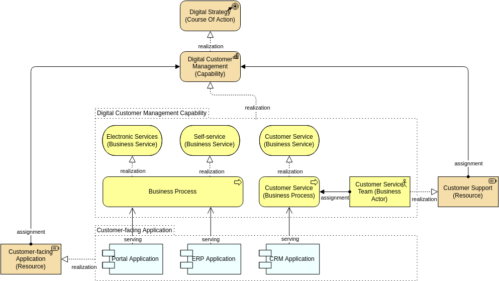
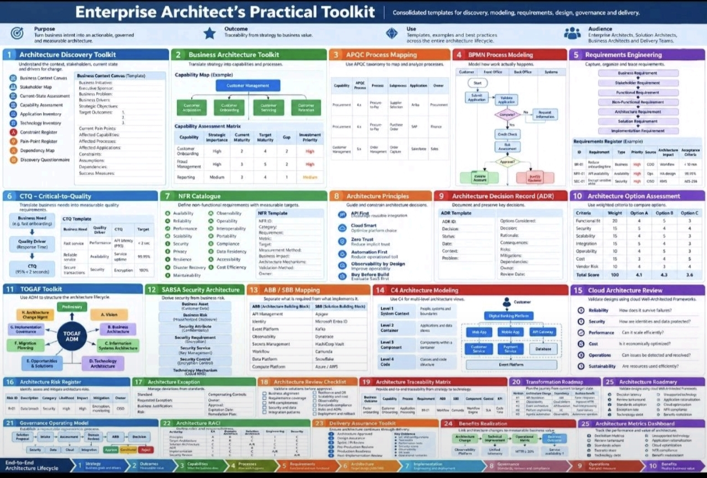
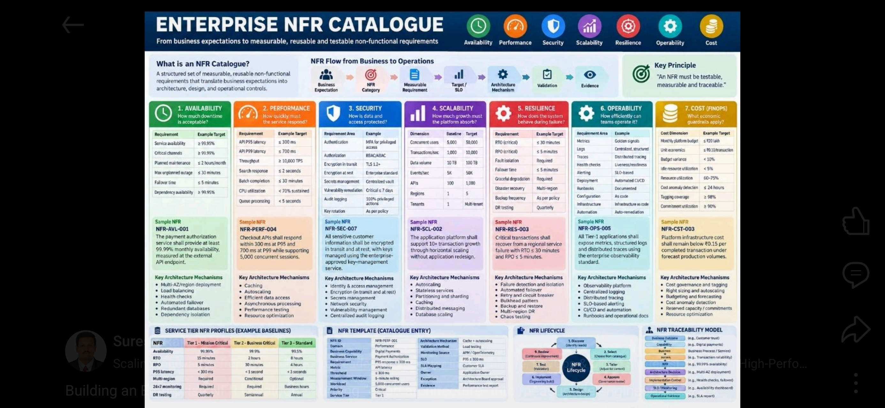
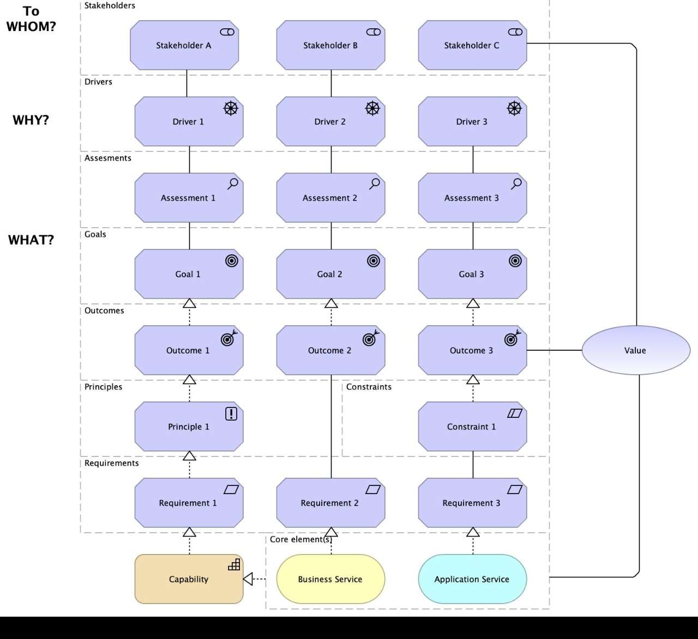
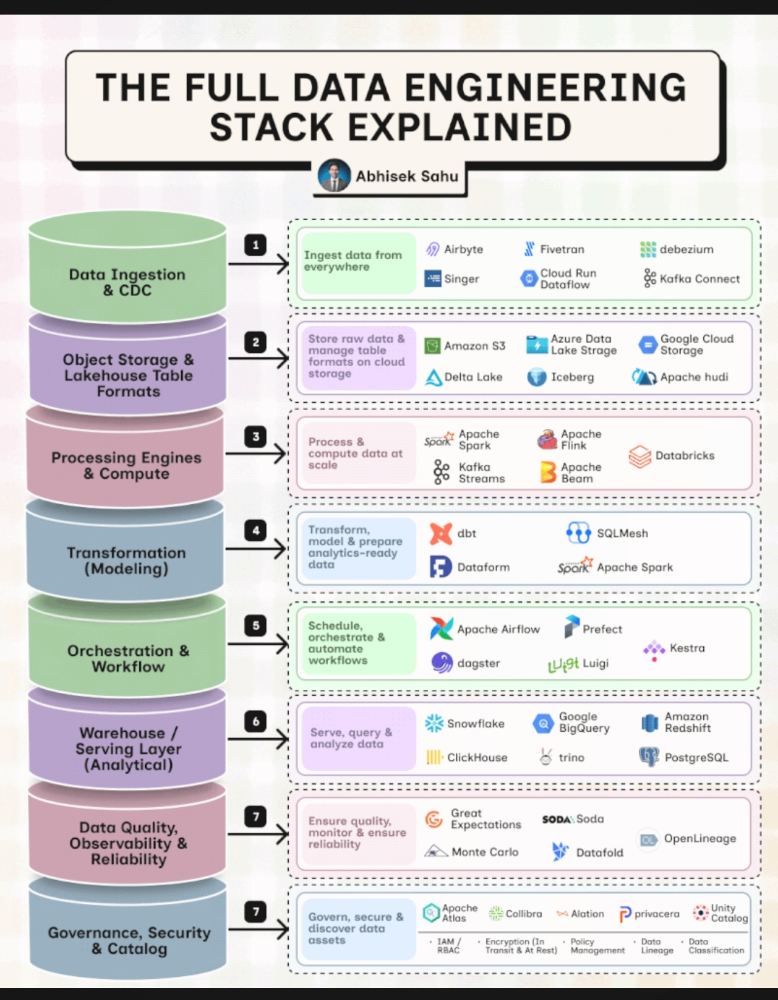

ARCHITECTURE D’ENTREPRISE · DOCUMENT DE RÉFÉRENCE

Cette page reprend le contenu du document de référence, dans son ordre d’origine. Les exemples fournis dans le document sont conservés avec les explications correspondantes.

Source : Synthese_catalogues_TOGAF_ADM.docx

SYNTHÈSE DES CATALOGUES TOGAF

Rôle • Contenu • Domaine ADM • Exemples • Pièges d’examen

Support de révision — TOGAF 10 / Architecture Content Framework

<h2>1. Comprendre ce qu’est un catalogue</h2>

Un catalogue est un inventaire structuré d’éléments d’architecture. Il décrit les objets, leurs caractéristiques et leurs propriétaires. Il répond à la question : « Quels éléments existent dans l’architecture ? »

<table><tr><td>
Artefact
</td><td>
Rôle
</td><td>
Question clé
</td><td>
Exemple
</td></tr><tr><td>
Catalogue
</td><td>
Inventorier des éléments et leurs attributs
</td><td>
Quels éléments avons-nous ?
</td><td>
Catalogue des applications
</td></tr><tr><td>
Matrice
</td><td>
Montrer les relations entre des ensembles
</td><td>
Quel élément est lié à quel autre ?
</td><td>
Matrice Application / Organisation
</td></tr><tr><td>
Diagramme
</td><td>
Représenter une structure, un flux ou un comportement
</td><td>
Comment cela fonctionne-t-il ?
</td><td>
Application Communication Diagram
</td></tr></table>

<h3>À retenir</h3>

Catalogue = liste structurée d’objets.

Matrice = tableau de correspondances entre objets.

Diagramme = représentation visuelle d’une structure ou d’un flux.

Ces artefacts sont complémentaires : un catalogue peut servir de base à une matrice ou à un diagramme.

<h2>2. Les principaux catalogues par domaine</h2>

Les intitulés et regroupements peuvent varier selon l’édition, le métamodèle et les adaptations de l’organisation. La fonction de chaque artefact reste le meilleur repère pour l’examen.

<h3>2.1 Gouvernance, principes et exigences</h3>

<table><tr><td>
Catalogue / registre
</td><td>
Contenu typique
</td><td>
Objectif
</td><td>
Exemple
</td></tr><tr><td>
Architecture Principles Catalog
</td><td>
Identifiant, nom, énoncé, justification, implications, propriétaire
</td><td>
Centraliser les principes qui guident les décisions
</td><td>
« API sécurisées par OAuth2/OIDC »
</td></tr><tr><td>
Architecture Requirements Catalog
</td><td>
Exigence, source, priorité, statut, critères d’acceptation, traçabilité
</td><td>
Suivre les exigences d’architecture durant l’ADM
</td><td>
« Toute API exposée doit être authentifiée »
</td></tr><tr><td>
Stakeholder Map / registre des parties prenantes
</td><td>
Acteur, rôle, influence, préoccupations, attentes
</td><td>
Identifier les parties prenantes et leurs préoccupations
</td><td>
RSSI : sécurité ; métier : délai de traitement
</td></tr></table>

<h3>2.2 Architecture métier — Phase B</h3>

<table><tr><td>
Catalogue
</td><td>
Contenu typique
</td><td>
Objectif
</td><td>
Exemple
</td></tr><tr><td>
Organization/Actor Catalog
</td><td>
Organisation, unité, acteur, rattachement, responsabilités
</td><td>
Inventorier les unités et acteurs métier
</td><td>
Direction Paiements ; conseiller bancaire
</td></tr><tr><td>
Driver/Goal/Objective Catalog
</td><td>
Facteur de changement, objectif, résultat, indicateur, cible
</td><td>
Relier motivations et objectifs métier
</td><td>
Réduire de 30 % le délai d’un crédit
</td></tr><tr><td>
Role Catalog
</td><td>
Rôle, responsabilités, compétences, habilitations
</td><td>
Décrire les rôles indépendamment des personnes
</td><td>
Gestionnaire de compte
</td></tr><tr><td>
Business Service/Function Catalog
</td><td>
Services et fonctions métier, description, propriétaire
</td><td>
Décrire ce que l’entreprise fournit et les fonctions qu’elle réalise
</td><td>
Service : ouvrir un compte ; fonction : vérifier le client
</td></tr><tr><td>
Location Catalog
</td><td>
Sites, agences, centres, localisation, rattachement
</td><td>
Répertorier les lieux concernés
</td><td>
Agence bancaire de Lyon
</td></tr></table>

<h3>2.3 Architecture des systèmes d’information — Phase C</h3>

<table><tr><td>
Catalogue
</td><td>
Contenu typique
</td><td>
Objectif
</td><td>
Exemple
</td></tr><tr><td>
Data Entity / Data Component Catalog
</td><td>
Entité, définition, propriétaire, sensibilité, cycle de vie
</td><td>
Inventorier les données et composants de données
</td><td>
Client, Compte, Virement
</td></tr><tr><td>
Application Portfolio Catalog
</td><td>
Application, fonction couverte, propriétaire, criticité, cycle de vie, technologie
</td><td>
Connaître le patrimoine applicatif
</td><td>
Core Banking, CRM, Mobile Banking
</td></tr><tr><td>
Interface Catalog
</td><td>
Interface, source/cible, protocole, format, fréquence, sécurité
</td><td>
Inventorier les échanges et contrats d’intégration
</td><td>
API REST entre CRM et Core Banking
</td></tr></table>

<h3>2.4 Architecture technologique — Phase D</h3>

<table><tr><td>
Catalogue
</td><td>
Contenu typique
</td><td>
Objectif
</td><td>
Exemple
</td></tr><tr><td>
Technology Standards Catalog
</td><td>
Standard, version, domaine, statut, support, dérogation
</td><td>
Définir les technologies autorisées ou recommandées
</td><td>
Java LTS, Kubernetes, TLS 1.3
</td></tr><tr><td>
Technology Portfolio Catalog
</td><td>
Composant technique, usage, emplacement, propriétaire, version, cycle de vie
</td><td>
Recenser les composants et plateformes techniques
</td><td>
Cluster Kubernetes, Linux, stockage, load balancer
</td></tr></table>

<h2>3. Exemple fil rouge : modernisation d’une banque</h2>

Une banque modernise son parcours de virement et remplace progressivement un système monolithique par des services distribués.

<table><tr><td>
Catalogue
</td><td>
Extrait illustratif
</td></tr><tr><td>
Principes
</td><td>
P1 : sécurité dès la conception ; P2 : API contract-first ; P3 : traçabilité des opérations.
</td></tr><tr><td>
Exigences
</td><td>
REQ-01 : authentification forte ; REQ-02 : journalisation ; REQ-03 : disponibilité cible.
</td></tr><tr><td>
Parties prenantes
</td><td>
Directeur des paiements ; conformité ; RSSI ; architecte SI ; exploitation.
</td></tr><tr><td>
Organisation / acteurs
</td><td>
Direction Paiements ; agence ; conseiller ; opérateur back-office.
</td></tr><tr><td>
Drivers / objectifs
</td><td>
Driver : croissance du paiement mobile ; objectif : simplifier le virement.
</td></tr><tr><td>
Rôles
</td><td>
Initiateur du virement ; contrôleur ; administrateur des habilitations.
</td></tr><tr><td>
Services / fonctions
</td><td>
Service : réaliser un virement ; fonctions : saisir, contrôler, exécuter, notifier.
</td></tr><tr><td>
Données
</td><td>
Client ; Compte ; Virement ; Bénéficiaire.
</td></tr><tr><td>
Applications
</td><td>
Mobile Banking ; API Gateway ; Payment Hub ; Core Banking ; Notification Service.
</td></tr><tr><td>
Interfaces
</td><td>
Mobile Banking → API Gateway : REST/JSON ; Payment Hub → Core Banking : API/événement.
</td></tr><tr><td>
Standards techniques
</td><td>
OAuth2/OIDC ; TLS ; OpenAPI ; standard de logs ; version Java supportée.
</td></tr><tr><td>
Portfolio technologique
</td><td>
Kubernetes ; Kafka ; PostgreSQL ; stockage ; réseau ; pare-feu.
</td></tr></table>

<h2>4. Où les catalogues interviennent-ils dans l’ADM ?</h2>

<table><tr><td>
Étape ADM
</td><td>
Catalogues / registres principalement concernés
</td><td>
Finalité
</td></tr><tr><td>
Préliminaire
</td><td>
Principes d’architecture ; standards ; référentiels de gouvernance
</td><td>
Poser le cadre et les règles communes
</td></tr><tr><td>
Phase A — Vision
</td><td>
Parties prenantes ; exigences de haut niveau
</td><td>
Comprendre les préoccupations et cadrer la vision
</td></tr><tr><td>
Phase B — Métier
</td><td>
Organisation/acteurs ; rôles ; drivers/objectifs ; services/fonctions ; lieux
</td><td>
Décrire l’architecture métier
</td></tr><tr><td>
Phase C — SI
</td><td>
Entités/composants de données ; portefeuille applicatif ; interfaces
</td><td>
Décrire données, applications et échanges
</td></tr><tr><td>
Phase D — Technologie
</td><td>
Standards technologiques ; portefeuille technologique
</td><td>
Décrire les standards et composants d’infrastructure
</td></tr><tr><td>
Phases E à H
</td><td>
Réutilisation et mise à jour des catalogues concernés
</td><td>
Concevoir les solutions, gouverner la mise en œuvre et gérer les évolutions
</td></tr></table>

Important : les catalogues ne sont pas figés à une phase. Ils sont enrichis au fil des itérations et peuvent décrire l’existant (Baseline), la cible (Target) et les états intermédiaires (Transition).

<h2>5. Ne pas confondre : mini-cas</h2>

<table><tr><td>
Besoin
</td><td>
Artefact adapté
</td><td>
Raison
</td></tr><tr><td>
Lister les applications, leurs propriétaires et leur criticité
</td><td>
Application Portfolio Catalog
</td><td>
Inventaire d’applications et attributs
</td></tr><tr><td>
Montrer quelles applications sont utilisées par quelles directions
</td><td>
Application/Organization Matrix
</td><td>
Relation entre applications et unités organisationnelles
</td></tr><tr><td>
Visualiser les échanges entre applications
</td><td>
Application Communication Diagram
</td><td>
Représentation des interactions
</td></tr><tr><td>
Lister les standards approuvés
</td><td>
Technology Standards Catalog
</td><td>
Inventaire des règles et standards
</td></tr><tr><td>
Montrer quelles applications utilisent quelles entités de données
</td><td>
Application/Data Matrix
</td><td>
Relation entre applications et données
</td></tr><tr><td>
Lister les interfaces et leurs protocoles
</td><td>
Interface Catalog
</td><td>
Inventaire des interfaces
</td></tr></table>

<h2>6. Pièges fréquents à l’examen</h2>

Application Portfolio Catalog = patrimoine applicatif ; Interface Catalog = interfaces et échanges entre systèmes.

Technology Standards Catalog = standards autorisés/recommandés ; Technology Portfolio Catalog = composants technologiques recensés.

Data Entity/Data Component Catalog = données ; Application Portfolio Catalog = applications.

Les préoccupations des parties prenantes ne sont pas automatiquement des exigences techniques. Elles sont analysées puis traduites en exigences d’architecture.

Un catalogue n’explique pas à lui seul les interactions : utiliser une matrice ou un diagramme si la question porte sur les relations ou les flux.

Les catalogues peuvent être adaptés à l’organisation : toujours vérifier le rôle de l’artefact et ne pas se fier uniquement à son nom.

<h2>7. Questions d’entraînement</h2>

Quel catalogue recense les applications, leurs propriétaires et leur cycle de vie ?

Réponse : Application Portfolio Catalog.

Où recense-t-on les standards comme TLS, Java LTS ou Kubernetes ?

Réponse : Technology Standards Catalog.

Quel catalogue inventorie les interfaces entre applications ?

Réponse : Interface Catalog.

Quel catalogue décrit les acteurs et unités organisationnelles ?

Réponse : Organization/Actor Catalog.

Quelle différence entre Application Portfolio Catalog et Application/Organization Matrix ?

Réponse : Le premier inventorie les applications ; la seconde montre leurs relations avec les unités organisationnelles.

Quel catalogue centralise les principes, leur justification et leurs implications ?

Réponse : Architecture Principles Catalog.

<h2>8. Mémo final</h2>

<table><tr><td>
Domaine
</td><td>
Catalogues à reconnaître
</td><td>
Mot-clé
</td></tr><tr><td>
Gouvernance
</td><td>
Architecture Principles Catalog
</td><td>
Principes
</td></tr><tr><td>
Exigences
</td><td>
Architecture Requirements Catalog
</td><td>
Exigences
</td></tr><tr><td>
Parties prenantes
</td><td>
Stakeholder Map / registre
</td><td>
Préoccupations
</td></tr><tr><td>
Métier
</td><td>
Organization/Actor ; Role ; Driver/Goal/Objective ; Business Service/Function ; Location
</td><td>
Acteurs et métier
</td></tr><tr><td>
Données
</td><td>
Data Entity / Data Component
</td><td>
Données
</td></tr><tr><td>
Applications
</td><td>
Application Portfolio ; Interface
</td><td>
Applications et échanges
</td></tr><tr><td>
Technologie
</td><td>
Technology Standards ; Technology Portfolio
</td><td>
Standards et infrastructure
</td></tr></table>

CATALOGUE = QUOI ?   •   MATRICE = QUEL LIEN ?   •   DIAGRAMME = COMMENT ?

<section class="resource-illustrations"><h2>Schémas et illustrations</h2>
<figure class="resource-figure"><figcaption>Vue de planification d’une capacité métier et de ses services.</figcaption></figure>
<figure class="resource-figure"><figcaption>Vue d’ensemble d’un kit pratique d’architecture d’entreprise.</figcaption></figure>
<figure class="resource-figure"><figcaption>Exemple visuel de catalogue d’architecture d’entreprise.</figcaption></figure>
<figure class="resource-figure"><figcaption>Exemple de planification des capacités métier et de leur réalisation.</figcaption></figure>
<figure class="resource-figure"><figcaption>Référentiel visuel d’outils et de livrables pour architectes d’entreprise.</figcaption></figure>
</section>

