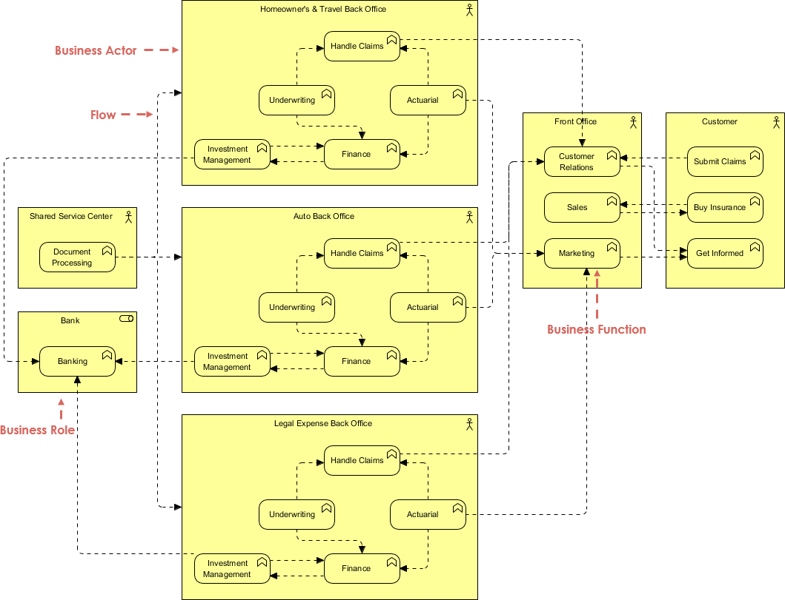
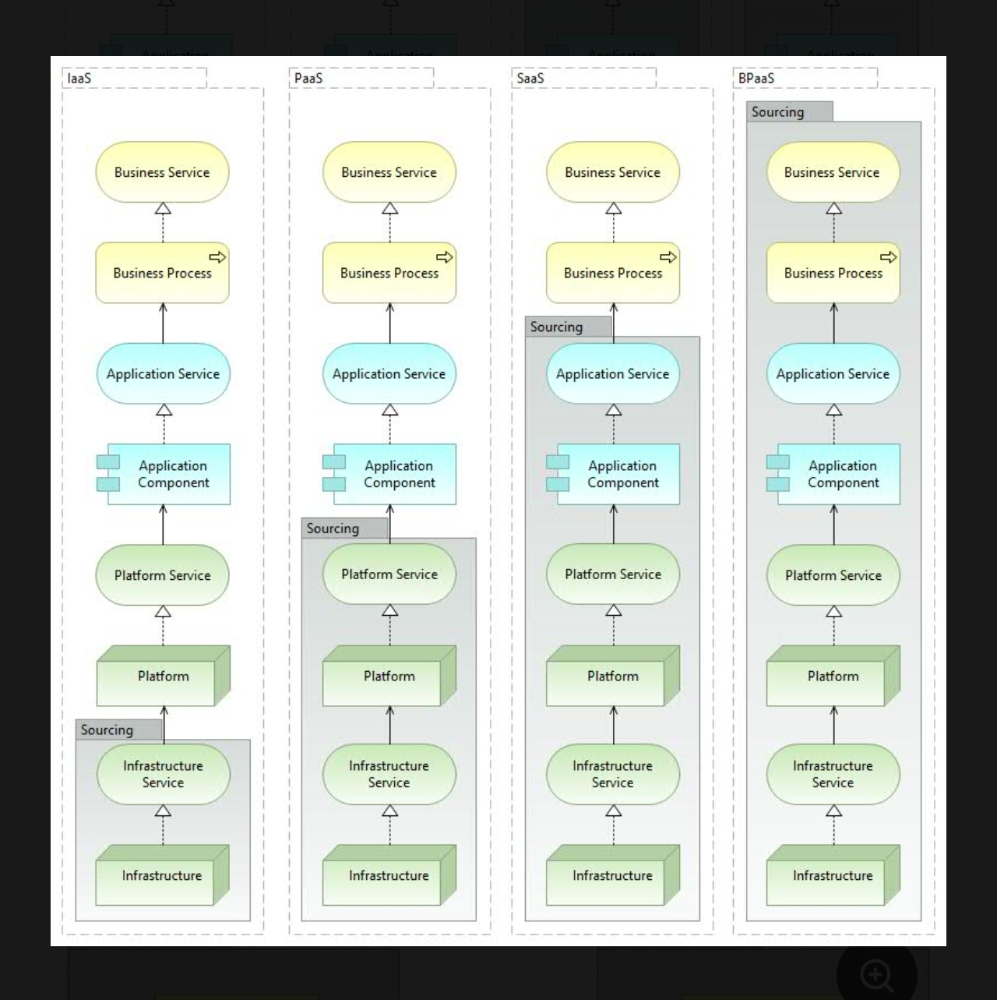
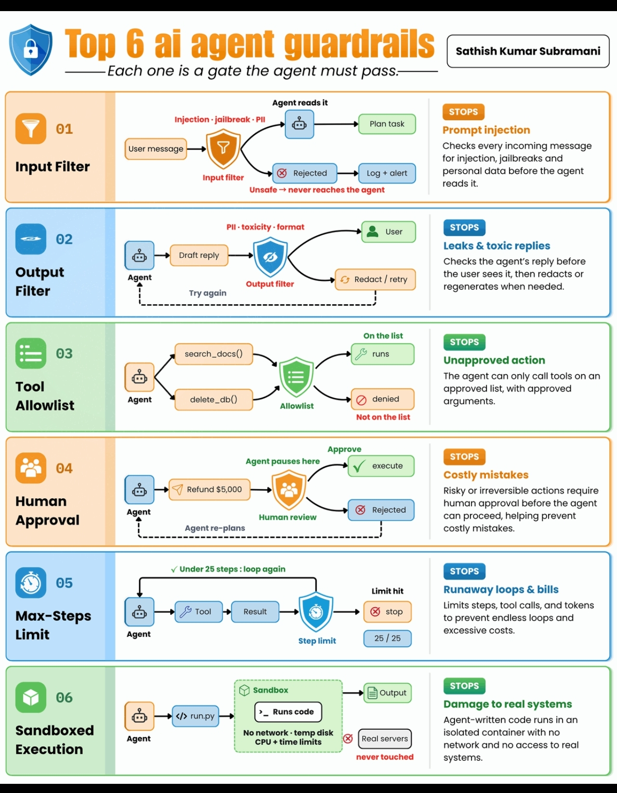

ARCHITECTURE D’ENTREPRISE · DOCUMENT DE RÉFÉRENCE

Cette page reprend le contenu du document de référence, dans son ordre d’origine. Les exemples fournis dans le document sont conservés avec les explications correspondantes.

Source : Guide_TOGAF_Building_Blocks_Banque.docx

TOGAF : de la vision aux solutions concrètes

Exemple fil rouge : transformation du système d’information d’une banque vers le Cloud et les microservices

<h2>Introduction – Comprendre la progression des Building Blocks</h2>

Pour bien comprendre cette notion dans TOGAF, prenons un exemple concret de transformation du système d’information d’une banque vers une architecture Cloud et microservices.

L’objectif est de suivre un même besoin métier à travers les différentes phases de l’ADM et de voir comment un Building Block abstrait devient progressivement une solution concrète.

<h3>Contexte : digitalisation d’une banque</h3>

Une banque souhaite permettre à ses clients de souscrire un crédit immobilier entièrement en ligne.

En phase A (Architecture Vision), plusieurs capacités nécessaires sont identifiées :

Digital Loan Management (gestion numérique des crédits)

Customer Data Management (gestion des données clients)

Document Management (gestion documentaire)

Credit Scoring (évaluation du risque de crédit)

Payment Management (gestion des paiements)

À ce stade, il s’agit de capacités architecturales de haut niveau. Les modalités précises d’implémentation ne sont pas encore définies.

<h2>1. Phase B – Business Architecture (architecture métier)</h2>

Objectif : transformer les capacités métier abstraites en processus, fonctions, services et responsabilités métier clairement définis.

Building Block abstrait : Digital Loan Management (gestion numérique des crédits). En phase B, cette capacité est décomposée en activités métier.

<h3>Exemple : processus de souscription d’un crédit immobilier</h3>

Réception de la demande du client

Vérification de l’identité et de l’éligibilité

Collecte des justificatifs

Analyse de solvabilité

Validation ou refus du crédit

Émission de l’offre de crédit

Acteurs métier concernés :

Client

Conseiller bancaire

Analyste crédit

Responsable des risques

Livrables possibles de la Phase B :

Business Capability Map

Business Process Diagram (BPMN)

Business Service Catalog

Organization/Actor Catalog

Gap Analysis entre l’architecture métier actuelle et cible

À retenir : on passe d’une capacité générale « Gestion des crédits » à une description structurée de la manière dont la banque doit fonctionner.

<h2>2. Phase C – Data Architecture (architecture des données)</h2>

Objectif : transformer les besoins d’information métier en entités de données, modèles de données et composants de données logiques.

Building Block abstrait : Customer Data Management (gestion des données clients). Le processus de souscription nécessite des informations sur le client, ses revenus et son patrimoine.

<h3>Exemple : décomposition du bloc Customer Data</h3>

Entités métier / données possibles :

Customer (client)

Loan Application (demande de crédit)

Income (revenu)

Property (bien immobilier)

Bank Account (compte bancaire)

Repayment (remboursement)

Exemple de modèle logique de données :

<table><tr><td>
Entité
</td><td>
Attributs possibles
</td></tr><tr><td>
Customer
</td><td>
Customer_ID, First_Name, Last_Name, Date_Of_Birth, Address
</td></tr><tr><td>
Loan_Application
</td><td>
Application_ID, Customer_ID, Requested_Amount, Duration, Status
</td></tr></table>

On peut également définir :

Les relations entre les entités

Les propriétaires des données (Data Owners)

Les règles de qualité des données

Les règles de sécurité et de confidentialité

Les flux de création, de modification et de consultation des données

Concernant le stockage, on peut identifier un composant logique de stockage de données, puis définir dans les phases technologiques les solutions concrètes : PostgreSQL, Oracle, stockage objet, etc.

Livrables possibles :

Conceptual Data Diagram

Logical Data Diagram

Data Entity/Data Component Catalog

Data Entity/Business Function Matrix

Application/Data Matrix

<h2>3. Phase C – Application Architecture (architecture applicative)</h2>

Objectif : transformer les capacités applicatives abstraites en composants applicatifs logiques et définir leurs interactions.

Building Block abstrait : Digital Loan Management. À partir du processus métier défini en phase B, on identifie les applications et composants logiques nécessaires pour le supporter.

<h3>Exemple : composants applicatifs</h3>

<table><tr><td>
Composant applicatif logique
</td><td>
Responsabilité
</td></tr><tr><td>
Digital Banking Portal
</td><td>
Interface utilisateur du client
</td></tr><tr><td>
Loan Management Component
</td><td>
Gestion du dossier de crédit
</td></tr><tr><td>
Customer Management
</td><td>
Gestion des informations client
</td></tr><tr><td>
Document Management
</td><td>
Gestion des justificatifs et documents
</td></tr><tr><td>
Credit Scoring
</td><td>
Évaluation du risque de crédit
</td></tr><tr><td>
Notification Service
</td><td>
Notifications au client
</td></tr></table>

<h3>Exemple d’interaction</h3>

Le portail client transmet une demande à Loan Management.

Loan Management interroge Customer Management.

Les documents sont transmis à Document Management.

Loan Management sollicite Credit Scoring.

La décision est récupérée et communiquée au client.

On définit également :

Les responsabilités de chaque composant

Les interfaces et les API

Les interactions entre les composants

Les échanges de données

Les relations entre applications et processus métier

Livrables possibles :

Application Portfolio Catalog

Interface Catalog

Application Communication Diagram

Application Interaction Matrix

Application Use-Case Diagram

Point de vigilance : le choix d’une architecture Serverless, d’AWS Lambda, d’Azure Functions ou de Kubernetes relève principalement de la Phase D – Technology Architecture. En Phase C, on définit les composants applicatifs logiques et leurs interactions, indépendamment des choix technologiques.

<h2>4. Phase E – Opportunities &amp; Solutions (opportunités et solutions)</h2>

Objectif : transformer les architectures définies dans les phases B, C et D en solutions réalisables, projets et lots de travaux (Work Packages).

À ce stade, on dispose d’une architecture métier cible, d’une architecture de données cible, d’une architecture applicative cible et d’une architecture technologique cible (Phase D). Il faut déterminer comment concrétiser cette architecture.

<h3>Exemple : correspondance entre besoins et solutions</h3>

<table><tr><td>
Besoin / ABB
</td><td>
Solution envisagée / SBB
</td></tr><tr><td>
Gestion des crédits
</td><td>
Microservice Loan Management
</td></tr><tr><td>
Gestion des clients
</td><td>
Microservice Customer
</td></tr><tr><td>
Gestion documentaire
</td><td>
Alfresco ou solution documentaire existante
</td></tr><tr><td>
Communication entre applications
</td><td>
Kafka
</td></tr><tr><td>
API Management
</td><td>
Kong ou Apigee
</td></tr><tr><td>
Stockage des données
</td><td>
PostgreSQL et stockage objet
</td></tr><tr><td>
Exécution Serverless
</td><td>
AWS Lambda
</td></tr></table>

Ces technologies sont des exemples de solutions possibles, et non des choix imposés par TOGAF.

<h3>Exemple de Work Packages / projets</h3>

Projet 1 – Digitalisation du parcours client : mise en place du portail bancaire et du parcours de souscription.

Projet 2 – Modernisation du système de crédit : développement des microservices Loan Management et Credit Scoring.

Projet 3 – Modernisation des données : mise en place des modèles de données et migration des données clients.

Projet 4 – Infrastructure Cloud : mise en place de la plateforme Cloud, des API et de la messagerie événementielle.

La Phase E permet notamment de :

Consolider les écarts (Gap Analysis) des phases B à D

Identifier les dépendances entre les projets

Étudier les solutions possibles : acheter, développer ou réutiliser (Buy, Build, Reuse)

Définir les Work Packages

Identifier les architectures de transition (Transition Architectures)

Construire une première Architecture Roadmap

<h2>5. Synthèse – Comment un ABB devient une solution concrète ?</h2>

<table><tr><td>
Phase ADM
</td><td>
Exemple dans la banque
</td><td>
Résultat attendu
</td></tr><tr><td>
A – Architecture Vision
</td><td>
Digital Loan Management
</td><td>
Besoin/capacité abstraite
</td></tr><tr><td>
B – Business Architecture
</td><td>
Souscription, vérification, solvabilité, décision, offre
</td><td>
Processus métier et acteurs
</td></tr><tr><td>
C – Data Architecture
</td><td>
Customer, Loan Application, Income, Property, Repayment
</td><td>
Entités et modèles de données
</td></tr><tr><td>
C – Application Architecture
</td><td>
Loan Management, Customer Management, Credit Scoring
</td><td>
Composants applicatifs et interactions
</td></tr><tr><td>
D – Technology Architecture
</td><td>
Kubernetes, Kafka, API Gateway, PostgreSQL, Cloud
</td><td>
Architecture technologique
</td></tr><tr><td>
E – Opportunities &amp; Solutions
</td><td>
SBB, projets, Work Packages, Transition Architectures
</td><td>
Solutions et roadmap initiale
</td></tr></table>

Logique fondamentale :

Phase A : identifier les capacités nécessaires.

Phases B, C et D : détailler l’architecture cible dans chaque domaine.

Phase E : transformer cette architecture en solutions et projets réalisables.

<h2>6. Kubernetes, Kafka, API Gateway, PostgreSQL et Cloud : sont-ils des solutions ?</h2>

Oui, mais il faut distinguer les notions. Kubernetes, Kafka, API Gateway, PostgreSQL et Cloud sont des technologies ou des plateformes qui peuvent être utilisées pour implémenter des Solution Building Blocks (SBB).

<h3>Les trois niveaux à distinguer</h3>

Architecture Building Block (ABB) : décrit une capacité ou un besoin architectural, indépendamment de la technologie.

Solution Building Block (SBB) : décrit un composant concret qui réalise cette capacité.

Produit / Technologie : fournit l’implémentation technique du SBB.

<h3>Exemples de correspondance ABB → SBB → Technologie</h3>

<table><tr><td>
ABB (besoin abstrait)
</td><td>
SBB (solution concrète)
</td><td>
Technologie possible
</td></tr><tr><td>
Container Orchestration
</td><td>
Plateforme d’orchestration de conteneurs
</td><td>
Kubernetes
</td></tr><tr><td>
Event Messaging
</td><td>
Plateforme de messagerie événementielle
</td><td>
Apache Kafka
</td></tr><tr><td>
API Management
</td><td>
Passerelle de gestion des API
</td><td>
Kong, Apigee
</td></tr><tr><td>
Relational Data Storage
</td><td>
Service de base de données relationnelle
</td><td>
PostgreSQL, Oracle
</td></tr><tr><td>
Cloud Infrastructure
</td><td>
Infrastructure Cloud
</td><td>
AWS, Azure, GCP
</td></tr><tr><td>
Object Storage
</td><td>
Service de stockage objet
</td><td>
AWS S3, Azure Blob
</td></tr><tr><td>
Identity Management
</td><td>
Service de gestion des identités
</td><td>
Keycloak, Okta
</td></tr></table>

<h3>Exemple : architecture microservices</h3>

Dans une banque construisant une architecture microservices, les correspondances peuvent être :

<table><tr><td>
Besoin architectural (ABB)
</td><td>
Solution (SBB)
</td></tr><tr><td>
Exposer les services aux consommateurs
</td><td>
API Gateway
</td></tr><tr><td>
Orchestrer les microservices
</td><td>
Kubernetes
</td></tr><tr><td>
Gérer les communications asynchrones
</td><td>
Kafka
</td></tr><tr><td>
Persister les données relationnelles
</td><td>
PostgreSQL
</td></tr><tr><td>
Héberger les composants
</td><td>
AWS / Azure / GCP
</td></tr></table>

<h3>Subtilité importante pour TOGAF</h3>

Un produit technologique n’est pas automatiquement un SBB. C’est le rôle architectural qu’il joue qui permet de le considérer comme un composant de solution.

Par exemple, Kubernetes seul est un produit technologique. Une plateforme Kubernetes configurée avec des mécanismes de déploiement, de supervision, de sécurité et de gestion des conteneurs peut constituer un SBB.

<h2>7. À retenir</h2>

<table><tr><td>
Notion
</td><td>
Question clé
</td><td>
Exemple
</td></tr><tr><td>
ABB
</td><td>
What do we need? / De quoi avons-nous besoin ?
</td><td>
Event Messaging
</td></tr><tr><td>
SBB
</td><td>
How do we provide it? / Quelle solution répond au besoin ?
</td><td>
Event Streaming Platform
</td></tr><tr><td>
Technology / Product
</td><td>
Avec quelle technologie ?
</td><td>
Apache Kafka
</td></tr></table>

Point essentiel : l’ABB exprime le besoin architectural, le SBB décrit la solution qui répond à ce besoin, et la technologie fournit les moyens de l’implémenter.

<h2>Conclusion</h2>

La progression des Building Blocks dans l’ADM permet de passer d’une vision abstraite à une architecture détaillée puis à des solutions réalisables. La Phase A identifie les capacités nécessaires ; les Phases B, C et D détaillent respectivement les domaines métier, données, applications et technologies ; la Phase E organise les solutions et les projets permettant de concrétiser l’architecture cible

<section class="resource-illustrations"><h2>Schémas et illustrations</h2>
<figure class="resource-figure"><figcaption>Relations entre acteurs, rôles, processus, services métier et composants applicatifs en ArchiMate.</figcaption></figure>
<figure class="resource-figure"><figcaption>Domain-Driven Design pour architectes d’entreprise : domaines, bounded contexts et context map.</figcaption></figure>
<figure class="resource-figure"><figcaption>Matrice de classification des domaines cœur, support et génériques.</figcaption></figure>
</section>

