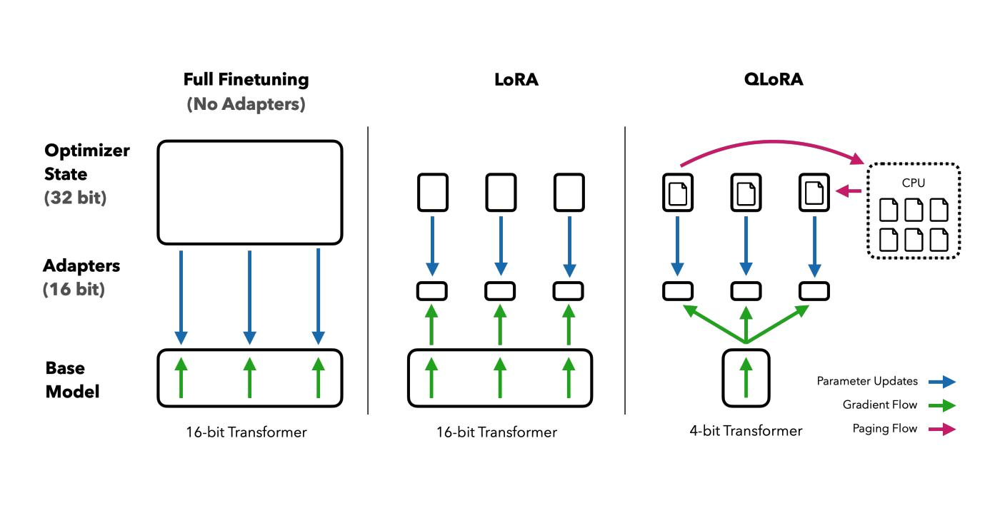
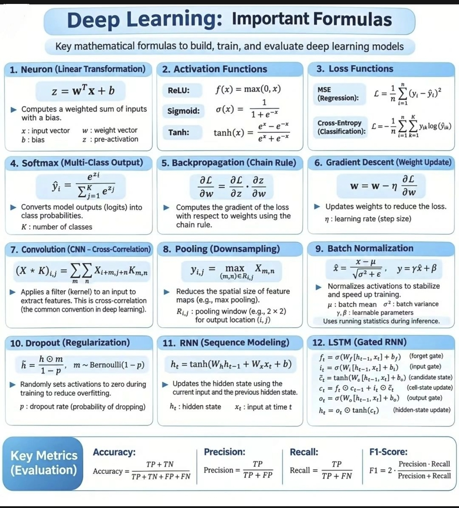

MACHINE LEARNING · DOCUMENT DE RÉFÉRENCE

Cette page reprend le contenu du document de référence, dans son ordre d’origine. Les exemples fournis dans le document sont conservés avec les explications correspondantes.

Source : Tutoriel_complet_Machine_Learning_Deep_Learning_LLM.docx

<h2>Tutoriel complet : Machine Learning, Deep Learning, ANN et LLM</h2>

Classification des algorithmes, fonctionnement, fonctions mathématiques, exemples et cas d’utilisation.

<h2>1. Cartographie générale de l’intelligence artificielle</h2>

Intelligence artificielle (AI) → Machine Learning (ML) → Deep Learning (DL) → réseaux de neurones profonds → Transformers et LLM. Les réseaux de neurones artificiels (ANN) sont une famille de modèles ; les réseaux profonds relèvent du Deep Learning.

<h2>2. Les trois grandes catégories du Machine Learning</h2>

<table><tr><td>
Approche
</td><td>
Principe
</td><td>
Exemple
</td></tr><tr><td>
Supervisé
</td><td>
Données avec labels
</td><td>
Prédire le churn
</td></tr><tr><td>
Non supervisé
</td><td>
Données sans labels
</td><td>
Segmenter les clients
</td></tr><tr><td>
Renforcement
</td><td>
Apprentissage par récompenses
</td><td>
Robot autonome
</td></tr></table>

<h2>2.1 Classification des algorithmes</h2>

<table><tr><td>
Famille
</td><td>
Algorithmes
</td><td>
Objectif
</td></tr><tr><td>
Régression
</td><td>
Linear, Ridge, Lasso
</td><td>
Prédire une valeur
</td></tr><tr><td>
Classification
</td><td>
Logistic, SVM, KNN, Naive Bayes
</td><td>
Prédire une classe
</td></tr><tr><td>
Arbres et ensembles
</td><td>
Decision Tree, Random Forest, XGBoost
</td><td>
Prédire à partir de règles
</td></tr><tr><td>
Clustering
</td><td>
K-Means, DBSCAN, GMM
</td><td>
Identifier des groupes
</td></tr><tr><td>
Réduction dimensionnelle
</td><td>
PCA, t-SNE, UMAP
</td><td>
Réduire les variables
</td></tr><tr><td>
Deep Learning
</td><td>
ANN, CNN, RNN, LSTM
</td><td>
Apprendre des représentations
</td></tr><tr><td>
Génératif
</td><td>
GAN, VAE, Transformers
</td><td>
Générer des données
</td></tr><tr><td>
Renforcement
</td><td>
Q-Learning, PPO
</td><td>
Apprendre une stratégie
</td></tr></table>

<h2>3. Fonctions mathématiques fondamentales</h2>
<h3>3.1 Fonction linéaire</h3>

f(x) = ax + b

Exemple : Prix = 2 000 × Surface + 15 000. Pour 50 m² : 115 000.

<h3>3.2 Fonctions de coût</h3>

MSE = (1/n) Σᵢ (yᵢ − ŷᵢ)²

MAE = (1/n) Σᵢ |yᵢ − ŷᵢ|

Binary Cross-Entropy = −(1/n) Σᵢ [yᵢ ln(pᵢ) + (1−yᵢ) ln(1−pᵢ)]

MSE pénalise fortement les grandes erreurs ; MAE est moins sensible aux valeurs extrêmes ; la cross-entropy évalue les probabilités prédites.

<h3>3.3 Descente de gradient</h3>

θₜ₊₁ = θₜ − α∇J(θₜ)

θ : paramètres ; α : learning rate ; ∇J : gradient. Variantes : Batch, SGD, Mini-batch, Momentum, RMSProp et Adam.

<h3>3.4 Fonctions d’activation</h3>

<table><tr><td>
Fonction
</td><td>
Formule
</td><td>
Usage
</td></tr><tr><td>
Sigmoid
</td><td>
1/(1+e⁻ˣ)
</td><td>
Classification binaire
</td></tr><tr><td>
Tanh
</td><td>
tanh(x)
</td><td>
Réseaux récurrents
</td></tr><tr><td>
ReLU
</td><td>
max(0,x)
</td><td>
Couches cachées
</td></tr><tr><td>
Leaky ReLU
</td><td>
max(0,01x,x)
</td><td>
Éviter neurones inactifs
</td></tr><tr><td>
Softmax
</td><td>
eᶻⁱ / Σⱼeᶻʲ
</td><td>
Multiclasse
</td></tr><tr><td>
GELU
</td><td>
xΦ(x)
</td><td>
Transformers
</td></tr></table>

<h2>4. Machine Learning supervisé</h2>
<h3>4.1 Linear Regression</h3>

Prédit une valeur numérique (prix, consommation, ventes).

ŷ = w₁x₁ + … + wₙxₙ + b

Minimiser J = (1/m)Σ(yᵢ−ŷᵢ)². Ridge : MSE + λΣwⱼ² ; Lasso : MSE + λΣ|wⱼ|. Elastic Net combine L1 et L2.

<h3>4.2 Logistic Regression</h3>

Classification binaire, par exemple spam ou churn.

z = wᵀx+b ; P(y=1|x) = 1/(1+e⁻ᶻ)

Utilise généralement Binary Cross-Entropy et un seuil de décision, par exemple 0,5.

<h3>4.3 Decision Tree</h3>

Arbre de règles successives, pour classification et régression.

Gini = 1 − Σₖpₖ² ; H = −Σₖpₖ log₂(pₖ)

Information Gain = H(parent) − Σⱼ(Nⱼ/N)H(enfantⱼ). En régression, réduction de variance ou MSE.

<h3>4.4 Random Forest</h3>

Agrège des arbres entraînés sur des échantillons bootstrap et des sous-ensembles de variables.

Régression : ŷ = (1/n)Σᵢ Tᵢ(x)

Classification : vote majoritaire. Réduit la variance par rapport à un arbre isolé.

<h3>4.5 Gradient Boosting / XGBoost / LightGBM</h3>

Arbres ajoutés successivement pour corriger les erreurs.

Fₘ(x) = F₀(x) + Σₘ ηhₘ(x)

XGBoost exploite gradient, Hessienne et régularisation ; LightGBM favorise la rapidité ; CatBoost gère les catégories.

<h3>4.6 K-Nearest Neighbors (KNN)</h3>

Classe une observation selon ses K voisins les plus proches.

d(x,y) = √[Σᵢ(xᵢ−yᵢ)²]

Vote majoritaire pour classification ; moyenne pour régression. Normaliser les variables.

<h3>4.7 Support Vector Machine (SVM)</h3>

Trouve un hyperplan séparateur à marge maximale.

wᵀx+b=0 ; min ½||w||² + CΣξᵢ

Contraintes : yᵢ(wᵀxᵢ+b) ≥ 1−ξᵢ. Noyau RBF : K(x,x′)=exp(−γ||x−x′||²).

<h3>4.8 Naive Bayes</h3>

Classification probabiliste avec indépendance conditionnelle des variables.

P(A|B)=P(B|A)P(A)/P(B)

P(C|X) ∝ P(C)∏ᵢP(xᵢ|C). Variantes Gaussian, Multinomial, Bernoulli.

<h2>5. Machine Learning non supervisé</h2>
<h3>5.1 K-Means</h3>

Choisir K centroïdes ; affecter chaque point au plus proche ; recalculer les centroïdes ; itérer jusqu’à convergence.

J = Σₖ Σₓᵢ∈Cₖ ||xᵢ−μₖ||²

μₖ = (1/|Cₖ|) Σₓᵢ∈Cₖ xᵢ

K se choisit notamment avec la méthode du coude (Elbow). Limites : K fixé, sensibilité aux outliers et aux formes non convexes.

<h3>5.2 DBSCAN</h3>

Clustering fondé sur la densité. Paramètres : ε (rayon) et MinPts (nombre minimum de points). Types : core, border et noise.

Nε(p) = {q ∈ D : d(p,q) ≤ ε} ; point central si |Nε(p)| ≥ MinPts

Détecte des clusters de formes complexes et des points isolés, sans fixer le nombre de groupes.

<h3>5.3 K-Means versus DBSCAN</h3>

<table><tr><td>
Critère
</td><td>
K-Means
</td><td>
DBSCAN
</td></tr><tr><td>
Nombre de clusters
</td><td>
K imposé
</td><td>
Automatique
</td></tr><tr><td>
Forme
</td><td>
Plutôt convexe
</td><td>
Arbitraire
</td></tr><tr><td>
Outliers
</td><td>
Sensible
</td><td>
Bruit identifié
</td></tr><tr><td>
Paramètres
</td><td>
K
</td><td>
ε, MinPts
</td></tr><tr><td>
Centroïdes
</td><td>
Oui
</td><td>
Non
</td></tr></table>

Autres méthodes : Hierarchical Clustering, GMM, Mean Shift, OPTICS, Spectral Clustering.

<h3>5.4 PCA</h3>

Réduit la dimension en conservant autant que possible la variance.

Xc = X − X̄ ; Σ = XcᵀXc/(n−1) ; Σv = λv ; Z = XcW

Étapes : centrer, calculer la covariance, trouver les vecteurs propres, sélectionner les composantes et projeter.

<h2>6. ANN – Réseaux de neurones artificiels</h2>

Architecture : couche d’entrée, couches cachées et couche de sortie. Chaque neurone réalise une combinaison pondérée suivie d’une activation.

z = Σᵢ wᵢxᵢ + b ; a = f(z)

Exemple : x₁=2, x₂=3, w₁=0,5, w₂=0,8, b=0,1 → z=3,5 ; ReLU(z)=3,5.

<h3>6.2 Forward Propagation</h3>

Z⁽ˡ⁾ = W⁽ˡ⁾A⁽ˡ⁻¹⁾ + b⁽ˡ⁾ ; A⁽ˡ⁾ = f(Z⁽ˡ⁾)

<h3>6.3 Backpropagation</h3>

∂L/∂w = (∂L/∂a)(∂a/∂z)(∂z/∂w)

wₜ₊₁ = wₜ − α ∂L/∂w

Calcul des gradients par règle de dérivation en chaîne, puis mise à jour des poids.

<h3>6.4 ANN et Deep Learning</h3>

Un ANN peut être peu profond ; un réseau à plusieurs couches cachées relève généralement du Deep Learning.

<h2>7. Architectures de Deep Learning</h2>
<h3>7.1 CNN</h3>

Réseau convolutif pour images : convolution, activation, pooling, classification.

Y(i,j) = ΣₘΣₙ X(i−m,j−n)K(m,n)

MaxPooling : Y(i,j) = max₍ₘ,ₙ₎∈Rᵢⱼ X(m,n)

<h3>7.2 RNN</h3>

Réseau récurrent pour séquences et séries temporelles. Limites : vanishing et exploding gradients.

hₜ = f(Wₓxₜ + Wₕhₜ₋₁ + b) ; yₜ = g(Wᵧhₜ+bᵧ)

<h3>7.3 LSTM</h3>

Mémoire interne avec Forget Gate, Input Gate et Output Gate.

fₜ = σ(Wf[hₜ₋₁,xₜ]+bf)

iₜ = σ(Wi[hₜ₋₁,xₜ]+bi)

C̃ₜ = tanh(Wc[hₜ₋₁,xₜ]+bc)

Cₜ = fₜ ⊙ Cₜ₋₁ + iₜ ⊙ C̃ₜ

oₜ = σ(Wo[hₜ₋₁,xₜ]+bo) ; hₜ = oₜ ⊙ tanh(Cₜ)

<h3>7.4 GRU</h3>

Réseau récurrent avec deux portes : Update et Reset ; généralement plus simple que LSTM.

<h3>7.5 Autoencoder</h3>

Encoder → représentation latente → Decoder. Utilisé pour réduction de dimension, compression et détection d’anomalies.

z = fθ(x) ; x̂ = gφ(z) ; L = ||x−x̂||²

<h3>7.6 GAN</h3>

Deux réseaux adversariaux : Generator et Discriminator.

minG maxD V(D,G) = Eₓ[log D(x)] + E𝓏[log(1−D(G(z)))].

<h2>8. Transformers</h2>

Architecture fondée sur l’attention, présentée en 2017. Embeddings, information positionnelle, attention, FFN.

<h3>8.1 Embeddings</h3>

Embedding(token) = [e₁,e₂,…,e𝑑]

<h3>8.2 Positional Encoding</h3>

PE(pos,2i) = sin(pos/10000^(2i/d))

PE(pos,2i+1) = cos(pos/10000^(2i/d))

D’autres modèles utilisent des encodages positionnels appris ou relatifs (RoPE).

<h3>8.3 Self-Attention</h3>

Q=XWQ ; K=XWK ; V=XWV

Attention(Q,K,V) = Softmax(QKᵀ/√dₖ)V

Q : Query ; K : Key ; V : Value. Scores → normalisation → Softmax → somme pondérée des Values.

<h3>8.4 Multi-Head Attention</h3>

MultiHead(Q,K,V) = Concat(head₁,…,headₕ)WO

headᵢ = Attention(QWᵢQ, KWᵢK, VWᵢV)

<h3>8.5 Feed Forward Network</h3>

FFN(x) = W₂σ(W₁x+b₁)+b₂

<h3>8.6 Encoder et Decoder</h3>

<table><tr><td>
Architecture
</td><td>
Rôle
</td><td>
Exemples
</td></tr><tr><td>
Encoder-only
</td><td>
Représenter et comprendre
</td><td>
BERT
</td></tr><tr><td>
Decoder-only
</td><td>
Générer
</td><td>
GPT, Llama
</td></tr><tr><td>
Encoder-Decoder
</td><td>
Transformer des séquences
</td><td>
T5
</td></tr></table>

<h2>9. Large Language Models (LLM)</h2>

Chaîne de traitement : Tokenization → Embedding → Position → Transformer → Logits → Softmax → Génération.

<h3>9.1 Next Token Prediction</h3>

P(tokenᵢ) = eᶻⁱ / Σⱼeᶻʲ

L = −Σᵢ log P(xᵢ | x₁,…,xᵢ₋₁)

<h3>9.2 Temperature</h3>

Pᵢ = Softmax(zᵢ/T)

Faible température : prédictions plus concentrées ; forte température : distribution plus diversifiée.

<h3>9.3 Fine-Tuning et LoRA</h3>

Full Fine-Tuning modifie tous les poids. LoRA apprend une correction de faible rang. QLoRA combine LoRA et quantification.

W′ = W + ΔW ; ΔW = BA

<h3>9.4 RAG</h3>

Documents → chunks → embeddings → base vectorielle → question → recherche → contexte → LLM → réponse.

CosineSimilarity(A,B) = (A·B)/(||A|| ||B||)

<table><tr><td>
RAG
</td><td>
Fine-Tuning
</td></tr><tr><td>
Récupère des informations externes
</td><td>
Adapte les paramètres
</td></tr><tr><td>
Documents actualisables
</td><td>
Nécessite un entraînement
</td></tr><tr><td>
Sources potentiellement citées
</td><td>
Connaissance moins traçable
</td></tr></table>

<h2>10. GNN et GraphRAG</h2>

Les Graph Neural Networks apprennent sur des graphes (nœuds, arêtes, attributs) ; GraphRAG associe recherche et graphe de connaissances.

hᵥ⁽ˡ⁺¹⁾ = σ(W⁽ˡ⁾ AGG{hᵤ⁽ˡ⁾ : u∈N(v)})

Architectures : GCN, GAT, GraphSAGE. Exemple GraphRAG : Référentiel client → API Client → CRM → Facturation → Portail client.

<h2>11. Reinforcement Learning</h2>

Un agent interagit avec un environnement : état, action, récompense et politique.

<h3>11.1 Q-Learning</h3>

Q(s,a) ← Q(s,a) + α[r + γ maxₐ′ Q(s′,a′) − Q(s,a)]

Autres algorithmes : DQN, Policy Gradient, Actor-Critic, PPO.

<h2>12. Tableau récapitulatif des fonctions mathématiques</h2>

<table><tr><td>
Fonction
</td><td>
Algorithmes
</td><td>
Rôle
</td></tr><tr><td>
ax+b
</td><td>
Régression
</td><td>
Relation linéaire
</td></tr><tr><td>
Sigmoid
</td><td>
Logistic, ANN
</td><td>
Probabilité binaire
</td></tr><tr><td>
Softmax
</td><td>
ANN, LLM
</td><td>
Distribution multiclasse
</td></tr><tr><td>
MSE / MAE
</td><td>
Régression
</td><td>
Erreur
</td></tr><tr><td>
Cross-Entropy
</td><td>
Classification, LLM
</td><td>
Erreur probabiliste
</td></tr><tr><td>
Gradient Descent
</td><td>
ML, DL
</td><td>
Optimisation
</td></tr><tr><td>
ReLU / GELU
</td><td>
ANN, Transformers
</td><td>
Non-linéarité
</td></tr><tr><td>
Gini / Entropy
</td><td>
Arbres
</td><td>
Impureté
</td></tr><tr><td>
Distance euclidienne
</td><td>
KNN, K-Means, DBSCAN
</td><td>
Proximité
</td></tr><tr><td>
Cosine Similarity
</td><td>
RAG
</td><td>
Similarité
</td></tr><tr><td>
Covariance / valeurs propres
</td><td>
PCA
</td><td>
Axes principaux
</td></tr><tr><td>
Convolution
</td><td>
CNN
</td><td>
Extraction de motifs
</td></tr><tr><td>
Chain Rule
</td><td>
ANN
</td><td>
Rétropropagation
</td></tr><tr><td>
Attention
</td><td>
Transformers
</td><td>
Pondération des tokens
</td></tr><tr><td>
Bayes
</td><td>
Naive Bayes
</td><td>
Probabilités
</td></tr><tr><td>
Q-Learning
</td><td>
RL
</td><td>
Décisions
</td></tr></table>

<h2>13. Quel algorithme utiliser ?</h2>

<table><tr><td>
Besoin
</td><td>
Algorithmes
</td></tr><tr><td>
Prédire un prix
</td><td>
Linear Regression
</td></tr><tr><td>
Churn
</td><td>
Logistic Regression, XGBoost
</td></tr><tr><td>
Fraude
</td><td>
Random Forest, XGBoost, GNN
</td></tr><tr><td>
Segmentation
</td><td>
K-Means, DBSCAN
</td></tr><tr><td>
Anomalies
</td><td>
DBSCAN, Isolation Forest, Autoencoder
</td></tr><tr><td>
Images
</td><td>
CNN, Vision Transformers
</td></tr><tr><td>
Séries temporelles
</td><td>
XGBoost, LSTM, Transformers
</td></tr><tr><td>
Texte
</td><td>
Naive Bayes, BERT
</td></tr><tr><td>
Génération
</td><td>
LLM
</td></tr><tr><td>
Documents
</td><td>
RAG + LLM
</td></tr><tr><td>
Relations
</td><td>
GNN, GraphRAG
</td></tr><tr><td>
Décisions
</td><td>
Reinforcement Learning
</td></tr></table>

<h2>14. Étapes d’un projet Machine Learning</h2>

<table><tr><td>
Étape
</td><td>
Description
</td></tr><tr><td>
1
</td><td>
Business Understanding
</td></tr><tr><td>
2
</td><td>
Data Collection
</td></tr><tr><td>
3
</td><td>
Data Preparation
</td></tr><tr><td>
4
</td><td>
Feature Engineering
</td></tr><tr><td>
5
</td><td>
Model Selection
</td></tr><tr><td>
6
</td><td>
Training
</td></tr><tr><td>
7
</td><td>
Evaluation
</td></tr><tr><td>
8
</td><td>
Deployment
</td></tr><tr><td>
9
</td><td>
Monitoring
</td></tr></table>

<h3>14.1 Métriques d’évaluation</h3>

Accuracy = (TP+TN)/(TP+TN+FP+FN)

Precision = TP/(TP+FP)

Recall = TP/(TP+FN)

F1 = 2×Precision×Recall/(Precision+Recall)

Classification : Accuracy, Precision, Recall, F1, AUC-ROC. Régression : MAE, MSE, RMSE, R². Clustering : Silhouette, Davies-Bouldin, Calinski-Harabasz.

<h2>15. Parcours d’apprentissage recommandé</h2>

Mathématiques : algèbre linéaire, statistiques, probabilités, gradients

ML supervisé : régressions, arbres, ensembles, KNN, SVM

ML non supervisé : K-Means, DBSCAN, PCA, GMM

ANN : propagation, backpropagation, Adam, activations

Deep Learning : CNN, RNN, LSTM, GRU, GAN

GenAI : Transformers, attention, embeddings, RAG, LoRA

Avancé : GNN, GraphRAG, MLOps, LLMOps

<h2>16. Quiz de révision</h2>

1. Quel algorithme segmente sans connaître K et identifie le bruit ? 
Réponse : DBSCAN

2. Quelle fonction transforme le score logistique en probabilité ? 
Réponse : Sigmoid

3. Quelle technique calcule les gradients dans un ANN ? 
Réponse : Backpropagation

4. Quelle formule est au cœur de la Self-Attention ? 
Réponse : Softmax(QKᵀ/√dₖ)V

5. Différence principale entre RAG et Fine-Tuning ? 
Réponse : RAG récupère du contexte externe ; Fine-Tuning adapte les poids.

6. Quel algorithme minimise la somme des distances aux centroïdes ? 
Réponse : K-Means

Conseil : maîtriser les distances pour le clustering, les probabilités pour la classification, les gradients pour les réseaux de neurones et l’attention pour les Transformers.

<section class="resource-illustrations"><h2>Schémas et illustrations</h2>
<figure class="resource-figure"><figcaption>Schéma comparant le fine-tuning complet, LoRA et QLoRA.</figcaption></figure>
<figure class="resource-figure"><figcaption>Formules de référence en deep learning : neurone, activations, perte, rétropropagation et descente de gradient.</figcaption></figure>
</section>

